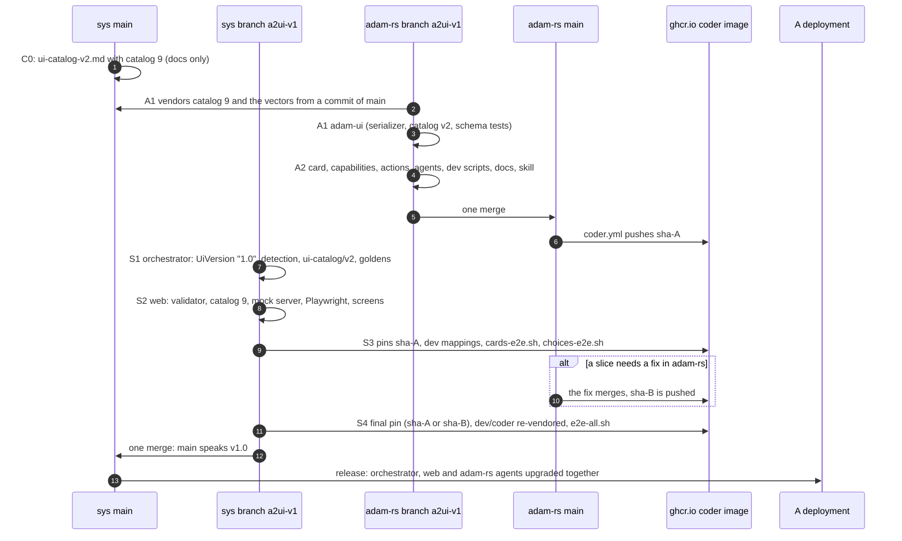
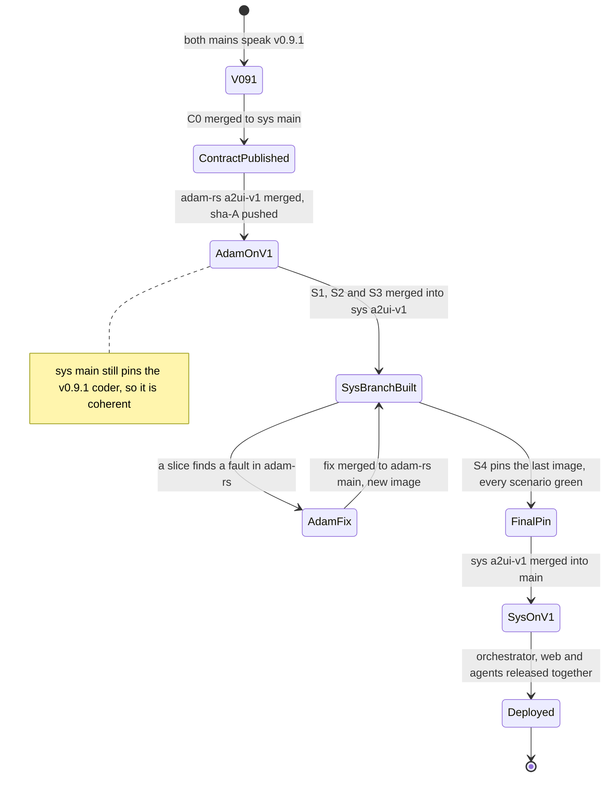

# ADR 0075 — A2UI v1.0, a hard cutover, and `ui-catalog/v2`

- **Status:** **Accepted (2026-11-19).** The owner's decision (2026-11-19): *"That falls into V1, we absolutely need to
  upgrade to a2ui@v1"*: the system moves from A2UI v0.9.1 to v1.0 **as a hard cutover, in R1, the first release**.
  **Amended (2026-11-19, the owner's answers):** old threads keep their v0.9.1 surfaces, shown as made by an earlier
  version, with actions on them refused and no migration (decisions 4 and 6); and `ui-catalog/v2` keeps the same
  `catalogId`, its `version` continuing at 9 (decision 5). Every part marked **(owner)** is the owner's; the rest is
  the design that follows from it and from the repository's rule on extension versions, marked **(proposed)** where it
  is a choice (never forwarding an action's `userMessage`), and the owner may change it by a dated note. No question
  of this ADR is open. **Amended (2026-11-19, two more owner decisions):** A2UI over MCP is noted now and built in R2,
  and a richer catalog (versions 10 and up) follows the cutover in R1; see [*Follow-up*](#follow-up).
  **Nothing is built.** It amends
  [ADR 0013](0013-a2ui-generative-ui.md) (the A2UI version, its URI, its capabilities key and the actions) and
  [ADR 0023](0023-ui-component-catalog-as-an-a2a-extension.md) (the catalog's shape and the extension's URI), and closes
  [open question 22](../open-questions.md#closed). The agent side is adam-rs
  [ADR 0056](https://github.com/vymalo/another-adam-rs/blob/main/docs/decisions/0056-a2ui-v1-0-only-a-hard-cutover.md).
  Epic: [#380](https://github.com/vymalo/another-agentic-system/issues/380).

## Context

The system speaks A2UI v0.9.1 end to end (ADR 0013): adam-rs writes it, the orchestrator relays it, the web draws it.
The orchestrator also detects a `v1.0` candidate (open question 22), written against a draft. What is in the code at
`main` (`8fc131f`):

| What | Value | Where |
|---|---|---|
| A2A extension URI | `https://a2ui.org/a2a-extension/a2ui/v0.9.1`, and `…/a2ui/v1.0` detected as a candidate | `A2UI_EXTENSION_V0_9_1`, `A2UI_EXTENSION_V1_0`, `orchestrator/crates/core/src/ui.rs` |
| Envelope `version` accepted | `"v0.9"`, `"v0.9.1"`, `"v1.0"` | `UiVersion`, same file; the web's `VERSIONS`, `web/src/features/chat/lib/a2ui/limits.ts` |
| Capabilities key | `a2uiClientCapabilities` under `"v0.9.1"`; `a2uiRendererCapabilities` under `"v1.0"` for the candidate | `orchestrator/crates/agent-a2a/src/a2ui.rs` |
| Basic catalog ids | `…/v0_9/…`, `…/v0_9_1/…`, `…/v1_0/catalogs/basic/catalog.json` | `UiVersion::basic_catalog_ids`; the web's `BASIC_CATALOG_IDS` |
| Media type | `application/a2ui+json` | `A2UI_MEDIA_TYPE`, `orchestrator/crates/core/src/ui.rs` |
| The screen's catalog | `{catalogId, components}`, `catalogId` `https://agents.vymalo.com/a2ui/catalogs/chat`, version 8 | `web/src/features/chat/lib/a2ui/catalog/catalog.json`, [`ui-catalog-v1.md`](../api/ui-catalog-v1.md#1-the-catalog) |

What A2UI v1.0 is (*verified 2026-11-19* unless marked; sources: <https://a2ui.org/specification/v1.0-a2ui/>,
<https://a2ui.org/specification/v1.0-evolution-guide/>,
<https://a2ui.org/specification/v1.0-a2ui-extension-specification/>, and the repository
<https://github.com/a2ui-project/a2ui> at commit `b4f91c26fcf62abc0720c21a65840220941d0a3f`, 2026-11-18):

* **Status.** v1.0 is "Current" (last updated Jun 8, 2026); v0.9.1 and v0.9 are "previous"
  (`specification/versions.json`); v1.1 is only collecting requirements (`README.md`). The repository moved to
  `a2ui-project/a2ui`, and `google/A2UI` serves the same history (`git ls-remote` of both answered `b4f91c2`).
* **The envelope's `version` is `"1.0"`**, not `"v1.0"` (`agent_to_renderer.json` and `renderer_to_agent.json`:
  `"const": "1.0"`), and the capabilities are keyed `"1.0"`. **The candidate built for open question 22 used the
  wrong spelling in both places**, so it would not have talked to a released v1.0 agent.
* **The A2A binding.** The extension URI is `https://a2ui.org/a2a-extension/a2ui/v1.0`. The renderer sends
  `message.metadata["a2uiRendererCapabilities"] = {"1.0": {supportedCatalogIds, inlineCatalogs?}}`, scoped to that
  message's turn; **an agent MUST treat a message with no entry for its version as a turn with no A2UI and MUST NOT send
  A2UI parts in reply**. Data-model sync is `a2uiRendererDataModel`. The card's `params` are the inner `1.0` object of
  `agent_capabilities.json` (`supportedCatalogIds`, `acceptsInlineCatalogs`). The page's examples activate with the
  header `X-A2A-Extensions`; the orchestrator sends `A2A-Extensions`, the A2A 1.0 name, as ADR 0013 decided
  (*unverified* whether A2UI's SDKs read both).
* **The media type is `application/a2ui+json`.** The guide tells agents to move to it from `application/json+a2ui`;
  this system and adam-rs already use it, as the v0.9.1 extension page does
  (<https://a2ui.org/specification/v0.9.1-a2ui-extension-specification/>). Nothing changes here.
* **The basic catalog id is `https://a2ui.org/specification/v1_0/catalogs/basic/catalog.json`** (the `catalogId` of
  `catalogs/basic/v1/catalog.json`, which declares `"protocolVersion": "1.0"`).
* **Catalogs.** A catalog for 1.0 MUST declare `"protocolVersion": "1.0"` (`catalog_definition.json`: default `"0.9"`),
  and "catalogs authored for v0.9 cannot be used directly with v1.0 protocol runtimes". Catalogs gain optional
  `instructions`, `$schema`, `$id`, `title`, `description`, `allowedParents`, `allowedChildren`; `theme` is gone;
  `functions` is a map; names follow UAX #31; the name `Surface` is reserved.
* **Messages.** The four keep their names. `createSurface` loses `theme`, may carry `components`, `dataModel` and
  `metadata` inline, and its `catalogId` is optional (a component then names its catalog with `@catalogId`); a second
  `createSurface` for a live `surfaceId` is an error. `updateDataModel` without `value` is invalid, and `null` deletes.
  New: `callRendererFunction` / `rendererFunctionResponse` and `callAgentFunction` / `agentFunctionResponse`.
* **Components.** Bindings are `{"@path": …}` and calls `{"@call": …}`; ChildList templates keep a plain `path`, and
  the guide warns against a blanket find-and-replace. `accessibility` and `checks` become `@accessibility` and
  `@checks`; `@catalogId` and `@metadata` are new; a single-`@` key in nested data is refused unless written `@@`.
  `TextField` requires `value`; `openUrl` has `requiresUserActivation: true`.
* **Actions** are `{"version": "1.0", "action": {name, surfaceId, sourceComponentId, timestamp, context, userMessage?,
  metadata?}}`, `userMessage` resolved by the renderer from `Action.event.userMessage`.
* **Schema files** are `agent_to_renderer.json`, `renderer_to_agent.json`, `common_types.json`,
  `catalog_definition.json`, `renderer_capabilities.json`, `agent_capabilities.json` and `renderer_data_model.json`
  under `specification/v1_0/json/` (Apache-2.0).

## Decision

1. **A2UI v1.0 only, a hard cutover (owner).** After the cutover the orchestrator, the web, the dev stack and the agents
   speak v1.0 and nothing older: no dual support, no candidate, no negotiation. The cutover reaches `main` in one merge
   (decision 9), so `main` never has a v0.9.1 agent and a v1.0 client together, or the reverse.
2. **The orchestrator's A2UI** (`orchestrator/crates/core/src/ui.rs`, `orchestrator/crates/agent-a2a/src/a2ui.rs`):
   - `UiVersion` stays a closed enum with **one variant, `V1_0`, spelled `"1.0"`**; `V0_9`, `V0_9_1` and the `"v1.0"`
     spelling go, so every match on a version fails to compile until it is reviewed. An operation of any other
     `version` fails the envelope check, as an unknown version does today.
   - Detection: a card counts only when it lists exactly `https://a2ui.org/a2a-extension/a2ui/v1.0`
     (`A2UI_EXTENSION_V1_0`); `A2UI_EXTENSION_V0_9_1` is removed. Read live, never cached, fail closed, as ADR 0008 says.
   - Every message to such an agent carries `a2uiRendererCapabilities: {"1.0": {"supportedCatalogIds": [...]}}` with
     the screen's `catalogId` first when the thread has a catalog, then
     `https://a2ui.org/specification/v1_0/catalogs/basic/catalog.json`, the only basic id;
     `a2uiClientCapabilities` is never sent. The extension is activated in `A2A-Extensions` and `message.extensions`
     as before. `a2uiRendererDataModel` is not sent: the web does not implement data-model sync.
   - **The envelope check stays an envelope check** (ADR 0013: relayed, not interpreted): the payload limits, a
     `version` of `"1.0"`, exactly one of the four operations and a `surfaceId`. `createSurface` with inline
     `components` or `dataModel` is relayed as it is. `callRendererFunction` and `agentFunctionResponse` are still
     refused as unknown operations (decision 8). Component rules are the web's.
   - The media type stays `application/a2ui+json` (`A2UI_MEDIA_TYPE`).
3. **`KnownExtension`** (`orchestrator/crates/core/src/extension.rs`) keeps its variants. A2UI is not one of them (it is
   detected by `UiVersion::from_extension_uri`); `KnownExtension::UiCatalog` now means `ui-catalog/v2`: its URI constant
   `UI_CATALOG_EXTENSION` becomes `https://agents.vymalo.com/a2a/extensions/ui-catalog/v2` and the v1 URI is no longer
   detected. The fake agent (`orchestrator/crates/testsupport/src/bin/orch-fake-agent.rs`) lists the new URIs.
4. **Actions.** The web sends, and the orchestrator forwards, `{"version": "1.0", "action": {name, surfaceId,
   sourceComponentId, timestamp, context}}`. **(proposed)** `userMessage` and `metadata` are never forwarded: ADR 0013's rule 7
   stands (an agent-authored line is put in the message box unsent, and is never sent as the person's words, inside
   an action or outside it), and `ui_action` keeps its fields. **(owner)** An action on a surface whose operations are
   not `"1.0"` (a surface of a thread from before the cutover) is refused with 422 before anything is written.
5. **`ui-catalog/v1` becomes `ui-catalog/v2`, a new URI and a new page.** The repository's rule is that "a breaking
   change is a `v2` URI and a new page, never an edit" ([`extensions.md`](../api/extensions.md)), and this change breaks
   every v1 reader:
   - the catalog document gains a required member: v1 says it is "exactly … `{catalogId, components}` … and nothing
     else" ([section 1](../api/ui-catalog-v1.md#1-the-catalog)), and adam-rs's reader refuses any other member
     (`Catalog::read`, `crates/adam-ui/src/catalog.rs` of adam-rs), while A2UI v1.0 requires `"protocolVersion": "1.0"`
     on the catalog and refuses a v0.9 one;
   - the digest of every catalog changes, because the canonical form covers the new member;
   - the catalog travels in `a2uiRendererCapabilities["1.0"].inlineCatalogs`, where a v1 agent does not look, and v1's
     card names the A2UI v0.9.1 URI.

   **`docs/api/ui-catalog-v2.md`** (slice C0) is written from v1 with these changes and nothing else: the URI
   `https://agents.vymalo.com/a2a/extensions/ui-catalog/v2`; the document is `{catalogId, protocolVersion,
   components}` with `protocolVersion` exactly `"1.0"`, still no `functions` and no `theme` (and no `instructions`,
   `$schema`, `$id`, `title`, `description`, `allowedParents` or `allowedChildren`, which a later version may add);
   component schemas may not declare `@`-prefixed properties, and since our components take literals only, they
   carry no `@path` or `@call`; a new known-answer vector for the digest; the A2UI entry of the card and the
   capabilities key of v1.0; the forms, the answers, the refetch and section 8 unchanged in meaning. **(owner) The
   `catalogId` stays `https://agents.vymalo.com/a2ui/catalogs/chat`, and `version` continues: 9 is the first v2
   catalog**, the
   components of version 8 with `protocolVersion` added. So a thread whose current catalog is a v1 one (8 or lower)
   moves to 9 on its next run under the ledger's rule (a higher version becomes current) with no migration, and the
   v1 catalogs stay in the log. `get_ui_catalog` (`thread-tools/v1`) serves the v2 document; its own shape does not
   change, so `thread-tools` stays v1. `ui-catalog-v1.md` stays as the record of what v1 was, marked retired by the
   cutover.
6. **The web** (`web/src/features/chat/lib/a2ui/`): `VERSIONS` is `["1.0"]` and `BASIC_CATALOG_IDS` the one v1.0 id.
   The validator reads the v1.0 rules that touch what it draws: `@path` and `@call` in bindings and calls, a plain
   `path` in ChildList templates, `@accessibility`, `@checks`, `@catalogId` and `@metadata` at a component's root and
   a single-`@` key refused elsewhere, `TextField` with no `value` refused, `theme` on `createSurface` refused (strict),
   `createSurface` with inline `components` and `dataModel` read, a second `createSurface` for a live `surfaceId`
   refused, `updateDataModel` without `value` refused and `null` deleting. The limits, the vocabulary of the basic
   catalog and rules 1 to 7 of ADR 0013 stand. The catalog is version 9 (`catalog.json`, `catalog.lock.json`,
   `page-ties.test.ts` against `ui-catalog-v2.md`). **The pinned converter's dialect is an implementation detail:** the
   web lowers a valid v1.0 surface to what the pinned `@assistant-ui/react-generative-ui` reads, as it lowers
   `v0.9.1` to `v0.9` today. **No release reads the released dialect yet** (*verified 2026-11-19*, the npm registry
   and the published tarballs): the pinned 0.0.21 took the draft's `"v1.0"` (ADR 0013, *verified 2026-09-29*), and the
   latest, `@assistant-ui/react-generative-ui` **0.1.11** (published 2026-11-18), depends on
   `@assistant-ui/generative-ui` `^0.0.12` (latest 0.0.12, the same day), whose `dist/a2ui/reducer.js` still accepts
   only `"v0.9"`, `"v0.9.1"` and `"v1.0"` and whose `dist/a2ui/convert.js` reads a binding as `{"path": …}`, never
   `{"@path": …}`. So slice S2 keeps lowering (`"1.0"` to a version the converter takes, `@path` to `path`), and
   decides whether to stay on 0.0.21 or move to 0.1.11 for other reasons; it checks npm again before it starts.
   **(owner) A surface of another version in an old thread's history is not drawn and is not migrated**: it is shown
   as a card that says it was made by an earlier version of the app, with its operations folded and no live control.
7. **AG-UI** keeps its shape: `ACTIVITY_SNAPSHOT{activityType: "a2ui-surface", content: {a2ui_operations}}` carries the
   operations as sent, now `"1.0"`. The goldens move with the operations: `docs/api/examples/a2ui.events.json`,
   `a2ui-again.events.json`, `docs/api/examples/agui/a2ui.agui.json`, `a2ui-again.agui.json`, the history and export
   examples, and `tools/agui-conformance/expected/a2ui.json` and `a2ui-again.json`; `docs/api/agui.md`'s A2UI section
   and `docs/api/chat-api.yaml` are rewritten for v1.0.
8. **The function-call messages are not in R1.** No component of the screen's catalog or of the basic vocabulary the
   web draws needs one: the catalog declares no function, `openUrl` is drawn by the web on a click, and the other
   basic functions are lowered or ignored (ADR 0013, rule 6). The orchestrator keeps refusing `callRendererFunction`
   and `agentFunctionResponse` as unknown operations (the agent's part becomes an `error` event, the turn goes on), and
   the web sends no `callAgentFunction`. A later ADR adds them, with an answer path through the log, when a component
   needs one.
9. **The official schemas are the oracle, and the order is fixed.** The v1.0 schemas are vendored, byte for byte, from
   <https://github.com/a2ui-project/a2ui> at **`b4f91c26fcf62abc0720c21a65840220941d0a3f`**
   (`specification/v1_0/json/*.json` and `catalogs/basic/v1/catalog.json`), into `orchestrator/crates/core/tests/` with
   an `UPSTREAM` file naming the commit and each file's SHA-256, as adam-rs vendors them (adam-rs ADR 0056, decision 8):
   every golden's operations validate against `agent_to_renderer.json`, every action against `renderer_to_agent.json`,
   the capabilities against `renderer_capabilities.json` and catalog 9 against `catalog_definition.json`. The web's
   tests read the same copies. At that commit `agent_to_renderer.json` is
   `sha256:2f575f783fdda0e4d175fe5d331661655e4a4901613262322792dae7e823761d` and `renderer_to_agent.json`
   `sha256:58ecde02101f0f37566b5e238dc6ef6af628c3ff312fce0e17ab7670b7215465`. **The order across the repositories:**

   | Step | Where it merges | What | Why there |
   |---|---|---|---|
   | C0 | sys `main` | `docs/api/ui-catalog-v2.md`, catalog 9 as its JSON block, the vector; nothing built | docs only, so `main` stays coherent; adam-rs vendors catalog 9 from a commit of `main` |
   | A1, A2 | adam-rs branch `a2ui-v1`, then adam-rs `main` in one merge | adam-rs ADR 0056 | adam-rs `main` never has a v1.0 writer under a v0.9.1 card; the merge publishes the coder image `sha-<A>` |
   | S1, S2, S3 | sys branch `a2ui-v1` | the orchestrator and goldens; the web, its mock and Playwright; `dev/` (S3 pins `sha-<A>` to run the scenarios) | each is a pull request into the branch with CI as its proof (every workflow runs on `pull_request` with no branch filter) |
   | S4 | sys branch `a2ui-v1`, then sys `main` in one merge | the final pin: the coder image of adam-rs `main` with any fix S1 to S3 needed, `dev/coder/` re-vendored at it, every scenario | sys `main` goes from v0.9.1 to v1.0 in one commit |

   A real deployment upgrades the orchestrator, the web and every agent built on adam-rs together. A mixed one degrades
   to words, never to a broken surface: a v1.0 agent behind a v0.9.1 orchestrator gets no `"1.0"` capabilities and, by
   A2UI's rule, draws nothing; a v0.9.1 agent behind a v1.0 orchestrator lists no URI it detects.

### The cutover across the repositories

## Consequences

* Open question 22 is closed: v1.0 is final, and the candidate's spellings were wrong.
* Every A2UI fixture, golden, mock and example moves in the cutover, and the scenarios `cards-e2e.sh`,
  `choices-e2e.sh`, `artifact-e2e.sh`, `workspace-e2e.sh` and `delete-e2e.sh` assert v1.0 cards and operations.
* **Old threads keep their v0.9.1 surfaces in the log but no longer draw them** (decision 6, the owner's), and an
  action on one is refused (decision 4); nothing is migrated, and their agents' words are untouched. R1 is the first release, so no released thread is
  affected; a thread from the test deployments shows the "earlier version" card.
* **Look and feel belongs to the client.** A2UI v1.0 removed `theme` from the catalog and from `createSurface`, so an
  agent describes structure (which components, what they hold, what a gesture does) and a client draws it in its own
  design system. The web keeps its shadcn-backed components; another client of the same catalog may look different and
  still be right. No agent, catalog or contract here names a color, a font or a spacing.
* `ui-catalog/v1` is retired with no reader left; an agent outside adam-rs that implemented it moves to v2.
* another-agentic-platform does not speak A2UI (its registry and forms name no A2UI value, *verified 2026-11-19* by a
  search of its tree); it only updates its vendored `adam-a2a-extensions` skill after the cutover, and its coder pins
  move on their own schedule.
* A later A2UI version is another reviewed cutover, not a second dialect.

## Follow-up

**A2UI over MCP: noted now, built in R2 (owner, 2026-11-19).** A2UI's guide *Serve A2UI Layouts from an MCP Server*
(<https://a2ui.org/guides/a2ui-over-mcp/>, read 2026-11-19) describes it:

* An MCP server publishes layouts (`createSurface`, `updateComponents`) as resources under `a2ui://` URIs with the
  media type `application/a2ui+json`; a tool names its layout in `_meta.ui.resourceUri`, and `tools/call` returns an
  `EmbeddedResource` (`mimeType: "application/a2ui+json"`) holding an `updateDataModel` message, beside a plain text
  summary "for text-only MCP hosts".
* The client declares what it draws in `params.capabilities.a2ui` of `initialize`
  (`rendererCapabilities["1.0"].supportedCatalogIds`), or, for a server without session state, in `params._meta.a2ui`
  of each `tools/call`.
* A gesture goes back either through `callMcpTool`, a function of A2UI's MCP catalog that calls the tool directly, or
  as an action whose five fields (`name`, `surfaceId`, `sourceComponentId`, `timestamp`, `context`) are the arguments
  of an `a2ui_action` tool on the server.

What the system will do (R2, its own ADR): the orchestrator, as an MCP client, draws such a result as a surface
through the same relay as an agent's (the log's `ui_surface`, the web's validator), over the same credentials and the
same egress guard as every tool server ([ADR 0046](0046-people-add-their-own-mcp-servers-secrets-in-a-credential-broker.md)), and allows only our
catalog's components. **MCP Apps** (sandboxed HTML under `ui://`, `text/html;profile=mcp-app`) is a separate, later
decision. **The cutover's types must not preclude it:** `UiVersion`, the envelope check and the web's validator take
surfaces from any source, and nothing in them assumes an A2A agent sent them. *Unverified* as to stability: the guide
carries no stable or experimental label, and its samples are under `samples/community/` of the A2UI repository (the
recipe sample emits v0.9; a v1.0 one is `samples/community/mcp/a2ui-over-mcp-filesystem/`).

**A richer catalog, right after the cutover, in R1 (owner, 2026-11-19).** Catalog versions 10 and up are additive
slices after S4, each with its web components, golden surfaces and screens; each is a `ui-catalog/v2` catalog (a
higher `version`, a new digest, no new URI). Which components is the owner's choice, drafted separately; the epic
([#380](https://github.com/vymalo/another-agentic-system/issues/380)) lists the slices as C10 to C1n.

## Alternatives rejected

* **Keep the URI `ui-catalog/v1` and add `protocolVersion` to it.** An edit that breaks every v1 reader, against the
  repository's rule.
* **Dual support for a release** (detect both URIs, speak the newer). The owner chose a hard cutover; it would double
  the readers, the tests and the goldens for a system with no released client on v0.9.1.
* **Land the slices on `main` one by one.** Each would leave `main` with one side on v0.9.1 and the other on v1.0
  until the last.
* **A new `catalogId` for v2.** The ledger's forward-only rule already moves a thread to version 9; a new id would add
  nothing but a second id to every reader.
* **Have the orchestrator validate components against the official schemas at runtime.** ADR 0013 keeps it a relay;
  the schemas are the tests' oracle, and the web's validator stays the gate.
