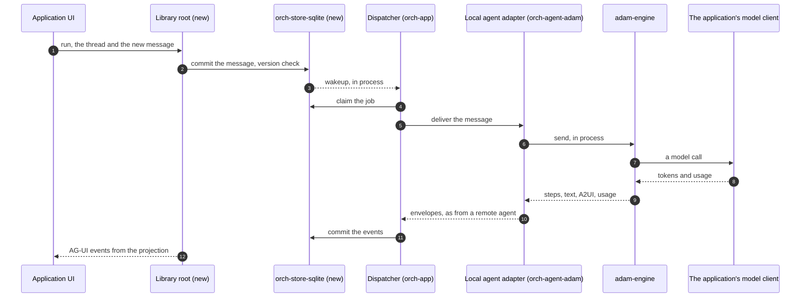
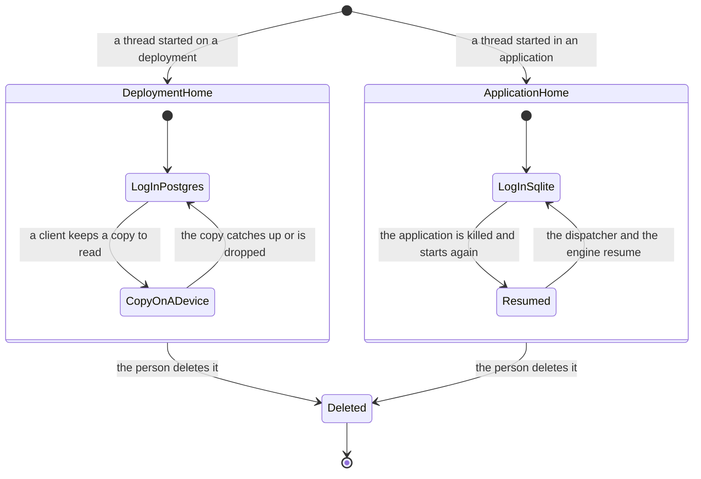

# ADR 0076 — The orchestrator as a library in an application

- **Status:** **Accepted (2026-11-19).** The owner's decision of 2026-11-19: an application that runs agents on the
  person's own computer embeds the orchestrator itself (*"We'll have the thing in rust anyways, so why not embed it
  anyways"*), the ADR is written now and the work is built in R2. A phone may run one local agent the same way, after R2,
  with the tools its system allows. A thread's home is fixed, and hard cutovers reach installed applications through a
  minimum application version (the owner, the same day). Every part marked **(proposed)** is a choice that follows from
  the decision, which the owner may change by a dated note. **Nothing is built.** It amends
  [ADR 0001](0001-rust-state-machine-on-postgres.md) (the log may live in SQLite, in one process),
  [ADR 0015](0015-control-plane-and-workers-on-adam-rs.md) (local agents run adam in process on adam's SQLite store)
  and invariant 3 (one event log); each carries a dated note pointing here. The agent side is adam-rs
  [ADR 0047](https://github.com/vymalo/another-adam-rs/blob/main/docs/decisions/0047-adam-rs-can-be-embedded-in-an-application.md)
  (`adam-engine`, accepted 2026-11-16) and [ADR 0053](https://github.com/vymalo/another-adam-rs/blob/main/docs/decisions/0053-sqlite-a-store-service-a-database-per-agent-and-a-static-coder.md)
  (SQLite, and Postgres without `sqlx`, accepted 2026-11-19). Epic: [#382](https://github.com/vymalo/another-agentic-system/issues/382).

## Context

adam-rs can be embedded in an application as a library that speaks no protocol (`adam-engine`, adam ADR 0047), with its
runs in SQLite (adam ADR 0053). An application that runs agents on the person's computer also needs what this
repository does around an agent: the thread's log, the dispatcher, the inbox and the outbox, the tool relay, agent-team
([ADR 0074](0074-agent-team.md)), mentions, titles, child sessions ([ADR 0072](0072-child-sessions-are-nested-threads-followed-through-child-sessions-v1.md)),
and the AG-UI projection a client reads. Without the orchestrator, the application would rebuild a second, smaller
orchestrator, and a thread on the computer would lack what a thread in a deployment has.

What the code allows today (*verified 2026-11-19*, this repository at `main` `745418a`):

| Fact | Where |
| --- | --- |
| Every infrastructure boundary is already a port with a testkit; `orch-app` and `orch-api` name no adapter; only `bin/orchestrator` chooses the adapters | `orchestrator/crates/ports`, [`orchestrator.md`](../orchestrator.md) |
| The core, the AG-UI types and the projection do no input or output: `orch-core` depends on serde, JSON, `thiserror`, `uuid`, `jiff`, `sha2`, `regex` and Unicode normalisation; `orch-agui-proto` and `orch-agui-projection` on serde, JSON, `thiserror` and each other | their `Cargo.toml` |
| The thread store is Postgres only: `orch-store-postgres` implements `ThreadStore`, `Wakeup` (`LISTEN`/`NOTIFY`), `UsageLedger`, `ThreadSearch`, `PromptStore`, `UserToolServerStore` and `PendingAuthorizations`; `orch-secrets-pg` implements `SecretStore` | their `src/` |
| **Five crates depend on `sqlx`**: `orch-store-postgres` (with `jiff-sqlx`, and `sqlx::migrate!` for its migrations), `orch-secrets-pg` (its own `sqlx::migrate!`), `orch-agent-adam` (a pool for the local agents' journal), `orch-e2e` (tests) and `bin/orchestrator` (tests of the tool servers) | their `Cargo.toml` |
| **`sqlx` locks its SQLite driver even when nothing uses it**: the lock has `sqlx` 0.9.0, `sqlx-sqlite` 0.9.0 and `libsqlite3-sys` **0.37.0** | `orchestrator/Cargo.lock` |
| `rusqlite` 0.41, the minor that adam's SQLite store takes (adam ADR 0053, decision 2), needs `libsqlite3-sys` 0.39 or later, `sqlx-sqlite` 0.9.0 wants one below 0.38, and `libsqlite3-sys` declares `links = "sqlite3"`, so one build holds one of them | *verified 2026-11-16 and 2026-11-19* by adam-rs, its ADR 0047 and ADR 0053 (the crates.io index and `cargo generate-lockfile` probes) |
| adam-rs `main` (`7d62287`) has not built that store yet: its lock has no `rusqlite` and still `sqlx` 0.9.0 | adam-rs `Cargo.lock` |
| Local agents exist: `orch-agent-adam`, behind the binary's feature `agent-local`, off by default, runs adam in process with its journal in the orchestrator's Postgres (`adam-store-postgres`); its kinds are the closed enum `LocalKind` (today `Echo`) | [ADR 0015](0015-control-plane-and-workers-on-adam-rs.md), [`orchestrator.md`](../orchestrator.md#local-agents) |

So an application that links the orchestrator as it is and adam's SQLite store cannot be built: two SQLite drivers.

## Decision

1. **The orchestrator can be embedded as a library in an application**: on a desktop, and later on a phone. It is the
   same core, the same ports and the same features as the server (dispatcher, inbox and outbox, tool relay, agent-team,
   mentions, titles, child sessions, usage, search, prompts), **with no HTTP server**. The application calls the
   operations of the chat API and reads the AG-UI events in process, so a client has one code path for a thread in a
   deployment and a thread in the application. Beside it runs adam in the same process (`adam-engine`, adam ADR 0047).
2. **The Postgres adapters leave `sqlx`, a hard cutover**, as adam ADR 0053 decision 1 did: `tokio-postgres`, pooled by
   `deadpool-postgres`, TLS by `tokio-postgres-rustls`. Every crate that depends on `sqlx` moves in the same cutover:
   `orch-store-postgres` (its `LISTEN` reads notifications from the connection; `jiff-sqlx` goes), `orch-secrets-pg`,
   `orch-agent-adam`, `orch-e2e` and the tests of `bin/orchestrator`. `sqlx` leaves the workspace and its lock, and CI
   fails when it comes back (`cargo tree -i sqlx` finds nothing). The schema, the statements and every port's guarantee
   stay; the migration files stay, and **(proposed)** a small runner applies them and records them in the table `sqlx`
   kept, so an existing database moves with no migration (that its checksums can be kept is *unverified*: the slice
   checks it). The URL parameters `tokio-postgres` does not parse (`sslmode=verify-ca`, `verify-full`, `sslrootcert`,
   `sslcert`, `sslkey`) are parsed by the adapter, so every database URL that works today works after. One code path,
   no dual support.
3. **`orch-store-sqlite` (new)** implements the same ports as `orch-store-postgres` (`ThreadStore`, `Wakeup`,
   `UsageLedger`, `ThreadSearch`, `PromptStore`, `UserToolServerStore`, `PendingAuthorizations`) on `rusqlite` with
   bundled SQLite, **on the `rusqlite` minor adam-rs's SQLite store uses** (adam ADR 0053: one build, one `sqlite3`), and
   passes each port's testkit (`thread_store_conformance!`, `wakeup_conformance!` and the others). The thread's version
   check is one immediate transaction; the wakeup is in process; one writer, WAL, and a lock file that refuses a second
   process. Search must pass the vectors of [`thread-search-v1.md`](../api/thread-search-v1.md); that SQLite's full-text
   index can is *unverified*, and the slice says so if it cannot. Secrets are the application's: it provides a
   `SecretStore` (the system's keychain, for example) that passes `secret_store_conformance!`.
4. **A library composition root (new)**: a crate that composes the ports with the adapters an application gives
   (`orch-store-sqlite`, the local agent adapter, the application's `ChatModel` for titles and descriptions, its
   `SecretStore`, a filesystem artifact store), runs the dispatcher and the inbox worker on the caller's async runtime,
   and offers the chat API's operations and the AG-UI stream as Rust calls. The person is the one the application
   states; no bearer is checked in process. A CI job fails when the embedded build's dependency tree holds `sqlx`, an
   HTTP server (`axum`, `hyper`'s server), a Postgres driver or a second SQLite, as adam ADR 0047 decision 2 checks
   `adam-engine`. `bin/orchestrator` stays the server's composition root and does not change.
5. **Local agents run adam in process on adam's SQLite store** (amends ADR 0015). The `AgentClient` adapter of
   `orch-agent-adam` drives `adam-engine` (adam ADR 0047) on `adam-store-sqlite`, not `adam-store-postgres`, in the
   embedded build. Which agents it serves is the application's (an agent folder it embeds or names, adam ADR 0047); new
   kinds join `LocalKind`, a closed enum, so each fails to compile until handled. In a server build `agent-local` stays
   what ADR 0015 says.
6. **A thread has one home, fixed when it starts**: a deployment, or one application. The home's store holds the log,
   and nothing else writes it. Another device may hold a copy to read; it never answers a write. Moving a thread between
   homes is not offered.
7. **Hard cutovers reach installed applications through a minimum application version.** A client says its version
   with each request; a deployment refuses a client below its minimum with a problem the client shows as "update the
   application", and every hard cutover (such as [ADR 0075](0075-a2ui-v1-0-cutover.md)) raises the minimum in the release
   that makes it. The check may sit in the orchestrator or in front of it; **(proposed)** the orchestrator offers it, so
   every deployment has it. A thread whose home is an application moves with the application's own release.

No transition joins the two homes: a thread is never in both.

### Invariants

- **Invariant 3, one event log**, holds per thread: a thread has one log, in its home's store. In a deployment that is
  Postgres; in an application it is SQLite on the device, written by one process. Processes in a deployment stay
  stateless; an application's process owns its file, as adam's engine owns its own.
- **Invariant 6, swappable implementations**, is what makes this possible: the store, the wakeup, the agent client, the
  model and the secrets are ports, and an application chooses adapters at build time in its own composition root. No
  implementation type enters a port's signature; no runtime plugin is added.
- **Invariant 5, a pure core**, is unchanged: `transition` is the same function in both homes.
- **Invariants 1 and 2** are unchanged: a remote agent is still an A2A card URL, extensions stay optional, and the
  embedded adapter is the one ADR 0015 already allows.

## Consequences

- Five crates change their database library in one cutover; the migrations and the guarantees do not change, and the
  Postgres testkits are the proof.
- Two new crates (the SQLite store and the library root), each with a README and the testkits; the embedded build has a
  dependency check of its own.
- **Not known yet** (*unverified*): the size the orchestrator and `adam-engine` add to an application, above all on a
  phone; that every crate of the embedded set compiles and runs for iOS and Android; that the HTTP client of the tool
  relay agrees with the application's TLS provider. A CI job builds the embedded set for those targets (slice E5) and
  reports the size.
- On iOS an agent has no subprocess, so no shell and no git; the agent's tools are what the system allows (adam ADR
  0053's phone shape). Windows is not planned (adam ADR 0047).
- A deployment gains a minimum application version, and a cutover's pull request says whether it raises it.

## Slices

| # | Slice | Proof | Needs |
| --- | --- | --- | --- |
| E1 | Off `sqlx`, a hard cutover, crate by crate (`orch-store-postgres`, `orch-secrets-pg`, `orch-agent-adam`, `orch-e2e`, the binary's tests) | every Postgres testkit green; an existing database migrates as a no-op; `cargo tree -i sqlx` empty | nothing: it can start early, as clean-up |
| E2 | `orch-store-sqlite` with its testkits | every store testkit green on SQLite; a second process refused; the search vectors | E1 |
| E3 | The library root and its dependency check | an example application runs a thread with a scripted model; the check fails on a planted `axum` or `sqlx` | E2 |
| E4 | `agent-local` on adam's SQLite store, through `adam-engine` | a killed application resumes the thread and its run; a local agent's envelopes equal a remote agent's | E3, adam ADR 0047 slice 4, adam ADR 0053 slice 3 |
| E5 | A compile check of the embedded set for iOS, Android, macOS and Linux in CI, with the size | the job builds each target and reports the size | E3 |
| E6 | The minimum application version | a client below the minimum gets the problem; a cutover raises it | nothing |

## Alternatives rejected

- **A small host in the application that drives adam directly**: a second orchestrator to write, and a thread on the
  computer without agent-team, mentions, the tool relay or titles.
- **A local orchestrator process with HTTP on the loopback**: a server, a port and a token on every computer, against
  adam ADR 0047's "speaks no protocol".
- **A phone with no agent**: the owner chose one local agent on a phone, within what its system allows.
