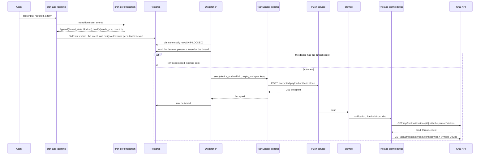
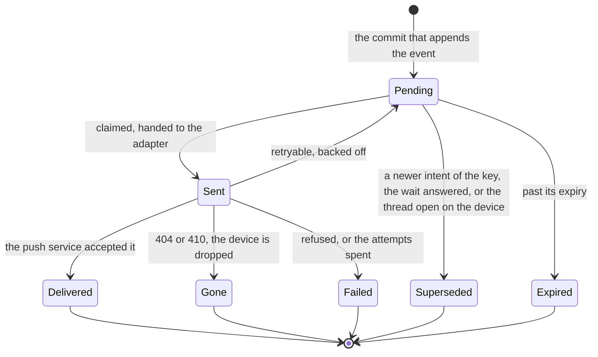

# ADR 0077 — Push notifications for a person's runs, delivered by the deployment's own services

- **Status:** **Accepted (2026-11-19).** The owner's decision of 2026-11-19: push notifications are **in R1**, with
  **self-hosted delivery**. Every part marked **(proposed)** is a choice that follows from the decision (names of routes,
  tables, crates, defaults and timings), which the owner may change by a dated note. **Nothing is built.** It amends
  invariant 3 of `CLAUDE.md` and [ADR 0001](0001-rust-state-machine-on-postgres.md) (devices, settings, presence and
  notification intents are durable state beside the log), as [ADR 0070](0070-a-persons-prompt-library.md) did. It closes
  open questions [37 and 57](../open-questions.md#closed). The owner also decided, the same day, the three questions
  the first draft left open: quiet is judged per device, a new device starts at `all`, and there is no Firebase adapter
  (marked **(owner)** below). The contract for clients is
  [`api/notifications-v1.md`](../api/notifications-v1.md). Epic: [#384](https://github.com/vymalo/another-agentic-system/issues/384).

## Context

Nothing reaches a person when their run waits for them, or ends, while the app is closed. The person comes back hours
later to a question that has expired. The waits that matter:

| Wait | Where it is in the log | Built? |
|---|---|---|
| An agent-team hand-off waiting for approval, which expires after `teams.approvalExpiry`, 30 minutes by default | `handoff_proposed`, then `handoff_decided` ([ADR 0074](0074-agent-team.md) A5) | No (R1) |
| A declared checkpoint | `team_checkpoint` ([ADR 0074](0074-agent-team.md)) | No (R1) |
| An A2UI form or confirm (`Choices`) | an open `ui_surface` with an input, the task `input_required` | Yes |
| A gate or an approval of the hooks | the hooks epic, [#333](https://github.com/vymalo/another-agentic-system/issues/333) | No |
| A run parked over the person's limit | the thread state and the typed reason of R1's "over the limit pauses" | No (R1) |
| An agent asking for a credential | the task `auth_required` | Yes |

The ends that matter: a job `done`, `failed` or `cancelled` (`thread_state`), and a pull request opened (an `artifact`
the gate reads as a pull request, `orchestrator/crates/core/src/gate.rs`).

Open question 37 asked for the channel, where a subscription is stored, how an agent asks for a notification and how
consent is withdrawn. Open question 57 asked for the channel of the desktop and mobile applications of
[ADR 0047](0047-one-ui-for-web-desktop-and-mobile-each-signs-in-as-a-public-oauth-client.md). Both said that a
notification is never the truth: the log is.

What the services allow (each *verified 2026-11-19* at the source named, unless marked):

| Fact | Source |
|---|---|
| Web Push is RFC 8030 (delivery, with `TTL` §5.2, `Urgency` §5.3, and `Topic` §5.4: a newer message with the same topic replaces a stored one; a topic is at most 32 characters of the URL-safe Base64 alphabet), RFC 8291 (the payload is encrypted to the browser, `aes128gcm`; a push service need not take more than 4096 octets) and RFC 8292 (VAPID, the application server's identity) | <https://www.rfc-editor.org/rfc/rfc8030>, <https://www.rfc-editor.org/rfc/rfc8291>, <https://www.rfc-editor.org/rfc/rfc8292> |
| A push to an expired Web Push subscription is answered `404 Not Found` (RFC 8030 §7.3). That push services also answer `410 Gone` for a subscription the browser dropped is common practice, *unverified* here | RFC 8030 |
| **ntfy** is dual licensed, Apache-2.0 and GPLv2. Its latest server release is **v2.38.1, 2026-11-16** (a security release; Android app v1.25.2, iOS app v1.7.0) | its `README.md` and `docs/releases.md` at `main`, <https://github.com/binwiederhier/ntfy>. The releases page itself could not be read from this session; the release notes list it as the current stable release |
| ntfy documents **no end-to-end encryption**: TLS to the server, its own access control, and `Cache: no` to keep a message off the server | its `docs/faq.md`, `publish.md`, `privacy.md` and `config.md` at `main` (nothing else found) |
| A self-hosted ntfy reaches **iOS** instantly only through `upstream-base-url`: it sends a poll request with the message id to ntfy.sh (or another server connected to APNs), and the app then reads the message from the deployment's server; without it, delivery "can take hours" | ntfy `docs/config.md`, "iOS instant notifications" |
| ntfy can be a **UnifiedPush distributor** on Android | ntfy `docs/subscribe/phone.md` |
| **UnifiedPush** (spec `AND_3.1.0`): a message MUST be encrypted as RFC 8291 says, the application server is identified with VAPID (RFC 8292), a message is 1 to 4096 bytes, an endpoint at most 1000 bytes and hard to guess. So **its wire is Web Push** | <https://unifiedpush.org/developers/spec/android/> |
| **iOS**: a native app gets remote notifications through **APNs** only, with a device token per app and device; APNs answers `410` when "the device token is no longer active for the topic"; it has `apns-collapse-id` and `apns-expiration`. Web Push for a Home Screen web app (iOS 16.4 or later) also goes through Apple's service (`*.push.apple.com`). A notification service extension may rewrite an alert's content and has "only about 30 seconds" to do it | Apple's documentation: *Registering your app with APNs*, *Handling notification responses from APNs*, *Sending notification requests to APNs*, *Sending web push notifications in web apps and browsers*, *Modifying content in newly delivered notifications* (developer.apple.com, read 2026-11-19) |
| Rust crates that may serve the adapters: `web-push` 0.11.0 (Apache-2.0, 2025-02-22), `web-push-native` 0.5.0 (MIT or Apache-2.0, 2026-07-26), `ece` 2.4.2 (MPL-2.0, 2026-09-15), `a2` 0.10.0 for APNs (MIT, 2024-05-05). Whether each fits the workspace's one TLS backend (`reqwest` 0.13, rustls on aws-lc-rs, `orchestrator/Cargo.toml`) is *unverified* | crates.io API, 2026-11-19 |

So **iOS is the one place where self-hosting stops**: whether the app is native or a web app on the Home Screen, a push
to an iPhone goes through Apple. A self-hosted ntfy on iOS goes through ntfy.sh and then APNs, which is worse: a second
third party. This ADR uses APNs directly for iOS, and nothing else of Apple's.

## Decision

1. **Intents are a function of the log, in the pure core (owner: events; proposed: the names).** `transition` emits a
   new command, `Command::Notify(NotifyIntent)`, from the events it already folds. Nothing outside the log makes a push:
   **an agent never sends one and never asks for one** (question 37's "the agent is told it may notify later" is
   dropped). An intent is:

   | Field | What |
   |---|---|
   | `class` | `needs_you` or `done`, a closed enum ([ADR 0004](0004-closed-enums-over-dyn-registry.md)) |
   | `kind` | the closed enum the client localises: `needs_you` (a form, a confirm, a credential, a hand-off or a gate waits), `checkpoint`, `over_limit`, `done`, `failed`, `cancelled`, `pull_request` |
   | `thread` | the thread's id |
   | `count` | for `needs_you`, what waits for the person in the thread at that commit; `1` otherwise |
   | `cause` | the `seq` of the event that made it: the **dedupe key** is `(thread, cause, kind)`, so a replayed input makes no second intent |
   | `expires` | when the push is useless: the hand-off's own expiry (`teams.approvalExpiry`), else `notifications.ttl.needsYou` (proposed 24 h) or `notifications.ttl.done` (proposed 6 h) |

   The **collapse key** is per thread and class: a newer intent of the same thread and class **supersedes** the older
   ones not yet sent, and replaces the shown one on the device (Web Push `Topic`, APNs `apns-collapse-id`). The key
   sent to a push service is a keyed hash of `(thread, class)` cut to 32 URL-safe Base64 characters, never the thread
   id: RFC 8030 §8.1 warns that a topic aids traffic analysis. When the core sees the wait answered (a `ui_action`, a
   `handoff_decided`, a message of the person), it emits `Notify::Withdraw { thread, class }` and the pending pushes of
   that key are superseded. A push already shown stays until the client opens the thread.

   **Quiet rules** (proposed): the person's own act makes no push (they cancelled, so no `cancelled` push to the device
   that sent it); a child session's end ([ADR 0072](0072-child-sessions-are-nested-threads-followed-through-child-sessions-v1.md))
   makes none, its parent's does; a `needs_you` of a child thread does. **No push goes to a device that has the thread
   open**, and **each device is judged on its own (owner)**: a thread open on one device does not quiet the person's
   other devices. Presence rides the existing connect stream (`GET /agui/threads/{id}/connect`), which names the device in the
   header `X-Vymalo-Device`; while it is open, the orchestrator keeps a presence lease of 45 s, renewed every 20 s, in
   the store (the stream and the dispatcher may run in different processes). The web client closes its stream when the
   page has been hidden for 30 s and catches up on return with the history read of
   [ADR 0059](0059-a-thread-opens-at-its-end-and-older-turns-load-on-scroll-up.md). A stale lease is ignored: at worst
   a push is sent that was not needed, never one missed.

2. **Two ports, a crate per service (invariant 6).** The name `Notifier` is not used: `Wakeup::notify` is the
   orchestrator's wake-up hint, and adam-rs's `Notifier` is its own wake-up signal.

   - **`PushSender`** (`orch-ports`): `channel()` and `send(&DeviceAddress, &Push) -> Result<Accepted, PushError>`.
     `PushError` has a class ([ADR 0004](0004-closed-enums-over-dyn-registry.md)): `Gone` (the device is dropped),
     `Retry { after }`, `Refused` (no retry: a bug or a bad key), `Unavailable`. Its testkit,
     `push_sender_conformance!`, runs every adapter against a mock push service of its own: the payload has only the
     allowed members and fits 4096 bytes, `Gone` on 404 and 410, `Retry-After` kept, the expiry and the collapse key
     sent, no secret in an error or a log line.
   - **`NotificationStore`**: devices, settings, presence and intents. It is the **fourth supertrait of
     `ThreadStore`**, because intents and their outbox rows commit with the event that made them. **A breaking change**
     for every store: the in-memory one, Postgres and the SQLite store of
     [ADR 0076](0076-the-orchestrator-as-a-library-in-an-application.md). Its testkit is
     `notification_store_conformance!`.

   The adapters, each a crate behind a feature of the binary, **off by default** (proposed names):

   | Channel | Crate, feature | For | Payload |
   |---|---|---|---|
   | Web Push | `orch-push-webpush`, `push-webpush` | a browser, the web client; an iPhone's Home Screen web app (through Apple) | encrypted to the device (RFC 8291): `{v, id, kind, thread, count}` |
   | UnifiedPush | the same crate: **its wire is Web Push** (above), so it is the same adapter with the endpoint of the person's distributor, a self-hosted ntfy for example | an Android application | the same, encrypted |
   | ntfy | `orch-push-ntfy`, `push-ntfy` | the ntfy app on Android or a desktop, subscribed to a topic the orchestrator makes for the device (at least 128 random bits) on the deployment's ntfy | no end-to-end encryption: a fixed title per `kind` in the person's language, the count, and a link to the thread; **never a title of the thread or a word of it** |
   | APNs | `orch-push-apns`, `push-apns` | an iOS application, **only** | `{v, id}` and an alert the app's notification service extension rewrites (`mutable-content`): the app fetches `kind`, `thread` and `count` over the authenticated API |

   UnifiedPush has no crate of its own because nothing of its wire differs; its slice (N6) is its registration and its
   endpoint rule. A crate that brings a second TLS stack or HTTP client is refused; writing RFC 8291 over the
   workspace's own primitives is the fallback.

3. **Content rules.** A push carries **no message text, no title of a thread, no secret and no tool output**. Only
   `{kind, thread, count}`, an opaque notification id and a version. The client builds the localised title from `kind`.
   Where the channel encrypts to the device (Web Push, UnifiedPush), those members ride in the payload. Where it does
   not, or the service is not the deployment's (APNs), only the id rides, and the app reads the rest with its own token
   from `GET /api/me/notifications/{id}`. ntfy is the deployment's own server and carries only the fixed text above.
   The endpoints, keys, device tokens and ntfy topics are **sealed through `SecretStore`**
   ([ADR 0046](0046-people-add-their-own-mcp-servers-secrets-in-a-credential-broker.md)): a capability to push is a
   secret. The deployment's keys (VAPID, the APNs key, the ntfy token) are secrets by reference
   ([ADR 0034](0034-one-yaml-configuration-secrets-by-reference.md)).

4. **The API (proposed routes, for any client).** A person reaches only their own devices and settings, with the
   permission that reads their own threads, `thread.read`, and **no new permission**, as for search
   ([ADR 0068](0068-a-person-searches-their-own-threads.md)); nobody reaches another person's
   ([ADR 0039](0039-nobody-reads-another-persons-thread.md)).

   | Route | What |
   |---|---|
   | `GET /api/me/devices`, `POST /api/me/devices`, `PATCH` and `DELETE /api/me/devices/{id}` | register a device (`channel`, `platform`, a label, and the endpoint and keys, or the token, or a request for an ntfy topic), list them (never an endpoint or a key), rename, rotate a Web Push subscription, remove one; at most 10 per person |
   | `POST /api/me/devices/{id}/test` | one test push, `kind: test` |
   | `GET` and `PUT /api/me/notification-settings` | the person's level, `all`, `needs_you` or `off`, and their language for the fixed ntfy text; **a new device starts at `all` (owner)**: the level is `all` until the person changes it |
   | `GET` and `PUT /api/threads/{id}/notifications` | the thread's level: the same three, or `inherit` |
   | `GET /api/me/notifications/{id}` | `{kind, thread, count, at}` of a notification of the person's own, for a channel that carries only the id; 404 for anyone else or after it expired |
   | `GET /api/config` | gains the channels the deployment enabled and the VAPID public key, for the web client's `PushManager.subscribe` |

   The contract is [`api/notifications-v1.md`](../api/notifications-v1.md); N3 adds the routes to
   [`api/chat-api.yaml`](../api/chat-api.yaml). **Consent** is the device's registration, which the client makes only
   after the OS or browser prompt; **withdrawing it** is `DELETE`, `off`, or the browser revoking the permission (the
   next push answers 404 or 410 and the device is dropped). The UI catalog's Notification opt-in component is not
   needed: the opt-in is the client's own control, never an agent's surface.

5. **Delivery is at least once, through the outbox.** The commit that appends the event writes the intent and, for
   each of the owner's devices that the settings allow, one outbox row of a new kind, `notify`, unordered like `ask`.
   The dispatcher claims it (`SKIP LOCKED`), drops it as superseded when the device has the thread open, else sends it.
   A retryable failure backs off (proposed: from 15 s, doubling, at most 10 min, with jitter, `Retry-After` kept, at
   most 8 attempts) and is never sent after `expires`. `404` or `410` (APNs `410`, `BadDeviceToken`) deletes the device
   and its sealed address in one transaction. A device may get a push twice; the collapse key makes the OS replace it,
   and the client keys on the notification id. "Delivered" means **the push service accepted it**: no channel here says
   the person saw it.

6. **The service is the deployment's (owner).** Web Push goes to the browser's push service, which the person's browser
   chose. UnifiedPush and ntfy go to the deployment's own ntfy. APNs is used for iOS only. No other third-party relay,
   and **no Firebase adapter (owner)**, not even an optional one for a phone without a distributor. A deployment with no channel configured has no routes: they answer `404 notifications_disabled`
   and nothing is written (fail closed).

7. **Durable state beside the log (amends invariant 3 and ADR 0001).** Postgres keeps, beside the log and not in it:
   a person's **devices** (sealed addresses), their **settings** and each thread's, the **presence leases**, and the
   **notification intents** with their outbox rows. Intents are a function of the log; the rest is the person's own,
   read and changed only through the API. Deleting a thread erases its intents, its setting, its presence and its
   rows ([ADR 0043](0043-deleting-a-thread-erases-it.md)); deleting an account erases the devices and settings
   ([#294](https://github.com/vymalo/another-agentic-system/issues/294)); none of it is copied into a fork, an export or
   a shared view. Intents and delivered rows are pruned 7 days after they end (proposed).

## Diagrams

A run waits for the person, and their phone shows it:

The life of one push to one device (one `notify` outbox row):

`Delivered` is the push service's acceptance, not the person's eyes. A row is pruned 7 days after it ends.

## Consequences

- A person learns of a wait while it can still be answered, on the web, on Android through a distributor they choose,
  and on iOS.
- **iOS depends on Apple.** It is the one exception to self-hosting, and it is honest about it: APNs sees that an app
  got a notification and when, and an opaque id; nothing else. A deployment that refuses Apple turns `push-apns` off,
  and its iOS users get nothing while the app is closed. A Home Screen web app on iOS goes through Apple too.
- An Android phone without a UnifiedPush distributor gets nothing while the app is closed. The app says so and points
  to one; there is no Firebase fallback.
- The desktop application ([ADR 0047](0047-one-ui-for-web-desktop-and-mobile-each-signs-in-as-a-public-oauth-client.md))
  gets no push while closed: while it runs it shows local notifications from its stream. Whether Web Push works inside
  its webview is *unverified*; a person may register their browser or the ntfy app instead.
- `ThreadStore` gains a supertrait (a breaking change for its three implementers), the core a command, the outbox a
  kind, the binary three features and the store a migration. `docs/orchestrator.md` describes them when they are built.
- The dispatcher reaches the internet (browser push services, APNs): the egress of the chart names them, and an
  endpoint passes the egress guard of [ADR 0046](0046-people-add-their-own-mcp-servers-secrets-in-a-credential-broker.md)
  (`https` only, no private address) before it is stored.
- Questions 37 and 57 are closed.

### Slices (epic [#384](https://github.com/vymalo/another-agentic-system/issues/384))

| Slice | What | Proof |
|---|---|---|
| N1 | `Command::Notify` and `Notify::Withdraw` in `orch-core`: every wait and end above, dedupe, collapse, the quiet rules that need no I/O | pure tests over event sequences, and vectors in `docs/api/examples/notifications/` |
| N2 | `PushSender`, `NotificationStore` and their testkits, the memory implementations | `push_sender_conformance!` and `notification_store_conformance!` pass on memory, and fail on a store and a sender broken on purpose |
| N3 | the device and settings API, presence on the connect stream, the `notify` outbox kind, the Postgres migration | `notification_store_conformance!` on Postgres; route tests, another person's device a 404; no endpoint or key in an answer or a log |
| N4 | Web Push (VAPID, RFC 8291) | the conformance against a mock push service; RFC 8291's own example decrypts |
| N5 | ntfy | the conformance against a mock ntfy; the fixed text has no word of the thread |
| N6 | UnifiedPush: registration of an Android application and its endpoint rule | the conformance of N4 with a distributor's endpoint |
| N7 | APNs, the id alone | the conformance against a mock APNs: `410` drops the device, the payload is `{v, id}` |
| N8 | `dev/notify-e2e.sh` and a mock push service in `compose.yaml` | a form waits, one push reaches the mock with no text of the thread; a thread open on the device gets none; a `410` drops the device; an expired hand-off is not sent |
| N9 | the web client: the permission prompt after a first wait, the service worker, the settings per person and per thread | the web's Playwright specs on its mock server |

## Alternatives rejected

- **Firebase Cloud Messaging as the only path:** a third party for every Android and web push, against self-hosted
  delivery.
- **Email only:** slow, not on the lock screen, and a mail holds more than a push may.
- **Polling only:** a closed app does not poll; the OS stops it.
- **The agent sends or asks for the push:** a push would then come from outside the log, and an agent would hold a way
  to reach a person's device.
- **A self-hosted ntfy for iOS:** it reaches iOS through ntfy.sh and then APNs, a second third party.
