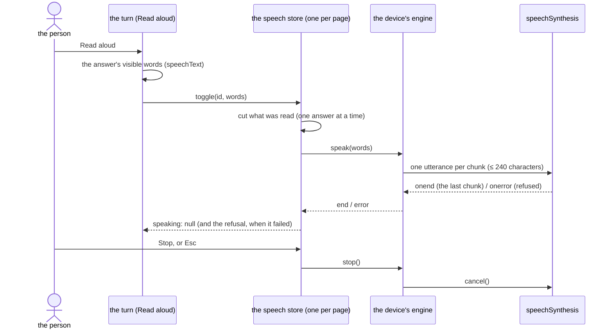
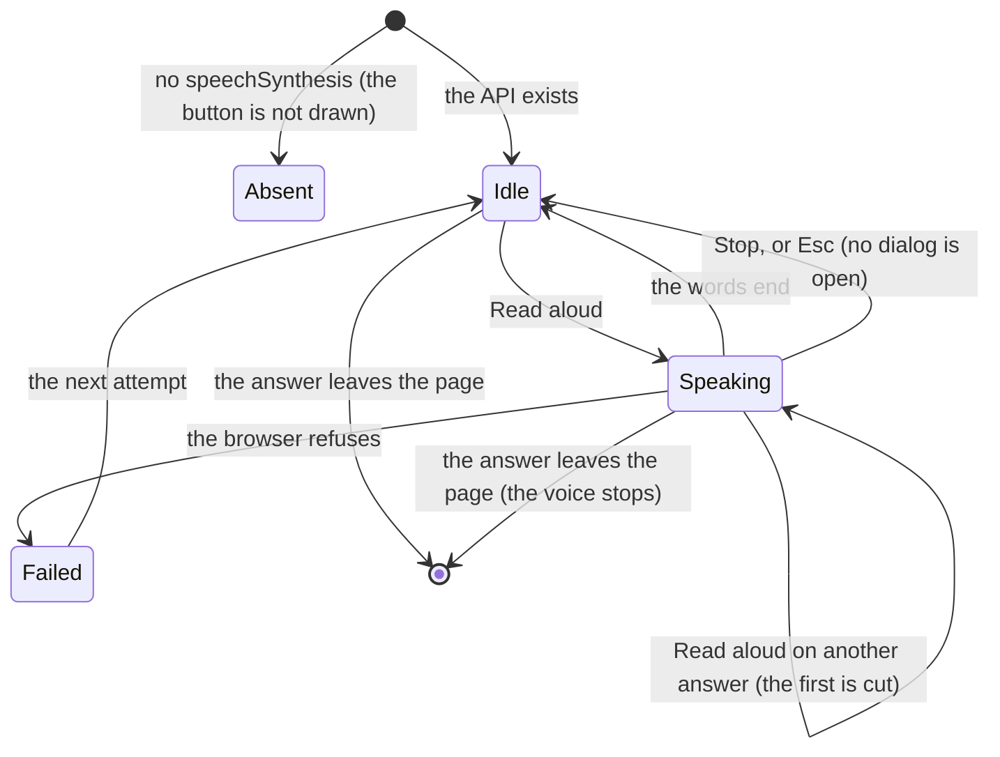

# ADR 0078 — Read aloud with the device's voice, and the keyboard help

- **Status:** accepted (2026-11-19), the owner's decision, relayed on the coordination channel
  (`RELAY [S-tM2P] → S-WEB`, 2026-11-19). Built in the web (`web/src/features/speech/`,
  `web/src/features/shortcuts/`); no orchestrator, contract or storage change.

## Context

[ADR 0067](0067-the-plan-to-librechat-grade-and-the-client-agnostic-rule.md) lists S1 as "read an answer aloud with
the device's own voice, and global shortcuts", beside S2 (a deployment's voice and dictation through a configured
endpoint, counted in the usage ledger) and S3 (the microphone and the server's voice in the composer and on each
answer). S1 is therefore the client-only half: it must work with no deployment support at all, and it must not
pretend to be S2.

The web already listens to a few keys — Ctrl/⌘+K for search, Ctrl/⌘+Shift+. for the thread's panel, Enter,
Shift+Enter and Ctrl/⌘+Shift+Enter in the composer, Esc in every dialog — but nothing tells a person they exist. The
owner asked for the device's voice, and for a help sheet rather than more bindings.

## Decision

1. **The device's voice only.** `window.speechSynthesis` and `SpeechSynthesisUtterance`, the voice the browser and
   the operating system already have: no network, no endpoint, no key, no setting and nothing stored. A browser
   without the API draws no Read aloud at all; a browser that refuses (for example `not-allowed`) is answered in
   words under that answer, never with an unhandled rejection. The deployment's voice stays S2/S3, behind the
   capability ADR 0067 names for them (`ui.speech`), which does not exist yet.
2. **Read aloud is an action on a finished answer**, in the turn actions row beside Copy and Quote, and **one answer
   at a time across the page**: starting a second answer cuts the first, Stop cuts it, and it stops when the answer
   leaves the page. Nothing plays by itself, nothing is remembered across a reload, and the same button serves a
   shared link and a person who may only read, where Copy already is.
3. **What is read is the words the page shows, not the Markdown.** The rules of
   [`docs/api/message-text-v1.md`](../api/message-text-v1.md) where they speak (raw HTML as the text that was
   written, a single dollar a price, display math by its two shapes), and these choices where they do not: a link is
   its label and never its URL, an image is its alt text or "image", inline code and a fenced block are their
   content, a table is read cell by cell, and display math is the word "formula".
4. **An answer is spoken in utterances of at most 240 characters**, cut at sentence ends and then at spaces, because
   a browser says an utterance and stops at its end: one utterance of 20,000 characters would be cut off or refused.
   Stop cancels the whole queue.
5. **The keyboard help is a sheet, not more bindings.** `?` and Ctrl/⌘+`/` open a modal dialog that lists the keys
   the page has; `?` is not read while a person writes in a box, and neither key stacks a second dialog over an open
   one. **Esc stops a read-aloud**, and a dialog that is open takes Esc first, as it always did. No other binding is
   added.
6. **The sheet's list is one array**, and a test holds each chord against the handler that reads it, so a binding the
   page does not have cannot be listed. `web/README.md` quotes the same list and says that a Markdown page cannot
   import it.

## Consequences

- A person reads an answer with no deployment support, and no model, key or ledger line is involved: speech costs
  nothing here and has no event to record, which is why S2's ledger line is its own decision.
- S2 and S3 extend the same control rather than replace it: when the deployment announces `ui.speech`, the answer's
  voice becomes the deployment's and a client without it keeps the device's, as ADR 0067 says.
- The keyboard help makes the page's existing bindings discoverable without changing any of them, and its list is
  the place a future binding is registered — with its test, or not at all.
- The one hole, accepted: a voice keeps speaking while the person moves around the page; it stops when the answer
  itself leaves, or on Stop and Esc.
- No invariant is touched: the web only, no protocol, no extension, no storage.

## Alternatives rejected

- **Synthesise on the server** (S2's shape) — needs a configured endpoint, a key and a ledger line, and would leave
  a client with no deployment without a voice.
- **Read the Markdown source** — says "hash hash heading" and the URL of every link.
- **Auto-read the newest answer** — the person did not ask for it, and a page that speaks on its own is hard to
  silence.
- **A settings panel for voice, rate and pitch** — nothing to choose before a deployment has a voice of its own.
- **More global bindings** (a key to read, a key to stop, a key per action) — the owner chose a help sheet and Esc,
  and every added chord risks the browser's own.
