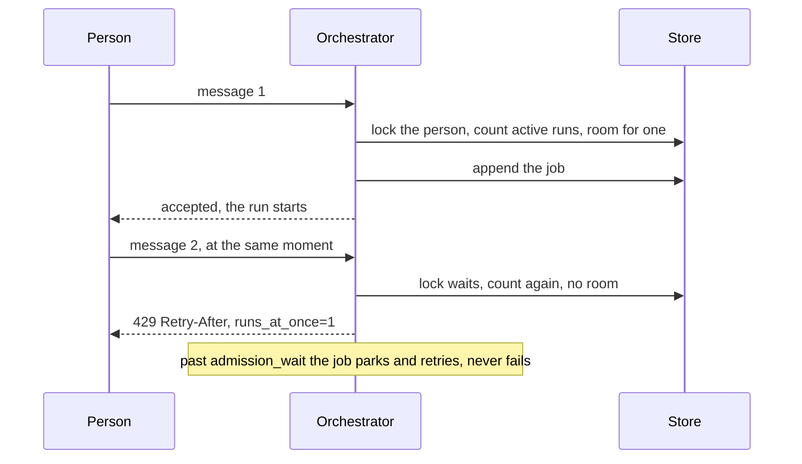

# ADR 0081 — Limits per person before a run starts: the role's allowance, checked before dispatch

- **Status:** **proposed (2026-11-21).** The requirements are the owner's answers of 2026-11-21 in the resource-governance
  plan (`another-context plans/2026-11-21-resource-governance.md`, questions 2, 3, 4 and 7): "wait, then park; never fail a
  run because a slot is busy", "role now, plan later", and a device's settings never cap a cloud agent. It folds system
  issues **#282** (nothing checks a person's allowance before a run starts) and **#170** (a webhook burst starts every
  job). The code follows in the plan's slice 8; this record fixes the semantics that slice implements.

## Context

The orchestrator has 32 dispatcher slots with fair ordering, the ask limits (depth 2, 16 asks per job, 4 running at once),
1 MiB request bodies and a few route rate limits. It has **no per-person limit** on runs, messages, webhooks or tokens
before a run starts (issue #282), and the namespace's run-pod quota is shared by everyone. A person can fill every slot;
a webhook burst starts every job (#170).

The owner's decisions (2026-11-21) are the requirements:

| # | Question | Answer |
|---|---|---|
| 2 | Are the plan's defaults right? | yes: cloud per person, **4 runs at once**, 4 model calls in flight, 2 run pods, no tokens-per-minute limit until a plan |
| 3 | Over budget: wait, park or fail? | **wait, then park; never fail a run because a slot is busy**; refuse only what can never fit; ask the person only when the disk is full |
| 4 | Who sets the cloud limits? | **role now, plan later** |
| 7 | Does a device setting cap cloud agents? | **no, device only** |

The invariants of `CLAUDE.md` that bind this record: **3, stateless processes, one event log** — the admission state is the
log and the usage ledger, never an in-memory counter; **4, verification over consensus** — the acceptance is an e2e
scenario on mocks; **6, swappable implementations** — the queries sit behind the existing ports (the thread store, the
usage ledger, the inbox), and a new query is a provided default or a stated break, never a driver type in a signature.

## Decision

1. **The unit is the person.** A message is charged to the thread's owner; a run to the run's owner; a webhook job to the
   source's owner; a scheduled run to the schedule's owner. The limit is the **role's**; a plan is another source of the
   same numbers later.

2. **The limits, per role, in the orchestrator's configuration** (`limits` per role; the deployment sets them):

   | Key | Meaning | Default |
   |---|---|---|
   | `runs_at_once` | the person's jobs that have not finished (queued, working, or waiting for an ask) | 4 |
   | `messages_per_minute` | the person's messages in the last minute | none until a role sets one |
   | `webhook_jobs_per_minute` | the jobs a webhook source starts in the last minute | none until a role sets one |
   | `tokens_per_period` | the person's tokens in the period, from the usage ledger (ADR 0065) | none until a plan |
   | `model_calls_in_flight` | the orchestrator's own model calls for the person (titles, descriptions) | 4 |
   | `admission_wait` | how long a run waits for a slot before it parks | the slice's (a short queue) |

   `run_pods_per_person` (2) is the coder's admission (adam-rs), cited here; the BFF's per-caller limits are ADR 0029,
   slice 11. The agents' own model calls are adam's model client, not this gate.

3. **The admission is one transaction, and the log is the state.** Before dispatch, the orchestrator takes a
   **per-person advisory lock** (`pg_advisory_xact_lock`, the prompt store's precedent in this database), counts the
   person's active jobs / messages in the window / webhook jobs, or reads the usage ledger, and creates the job (or
   appends the message) in the same transaction when there is room. When there is not, it queues the job (the existing
   `queued` state) or answers the `429`. Two messages at the same moment with room for one: the lock serializes them, the
   first creates the job, the second sees it and queues. **No new durable state**: the counts are queries over the log,
   the ledger and the inbox; the lock is the serialization.

4. **Over budget: wait, then park; never fail.**
   - A run with no slot waits in the existing dispatcher queue. Past `admission_wait`, the job **parks**: a
     `RateLimited` with `retry_after`, and the run resumes at the same step (the plan's "over the limit pauses, never
     fails").
   - A message over `messages_per_minute` gets **`429`** with `Retry-After` and a body that **names the limit and its
     value**; the web shows them.
   - A webhook burst starts **at most N jobs per source**; the rest stay in the existing inbox, and the source's reports
     are not lost. The jobs start as slots free.
   - **Refuse only what can never fit**: a request larger than the whole budget (a body over the 1 MiB cap, a run pod
     class bigger than the quota) is `Invalid`, naming the limit. The disk-full question is the device's/adam's (the
     plan's `NeedsYou`), not the orchestrator's.

5. **The surfaces.**
   - `GET /api/me/limits`: the person's role, the limits and the current usage (runs at once, messages in the window,
     tokens in the period). The web shows it and names the limit in a refusal.
   - The **embedded orchestrator** (ADR 0076) takes the **device's** budget (the app's settings), not the cloud role's; a
     device setting never caps a cloud agent (owner's answer 7).
   - The web's refusal uses `Retry-After` and the limit's name; no new UI kind.

6. **No new error class.** `RateLimited` (with `retry_after`) for a wait or a park, `Rejected` when a person's action is
   needed (the disk), `Invalid` for what can never fit. The HTTP boundary maps them to `429`, `409` and `400`, each naming
   the limit.

7. **The role's limits are a ceiling.** An agent's files or a person can lower a limit, never raise it — the rule adam
   already has for parallel tool calls. The role is the deployment's; a plan later is another source of the same numbers.

8. **The acceptance** (slice 8): two messages at the same moment with room for one — one passes, the other waits or
   parks; every refusal names the limit and its value; a webhook burst starts at most N jobs and the rest wait; and the
   pass-through under the limits changes nothing. One e2e scenario on mocks per refusal and for the pass-through.

## A message at the limit

## Consequences

- A person's burst is serialized by the lock; the counts are queries; no new table and no in-memory counter across
  replicas (invariant 3).
- The dispatcher's 32 slots remain the global ceiling; the per-person cap is a fair share below it, so one person cannot
  fill every slot.
- The webhook's inbox holds the excess; a source's reports are not lost and its jobs start as slots free.
- The tokens/period check is the usage ledger's (ADR 0065); a period with no plan has no limit.
- The role's limits are configuration; a plan later changes the source, not the semantics.
- `GET /api/me/limits` and the web's refusal are the visible half; the embedded orchestrator's device budget is the
  app's (ADR 0076), not this record.
- The admission adds one query and one lock per message; the indexes on the person's unfinished jobs, the messages'
  timestamps and the usage ledger's month make it cheap. Proving that is the slice's job.

## Alternatives

- **Per deployment only**: the owner chose per person, role now and plan later.
- **Fail on over budget**: the owner chose wait, then park.
- **A new error class**: the ten classes of `adam_error` already say what to do.
- **An in-memory counter**: breaks stateless replicas and loses the count on a restart; the log is the state.
- **A new table of counters**: the log, the ledger and the inbox already answer; a table would be a second truth.
- **The BFF's token bucket here**: ADR 0029, slice 11, is the BFF; this record is the orchestrator before dispatch.

## Open questions

- The exact role names and numbers: the owner's roles; the plan's defaults for runs (4), model calls (4) and run pods
  (2); `messages_per_minute` and `webhook_jobs_per_minute` have no default until a role sets one.
- The token/cost allowance per period: none until a plan.
- The `admission_wait` default (the slice's; the plan says "a short queue").
- The webhook source's identity: the repository, the installation, or the source's configured id.
- Whether the thread store needs new query methods or the existing job, usage and inbox queries suffice; the slice
  decides and states the port change, with provided defaults for the in-memory store and the testkit.
