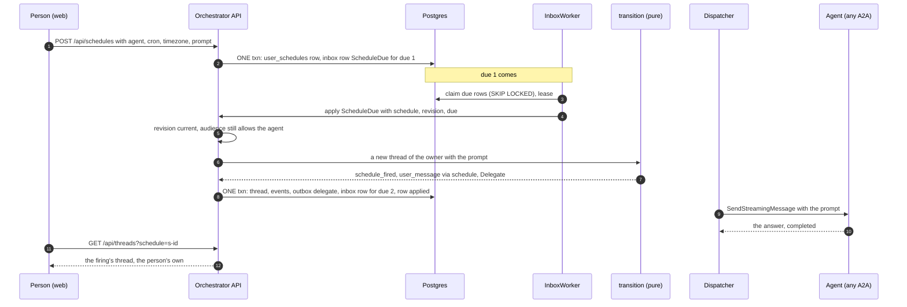
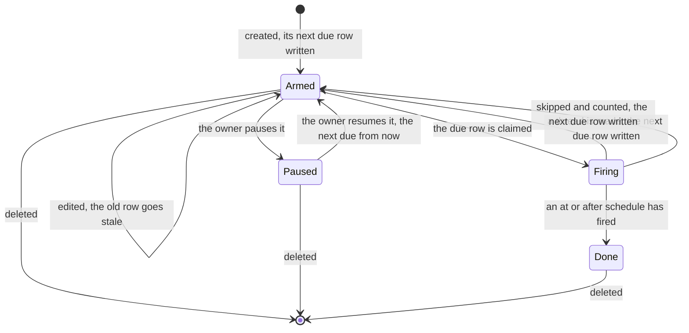

# ADR 0088 — A person's schedules live in the orchestrator, and each firing is a thread they can open

- **Status:** **proposed (2026-11-24)** (task ANR-396, issue [#414](https://github.com/vymalo/another-agentic-system/issues/414),
  parity gap 14 of adam's [parity matrix](https://github.com/vymalo/another-adam-rs/blob/main/docs/reference/parity.md)).
  **Nothing is built.** The engine side of the same epic, adam#269, is adam's and is not covered here. Every name, shape
  and default below is the design's, for the owner to confirm or change by a dated note; what the existing records leave
  to the owner is under [Open questions](#open-questions), each with a recommendation. Builds on
  [ADR 0016](0016-inbox-timers-and-job-ledger-on-the-thread.md) (timers are inbox rows) and
  [ADR 0020](0020-a-thread-is-a-conversation.md) (a thread is a conversation). Follows the pattern of
  [ADR 0070](0070-a-persons-prompt-library.md) and [ADR 0074](0074-agent-team.md) decision 13 for a person's own
  definitions. **It amends invariant 3** of `CLAUDE.md` and [ADR 0001](0001-rust-state-machine-on-postgres.md)
  (decision 3). Not to be confused with this repository's own ADR 0060 (the client's cache): "adam ADR 0060" below is
  adam-rs's.

## Context

**Today a schedule is a file of an agent's folder, and its firings are seen by nobody.** Read on 2026-11-24 in adam-rs
at `eb91543b`:

- A folder may hold `schedules/<name>.md`: frontmatter `cron`, `at` or `after` and `timezone`, the body a prompt
  ([adam ADR 0060](https://github.com/vymalo/another-adam-rs/blob/main/docs/decisions/0060-schedules-are-parked-runs.md),
  decisions 4, 6 and 7).
- The coder reads them and runs them on the roles that run workers (`bin/adam-coder/src/serve.rs:384-385`,
  `:413`, `:422-432`). So does `adam-agent` (`bin/adam-agent/src/agent.rs:274`, `:320-333`).
- A schedule is a parked run of a built-in agent. Each firing is a run of the root agent in a conversation of its own,
  `adam.schedule:<agent>/<name>@<due>`, with one firing per due time (adam ADR 0060, decisions 1 and 2).
- **A firing is nobody's message.** No A2A caller owns its conversation, so no caller lists it as a task, and
  "delivering a firing's result somewhere (a push, a person's thread) is a later decision" (adam ADR 0060,
  *Consequences*). An A2A call does not reach a firing (adam ADR 0060, amended 2026-11-21 for #289).
- A firing is unattended: a tool that asks the person is answered that nothing can be asked. The coder ends a firing
  that would wait as `Failed` (adam ADR 0060, amended for slice 6c).

**This system has no schedule of its own.**

- adam's parity matrix says so for the system column: "**gap**: no API makes a schedule, and a firing is in no thread"
  (adam `docs/reference/parity.md:115`, gap 14 at `:182`, read against sys `ebcee350`).
- The roadmap's M9 row says the same: "no API of the orchestrator makes or lists one, and a scheduled run's thread in
  the chat is not designed" (`ROADMAP.md:603`).
- The orchestrator does have durable timers. The core asks for a delay with `Command::Schedule` and is handed
  `TimerFired`; a timer is an inbox row with an `available_at`, claimed under a lease and deduplicated by
  `UNIQUE (source, idempotency_key)` ([ADR 0016](0016-inbox-timers-and-job-ledger-on-the-thread.md), section 4).
  Every such timer belongs to a thread and a job.

**What this record must settle:** where a person's schedule lives; who may create, list and delete one; and how a
firing becomes a thread the person can open.

**What already binds the answer:**

- Nobody reads another person's thread, administrators included ([ADR 0039](0039-nobody-reads-another-persons-thread.md)).
- Who may use an agent comes from its audience, checked live ([ADR 0045](0045-admin-dashboard-in-the-web-and-agent-access-from-the-registry.md)).
- An agent is any A2A card URL, with no extension required (invariant 1, [ADR 0007](0007-protocol-only-dependencies.md)).
- A person's own definitions are durable state beside the log, behind a port with a testkit (ADR 0070, ADR 0074
  decision 13).
- [ADR 0081](0081-limits-per-person-before-a-run-starts.md) (accepted 2026-11-24), decision 1, charges "a scheduled run
  to the schedule's owner". Its rule over budget is "wait, then park; never fail a run because a slot is busy", with a
  refusal only for what can never fit.

## Options weighed

### Where a schedule lives

| Option | What it means | Consequences |
|---|---|---|
| **A. In the agent's folder only** (today) | The orchestrator lists the folder's schedules through a new A2A extension and shows their firings | A folder is the deployment's: one set of schedules for everybody who uses the agent, written by whoever deploys it, so a person cannot make one. A firing has no owner, so there is no thread to put it in, no ledger row to charge (ADR 0065) and no audience to check. It needs an agent-side extension (adam only), which invariant 1 forbids making required. **Rejected** for a person's schedules. |
| **B. In the orchestrator's store only** | A person's schedule is a row of the orchestrator's. Its due times are inbox timers (ADR 0016), and each firing is an ordinary job sent to the agent over plain A2A | It works with any A2A agent, as a person's message does. Ownership, audience, ledger, fair share (ADR 0066), push (ADR 0077) and deletion follow from the thread the firing makes. It is new durable state beside the log (amends invariant 3). The orchestrator evaluates cron itself, and must mean what adam means by it. |
| **C. In both, kept in step** | The orchestrator writes a person's schedule into the agent (an extension that creates folder schedules), or mirrors the folder's into its store | There are two sources of truth for one schedule, and two firings unless one side is switched off. It needs an agent that accepts schedules from outside, which no agent offers. The agent's firing is still "nobody's message", so it still has no thread. **Rejected.** |

**Chosen: B for a person's schedules. The folder's own schedules stay the agent's (A as it is today), unlisted by the
orchestrator in this version.** The two never describe the same schedule, so nothing is kept in step. Whether the
orchestrator should also list a folder's schedules, read-only, is [open question 6](#open-questions).

### How a firing becomes a thread

| Option | Consequences |
|---|---|
| **One new thread per firing** | Each firing is a fresh conversation, as an adam firing "starts with no memory of earlier firings". A thread stays short and readable; a failed firing does not poison the next one. The list grows by one thread per firing, which the rail must group. |
| **One thread per schedule, a job per firing** (ADR 0020) | The agent sees the earlier firings as context, which suits a running digest and not a daily task. The thread grows without bound, a firing that waits for the person blocks every later one, and a fork or an edit of a past firing changes what the next one is told. |
| **The person picks, per schedule** | Both behaviours, at the cost of two code paths and two sets of tests from the first slice. |

**Recommended: a new thread per firing**, [open question 3](#open-questions).

## Decision

1. **A person's schedule is the orchestrator's.**
   - It is a row of `user_schedules` (new migration) behind a port `ScheduleStore` with a conformance testkit
     (invariant 6). The port is a supertrait of `ThreadStore`, as `NotificationStore` is in ADR 0077, so that a
     schedule's row and its due timer commit in one transaction (ADR 0016 rejected a second port for the same reason).
   - It has an in-memory and a Postgres adapter, and later the SQLite store of [ADR 0076](0076-the-orchestrator-as-a-library-in-an-application.md).
   - It is shaped like ADR 0070 and ADR 0074 decision 13: an id `s-` and 12 base-36 characters, a revision per write,
     `If-Match` on a change.
   - A schedule holds:
     - the agent id and, optionally, the agent's release;
     - exactly one of `cron`, `at` or `after`, with a `timezone`;
     - the prompt, at most 32 KiB;
     - optionally an access tier ([ADR 0061](0061-the-person-picks-an-access-tier-for-each-message-the-agent-keeps-to-it.md));
     - `enabled`, and a short title.
   - **Invariant 3 is amended:** a person's schedules are durable state beside the log, the person's own, read and
     changed only through the API. They are erased with the account.

2. **It means what an adam folder schedule means.**
   - The five-field cron, `at`, `after`, the time-zone rules, and "missed due times fire once, with `missed` counted"
     are adam ADR 0060's decisions 3, 4, 6 and 7, word for word.
   - The contract `docs/api/schedules-v1.md` (new) states them, with test vectors that this repository's evaluator
     must pass. The evaluator is a pure crate of ours on `jiff` with the bundled time-zone database; it is not adam's
     crate (invariant 1).
   - A schedule moved from a folder to a person, or back, fires at the same instants.

3. **A due time is an inbox timer of its own.**
   - `InboxPayload` (a closed enum, [ADR 0004](0004-closed-enums-over-dyn-registry.md)) gains `ScheduleDue { schedule,
     revision, due }`. It is written by the store, never by a surface, under source `timer` and the key
     `schedule:<id>:<due as UTC RFC 3339>`.
   - The inbox's `UNIQUE (source, idempotency_key)` makes **one firing per due time** across replicas and redeliveries,
     as adam's due-time ids do.
   - The commit that creates, edits or resumes a schedule writes its next due row. The commit that applies a firing
     writes the following one, in the same transaction.
   - A row whose `revision` is not the schedule's current one is stale: it is recorded as applied and nothing else
     happens (ADR 0016, section 3, "a stale timer"). An edit therefore never fires the old time.
   - The core never reads a clock: the due time is in the payload, and "now" is the commit's.

4. **A firing is a new thread of the schedule's owner** (pending [open question 3](#open-questions)).
   - Applying `ScheduleDue` creates a thread whose owner is the schedule's owner and whose agent is the schedule's
     agent. Its log starts with `schedule_fired {schedule, revision, due, missed}` (new event kind), then a
     `user_message` with the prompt, marked `via: schedule`.
   - The usual job then starts and is delegated over plain A2A. The agent needs no extension, and cannot tell a
     firing from a message.
   - The thread row keeps `schedule_id` (new column), so `GET /api/threads?schedule=<id>` lists a schedule's firings.
     The rail groups them under the schedule's title, a grouping of the list and not a fork ([ADR 0042](0042-the-thread-list-is-the-owners.md)).
   - The AG-UI projection says it once, as `CUSTOM` `vymalo.schedule` `{schedule, title, due, missed}` before the
     first run. The web draws a "Scheduled" chip that links to the schedule.
   - Deleting a schedule keeps its threads: they are the person's, and [ADR 0043](0043-deleting-a-thread-erases-it.md)
     deletes them one by one.

5. **Who may create, list and delete.**
   - **Only the owner reads, edits, pauses, runs or deletes a schedule.** Another person and an administrator get 404,
     body for body, as for a thread (ADR 0039). There is no `?owner=` and no administrators' list.
   - **Creating needs a permission**, `schedules.create`. Which roles hold it by default is
     [open question 1](#open-questions). Listing, editing, pausing and deleting one's own need none, as deleting a user
     server needs none (ADR 0046).
   - **The agent's audience is checked when the schedule is saved and again at each firing** (ADR 0045, as ADR 0074
     decision 1 does at each turn). A firing whose agent the person may no longer use makes no thread: it is counted
     on the schedule as `skipped: agent_refused`, and the next due time is armed.
   - The access tier, if any, is capped by the role cap **at each firing**, never at save time only (ADR 0061).

6. **Unattended, not unowned.**
   - A firing's thread is an ordinary thread. If the agent asks a question, the thread is `blocked` and waits for its
     owner. The `needs_you` push of [ADR 0077](0077-push-notifications-for-a-persons-runs.md) tells them; `done` tells
     them when it ends.
   - What a later due time does while an earlier firing still works or waits is [open question 4](#open-questions).
   - An adam agent ends a firing of its own that would wait as `Failed`, but **this system's firing is not adam's
     firing.** The agent sees a person's message in a thread, not an `adam.schedule:` conversation, so adam's
     unattended rule does not apply to it.

7. **Counted against the owner.** The firing's thread belongs to the schedule's owner, so the usage ledger
   ([ADR 0065](0065-a-usage-ledger-per-person.md)) and the dispatcher's fair share
   ([ADR 0066](0066-a-fair-share-of-the-dispatcher.md)) count it there with no change. What a limit does to a firing
   follows ADR 0081, [open question 7](#open-questions).

8. **The API** (additive, in `docs/api/chat-api.yaml`):
   - `GET` and `POST /api/schedules`;
   - `GET`, `PATCH` and `DELETE /api/schedules/{id}`, where `PATCH` with `enabled: false` pauses;
   - `POST /api/schedules/{id}/run`, which fires now as a due time of "now" under the same key rule, so a double click
     is one thread;
   - `GET /api/threads?schedule=<id>`;
   - `schedules` in `GET /api/config`, with the limits in force ([ADR 0067](0067-the-plan-to-librechat-grade-and-the-client-agnostic-rule.md)'s
     client-agnostic rule).
   - Problems are typed: `schedule_invalid` with the field, `schedule_limit`, `agent_not_found` (the same body as an
     unknown agent), and `409` on a stale revision.
   - The prompt is in no log line, as prompts are not (ADR 0070).

## The process

The diagrams leave three rules out:

- A missed due time follows decision 2: one firing for the latest one, with `missed` counted.
- A stale row (an older revision, a paused or deleted schedule) is applied with no effect, as an ADR 0016 stale timer.
- Deleting a schedule deletes its pending due row in the same transaction.

## Open questions

Each one is the owner's; the recommendation is what the build follows until a dated note says otherwise.

1. **Who may create a schedule by default?** A schedule spends on the person's behalf with nobody watching.
   **Recommendation:** the permission `schedules.create` is held by no role by default, as `tools.user.add` and
   `prompts.share` are, and the deployment grants it. The dev stack grants it to one test role.
2. **How many schedules per person, and how often may one fire?** **Recommendation:** at most 20 per person; a `cron`
   no more often than every 15 minutes; an `at` or `after` at least one minute ahead. All three are configuration
   (`schedules.maxPerPerson`, `schedules.minInterval`), stated in `GET /api/config`.
3. **One thread per firing, or one thread per schedule?** **Recommendation:** one per firing (decision 4), for the
   reasons in [the options](#how-a-firing-becomes-a-thread). "Continue in one thread" could be added later as a
   per-schedule switch.
4. **What does a due time do while the previous firing still works or waits?** **Recommendation:** it is skipped and
   counted (`skipped: overlap`), so that a firing that waits for its owner never piles up copies behind it. The
   alternative is to fire anyway in a new thread, which decision 4 makes possible.
5. **Should a firing that would wait for the person fail instead, as adam's own firings do?** **Recommendation:** no.
   It waits, and the push tells its owner (decision 6); question 4 keeps it from blocking later firings silently.
6. **Should the orchestrator list a folder's own schedules?** **Recommendation:** not in this version. If it is
   wanted, an optional, read-only A2A extension later, failing closed, so that the person knows the agent also runs on
   its own.
7. **What does a limit do to a firing?** [ADR 0081](0081-limits-per-person-before-a-run-starts.md) charges the run to
   the schedule's owner and, over budget, waits and then parks it, refusing only what can never fit.
   **Recommendation:** a firing follows ADR 0081 like any other run. Its thread is created, and the run waits, then
   parks, as a person's message would. It is not skipped because a slot is busy. Two firings of one schedule still
   don't pile up, because of question 4's rule. What stays open is whether the schedule page shows "waiting for a slot".
8. **Tools and tier on a firing.** **Recommendation:** a schedule may name an access tier (decision 5), and attaches
   none of the person's tool servers in this version ([ADR 0024](0024-mcp-tools-attached-per-conversation.md)); naming
   tool servers on a schedule is a later, additive member.

## Slices

One pull request each, in this repository unless the row says otherwise.

| # | What | Decisive test |
|---|---|---|
| S1 | **The API.** `docs/api/schedules-v1.md` with the cron, `at`, `after` and time-zone vectors; the pure evaluator; `ScheduleStore` with its testkit, the in-memory and Postgres adapters and the migration; the routes of decision 8; `schedules.create`; `schedules` in `GET /api/config`. No firing yet: the due row is written and nothing claims it | The testkit's `a_schedule_is_its_owners_alone`: another person and `admin` get 404 for `GET`, `PATCH` and `DELETE`, and the list holds only the owner's. **Delete the owner filter from the Postgres list and the test fails.** Also: every vector passes, a stub evaluator fails them, and a `POST` whose transaction is cut after the schedule's insert leaves neither the schedule nor its due row |
| S2 | **The firing, shown in a thread.** `InboxPayload::ScheduleDue`, its application in `InboxWorker`, `schedule_fired`, `via: schedule`, `threads.schedule_id`, `?schedule=`, `vymalo.schedule` in the projection and its golden, and `dev/schedules-e2e.sh` on a mock agent | On a manual clock: two inbox workers claim one due time and **exactly one** thread is made, owned by the schedule's owner, whose ledger row is that owner's. **Drop the due time from the idempotency key and the test makes two threads.** Also: five hours down on an hourly cron makes one thread with `missed: 4`; an edit between arm and fire makes no thread at the old time; the AG-UI golden passes `tools/agui-conformance` |
| S3 | **The web screen.** A "Schedules" page (list, create with the cron's next five times shown, pause, run now, delete), the rail's group and the thread's "Scheduled" chip; the web's mock server gains a `schedules` scenario (a schedule and two firing threads) and a Playwright spec; `pnpm screens` writes its screens | The Playwright spec on the mock scenario: the page lists the scenario's schedule, its firing thread shows the chip, and the chip links to the schedule. **Remove the chip's render and the spec fails.** Also: the create form refuses the scenario's invalid cron with the field named |
| M | **The matrix cell, in adam-rs** (not this repository). After S2 merges, adam's `docs/reference/parity.md`: the Schedules row's **system** cell becomes `api` (S1's routes) and the firing's thread (S2), cited `sys:path:line` at the merge commit; after S3, `ui`; gap 14 is struck as resolved, naming the pull requests | Every `sys:` citation of the cell resolves at the pinned sys commit. While the web is not merged, the cell still says **gap** for `ui` |

## Consequences

- A person can make a schedule against any agent they may use, and open every firing as an ordinary thread: read it,
  answer it, fork it, delete it.
- The orchestrator gains a port and its testkit, a migration (the table and `threads.schedule_id`), an inbox payload
  kind, an event kind, an AG-UI custom event and a contract page. Each can be tested in the pure core or against the
  testkit first.
- Invariant 3 gains one more kind of durable state beside the log, the person's own. "Delete my account"
  ([sys#294](https://github.com/vymalo/another-agentic-system/issues/294)) must delete it.
- This repository and adam must keep one meaning of cron. The vectors of `schedules-v1.md` are that meaning; a change
  of adam ADR 0060's rules is a change of the contract.
- A folder's own schedules still fire with nobody watching, and the person does not see them (open question 6).
- Inbox rows grow by one per firing; their retention is [open question 29](../open-questions.md) of ADR 0016, unchanged.

## Alternatives rejected

- **The folder as the only home** (option A) and **both, kept in step** (option C), for the reasons in
  [the options](#where-a-schedule-lives).
- **A timer in memory, or a timer table of its own:** ADR 0016 rejected both. An inbox row already has availability, a
  lease, retries and deduplication.
- **The firing as an agent's own task, adopted into a thread afterwards:** adam's firing is no A2A caller's, so there
  is nothing to adopt, and every agent would need an extension for it.
- **Reusing adam's `adam-schedule` crate for cron:** it would make adam a dependency of the core beyond what
  [ADR 0015](0015-control-plane-and-workers-on-adam-rs.md) allows. Shared vectors keep the two in step without it.
