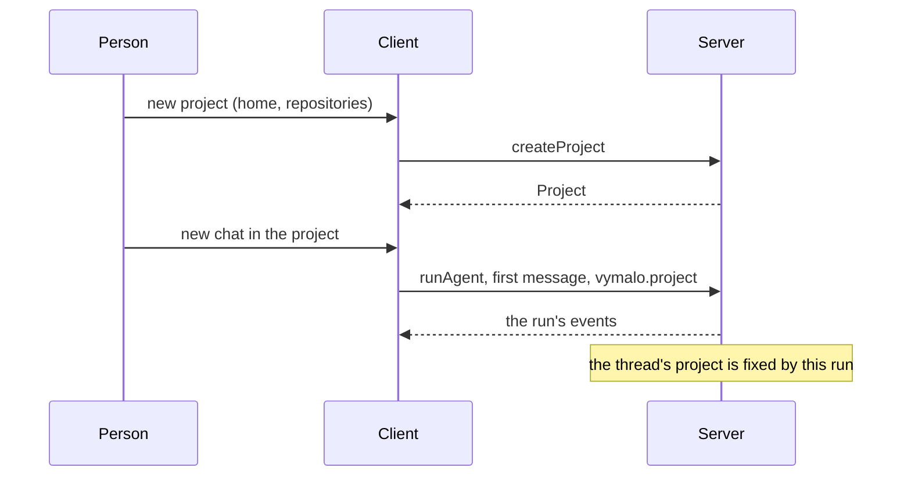

# ADR 0093 — A project groups a workspace's repositories, instructions and defaults, and a chat starts from one

- **Status:** **Proposed (2026-11-24).** The shape of a project and the contract that serves it
  ([`docs/api/projects-v1.md`](../api/projects-v1.md)). **Nothing is built.** The owner's answers of 2026-11-21 are decided and are cited by row; every
  other name, number and code here is **proposed**, for the owner to confirm. It amends no invariant (a project is durable state beside the log, as a
  prompt library is: [ADR 0070](0070-a-persons-prompt-library.md), decision 1), and it **needs an amendment of invariant 3's note when it is built**
  (slice 1).
- **Why proposed and not accepted:** the owner decided what a project is and how nine questions about it end; the record names no model for a workspace,
  an invitation or a model server, and the contract invents the smallest thing that holds them (see [Open](#open)).

## Context

The owner's words of 2026-11-19, the whole of what was decided before the answers below: a project is a **workspace times repositories**, it helps
manage several repositories **with worktrees or without**, and projects are **local or cloud**. Everything else about a project in the design
material was a proposal until 2026-11-21, when the owner answered the open questions (the rows below).

What exists today (*verified 2026-11-24* by reading this repository at `f444bca3`):

| Fact | Where |
|---|---|
| There is **no project** in the orchestrator or the API: no route, no `projectId` on a thread, no `projects` in `getConfig`. A thread has an owner, an agent and a rail position | [`chat-api.yaml`](../api/chat-api.yaml), [`vision.md`](../vision.md) |
| There is **no workspace object** either: the word names an agent's checkout (a coder's workspace holds repositories), not a group of people | [`mvp.md`](../mvp.md), [`open-questions.md`](../open-questions.md) |
| A thread's **home is fixed**: a deployment or one application; another device may hold a copy to read and never writes; moving is not offered | [ADR 0076](0076-the-orchestrator-as-a-library-in-an-application.md), decision 6 |
| A person's own durable definitions have a pattern: an own table, a revision from one sequence, compare-and-swap writes, a limit kept by the store, a contract page with vectors | [ADR 0070](0070-a-persons-prompt-library.md), [`prompts-v1.md`](../api/prompts-v1.md) |
| The access tier is picked per message, capped by the role (`maxTier`), and checked against the agent's live card | [ADR 0061](0061-the-person-picks-an-access-tier-for-each-message-the-agent-keeps-to-it.md), [`access-tier-v1.md`](../api/access-tier-v1.md) |
| A thread may carry a default model alias and a reasoning level, and a message its own pick | [ADR 0086](0086-a-person-picks-a-model-or-a-reasoning-level-for-a-thread-or-a-message.md), [`model-pick-v1.md`](../api/model-pick-v1.md) |
| A run's workspace is slots, one worktree per repository on a branch named for the run; a slot's `AGENTS.md`, else `CLAUDE.md`, is read once and grants no tool and no tier; a mirror is kept per repository under a lock | adam-rs ADRs 0008 and 0044 and its workspace crate: *unverified* here (not re-read on 2026-11-24) |

## The owner's answers of 2026-11-21

The record is private and is not linked; each row is cited here by its row number and its substance in neutral words.

| Row | Question | The owner's answer | What this ADR does with it |
|---|---|---|---|
| 14 | A local project and the cloud | A **cloud copy is created**: "create a cloud project from these repositories". The local project stays | Decision 4: no move; a new project, with no chat |
| 15 | Worktrees off in a cloud project | **Allowed in cloud too**: worktrees on or off in both | Decision 5: `worktrees` is a boolean per repository, in either home |
| 16 | Mirrors per project or per person | **One per repository**, in the repository bank | Decision 5: a project holds no mirror |
| 17 | A repository outside the project | **Yes, with the person's yes** (adam's `request_repository`) | Decision 5: never a change of the project |
| 18 | A local project with its computer offline | **The last copy, read only**: what ADR 0076 allows | Decision 3 |
| 19 | Members of a local project; who cleans up another member's worktree | A local project is **owner only**; **cloud members may clean up**, and the chat's owner is told | Decisions 6 and 8 |
| 20 | Clean-up defaults | **After 7 days, ask first, and offer automatic clean-up** | Decision 8: `staleDays` 7, `mode` `ask`, `auto` offered |
| 21 | One workspace or several per project | **One workspace each** | Decision 2: `workspaceId`, fixed |
| 23 | A chat that belongs to no project (the plan's question 8, answered later the same day) | **Yes, as now**: it stays possible | Decision 9 |
| 26 | Model servers | A person can add an **OpenAI-compatible model server per agent, per chat and per project**, for local and cloud agents; the order is chat, then project, then agent | Decision 7 |

Questions 1 to 10 of the plan are answered by rows 14 to 21 and 23 (row 19 answers two questions: members of a local project, and who may clean up).
Row 26 is the model-server decision; the plan's model-server paragraph states the order. **No answer was missing:** all nine questions and
row 26 were found.

## Decision

1. **A project is durable state beside the log**, in a table of its own, never folded by the core and never copied into a thread, a fork or an export;
   it goes with its owner's account. No event records it. Its contract is [`projects-v1.md`](../api/projects-v1.md) and it follows the pattern of
   [ADR 0070](0070-a-persons-prompt-library.md): ids made by the server (`pr-` and 12 characters), a revision from one sequence, every write a
   compare-and-swap, a limit kept by the store, one statement per write. *Proposed:* all of these names and limits.
2. **A project belongs to one workspace, fixed** (row 21), and **has a home, fixed** (the owner's words of 2026-11-19: local or cloud). The workspace is
   an opaque identifier in v1: this ADR does not define the object ([Open](#open) 1). A person who is not in the workspace gets a 404.
3. **A project's home is fixed as a thread's is** (ADR 0076, decision 6): a deployment or one application; the home's store holds the record; another
   device may hold a copy to read, never to write; moving is not offered. **With its computer offline, a local project shows the last copy, read
   only** (row 18). A deployment never answers a write for a local project. The contract is the same in both homes: the application serves it in
   process (ADR 0076, decision 1).
4. **"Move to the cloud" is not offered** (row 14). The client reads the local project's repositories and creates a **new** cloud project from their
   git URLs. It has no chat. The local project stays.
5. **A project holds repositories**, each with a name, a default branch, a source (a git URL, and for a local project a folder on the computer) and a
   `worktrees` switch, **allowed on or off in cloud and local alike** (row 15). With worktrees on, each chat gets its own worktree and branch in every
   repository; with them off, one shared checkout and one chat at a time. A chat that asks for a repository outside the project needs **the person's
   yes** each time, and that yes never changes the project (row 17). A project holds **no mirror**: one mirror per repository lives in the repository
   bank (row 16).
6. **Members.** A cloud project has an owner and members; a member reads it, starts chats and may **clean up a worktree**, and the chat's owner is told
   (row 19). Only the owner changes the project. **A local project has its owner only** (row 19). *Proposed:* one role, `member`, identified by
   e-mail as a thread's owner is; and no exception for `admin` (ADR 0039).
7. **A project carries model servers, as ids** (row 26). The order a chat is run with is **the chat's, then the project's, then the agent's**
   (row 26). A project holds no URL and no credential: sealing and egress are the credential broker's, as for a person's tool servers
   ([ADR 0046](0046-people-add-their-own-mcp-servers-secrets-in-a-credential-broker.md)); the object an id names is [Open](#open) 3.
8. **Clean-up is a policy of the project** (row 20): a worktree is stale when its pull request is merged or closed or its chat has been idle for
   `staleDays` (**7**), the person is **asked first** (`mode: "ask"`), and **"clean automatically when clean"** (`mode: "auto"`) is offered as a
   setting. A worktree with uncommitted or unpushed work is never removed silently. *Proposed:* `auto` is off by default; the bounds 1 to 365.
9. **A chat has no project, or one, fixed at its first message.** A chat with no project stays possible (row 23). The project is named by the run
   that creates the thread and never changes (*proposed*: `forwardedProps["vymalo.project"]`, as `vymalo.tools` names the servers of a new thread).
10. **What a chat starts from.** *Proposed*, in [`projects-v1.md`](../api/projects-v1.md#what-a-chat-is-run-with):
    - **instructions:** the project's text first, then each repository's own file; it grants no tool and no tier;
    - **access tier:** a project has a `ceiling` and a `default`; the message is held to the lowest of the role's cap and the project's ceiling, and
      the role's error wins when both apply;
    - **agent:** the one named, else the project's default agent, else the deployment's.
11. **Ending a project is archiving it.** Its chats stay readable, no chat starts in it, nothing changes in it. (The plan: "chats stay readable, no
    new chat, clean worktrees go"; the last part is the agent side's.)

## Consequences

- **A new table and a new port**, with a conformance testkit, in the orchestrator, and the same operations in the embedded build
  ([ADR 0076](0076-the-orchestrator-as-a-library-in-an-application.md), E3). Invariant 3's note in `CLAUDE.md` gets a dated amendment in slice 1, as
  ADR 0070's did.
- **Gaps of the chat API, found while writing the contract, and not fixed here** (the API epic's process decides; `chat-api.yaml` is not edited by this
  change):

  | # | Gap | Needed for |
  |---|---|---|
  | 1 | five routes: `listProjects`, `createProject`, `getProject`, `updateProject`, `archiveProject` | the whole contract |
  | 2 | a `projects` key in `getConfig` | a client offers projects only when the build serves them |
  | 3 | `forwardedProps["vymalo.project"]` on the run that creates a thread | decision 9 |
  | 4 | `projectId` on the thread and a `project` filter on the chat list | the rail, the composer's chip and the list's filter |
  | 5 | the problem codes of [the table](../api/projects-v1.md#errors-and-which-wins) in the `code` list of `Problem` | clients that act on a code |
  | 6 | a per-chat model server (the order's first layer); today a chat can pick a model **alias** only | decision 7 |
  | 7 | no route lists or cleans worktrees, and no agent read reports their ahead, behind and uncommitted counts (*unverified*) | decisions 6 and 8, the clean-up screen |
  | 8 | a permission, if creating a project is to be gated (as `prompts.share` gates sharing) | [Open](#open) 6 |

- **adam-rs needs** to receive a project's instructions, to keep a conversation's worktrees between jobs (the plan names a roadmap step; its issue
  was not read: *unverified*) and to keep a chat's worktree out of another chat's pod (adam-rs ADR 0041: *unverified* here). None is built.
- **A project's text is shared text** to its members: a client draws it as plain text.
- **A local project's record lives in its home**, so a deployment cannot list it unless the application sends it ([Open](#open) 2).

## Open

Every item is left open on purpose: the sources do not decide it. Each has a recommendation, which is not a decision.

| # | Question | Recommendation |
|---|---|---|
| 1 | **What is a workspace?** There is no workspace object in the orchestrator; `workspaceId` is an opaque string. Who administers it, how an address becomes a member, and how a deployment knows which workspaces a caller is in | A separate ADR before slice 2. Until then `workspaceId` is whatever the deployment's identity provider says (for example a group claim) and the contract does not look inside it |
| 2 | **Do other people see that a local project exists?** (the plan drew "owner only; others see that it exists"; row 19 settles members, not visibility) | No: a local project is its home's and a deployment lists none. Revisit with the team |
| 3 | **What a model server is.** The object, its sealing and its egress rules are not defined publicly; the plan says it needs a decision like ADR 0046, "not checked" | A separate ADR. This one fixes only the id, the order and the owner's check |
| 4 | **Which server of a project's list is used** when it holds several | The first; the person's model alias ([ADR 0086](0086-a-person-picks-a-model-or-a-reasoning-level-for-a-thread-or-a-message.md)) picks inside the server the agent offers |
| 5 | **How a project's instructions reach adam:** A2A metadata, or the agent's folder (*unverified*) | A2A message metadata as an optional extension (ADR 0008's pattern), with a size cap, never the agent's folder (a deployment's, not a person's) |
| 6 | **Is creating a project a permission?** And may `admin` read any project? | No new permission in v1 and no `admin` exception (ADR 0039) |
| 7 | **An invitation flow.** `members` is set by the owner; must the invited person accept? | Set by the owner in v1; an accept step with a notification later |
| 8 | **Can a project be deleted, and may it hold no repository?** The plan says a project ends archived and holds "a set of repositories" | No delete and zero repositories allowed in v1 (a project of instructions and defaults) |
| 9 | **Does `tier.default` replace ADR 0061's "nothing named for a person with no cap"?** Today a message with no tier is plain A2A | Yes, but only when the project sets one, and the agent's card still decides |
| 10 | **Tier ceiling and a member's cap on someone else's chat** (the lowest rule is per message, by the sender) | As written: the sender's role and the project's ceiling apply to each message |

## Slices

| # | Slice | Proof | Needs |
|---|---|---|---|
| 1 | A `ProjectStore` port, its testkit and the in-memory store; invariant 3's note | the testkit and the vectors of `projects.json` and `resolution.json` read by the core | this ADR accepted |
| 2 | The Postgres store and the five routes, with the API epic's process for the gaps above | the vectors of `requests.json` over HTTP | 1, [Open](#open) 1 |
| 3 | `vymalo.project`, `projectId` and the list filter | a thread keeps its project; another is 409 | 2 |
| 4 | The web's mock and the client pages: list, create, switch in the composer | the same vectors on the mock | 2 |
| 5 | The embedded store (SQLite) serves the same operations for a local project; the last copy read only | the testkit on SQLite | ADR 0076 E2, E3 |
| 6 | The model server order and the tier rules in the dispatcher | `resolution.json`, end to end | 2, [Open](#open) 3 |
| 7 | Instructions reach adam; worktree list and clean | adam-rs side | [Open](#open) 5, adam-rs |

## Alternatives rejected

- **Move a local project to the cloud:** the owner chose a cloud copy instead (row 14). A move would carry chats across homes, which a thread's fixed
  home forbids.
- **A mirror per project or per person:** the owner chose one per repository (row 16).
- **A project spanning workspaces:** the owner chose one workspace each (row 21).
- **A project that holds credentials for its model servers:** a project carries ids only; credentials are sealed by the broker (decision 7).
