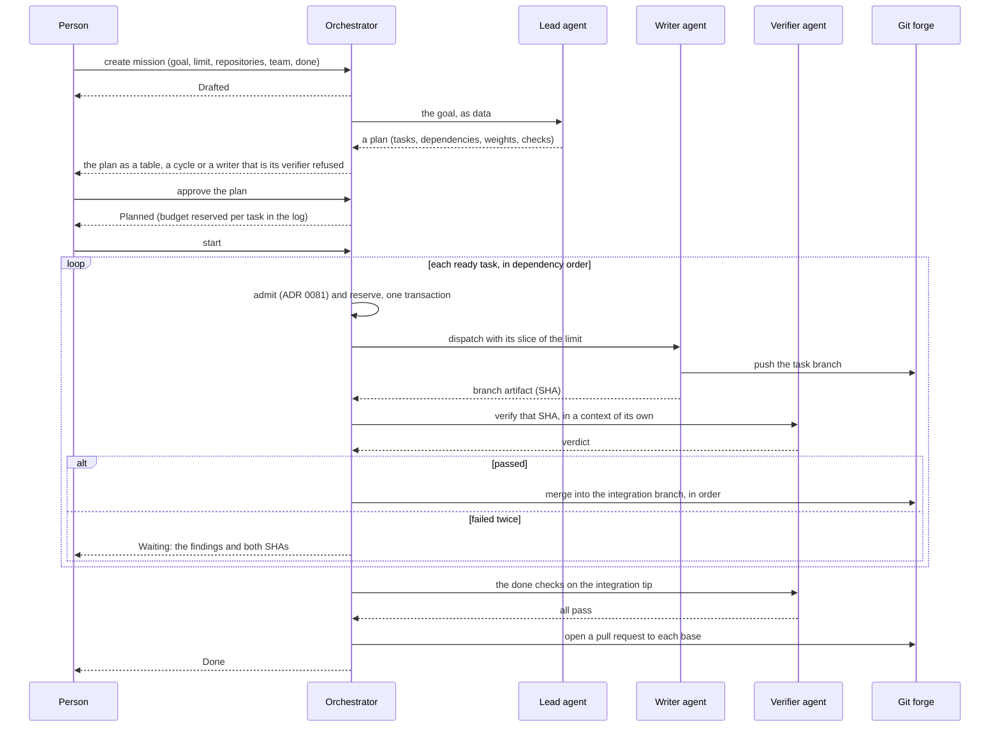

# ADR 0095 — A mission: a goal, a limit and a plan the person approves, run as tasks on branches and accepted by a verifier that did not write them

- **Status:** **Proposed (2026-11-24).** Slice 2 of the missions epic ([#342](https://github.com/vymalo/another-agentic-system/issues/342)).
  Nothing is built; slices 3 to 12 are in the table below. The epic's recommendations (the mission first, a GitHub issue before
  Notion) are the owner's; the shapes, the names and the numbers marked **(proposed)** are the design's, and the owner may change
  them by a dated note. It amends invariant 3 of `CLAUDE.md` and [ADR 0001](0001-rust-state-machine-on-postgres.md) only by the
  one sentence in decision 3 (a derived listing, never state). *The number is the next free one at the time of writing; renumber at merge
  if another record took it.*
- The contract the routes and events follow is [`docs/api/missions-v1.md`](../api/missions-v1.md).

## Context

A person can drive one agent, mention several, and have the coder reach a verified pull request on its own gate
([ADR 0018](0018-verification-gate-and-rework-loop.md)). Nothing holds **a goal larger than one conversation**: no object with a goal, a limit,
a repository, a team, a plan and a way to know it is done. [ADR 0074](0074-agent-team.md) (agent-team) is a conversation the person watches
and steers; its own text says a mission is "the long-running, scheduled form" and that a mission may name a preset as its team and that
nothing else is shared.

What already exists and what this record builds on (*verified 2026-11-24* in the ADRs cited):

| Need | What exists | Where |
|---|---|---|
| One persistence: the event log | A thread is a log; processes are stateless | ADR 0001 |
| A judge that is not the writer | The verify step, a verdict artifact, a verifier that never receives the worker's credentials and has its own A2A context | ADR 0002, ADR 0018 ("The verifier") |
| Work that survives workers | Every worker pushes a branch; a step is not complete until its branch is pushed | ADR 0003 |
| A helper as a thread of its own | Child sessions are nested threads (`childOf`), their usage counted once | [ADR 0072](0072-child-sessions-are-nested-threads-followed-through-child-sessions-v1.md) |
| A limit before dispatch | The role's allowance, taken in one transaction under a per-person advisory lock; wait, then park; never fail for a busy slot | [ADR 0081](0081-limits-per-person-before-a-run-starts.md) (issue #282) |
| Spend per person and task | The usage ledger, written in the commit of the event that carries the usage | [ADR 0065](0065-a-usage-ledger-per-person.md) |
| A team a person defined | A preset: a lead and members with roles, copied into a thread when formed | ADR 0074, decision 13 |
| Questions to the person | Forms of the UI catalog; a pending question parks a job | ADR 0020, ADR 0046 |

What is missing, and what the epic's risk table names: agents that call agents **multiply tokens** with nothing that stops them, a plan
nobody approved, and no statement of "done" a machine can check.

## Decision

1. **A mission is an object the person owns, with five parts (owner, the epic).** `goal` (text, at most 8 KiB), `limit` (decision 6), `repositories`
   (one to 5 of the person's linked repositories, each with a base branch), `team` (decision 9) and `done` (decision 5). It has a **plan** the person
   approves (decision 4) and a state (decision 2). A mission is the person's: it has an owner and nobody else lists, reads or acts on it (404 for
   anyone else, like a thread, ADR 0039). A mission runs on the owner's allowance, never on an agent's or an administrator's.

2. **Seven states, and every transition is named (owner, the epic).**

   ```mermaid
   stateDiagram-v2
     [*] --> Drafted: create
     Drafted --> Planned: the person approves a plan
     Planned --> Running: start (the limit has room)
     Running --> Waiting: a question, a task that failed twice, a limit parked, a verifier down
     Waiting --> Running: the person answers, or the limit has room again
     Running --> Paused: the person pauses
     Waiting --> Paused: the person pauses
     Paused --> Running: the person resumes
     Running --> Done: every check of the definition of done passes on the integration tip
     Drafted --> Stopped: stop
     Planned --> Stopped: stop
     Running --> Stopped: stop, or the mission's limit is spent
     Waiting --> Stopped: stop
     Paused --> Stopped: stop
     Done --> [*]
     Stopped --> [*]
   ```

   | State | Meaning | Who moves it out |
   |---|---|---|
   | `Drafted` | The object exists; there is no approved plan (a plan may be proposed and awaiting the person) | the person approves a plan |
   | `Planned` | A plan is approved and frozen; nothing has been dispatched | the person starts it |
   | `Running` | At least one task is dispatched or ready to dispatch | the core: tasks finish, the done checks pass |
   | `Waiting` | The mission needs something it cannot get by itself: a question to the person, a task that failed twice (decision 7), a limit that parked a task (ADR 0081), a verifier that is down | the person, or the clock for a parked limit |
   | `Paused` | The person said stop for now; no new task is dispatched and running tasks are cancelled at their next safe point | the person resumes |
   | `Done` | The definition of done passes on the integration tip (decision 5). **Terminal** | nobody |
   | `Stopped` | The person stopped it, or its limit was spent. **Terminal**; pushed branches stay | nobody |

   `Done` is reached **only by the core, from a passing check**, never because an agent said so, a person clicked or a model decided (ADR 0002).
   `Stopped` is reached by the person or by the limit and by nothing else. A person's message always wins over an agent's: a pause or a stop ends
   what an agent had pending. `transition(&state, &event)` stays pure (invariant 5): the states and events are closed enums in
   `orch-core`, so an impossible transition does not compile.

3. **Where it lives: the log, and a mission is a thread with threads under it (owner: the log stays the only persistence).**
   - **A mission is a thread** of its owner (the *mission thread*, where the lead agent speaks to the person). Its events are new variants of the log:
     `mission_drafted`, `mission_plan_proposed`, `mission_plan_approved`, `mission_started`, `mission_task_dispatched`, `mission_task_reported`,
     `mission_budget_reserved`, `mission_budget_released`, `mission_waiting`, `mission_resumed`, `mission_paused`, `mission_stopped`, `mission_done`.
     The mission's state is a **pure fold** of those events (invariant 5), like a job's.
   - **A task is a child thread** of the mission thread ([ADR 0072](0072-child-sessions-are-nested-threads-followed-through-child-sessions-v1.md): `childOf`,
     nested in the person's list): its log is its worker's rounds and its verifier's verdicts, so the person opens it from the board and reads the
     steps. The mission thread holds the **references** (`task_id`, `thread_id`, branch, SHA, verdict), never a copy of a child's content.
   - **No new durable state.** The list of a person's missions is a **derived index** (a function of the log, written in the commit of the event,
     erased with the thread, rebuilt by a backfill command), the model ADR 0068 and ADR 0065 already use; it holds no field the log does not.
     A mission rebuilt from the log alone is the same mission. **Invariant 3 is not amended beyond this sentence.**
   - **Forks and exports.** A fork of a mission thread is **refused** (409 `mission_not_forkable`) while the mission is not terminal: two copies would
     spend one limit. A task thread is forkable like any thread, outside the mission. Export JSON carries the mission's events and the task references.

4. **A plan the person approves (owner, the epic).** The **lead** agent (decision 9) proposes a plan as **data**: a list of tasks, each with
   `id`, `title`, `brief` (what to do, at most 4 KiB), `repository`, `depends_on` (task ids; the graph is acyclic and at most **16 tasks** a mission **(proposed)**),
   `writer` (an agent id of the team), `verifier` (an agent id of the team), `weight` (decision 6) and `checks` (what the verifier tests for this task).
   The plan is a structured artifact read by `serde` with `deny_unknown_fields`, never free text a model must parse. The person sees it as a table and, once the
   diagrams epic's slice 4 exists, as a diagram, and **approves, edits or rejects** it. Approval **freezes** it (`mission_plan_approved` carries its digest);
   a change after that is a **new plan version** the person approves again, and only tasks that have not started may change. A task the plan does not name is
   never dispatched. **The core refuses a plan** that has a cycle, a dependency on an unknown task, a writer or verifier outside the team, an agent the
   person may not use (the audience of [ADR 0045](0045-admin-dashboard-in-the-web-and-agent-access-from-the-registry.md), checked at approval **and at each
   dispatch**), a task over the cap, or a verifier that is its task's writer (decision 8).

5. **What "done" means: a machine checked it (invariant 4).** A mission's `done` is a list of **checks**, each one of three kinds, all of which already exist as
   sources of ADR 0018's gate:
   - `ci`: the named required check runs of each repository, on the **integration branch's tip**, read from the forge's check runs or the signed
     webhook ([`webhooks.md`](../api/webhooks.md));
   - `command`: an argv the **verifier agent** runs in its own run pod on the integration tip (no shell string; the network tier is the mission's, and a
     command that needs more than the mission's tier is a question to the person);
   - `verdict`: a verifier agent's `verdict {passed, findings[]}` artifact for the whole mission, not one task.

   A mission with an **empty `done` is refused at approval**: there is nothing a machine could check, so the person must say what done is (it may be
   a single `verdict` check). The mission is `Done` when **every check passes on the same integration tip** and that tip is pushed. A check that cannot run
   (a verifier down, CI silent past its timeout) is `Waiting`, not `Done`, and not `Stopped`: the same rule as ADR 0018 (the verifier being down is not the
   code's fault). The final result is **a pull request** from the integration branch to each base, opened by the core's merge step (slice 5), never merged by an agent.

6. **A limit, split per task and taken before dispatch (owner, the epic).**
   - **The mission's limit** has three numbers the person sets (and the role caps): `tokens` (total, over the mission), `wall_clock_secs` and `tasks_at_once`
     (at most the role's `runs_at_once` of [ADR 0081](0081-limits-per-person-before-a-run-starts.md), and never above it). A mission **never raises** a role's limit and
     never defines one: **it consumes the limit check of ANR-97 (issue #282, ADR 0081)**, which stays the only place an allowance is judged. Its
     run-pod and model-call limits are the role's and are not repeated here.
   - **The split is a reservation recorded in the log.** The plan gives each task a `weight` (1 to 10). On approval the core reserves, from the mission's `tokens`,
     a **lead share** (10 % **(proposed)**, for the lead's own turns and the final merge) and a **verification share** (15 % **(proposed)**, for verdicts and the done
     checks); the rest is split among tasks in proportion to their weight and the writer gets what its task is reserved. Each reservation is a
     `mission_budget_reserved` event with the task, the amount and the mission's remaining total; a finished task's **unspent part is released**
     (`mission_budget_released`) and goes to the tasks that have not started, never to the one that finished.
   - **Enforced before dispatch, never after.** A task is dispatched only when, in one transaction under ADR 0081's per-person advisory lock, (a) the person's
     role limits have room (the same `admit` call every run makes), (b) the mission's `tasks_at_once` has room and (c) the task's reservation is
     within the mission's unreserved total. The dispatch **passes the reservation to the agent as its token limit** where the agent declares the usage
     extension ([`usage-v1.md`](../api/usage-v1.md)); an agent that does not is bounded by the **wall clock and the count of model calls the orchestrator can see**
     and the screen says its spend is measured after the fact.
   - **Spend is read from the usage ledger** (ADR 0065), by task thread, so the log and the ledger agree: a child session's usage counts once
     ([ADR 0072](0072-child-sessions-are-nested-threads-followed-through-child-sessions-v1.md)). A task that reaches its reservation is **parked, not killed**
     (`Waiting`, "task over its share"): the person may raise the mission's limit or stop. The mission's total spent reaching the limit
     **stops the mission** (`Stopped`, reason `limit_spent`) after the running tasks end at their next safe point; no new task starts.
   - **No default token limit in the open source** (ADR 0081, the owner's answer): a deployment sets one per role; a mission without a role's token
     allowance still has to name a `tokens` limit, and the person is asked for one when they draft it. A mission with no limit is refused.

7. **A task that fails twice goes to the person (owner, the epic).** A task's attempt is one dispatch to its writer through its verifier's verdict. A **failed
   attempt** is a verdict `passed: false`, a writer run that ends `Failed`, or a branch not pushed. ADR 0018's inner rework loop sets its `maxAttempts` to **2** for
   a mission's task (the mission fixes it at dispatch; it never changes a deployment's default for other threads). **The second failure** moves the task to `NeedsPerson`
   and the mission to `Waiting`, with the findings and the two branches' SHAs on the card; the person can **retry** (a new reservation), **edit the task**
   (a new plan version), **skip it** (its dependants become `Blocked` and go to the person in turn), or stop. A verifier that is down does not count
   (ADR 0018: it does not spend an attempt).

8. **A verifier is never the branch's writer (ADR 0002, ADR 0018).** Four checks, all in the core, none a model's judgement:
   1. At approval and at dispatch the task's `verifier` **agent id is not its `writer` agent id**; two members that are the same agent count as the same writer.
   2. The verifier gets **its own A2A context**, a new one for each verification, and **never the writer's credentials** (as ADR 0018 already says); it
      reads the branch **at the pushed SHA** the writer reported and nothing newer.
   3. The verifier's **push credentials** are read-only on the task's branch: the run pod's git credential for a verifier is a pull credential; a push by a
      verifier is refused by the forge, and a branch whose head moved after the SHA the verifier was given is **rejected, not accepted** (the verdict names the SHA it saw;
      a verdict for another SHA than the branch's head is ignored).
   4. A verdict is accepted **only from the agent the task named as its verifier**, through the dispatcher's `Input::VerifierReported` path, never mapped to
      `Input::Agent` (ADR 0018).

   The decisive test of slice 5 is exactly this: a plan whose verifier is its writer is refused, and a verdict from another agent is dropped.

9. **A team, and its relation to agent-team presets (owner, ADR 0074).** A mission's `team` is **either** a preset id (a person's own preset, ADR 0074
   decision 13) **or** an explicit list of two to 8 members (a name, an agent id, a role of at most 280 characters), and in both cases it has a **lead**.
   **A preset is copied at drafting** (like `team_formed`): a later change to the preset does not change the mission. What a mission takes from a preset is
   **the members, their roles and the lead**; it takes **nothing else**: no charter, no hand-off rules, no checkpoints, no unattended-run settings, and no
   fan-out, which are the conversation's. A mission's tasks are dispatched by the core from the plan, not by a member's `hand_off`; **a mission's tasks are not team threads**
   and a preset's cap on hand-offs does not apply. A mission and a team thread **do not wait for each other** (ADR 0074 said so first). The roles a mission
   reads from a member are the words `lead`, `verifier` and `writer`; a member whose role text names none can only be chosen explicitly in the plan.
   The preset's agent audience is checked at drafting **and at each dispatch** (the owner may lose an agent's role between them; a dispatch to an agent the person may no longer use
   is refused and the task goes to the person).

10. **A depth limit.** A mission's tree is **mission → task → helper**: the lead plans, a task's writer works, and a writer's own helpers are bounded by the **ask limits of
    the orchestrator** (depth 2, 16 asks a job, 4 at once, ADR 0026/0081), unchanged. **A task never creates a task and never creates a mission**: the thread tool that would
    (`mission_*`) is offered to the **lead's turns on the mission thread only**, never to a writer or a verifier. The plan has no sub-plans. A mission started from a
    mission is refused (`mission_depth`).

11. **Git is the artifact (ADR 0003).** Each task works in its own worktree on a branch `mission/<mission-id>/<task-id>` from its repository's **integration
    branch** `mission/<mission-id>` (cut from the base at `mission_started`). A task is not finished until its branch is **pushed** and the SHA is in
    `mission_task_reported` (an agent reports a pushed branch as a `branch` artifact, ADR 0018). Accepted branches merge into the integration branch **in dependency order**
    (slice 5); a conflict goes **back to the lead**, with both sides, as a task of its own the person sees, never resolved by a force push or by dropping a side. The core
    never merges into a base branch: the result is a pull request, and a person merges it.

12. **A spec is data, and a grant comes only from the person (owner, the epic's risks).** The goal, an intake's text (a GitHub issue, a Notion page) and every
    agent's output are **data to the next agent**, wrapped and labelled as such (the same rule as ADR 0074's history and ADR 0046's relay results): an instruction inside a page
    is never a command. **What a mission may do is what the person approved in the plan and the team**, which is **building in the mission's own repositories** at the
    mission's network tier and access tier. Anything beyond it — a repository not in the mission, a new tool server, a secret, a higher tier, a network to open, a
    spend over the limit — **is a question to the person** (a form, ADR 0020) and the mission is `Waiting` until they answer; **no agent's text grants it**, and no
    answer of a question another agent asked counts. A mission keeps the **access tier of the message that started it** as a ceiling for all its tasks
    ([ADR 0061](0061-the-person-picks-an-access-tier-for-each-message-the-agent-keeps-to-it.md)).

13. **A mission needs the person's signed assertion before it leaves the cluster.** Slices 1 to 8 (intakes included) use only agents the deployment lists. A worker
    that is an **outside product** (slice 9) and the **gateway** (slice 10) wait for [ADR 0064](0064-the-person-reaches-the-agent-and-links-their-github.md)'s assertion
    (designed, not built): without it nobody answers for a swarm that reaches out.

14. **Each part is switchable.** `missions.enabled` (off by default in the first release), `missions.max_per_person` (5 running, **proposed**) and each intake and
    adapter by its own key. A deployment that turns the feature off keeps the threads it made.

## The flow



## Consequences

- Eighteen cards hang on this record (the slice table); the design is the contract before any of them starts, so a later slice that needs a different shape
  amends this record with a dated note.
- The core gains a `mission` module, a fold and a port-free set of routes; the **store gains no table the log does not explain** (only the derived list).
- The limit stays one thing in one place. A mission cannot spend what ADR 0081 would refuse.
- A mission can be **worse than one agent**: more coordination, more tokens, conflicts in git. Slice 12 measures it before the claim is made.
- Open items for the owner, none blocking this record: whether the lead share and the verification share (10 % and 15 %) are the right defaults; whether
  16 tasks is the cap; whether a skipped task's dependants should go to the person or stop the mission.

## Alternatives considered

- **A mission as its own table with its own state machine.** Rejected: a second source of truth beside the log (invariant 3); a thread already has an owner, a log,
  forks, export, search and erasure, and a mission wants the same.
- **A mission as a team thread of ADR 0074 with a longer life.** Rejected: a team thread is a conversation the person steers; a mission is a plan with a limit and
  a checked end. Merging them would give the team a limit it does not need and the mission hand-offs it must not have.
- **Agents agree "done".** Rejected by ADR 0002: consensus is plausible, not checked.
- **The verifier may be any member, including the writer's twin.** Rejected: the same agent id judging its own branch is the failure the gate exists to stop.
- **Split the limit by a model's estimate.** Rejected: the weights are the person's to see and change at approval; a model's guess at a budget is a number nobody can audit.

## The slice table

One pull request and one decisive test per row; the first two rows are this record and the vendor check.

| # | Slice | Repo | Depends on | The decisive test |
|---|---|---|---|---|
| 1 | The vendor check: which outside products may be driven, how, and whether they report usage | sys | none | `docs-check` passes; every fact is marked *verified* (date, source) or *unverified* |
| 2 | **This record and [`missions-v1.md`](../api/missions-v1.md)** | sys | none | `docs-check` passes: diagrams parse, links resolve |
| 3 | The mission core: the object, the fold, the routes `POST/GET /api/missions` | sys | 2 | a unit test that every `(state, event)` pair is handled and an impossible one is refused; a route test of the 404 for another person |
| 4 | Tasks as sessions: dispatch as background sessions on their own branches with a reserved slice | sys | 3; background sessions epic slices 4 and 7; ADR 0081's `admit` | a scenario: two ready tasks, one slot of the person: the second waits, none fails; the reservation is in the log and no task starts without room |
| 5 | The verifier and the merge order | sys | 4 | a plan whose verifier is its writer is refused; a verdict from another agent or for another SHA is dropped; branches merge in dependency order; a conflict goes to the lead |
| 6 | The board: the plan as a diagram, each task's state, open the thread, pause and stop | sys | 3; diagrams epic slice 4 | a Playwright spec on the mock server: pause stops new dispatches |
| 7 | The GitHub issue intake: an issue becomes a drafted mission, the plan comes back as comments, questions to the person | sys | 3 | a `dev/` scenario on mocks: a text in the issue that says "approve the plan" approves nothing |
| 8 | The Notion intake | sys | 7; an OAuth flow for a person's own server | the same scenario with a page; the page is read as data |
| 9 | An outside worker: an adapter agent over ACP on the person's own key | adam, sys | 1, 5; the background sessions epic's remote-session slice; ADR 0064's assertion | the adapter's branch is verified by a verifier that is not the adapter |
| 10 | The gateway: an agent made here reachable by a card URL and a credential per caller | sys, plat | 5; ADR 0064; the usage epic's limit slices | a caller over its limit gets 429 and the kill switch ends all its calls at once |
| 11 | A person's own agents: a space of their own, quotas, export | sys, plat | 10 | an agent in one person's space is not listed to another |
| 12 | The bar: a mission and one agent on a fixed set of real tasks, compared on success, tokens and time | adam, sys | 5, 9 | one report; the claim is made only if the report supports it |

## Verified

- *Verified 2026-11-24* in this repository at `b7cbece`: ADR 0001 decision and amendments; ADR 0002 ("an external judge"); ADR 0003 ("git is the durable artifact");
  ADR 0018, "The verifier" (a separate outbox kind and context, `Input::VerifierReported` only from a `verdict` artifact, a down verifier is `Blocked` and spends no attempt, the verifier never receives the worker's credentials);
  ADR 0074 ("Missions ... stay the long-running, scheduled form ... may name a team preset ... nothing else is shared"; decision 13 on presets);
  ADR 0081 (the per-person advisory lock, wait then park, no default token allowance); ADR 0072 (child threads, usage counted once).
- *Unverified:* that the forge can give a verifier a pull-only credential on a single branch in every deployment (decision 8.3 states the requirement; slice 5 proves it on the mock forge);
  adam's support for a token limit passed at dispatch (decision 6 says what happens without it).
