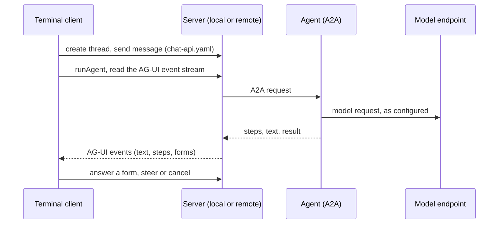
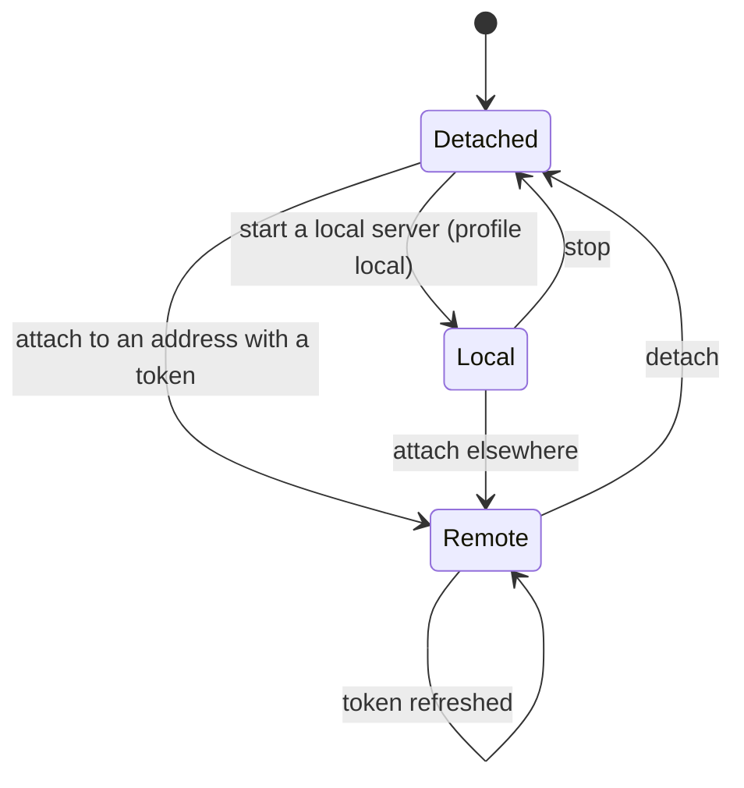

# ADR 0099 — A terminal client and a headless server are clients of the one chat API

- **Status:** **Accepted (2026-11-25): the direction, and Rust for the client (decision 5), by the owner on 2026-11-25.** Part 2 and below stay marked **(proposed)** until built. The owner's direction of 2026-11-25:
  a terminal client and a server version, as OpenCode has, so custom agents run on a person's own computer and still use a
  deployment's models. Nothing is built. Every part marked **(proposed)** is a choice that follows from the direction and
  that the owner or the lead may change by a dated note. It builds on [ADR 0076](0076-the-orchestrator-as-a-library-in-an-application.md)
  (the orchestrator as a library), [ADR 0015](0015-control-plane-and-workers-on-adam-rs.md) (local agents) and
  [ADR 0012](0012-ag-ui-user-facing-protocol.md) (AG-UI).

## Context

OpenCode is one server with the terminal client as one client of it: `serve` runs it headless, an OpenAPI SDK is generated
from it, and the client can `attach` to a remote server (*verified 2026-11-25*, opencode.ai/docs/server).

This repository already has every part of that except the clients:

| Fact | Where |
| --- | --- |
| The one API a client uses: threads, messages, files, search, prompts, tool servers, sharing, and the AG-UI run (`runAgent`, a stream of events over HTTP and SSE) | `docs/api/chat-api.yaml` |
| The web is a client of that file: its types are generated with `openapi-typescript` | `web/package.json` (`gen:api`) |
| The server is the binary `orchestrator`; its role (`all`, a control plane, a worker) and every surface are configuration, and `auth.mode` is `jwt`, `internal` or another named mode | `orchestrator/bin/orchestrator`, `dev/orchestrator.yaml` |
| The orchestrator can be linked as a library with no HTTP server, over SQLite, with agents in process | ADR 0076 (accepted, built in R2) |
| Local agents run adam in process behind the feature `agent-local` | ADR 0015 |

So a headless server needs no new core, and a terminal client needs no second orchestrator.

## Decision

1. **One API, three kinds of client.** The web, a terminal client and any program are clients of `chat-api.yaml` and of
   AG-UI. **Nothing is added to the core for a client**; an operation a terminal client needs and the file lacks is added
   to the file first, for every client.
2. **A headless server is the existing binary, run on a person's computer.** `orchestrator` with a configuration file that
   names one local role, a loopback listener, an SQLite home when ADR 0076 has landed (Postgres before), and the agents the
   person lists. It is not a new binary and not a fourth orchestrator. It serves the same API, so the web can attach to it
   as well. **(proposed)** The flag that starts it is a profile of the configuration, `--profile local`, that sets those
   defaults and nothing else.
3. **The terminal client is `attach` first.** It takes a server address and a way to authenticate, and runs threads on
   that server. **Two targets, one code path:** a local server on the loopback (no sign-in: the loopback listener and
   `auth.mode: internal`, as the dev stack does) or a remote one (a bearer token per its `auth.mode`, obtained with the
   sign-in the deployment offers; the client stores no password). A remote deployment is addressed by configuration, so
   the client names no deployment.
4. **The hybrid is configuration, not code.** Custom agents (folder agents, served by `adam-agent`) run on the computer,
   registered with the local server as A2A agents. Their model endpoint is whatever the person configures, including a
   deployment's gateway. Which of that costs anything is the gateway's and the deployment's affair, never the client's or
   this repository's (it is a public repository).
5. **What the terminal client is built in: Rust (decided by the owner, 2026-11-25).** The options weighed:
   - **Rust, over the orchestrator's own types** (`orch-agui-proto`, `orch-agui-projection`; the SDK is generated from
     `chat-api.yaml` with `progenitor` or by hand). One toolchain with the server, can be embedded with ADR 0076 so
     `attach` becomes `in-process` with no HTTP; a TUI library such as `ratatui`. **Chosen.**
   - **TypeScript, reusing the web's generated client** (`openapi-typescript`) with a TUI such as Ink. Reuses the
     generated types and some UI logic; needs a Node runtime to ship, which a person on a laptop must install.
6. **Security.** The headless server fails closed like the deployment: no `auth.mode` set is not "open"; the loopback
   listener is the only unauthenticated one and it refuses a non-loopback bind unless an authenticator is configured. The
   client sends the token only to the address it was given and follows no redirect to another host.

## Flow

## Consequences

- A person can run agents on their own computer and see them in the terminal or in the web, with one thread format.
- The cost is a small amount of client code, kept thin by the rule that nothing for a client enters the core.
- The local profile depends on ADR 0076 for SQLite; until then it needs a local Postgres, which is a poor laptop story, so
  the slice order below puts the library first.
- A terminal client in Rust and the web both consume the one file; drift between them is caught by the file's own tests.

## Slices (cards to file)

| Slice | What | Needs |
| --- | --- | --- |
| T1 | `--profile local` and its defaults, with a test that it binds loopback only and refuses a non-loopback bind with no authenticator | ADR 0076 R2 for SQLite |
| T2 | A generated or hand-written Rust client of `chat-api.yaml` plus the AG-UI stream reader, tested against the web's mock server | the owner's answer to decision 5 |
| T3 | The terminal client: threads, a message, the stream, a form answer, cancel; `attach` to a local address | T2 |
| T4 | Remote attach: sign-in with the deployment's flow, token storage in the keystore, refresh | T3 |
| T5 | End-to-end on mocks: start the local server, run a folder agent on a scripted model, drive it from the client | T1, T3 |

## Open questions

1. ~~Rust or TypeScript for the terminal client (decision 5).~~ Decided: Rust (owner, 2026-11-25).
2. Does the local profile ship as a separate download, or as a mode of the desktop application?
3. Should a remote attach use the device-code sign-in a deployment already offers to tools?
