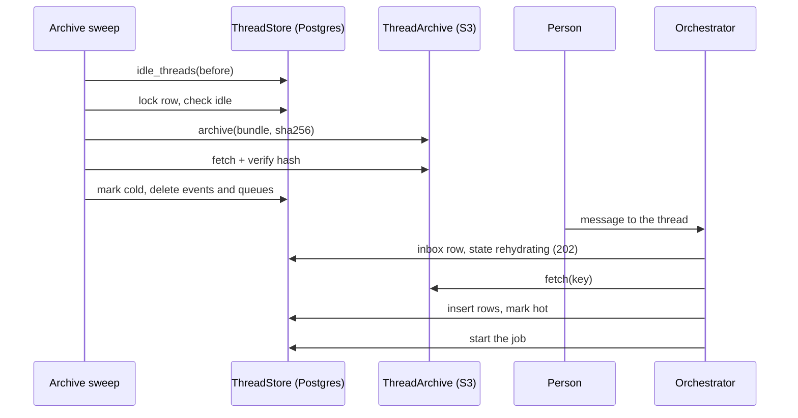
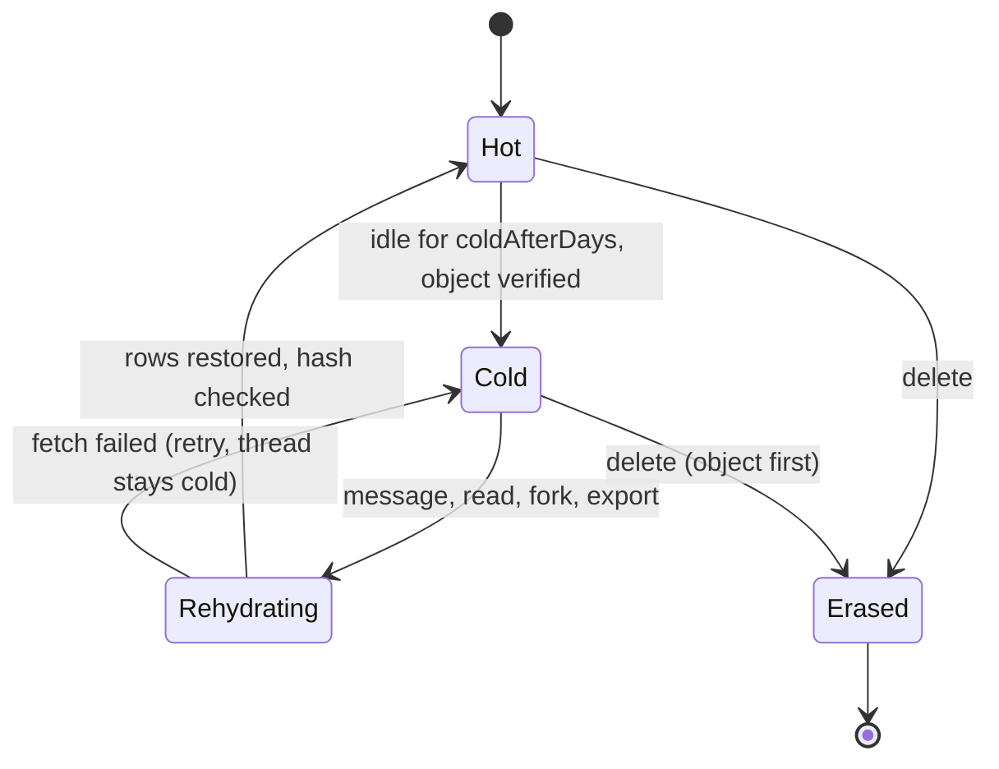

# ADR 0100 — A thread nobody reads goes cold to object storage and comes back on the next message

- **Status:** **Accepted (2026-11-26): by the owner, by merging.** Task ANR-819. Nothing is built. The owner's direction of 2026-11-25: *"We need
  to support other databases too, if an org decides e.g to use mongo-db for storing messages rather than postgres. Goal
  here is to have the possibility to save data that are accessed by users only once somewhere where it's cheap. E.g
  partitioning with postgres, archiving even to S3 at some point and reloading only when the users sends a message."*
  Every number and name below was the planner's choice; the owner accepted the ADR as it stands, and its open questions stay open. It **amends invariant 3** (one event log
  in Postgres) the way [ADR 0076](0076-the-orchestrator-as-a-library-in-an-application.md) did for SQLite, and builds on
  [ADR 0032](0032-files-from-agents-live-in-an-artifact-store.md) (the artifact store), [ADR 0043](0043-deleting-a-thread-erases-it.md)
  (erase), [ADR 0094](0094-retention-is-a-sweep-per-class-with-a-key-each-and-a-default-of-90-days.md) (the sweeps),
  [ADR 0065](0065-a-usage-ledger-per-person.md) and [ADR 0068](0068-a-person-searches-their-own-threads.md).

## Context

*Verified 2026-11-26 in this repository at `main` `1e07c8f`.*

| Fact | Where |
| --- | --- |
| The log is one table, `events`, primary key `(thread_id, seq)`, a foreign key to `threads` with `ON DELETE CASCADE`, and a unique index on `(thread_id, idempotency_key)` | `store-postgres/migrations/0001_init.sql` |
| The thread store is one port, `ThreadStore`, with a conformance kit; `idle_threads(before, after, limit)` already lists threads nobody touched, for the retention sweep | `ports/src/store.rs` |
| The artifact store is a port with S3 and filesystem adapters; `put` is idempotent by content hash, `delete_prefix` exists | `ports/src/artifacts.rs`, `artifacts-s3`, `artifacts-fs` |
| The ledger and the search index are separate tables, written in the commit of the event | ADR 0065, ADR 0068 |
| A MongoDB store exists on the agent side (adam-rs); the orchestrator has Postgres and SQLite (ADR 0076) | adam-rs `Store`; `store-postgres`, `store-sqlite` |

Most threads are read once, while they run, and never again. Their events stay in Postgres, in the hottest table, for ever
(or for the 90 days of ADR 0094, then deleted). An organisation wants them kept, but cheaply.

**A fact that shapes the design:** a table partitioned by time in Postgres needs the partition key in every primary key and
unique index. `events` has none (`at` is not in `(thread_id, seq)`), so a naive `PARTITION BY RANGE (at)` is refused. *(The
rule is Postgres's documented one for declarative partitioning; the slice checks it on the pinned major version before it
relies on this. Unverified here: no server was run.)*

## Decision

1. **Three tiers, one thread.**
   - **Hot:** the thread's rows in the store, as today.
   - **Cold:** the thread is archived **whole**, as one compressed object per thread, and its rows are removed from the store.
   - **Rehydrated:** back in the store, hot again.
   The thread row itself **stays** in the store with `tier = cold` and its list fields (owner, title, description, state,
   rail, `updated_at`, `last_seq`, the archive key and hash). The list, the rail and a person's thread count never read the
   archive.
2. **Only Postgres is partitioned for cost; the archive is the real saving.** The event log is partitioned by month of the
   **thread's creation**, held in a new column `born` that is constant per thread. The key becomes `(thread_id, seq, born)`
   and the idempotency index `(thread_id, idempotency_key, born)`; uniqueness is unchanged because `thread_id` fixes
   `born`. A month's partition holds threads born in it, so an old partition is mostly cold and **detached
   (`DETACH PARTITION … CONCURRENTLY`) and dropped** when empty. Hot threads of any age stay where they are. A deployment
   that does not partition keeps working: partitioning is a migration slice, the archive does not need it.
3. **`ThreadArchive` is a second port** (crate `ports`, a conformance kit, no driver type in a signature):
   `archive(thread) -> ArchiveKey`, `fetch(key) -> thread bundle`, `delete(key)`. Adapters: **in-memory** (the kit's
   reference) and **S3**, built on the artifact store's S3 client and bucket settings (ADR 0032), under a prefix of its own
   (`threads-cold/<owner-hash>/<thread>`), so the artifact sweep never touches it. A bundle is the thread row, its events,
   its binding and the rail, serialised as versioned JSON, compressed with zstd, with a SHA-256 kept in the thread row;
   `fetch` refuses a bundle whose hash differs.
4. **Archive, in this order, one thread at a time, idempotent:** (a) take the thread's row lock and check it is **idle**
   (state not `queued`, `working`, `verifying` or `blocked` on a running ask, no outbox or inbox row open, no child thread
   working, not shared by an open stream); (b) write the object; (c) read it back and check the hash; (d) in one
   transaction mark the row `cold` and delete the events, binding, outbox and inbox rows of the thread. A crash after (b)
   leaves an orphan object that the next pass overwrites (same key); a crash before (d) leaves the thread hot.
   **The thread is never cold with no object, and an object is never the only copy until (c).**
5. **Who archives.** A sweep in the unit of ADR 0094, key `archive.coldAfterDays`, **unset means the feature is off**
   (an operator opts in; a default of "never" is the safe one for an existing deployment). It reads `idle_threads` and
   archives at most `archive.batch` threads per pass.
6. **Rehydrate before the job starts.** Any operation that needs the log of a cold thread (a new message, a read of the
   events or the AG-UI stream, a fork, an export, an inspector replay) first calls `rehydrate(thread)` in the same
   unit that `claim` uses: fetch, check the hash, insert the rows in one transaction, mark the thread `hot`, restart its
   `updated_at` clock. **A message to a cold thread is accepted with `202` at once**, written to the inbox as for any thread,
   and the thread shows state `rehydrating` (a new value of the closed state enum, so every client must handle it; ADR 0004);
   the job starts when the rows are back. A read of a cold thread's events answers `503` with `Retry-After` and
   `code: thread_rehydrating` and starts the rehydration, rather than keeping a request open. The web shows "Loading this
   conversation" on the thread; the list and the title were never gone.
7. **What is never archived:** a thread with an active job or any open inbox/outbox row (decision 4a); the **usage ledger**
   (its own tables, its own retention, ADR 0065, which already survives the thread); the **search index** rows are
   **removed** when the thread goes cold and rebuilt on rehydrate (`orchestrator search backfill` for one thread), because
   they hold content; a cold thread is therefore **not found by content search** until it comes back, and the web says so
   (title and description are still found, they stay in the row). Stated as a cost, not hidden.
8. **Erase and retention.** Erasing a cold thread (ADR 0043) deletes its object **before** the row, through the same
   `thread_purges` queue (a lapsed lease retries); an account erase (ADR 0098) lists the archive prefix of the owner and
   deletes it. A retention delete (ADR 0094) of a cold thread is the same call. A person's export of a cold thread
   rehydrates it first (decision 6). Archiving **is not erasing**: the object holds the person's content and the
   bucket is the person's data for every legal and access purpose; the object is encrypted at rest by the bucket
   (server-side encryption, a deployment setting) and the key is under the owner's prefix hash.
9. **Other stores.** `ThreadStore` stays one port with `thread_store_conformance!`. **A MongoDB adapter** (`store-mongodb`) is
   a third adapter for an organisation that wants messages there; it is a **separate slice that follows the port, not this
   ADR's feature**: it must pass the same kit, including `commit`'s per-thread `seq` without gaps, the idempotency
   uniqueness, and `LISTEN`-like wakeups (`Wakeup` by change streams or polling). Which of the 7 ports it implements is
   open question 1. `ThreadArchive` is independent of the store, so a Mongo deployment archives to S3 the same way.
   adam-rs needs no change for this ADR: its stores hold the agent's own journal, not the thread (its retention is
   `purge_finished`, ADR 0094).
10. **Budgets, to be measured by slice A3 before it is accepted as built:** an archive object at most 64 MiB compressed
    (a thread over it is skipped and logged, not split, in v1); rehydration of a median thread under 2 s and of one at the
    cap under 15 s on the CI's S3 stand-in (RustFS); the numbers in this item are **targets, unverified**.

## Lifecycle

## Consequences

- A thread read once costs an object, not rows and indexes in the hottest table; partitions of old months can be dropped.
- **Latency is paid by the person who comes back**, once, with a visible state; a deployment tunes `coldAfterDays`.
- A new thread state (`rehydrating`) and a new error code reach the chat API and every client (OpenAPI, AG-UI, web, TUI).
- Content search misses cold threads (decision 7); a person who wants them found keeps `coldAfterDays` off or large.
- A second durable place for content: backups, residency (ADR 0097: the bucket is in the thread's home region) and erase
  must cover it. A backup of the database alone no longer restores cold threads.
- `ThreadStore` gains `mark_cold`, `restore_rows` and a `tier` read; a **required** method breaks every adapter
  (Postgres, SQLite, and any future), each with the kit's new cases.

## Alternatives rejected

- **Partitioning alone** (drop old partitions): loses data, or keeps it in Postgres; does not serve "reload on the next
  message".
- **Archive per event or per month, not per thread:** a thread's log is read whole and in order; per-thread is the unit of
  every operation (erase, fork, export, rehydrate).
- **Table `events` on an object-store foreign data wrapper or tiered storage of the database:** ties the feature to one
  database product; invariant 6 asks for a port.
- **Archive in Postgres large objects or a second schema:** cheaper in operations, not in storage, which is the goal.

## Open for the owner

1. Which ports the MongoDB adapter must implement (the thread store alone, or the ledger, search and prompts too).
2. Is "unset = off" right for `archive.coldAfterDays`, or a default (for example 30 days, shorter than the 90 of ADR 0094)?
3. May a cold thread be hidden from content search (decision 7), or must search rehydrate? (The recommendation is: hidden,
   title and description found.)

## Slices

A1 `ThreadArchive` port, kit, in-memory and S3 adapters. A2 `tier` column, `mark_cold` / `restore_rows`, kit cases, Postgres
and SQLite. A3 archive sweep and measured budgets. A4 rehydrate on message, `rehydrating` state, `503` on read, OpenAPI and
web. A5 erase and account-erase over the archive prefix. A6 `born` and monthly partitions of `events`, with detach and drop.
A7 MongoDB adapter against the kit.
