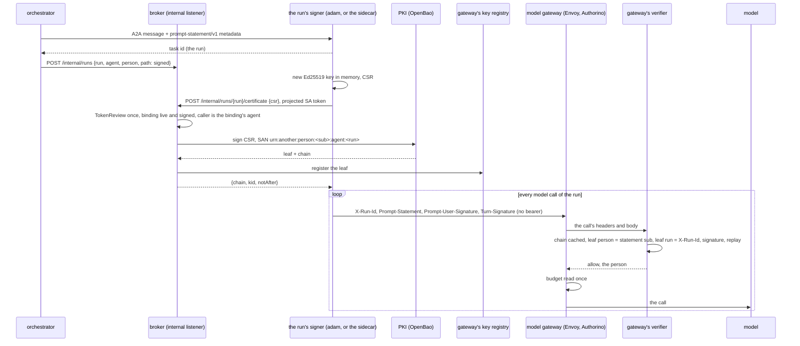
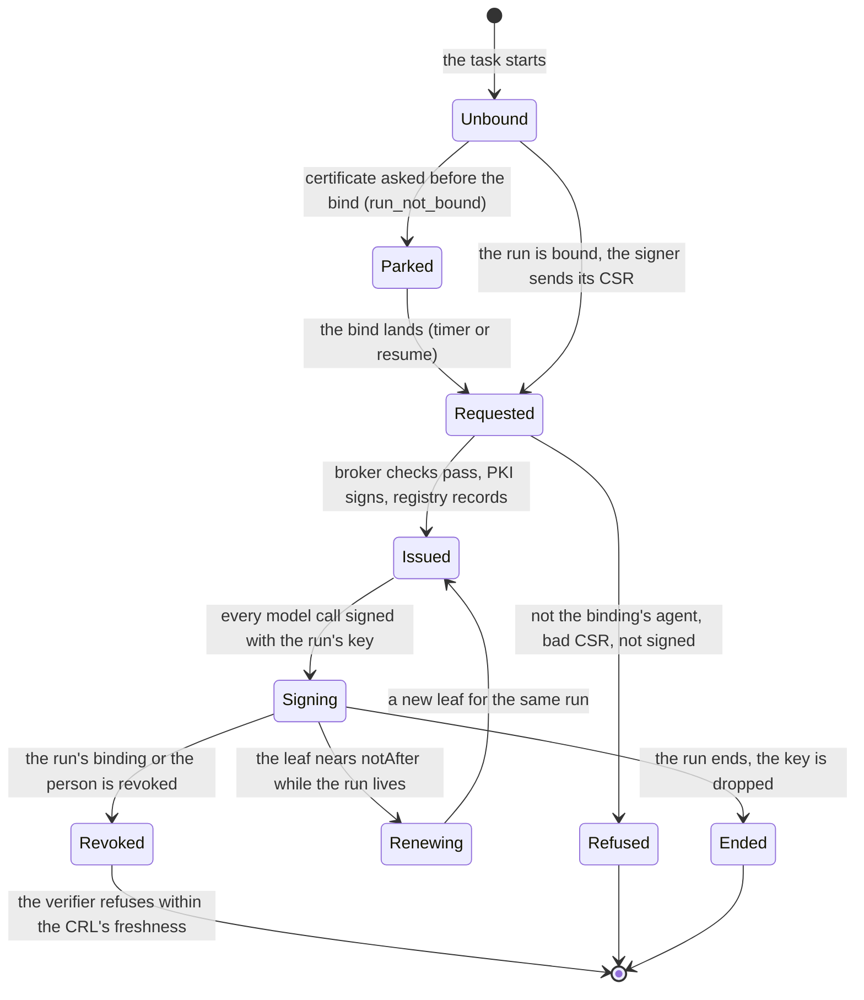

# ADR 0101 — A cloud run's model calls are signed for the run, and the injector stays only for custom cases

- **Status:** **Accepted (2026-11-26): by the owner, by merging**, on his direction of 2026-11-26 (below). **Nothing is built.** It
  **amends** [ADR 0084](0084-the-run-lease-the-broker-binds-a-run-and-lends-its-model-credential.md) (the run lease) and
  [ADR 0089](0089-the-run-identity-stays-the-agents-task-id-bound-on-first-sight.md) (the run identity), each with a
  dated note, and builds on [ADR 0087](0087-a-signing-app-signs-each-prompt-and-the-orchestrator-refuses-an-unsigned-one.md)
  (the prompt statement and the gateway's verifier) and [ADR 0009](0009-swappable-implementations-at-build-time.md)
  (ports). Names marked *(proposed)* are this record's until the slices fix them. The number 0100 is taken by the cold-thread archive, so this record is 0101.

## Context

**The owner's direction, 2026-11-26.** He first asked why the agents and the model gateway do not use signatures as the
apps and the backend do, "to remove some network hops". Then:

> *"We can have an intermediary certificate per user in the cloud for their agents, each agent getting a final
> certificate per run. Then we go with signatures only. A bring-your-own A2A doesn't use our gateway anyways. And for
> models not using adam or not signing yet, we proxy with a small signature injector, local to the cloud run and that's
> it. We own the deployment right? We can do that. We just need the -system and -platform to be modular enough. We can
> even keep the injector for completely custom use-cases, let's be creative"*

**Today a cloud run's model call crosses two authorizers** (read on 2026-11-26 at `origin/main`):

| Hop | What it does per call | Source |
|---|---|---|
| the model-credential injector: its own Gateway (Envoy), Authorino | a `TokenReview` of the pod's service-account token, the broker's lease lookup (`GET /internal/runs/{run}/lease`), a budget read, then `Authorization` and `x-account-id` stamped | [`docs/api/model-injector.md`](../api/model-injector.md), [`deploy/chart/templates/injector.yaml`](../../deploy/chart/templates/injector.yaml), ADR 0084 |
| the model gateway: Envoy, Authorino | it recognises the injector by its token (a second `TokenReview`), reads the budget again, then routes | the gateway's own authorizer |

Beside it, the signed path already exists on paper and partly in code: the orchestrator signs a **prompt statement**
(ADR 0087, amended 2026-11-25; `orch-prompt-statement`, the `PromptSigner` port), adam signs **each model request**
(`Turn-Signature`, adam-rs `crates/adam-model/src/signed.rs`, `SignedRequests`, *verified 2026-11-26* at adam-rs
`1027f77b`), and the gateway's verifier, called by the gateway's Authorino, checks both. What is missing is the reason
the injector still sits in front: **the gateway has no way to tell which person a cloud agent's turn key speaks for**,
because cloud adam's key is one workload identity for every person and every run, so the person came from the lease.

**Facts this record relies on:**

- A run's id is adam's A2A task id, bound by the orchestrator on first sight (ADR 0089, option (b)), and a model call
  sends it as `X-Run-Id`, from in-process state, never from a message (adam-rs ADR 0067).
- An agent pod serves one person's agents and many runs over its life (the platform's per-owner agents; pods are never
  shared across owners).
- OpenBao's PKI engine "supports multiple issuers in a single mount", but "it is strongly recommended that operators
  limit a mount to a single issuer"; "any revocation action will cause the CRL to be regenerated", which is "an expensive
  operation"; stored, unexpired certificates in the "50k-100k" range "become a problem"; and leaves should be no longer
  lived than the "maximum comfortable CRL lifetime" (*verified 2026-11-26*,
  <https://openbao.org/docs/secrets/pki/considerations/>).

## Decision

### 1. Signatures only, straight to the gateway

On the cloud path every model call of a run goes **from the run's pod to the model gateway directly**, carrying
`X-Run-Id`, the orchestrator's `Prompt-Statement`, the person's `Prompt-User-Signature` when there is one, and a
`Turn-Signature` made with **the run's own certificate** (decision 2). The call carries **no bearer**. The gateway's
Authorino sends it to its verifier (the signed path), the verifier answers the person, and the gateway reads that
person's budget **once**. On a cloud run of ours there is **no `TokenReview` per call, no lease lookup and no second
budget read**: the injector is not on the path.

### 2. Each run gets a certificate of its own

- **The key** is Ed25519, made by whoever signs the run's calls (decision 4), **in memory**, one key per run. It never
  leaves the pod; only a certificate signing request (CSR) and the public certificate travel.
- **The leaf** has one use, turn signing, and **one URI SAN naming the person and the run** *(proposed:
  `urn:another:person::agent:<run>`, the shape the device certificates use, with the kind `agent` and the run id
  where a device id would be)*. Its lifetime is **at most the run's binding** (ADR 0084: 24 h at most); a run that
  outlives it asks again.
- **The verifier** requires the leaf's person to be the statement's `sub` and the leaf's run to be `X-Run-Id`. So a
  run's identity is no longer a capability any accepted pod can name: **only the holder of that run's key can spend
  under that run.**
- **It is issued at the run's first model call** (or at the task's start, the signer's choice), never before the
  orchestrator has bound the run.

### 3. Who issues it: the broker, once per run

The credential broker serves a new internal route *(proposed)* `POST /internal/runs/{run}/certificate`, body
`{csr}`, answer `{chain, kid, notAfter}`, on its internal listener only (no edge route, as ADR 0084 decision 5).

| Check, in order | Refusal |
|---|---|
| the caller presents a projected service-account token for the broker's audience, and a `TokenReview` accepts it (**once per run**, not per call) | `401 unauthenticated` |
| the run is bound, live, and its binding's path is `signed` (decision 6) | `run_not_bound`, `lease_expired`, `not_signed` |
| the caller's workload is the binding's agent: the platform's registry item publishes the agent's workload identity *(proposed)*, and it must equal the reviewed service account | `run_not_bound` (the answer never says whether the run exists) |
| the CSR's own signature verifies, its key is Ed25519 | `bad_csr` |
| the issuing port answers (decision 5), and the leaf is registered with the gateway's key registry **before** the answer | `unavailable` |

The broker ignores the CSR's subject and extensions and builds the request itself, as a device certificate is built.
A `run_not_bound` is the race ADR 0089 already handles: the signer parks and asks again, and the orchestrator may resume
the run after its bind (ADR 0089, cure 1). A run may ask again (a renewal or a restarted signer); the broker bounds it
*(proposed: 8 live leaves per run)*.

### 4. Signing is a port, and a run's path is chosen per agent

How a run's calls get signed is chosen **per agent, when the run is bound**, and recorded on the binding:

| Path | When | Who holds the run's key | What the agent must do |
|---|---|---|---|
| **in-process** | the agent's card says it signs requests (adam: `prompt-statement/v1` and the turn signature) | the agent itself (adam's `TurnKeys`, a run-certificate adapter *(proposed)*) | everything, as adam does |
| **sidecar** | the platform's registry item says the agent's pod has the signing sidecar *(proposed attribute)* | a small signing proxy in the same pod, on loopback, rendered by the platform's operator | send its model calls to the proxy with `X-Run-Id` and the prompt headers (adam-rs ADR 0067 and 0077); the proxy adds `Turn-Signature` and forwards to the gateway |
| **injector** | only where the deployment turned the legacy injector on, for an agent that does neither | the injector's broker lease (ADR 0084) | send `X-Run-Id` and its service-account token, as today |

With none of the three available the orchestrator **does not delegate** the run (fail closed): a cloud run of ours is
never sent unsigned. The sidecar is local to the run's pod, so it adds no network hop. The orchestrator side is a port
(ADR 0009) *(proposed: `RunCertificates`, "sign this CSR for this bound run")* with two adapters, OpenBao's PKI for a
real deployment and a test CA for development and the conformance kit; the binding's path is a closed enum.

### 5. The PKI: the owner's starting point, and this record's recommendation

**The owner's starting point** is one intermediate CA per person for their cloud agents, and one leaf per agent per run;
revoking a person's intermediate cuts all their agents. Weighed against OpenBao (above) and the deployment's PKI, which
today has one root and two intermediates, one issuer per mount:

| | **A. An intermediate per person** (the owner's) | **B. One agents intermediate, the person in the leaf's SAN** |
|---|---|---|
| Issuers | one per person: thousands of issuers in one mount, against OpenBao's "strongly recommended" one per mount, or thousands of mounts | one, as the device certificates are issued |
| CRLs | one per person's issuer, each rebuilt on its own; the verifier must fetch them all or skip leaf revocation | one |
| Onboarding | an intermediate made and signed for each person (a parent CA online to sign them) | nothing |
| Run start | sign one CSR under the person's issuer | sign one CSR under the one issuer |
| The intermediate's key | generated inside OpenBao, never exported; OpenBao signs | the same |
| The verifier | pins the root and a parent; validates and caches a chain per person | pins the root and the intermediate; one chain |
| Cut a person's agents | one entry on the parent's CRL | the broker refuses new leaves for the person and revokes their live leaves (it knows each run's serial); within the CRL's freshness |
| What a compromised issuer can do | issue for any person (the broker signs for every person in both) | the same |

**Recommendation: B.** Both give the person and the run in the leaf, and the same revocation reach; A costs an issuer, a
CRL and a chain per person against OpenBao's own guidance and protects nothing more, since one service issues for
everyone in both. The leaf profile above is the same in both, so the choice changes the issuing role and the verifier's
trust step only, which are the gateway's and the deployment's to record. **Until the owner rules, A stands as his
starting point.** Issuance latency at run start is *unverified*: no signing against the deployed OpenBao has been timed.

### 6. The binding names its path, and the lease is only the injector's

`POST /internal/runs` gains `path` *(proposed: `signed` or `injected`, default `signed`)*. The lease lookup answers
**only a binding whose path is `injected`**; any other is refused (`signed_run`). Every cloud run of ours is bound
`signed`, so no cloud run of ours ever has a lease. The certificate route answers only `signed` bindings.

### 7. What is out of scope

- **A bring-your-own A2A image** does not call our gateway; nothing is issued to it.
- **The injector** is kept as built, off by default, for completely custom deployments (ADR 0084, as amended). Its page
  says so.
- **The orchestrator's own calls** (titles and descriptions, `thread:<id>:<property>`) keep their current path until a
  slice signs them; the recommendation is that the orchestrator issue itself a leaf for that lease id under the thread's
  owner and sign in process (question 3).

## The new path

## Consequences

- **One hop and one authorizer fewer per model call**, and two `TokenReview`s, a lease lookup and a budget read fewer.
  The cost moves to **run start**: one `TokenReview`, one binding read, one PKI signature and one registry write, once
  per run.
- **The run id is bound to a key.** ADR 0084's "the run id is a capability" no longer holds on the signed path: a pod
  that knows a run id cannot spend under it without that run's key.
- **What stays exposed, stated:** any process inside the run's pod can have calls signed for its runs, through adam or
  the sidecar, as it can with an in-process key today; the broker can issue for any bound run, as it can lease today.
- **The binding gains `path`**, and the broker a route, a port and a closed enum: a new required port method breaks
  implementers (invariant 6).
- **The platform** renders the sidecar, the projected token for the broker's audience and the agent's own service
  account, and publishes the agent's workload identity and the sidecar in its registry item (its own decision record).
- **The gateway's verifier** reads the person and the run from the run leaf and needs no lease (its own decision record;
  it replaces its rule that the injector serves a cloud run's unsigned calls).
- **adam** gains a run-certificate `TurnKeys` adapter; the signing sidecar is a small binary built on adam's own request
  signature, so the wire has one implementation (question 2).

## Alternatives

- **Keep the injector in front of every call** (today): two authorizers and four lookups per call; refused by the owner's
  direction.
- **One leaf per pod naming the person** (not per run): fewer issuances, but the run id stays a capability inside the
  person's pods and a leaked key spends for every run of the pod; refused for the per-run leaf the owner asked for.
- **An OpenBao agent or a CSI driver in the pod**: the pod would hold the right to sign any SAN the role allows (any
  person, any run), and it issues per pod, not per run; refused.
- **The operator asks for the certificate**: the operator sees no run and holds no secret, and would carry key material
  it has no business with; refused.
- **The orchestrator makes the key and sends it to the pod**: a private key on the wire; refused.

## Questions for the owner

1. **The PKI:** B (one agents intermediate, the person in the leaf) as recommended, or A (an intermediate per person) as
   first said?
2. **Where the sidecar is built:** in adam-rs, beside the request signature it reuses (recommended), or in this
   repository?
3. **The orchestrator's own calls:** signed with a leaf the orchestrator issues itself (recommended), or kept on the
   injector where one is enabled?

## Slices

| Slice | What | Where |
|---|---|---|
| S1 | `RunBinding.path`; the lease lookup answers only `injected` | this repository, broker |
| S2 | the `RunCertificates` port, its conformance kit, a test-CA adapter, the route | this repository, broker |
| S3 | the OpenBao PKI adapter (`pki-agents/sign/agent-run` *(proposed)*) and the registry write | this repository, broker |
| S4 | the orchestrator picks the path per agent and refuses a run with none | this repository, dispatcher |
| S5 | adam's run-certificate adapter; the signing sidecar | adam-rs |
| S6 | the operator renders the sidecar, the token and the registry attributes | the platform |
