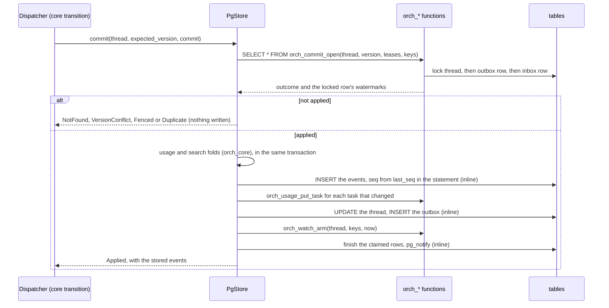
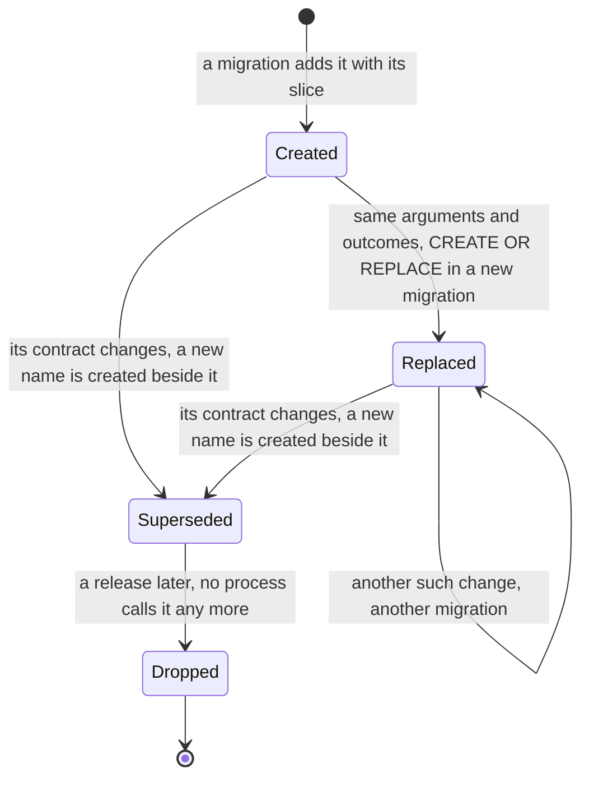

# ADR 0107 — The SQL adapters keep their rules in the database

- **Status:** **Accepted (2026-11-27)** by the owner, for the direction and the floor. Task ANR-1149.
  *Status note (2026-11-27): slice P0 is built* (the floor in `orch-pg-migrate`, `MigrateError::ServerTooOld` before any
  DDL and exit 78; the table `orch_pg_connect::sqlstate` with the class `OR`, read by both PostgreSQL adapters; the
  fresh-database tests of the three stores, whose lists are empty of `orch_` routines; CI on 18.7 and 19.0 by digest; the
  chart's refusal below 18). Two details differ from the text below, and the text is amended where they are said: the
  floor's CI is a job of its own, `store-floor`, and not a matrix of `check` (decision 4); and the store's first
  migration of a function is `0036_…`, since `0034` and `0035` were taken by other changes after this ADR was written
  (decision 6). No function existed then.
  *Status note (2026-11-27): slice P1 is built* (the log's append: `orch_commit_open` and `orch_usage_counted_through`, and the
  append as one statement). Its migration is `0037_orch_commit_open.sql`, not `0036_…`: `0036` was taken on `main` by
  `outbox_open_owner_due` (ANR-1175) before P1 landed, so the first function migration of the store is `0037`. No
  function of P1 names a column in a SQL-standard body (`orch_commit_open` is PL/pgSQL, `orch_usage_counted_through`
  reads only its arguments), so decision 6's rule that such a body freezes its columns is not met yet. The outcome word is
  `conflict` (decision 2), and `orch_commit_open` carries `SET search_path FROM CURRENT` (decision 1), which
  `tests/functions.rs` holds for every PL/pgSQL `orch_` function. For P2: a commit updates the `threads` row twice (the
  append's CTE advances `last_seq`, then the final `UPDATE`), which leaves an extra row version; computing the append's
  `base` from `cur_last_seq` and letting the final `UPDATE` write `last_seq` would avoid it. P2 is next.
  *Status note (2026-11-27): slice P2 is built* (admission: `orch_admit`, in migration `0038_orch_admit.sql`).
  `admit_commit` is now one transaction on one connection: `orch_admit` takes the person's lock, with the same key as
  before, so a replica of the previous release and one of this build exclude each other, then counts; `no_room` rolls
  back, and `admitted` runs the whole commit in that transaction. The function relies on that transaction being
  `READ COMMITTED`, so that its count sees what the lock's previous holder committed: `admit_commit` and `commit` both
  begin it with `BEGIN ISOLATION LEVEL READ COMMITTED`, whatever the database or the role defaults to, where they began
  with a plain `BEGIN`. It refuses a missing or empty owner and a missing or
  negative limit with `OR002`. The extra `threads` row version is gone: the append takes the seq it starts from (the
  commit's `cur_last_seq`, a new thread's cut) and does not move `last_seq`, which the caller's final `UPDATE` writes
  once. That replaces row 2's form of an `UPDATE` inside the append's `WITH`; the sequence is still gap-free because the
  thread's row is held. `tests/admission.rs` shows what the shared suites cannot: a pool of one connection admits and
  commits, and the session that holds the admission lock is the one whose commit waits for the thread's row. **The cost
  was not measured**, although *Consequences* says P1 and P2 measure a commit and an admission before they merge: the
  slice was written on a machine where it was not allowed to build or run the workspace, so it claims no timing of
  either, and the P1 note records none. By reading the code only, an admission sends three fewer statements (the second transaction's `BEGIN` and
  `ROLLBACK`, and the lock and the count as one call) and takes one connection instead of two. **The slice rule of
  *Slices*, that each moved rule is broken once on purpose and the pull request records the mutation and the failing
  case, was not met: no mutation was run and none of the new cases has been executed**, because the slice was written on
  a machine where the workspace may not be built; CI is the first compile and the first run.
  The owner decided on 2026-11-27 (the owner, 2026-11-27):

  > *"If something can be done in SQL, we better use SQL rather than rust."*
  >
  > *"Do it for all SQL adapters that we have in our system, included adam, -system and -platform."*
  >
  > *"Min postgres version is not 15, it's 18."*

  and, asked how far to go, settled the shape: *"Why don't we keep queries normal, and only mutation procedures uses
  the custom @sql bloc with postgres's procedures?"* (the owner, 2026-11-27). That was settled as: **queries stay normal**
  (inline, parameterized SQL), a read that carries a rule may be a **view**, and **a mutation that carries a rule calls a
  PostgreSQL function** from Rust in one statement (`SELECT … FROM fn($1, …)`); functions and not procedures, because a
  mutation returns its outcome; and a function only where one statement cannot hold the rule, not everywhere. The
  survey's row-by-row forms, the error prefix, the slices and the questions below were the planner's, and the owner
  confirmed them on 2026-11-27 (*Decided by the owner*).

This is the orchestrator's half. adam-rs decided its own SQL adapters in its
[ADR 0082, "the SQL adapters keep their rules in the database"](https://github.com/vymalo/another-adam-rs/blob/main/docs/decisions/0082-the-sql-adapters-keep-their-rules-in-the-database.md)
(accepted 2026-11-27, its slice P0 built), which this ADR follows wherever the two stores are alike; the platform
decides its own in its repository.

## Context

The orchestrator has three SQL adapters, and two shared crates under them:

| Crate | What it is | Where its rules live today |
|---|---|---|
| `orch-store-postgres` | `ThreadStore`, `Wakeup`, `UsageLedger`, `ThreadSearch`, `PromptStore`, `TeamPresetStore`, `UserToolServerStore`, `PendingAuthorizations`, `RunBindingStore` on PostgreSQL | SQL text in Rust, sent statement by statement on `tokio-postgres`; the control flow of a commit, an erase, a fork and every limit is Rust |
| `orch-secrets-pg` | `SecretStore` and `VaultStore`, sealed with AES-256-GCM | the same; sealing and opening are Rust |
| `orch-store-sqlite` | the same ports on one SQLite file, one process (ADR 0076) | SQL text in Rust, one `BEGIN IMMEDIATE` transaction per change; no trigger and no view |
| `orch-pg-migrate` | applies each crate's numbered migrations and continues sqlx's history | Rust |
| `orch-pg-connect` | the connection string, TLS, the pool | Rust |

Many rules are SQL already: a claim is `FOR UPDATE SKIP LOCKED`, a revision is a compare-and-swap in an `UPDATE`'s
`WHERE`, shapes are `CHECK`s, a pending authorization is taken once by one `DELETE … RETURNING`. What is not SQL is the
glue between statements: the commit's lock order and fences, the gap-free sequence of the log (computed in Rust from
the locked row and inserted one event at a time), the per-person limits (a lock, then reads, then a count, then the
insert), the second read that tells a stale revision from a missing row, the erase's refusals and its nine statements,
the watch-key lock that a commit and a park share, and one rule written twice, once in Rust and once as SQL text
(`usage_counted_through`). The survey under *Evidence* lists 68 rules of the PostgreSQL adapters and 9 of SQLite, each
with its `path:line` and its form.

No server below 18 runs anywhere today: CI's services and the compose stack run `postgres:19.0`, and the chart pins its
CloudNativePG image at 18.7. Nothing refuses an older server either: no adapter reads the server's version.

What makes the move possible is the SQL-standard function body: `BEGIN ATOMIC … END` or `RETURN expression`, for
`LANGUAGE sql` only, parsed when the function is created, with its dependencies on tables and columns tracked, and no
polymorphic arguments (*verified 2026-11-27*: postgresql.org, CREATE FUNCTION, 18 documentation). A function runs
inside the statement that calls it, so in the caller's transaction, and a `VOLATILE` function "obtain[s] a fresh
snapshot at the start of each query [it] execute[s]" (*verified 2026-11-27*: postgresql.org, Function Volatility
Categories, 18 documentation), which is what a read after another writer's commit needs.

## Decision

1. **Where the rules go.** For each operation, by this rule, in this order:
   - **A function** of the schema, called from Rust in one statement (`SELECT * FROM orch_…($1, …)`), when one plain
     statement cannot hold the rule: several statements that must agree in a set **lock order** (the commit's thread,
     outbox row, inbox row, watch key); a **read after a lock or another writer's commit**, which needs a fresh
     snapshot (an owner's count after the owner's lock, the second read that tells `Conflict` from `NotFound`, the watch
     looked up after its key's lock); **a rule two statements repeat** (when an outbox row is due, how far the ledger
     has counted). **SQL-standard bodies** (`BEGIN ATOMIC … END`, `RETURN`) where the logic is plain SQL; **PL/pgSQL**
     where it needs control flow, an outcome chosen between statements, or `RAISE`. Functions are `VOLATILE` unless
     they are a pure expression (`IMMUTABLE`), `SECURITY INVOKER` (the default), and named `orch_…` (`orch_secret_…` and
     `orch_vault_…` for `orch-secrets-pg`), so they never meet adam-rs's `adam_…` functions in a database the two share
     under `agent-local`. A PL/pgSQL function carries `SET search_path FROM CURRENT`, so it resolves the tables it was
     created beside, as a SQL-standard body does by construction (the store's tests pin a schema per test).
   - **A view**, read by an inline statement with the caller's filter, when a **read** carries a rule that several
     statements repeat: which of a person's threads the list shows and in which section (`orch_rail`), and which
     threads retention may erase (`orch_idle_threads`). A view takes no parameter: times and cursors stay the
     statement's.
   - **Inline**, a parameterized statement prepared once as today, for everything else: every other read, and every
     write that is one statement whose condition is its own `WHERE`. A rule that Rust computes for such a statement
     today **moves into the statement** where it can (the log's sequence numbers, a claim's order, an expiry, a grace),
     one statement with a data-modifying `WITH` where two writes touch different rows. A function there would add a
     migration to every change of a query, hide the plan behind a call in `EXPLAIN` and in the server's statistics, and
     make nothing more atomic.
2. **A lost race and a refusal the port names are an answer, not an error.** Each function returns an outcome column
   before anything is written: `applied`, `not_found`, `conflict`, `fenced`, `duplicate`, `exists`, `name_taken`,
   `too_many`, `nested_child`, `bad_anchor`, `bad_cut`, as its port says them; Rust maps each to the port's variant
   exactly as it does today. `RAISE` is kept for what the port calls corrupt data and for a caller's bug, never for a
   routine answer: every `RAISE` is an `ERROR` line in the server's log.
3. **What stays in Rust.**
   - **The `ports` traits and their testkits do not change** (invariant 6): no method, argument or variant is added or
     removed, so no implementer breaks, and the conformance suites are the proof of every slice. The in-memory adapter
     stays the reference the suites are written against.
   - **The core's `transition` stays in Rust** (invariant 5), and so do the core's pure rules that every store shares
     and the in-memory adapter applies: the usage fold (`UsageRow::fold`), the search fold (`orch_core::search::fold`
     and `FOLD_VERSION`: NFKD, marks, case, which PostgreSQL's `lower()` cannot match, since it follows the collation,
     ADR 0046 item 82), the rank keys of the list (`orch_core::rank`), the amounts a month adds up to. A store applies them
     between its calls, in the same transaction.
   - **`orch-secrets-pg`'s AES-256-GCM sealing stays in Rust, and no key, no plaintext and no associated data reaches
     SQL.** A function reserves the version under the key's lock; Rust seals with that version in the associated data;
     an inline statement writes the envelope.
   - **Times stay arguments.** The process computes `now` and passes it, as every claim already does; a function never
     reads the database's clock. Where a port method gives no time today (`retry_outbox`, `retry_inbox`, a tool
     server's `replace` and `set_state`, a secret's `put` and `rotate`, a pending authorization's `created_at`, and
     the column defaults of four migrations), the statement keeps `clock_timestamp()` for an `updated_at` or `created_at` that no rule
     reads: adding a time would change the traits (*Decided by the owner*, 1).
   - The migrator's orchestration, the configuration, the decoding of rows, the error mapping, `LISTEN` and the
     notifications (decision 9).
4. **The floor is PostgreSQL 18.** `BEGIN ATOMIC` needs 14; the owner set 18, which the community supports until
   2030-11-14 (*verified 2026-11-27*: postgresql.org, versioning policy; 19 until 2031-11-19, 14 ended 2026-11-12).
   - **The refusal is in `orch-pg-migrate`, before any DDL.** `Migrator::run` reads
     `current_setting('server_version_num')::integer` on its connection **before** it takes the advisory lock and before
     it creates the history table, and below `180000` returns a new `MigrateError::ServerTooOld { found }` that names
     the version and nothing else. *Amended (2026-11-27, P0):* it is `ServerTooOld { found, required }`, and its text
     names both versions (`17.6`, `18.0`), so a test that moves the floor reads the floor it moved. Both histories go through it (`PgStore::migrate` and `migrate_direct`,
     `PgSecretStore::migrate` and `migrate_direct`), so neither half-migrates; the binary's `exit_code` maps the error
     in a cause chain to 78 (the deployment points at a server it cannot run on). A test proves it on CI's own server
     with a floor one above the server's version, and checks that no table and no function of the run exists after.
   - **CI.** Nothing runs below 18 today. `.github/workflows/orchestrator.yml`'s `check` job (its service at line 79)
     becomes a matrix of `postgres:18.7` (the floor, and the chart's version) and `postgres:19.0`, each pinned by tag
     and digest (the digests are read at P0); the pooler job (`:295`), the image job (`:347`) and `system.yml` (`:38`)
     stay on 19.0, above the floor. *Amended (2026-11-27, P0):* `check` keeps its one service, `postgres:19.0` now
     pinned by digest, and a new job `store-floor` runs the PostgreSQL crates' suites and the binary's tests on
     `postgres:18.7` by digest, after checking that the server is an 18. A matrix would have renamed `check` (to
     `check (18.7)` and `check (19.0)`) and run its lints and its other suites twice; the owner's decision 5, the store
     suites on two servers, is what the job keeps.
   - **Compose** (`compose.yaml`: the orchestrator's `postgres` at line 235 and the three other servers at `:614`,
     `:894`, `:1113`) stays on `postgres:19.0-alpine3.24`, above the floor; nothing to raise.
   - **The chart** pins `ghcr.io/cloudnative-pg/postgresql:18.7-…-standard-trixie` by tag and digest
     (`deploy/chart/values.yaml:829`); `templates/_validate.tpl` gains a refusal of a `database.imageName` whose tag's
     major is below 18, and `tests/render-check.sh` a check that breaks it on purpose.
5. **Errors: the SQLSTATE class `OR`.** PostgreSQL 18 uses no class `OR` (*verified 2026-11-27*: postgresql.org,
   Appendix A, 18 documentation: its classes are `00` to `58`, `F0`, `HV`, `P0`, `XX`), adam-rs uses `AD`, and a custom
   code is five digits or upper-case letters, not `00000`, and should not end in `000` (*verified 2026-11-27*:
   postgresql.org, Errors and Messages, 18 documentation). The table is one closed enum in `orch-pg-connect`, which
   both PostgreSQL adapters depend on, beside the classes of PostgreSQL's own codes, which each adapter maps twice
   today (`store-postgres/src/error.rs:76`, `secrets-pg/src/store.rs`); each adapter builds its port's variant from it.

   | SQLSTATE | Raised when | The port's variant | Class |
   |---|---|---|---|
   | `OR001` | stored data breaks an invariant the function checks: a thread's `last_seq` is not its greatest event's, a stored revision or version is not a positive number | `Corrupt` | `Corrupt` |
   | `OR002` | a function refuses its arguments: arrays of different lengths, a negative limit, an empty owner; a caller's bug, raised before any write | `Internal` | `Internal` |

   An `OR` code this release does not know is `Internal`. PostgreSQL's own codes keep their meaning: a unique violation
   is read by the constraint's name as today (`events_idempotency`, `threads_share_nonce`, a name per owner), the
   transient codes stay transient, `55P03` stays a lock timeout. SQLite's triggers raise `RAISE(ABORT, 'orch:<code>')`,
   mapped by one table in `orch-store-sqlite` to the same variants (`orch:seq` is `Corrupt`; `orch:too_many` is the
   port's `TooMany` with its limit).
6. **The migration scheme.** Functions and views come in numbered migration files like every table
   (`orch-store-postgres` from `0034_…`, `orch-secrets-pg` from `0004_…`; *amended (2026-11-27, P0):* the store's from
   `0036_…`, `0034` and `0035` having been taken since), each in its migration's transaction, after
   the tables it names. A migration's text is never edited (its SHA-384 is in the history, `orch-pg-migrate`), so:
   - **every change of a function is a new migration file**, and each slice that adds, changes or drops one has its own
     (the rule adam-rs's ADR 0082 amended its decision 10 to, the same day: each slice bumps the version again);
   - a change that keeps a function's arguments and outcomes is `CREATE OR REPLACE`; a change of its contract is **a
     new name**, the old one dropped a release later (expand, then contract), so a process of the previous release,
     which still calls the old name or still sends its inline statements, keeps the same meaning during a rollout;
   - a column a SQL-standard body names cannot be altered or dropped while the function exists: such a migration drops
     and recreates the function in the same file;
   - a start on a current schema runs no DDL, as today. `orch-pg-migrate` sends a file whole with `batch_execute`, one
     simple-protocol message (`pg-migrate/src/lib.rs:163`, `:172`), so the server parses a `BEGIN ATOMIC` block itself;
     a tool that splits a file on `;` must never apply these files.
   - **A fresh-database test** in each PostgreSQL crate (`tests/functions.rs`) migrates an empty database, lists
     `pg_proc` and `pg_views` of the schema whose names start with the crate's prefix as `name(identity arguments)`,
     fails when that set differs from the list the test holds, and calls every listed function once. *Amended
     (2026-11-27, P0):* the test lists **every** function and view of the schema, prefixed or not, which is stricter: a
     routine without the prefix fails it too, and the one there is today, `outbox_set_owner()` (migration 0024's
     trigger), is listed by name with no call. The SQLite store
     has the same test over `sqlite_master` (its triggers and views).
7. **SQLite: constraints, views and triggers; no functions.** It has none. Its rules go where SQLite can hold them:
   the sequence of the log (a trigger that raises `orch:seq` when an event's `seq` is not the thread's `last_seq` plus
   one, and advances `last_seq`), the per-person limits (a `BEFORE INSERT` trigger that raises `orch:too_many` only
   when the id and the name are free, so the refusals keep the order the ports promise: exists, name taken, too many;
   its number is a literal a test holds equal to the port's constant), the erase's consequences (a `BEFORE DELETE`
   trigger: the children take the parent's place in the list, the thread's timers go, the ledger forgets the thread),
   the two views, and a pending authorization's expiry in its `DELETE … RETURNING`. The rest stays in Rust: the one
   writer (`BEGIN IMMEDIATE` on one connection) already serialises an admission, a park and a count, a trigger cannot
   read the caller's time (the purge row's `deleted_at` stays the statement's), and `RETURNING` gives no order.
8. **MongoDB and the platform are out of scope.** The orchestrator has no MongoDB adapter; the platform decides its own.
   adam-rs's store that runs inside the orchestrator under `agent-local` follows adam-rs's ADR 0082.
9. **Notifications stay explicit statements.** A commit sends its `pg_notify` calls as today; a trigger could send them
   at commit, but a notification is never the truth (invariant 3's log is), so it is a question, not a slice
   (*Decided by the owner*, 3).

### A commit through the functions

### A function across releases

A commit is one transaction, as today. The first call takes the locks in the order the store has always taken them
and answers before anything is written; the core's folds run in Rust between the calls; every later write is either an
inline statement or a function, in the same transaction, so a crash leaves none of it. A function is never edited in
place: a new migration replaces it, or a new name supersedes it while the processes of the previous release finish.

### Slices

One pull request per area, in this order. Each keeps the store testkits green on PostgreSQL (18.7 and 19.0) and on
SQLite, breaks every rule it moves once on purpose to see the named case fail (the mutation and the failing case go in
the pull request), adds its functions to the fresh-database list, and ships its own migration file. No slice turns an
inline statement into a function unless decision 1 says it carries a rule.

| Slice | Area | Functions and views | Decisive test |
|---|---|---|---|
| P0 | the floor, the `OR` table, CI on 18.7 and 19.0, the chart's refusal below 18, the empty fresh-database tests | none | a server below the floor is refused before any DDL; `every_function_is_created_and_answers` with an empty list fails when a stray `orch_` function is added |
| P1 | the event log's append | `orch_commit_open`, `orch_usage_counted_through`; the append statement computes `seq` | `commit_contiguous_seq`, `concurrent_writers_keep_seq_contiguous`, `version_conflict_writes_nothing`, `duplicate_key_writes_nothing`, `stale_attempt_is_fenced`, `commit_after_another_owner_reclaims_is_fenced`, `inbox_commit_is_fenced_and_marks_applied` |
| P2 | admission (ADR 0081) | `orch_admit`, in the commit's own transaction | `two_messages_at_once_one_passes`, `a_person_under_the_limit_sees_no_change` |
| P3 | claims, the inbox, the outbox and leases | `orch_outbox_due_at`, `orch_watch_arm`, `orch_inbox_park`; the claim order in the statements | `claim_once_and_concurrent_claimers`, the `a_fair_claim_*` cases, `inbox_parks_and_rearms_in_one_commit`, `inbox_park_finds_a_watch_that_appeared`, `watches_are_first_come`, `lease_expiry_reclaim` |
| P4 | the usage ledger (ADR 0065) | `orch_usage_put_task` | `usage_ledger_conformance!`, `a_catch_up_of_many_events_gives_what_folding_them_one_by_one_gives` |
| P5 | the search index's writes (ADR 0068) | none: the message write becomes one statement | `thread_search_conformance!`, `replaced_final_message_hits_once` |
| P6 | opening a thread: create, fork, child (ADR 0029, 0072) | `orch_thread_open` | `fork_copies_the_parents_log_up_to_the_cut`, `a_refused_fork_writes_nothing`, `a_session_has_one_child_and_a_second_open_writes_nothing`, `a_child_is_refused_a_foreign_parent_a_child_parent_and_no_parent` |
| P7 | erasing threads (ADR 0043), retention (ADR 0094), and account erasure when its adapter is built (ADR 0098) | `orch_threads_erase`, the view `orch_idle_threads`; later `orch_account_erase` | `delete_that_misses_an_edit_is_a_conflict_and_deletes_nothing`, `nested_children_take_the_place_of_a_deleted_parent`, `delete_removes_the_timers_of_the_thread_whatever_their_status`, `a_delete_and_an_open_that_race_leave_no_orphan`, `usage_after_an_erase_is_counted_on_top_of_what_was_kept`, `deleted_thread_leaves_no_hit` |
| P8 | the rail (ADR 0042) | the view `orch_rail` | `a_new_thread_is_on_top_of_the_rail`, `rail_pages_never_split_a_block`, `an_arrangement_that_changes_nothing_writes_nothing`, the nested-children cases |
| P9 | the prompt library (ADR 0070) | `orch_prompt_insert`, `orch_prompt_replace`, `orch_prompt_delete` | `concurrent_inserts_never_pass_the_limit`, `concurrent_inserts_of_one_id_have_one_winner`, `a_stale_replace_is_a_conflict_and_changes_nothing`, `a_stale_delete_is_a_conflict`, `a_write_after_a_delete_is_not_found_and_brings_nothing_back` |
| P10 | a person's tool servers and their pending authorizations (ADR 0046) | `orch_tool_server_insert`, `orch_tool_server_replace`, `orch_tool_server_set_state`, `orch_pending_put`; the take's expiry in its statement | the same five of `user_tool_server_store_conformance!`, `a_replace_racing_a_delete_never_brings_the_server_back`, `a_put_forgets_the_states_that_have_ended`, `a_state_that_has_ended_takes_nothing`, `concurrent_takes_of_one_state_have_one_winner` |
| P11 | team presets (ADR 0074) | `orch_team_preset_insert`, `orch_team_preset_replace`, `orch_team_preset_delete` | the same five of `team_preset_store_conformance!` |
| P12 | the secret store and the vault (ADR 0046, 0083) | `orch_secret_reserve`, `orch_vault_reserve`; the vault's write one statement, its grace in the read | `concurrent_rotates_from_one_version_have_one_winner`, `rotate_with_a_stale_version_is_a_conflict_and_changes_nothing`, `concurrent_puts_take_two_versions_and_lose_nothing`, `a_superseded_version_reads_for_the_grace_and_is_refused_after` |
| S1 | SQLite: the log's sequence trigger, the two views | `orch_rail`, `orch_idle_threads` (views) | `thread_store_conformance!` on SQLite, and a file of the previous version upgrades |
| S2 | SQLite: the limit triggers, the erase trigger, the take's expiry | none (triggers) | the limit, delete and pending cases on SQLite |

## Consequences

- **The schema holds the rules.** A reader of the database sees each lock order, limit, fence and erase beside the
  data it guards; what stays in Rust as text is plain: reads, and one-statement writes whose condition is their
  `WHERE`, each visible as itself in `EXPLAIN` and in the server's statistics.
- **Fewer round trips.** A commit stops sending one `INSERT` per event, a lost compare-and-swap stops costing a second
  statement, an admission stops holding a second connection for the length of a commit, and a limit check is one call.
  The cost of a call against today's statements is *unverified*: P1 and P2 measure a commit and an admission before
  they merge.
- **PostgreSQL 12 to 17 are refused.** No deployment of this repository runs one (the chart pins 18.7); one elsewhere
  must upgrade its server first, and the process says so and exits 78.
- **Migrations get heavier.** Every change of a function is a migration file of its own, and a column a function uses
  cannot change without dropping and recreating it.
- **Two dialects of some rules.** A rule SQLite keeps in Rust (an admission under the one writer, a park) exists in
  PL/pgSQL and in Rust; the shared suites keep them equal, as they keep the in-memory adapter equal today.
- **Mixed fleets during a rollout are safe**: a process of the previous release keeps sending its statements against
  the same tables, and the functions keep their meaning; a change of meaning takes a new name.
- `docs/orchestrator.md` ("Data model") and each crate's README say, in the slice that changes them, which functions
  and views the crate's migrations create.

## Alternatives rejected

- **Keep the rules in Rust.** It works; it is what the owner decided against.
- **Procedures (`CALL`).** A procedure returns at most one row and cannot be used in a `SELECT`, so an outcome with the
  events of a commit or the rows of a claim could not be one. Functions return sets.
- **A function for every operation, reads included.** The owner settled against it: queries stay normal. A single
  statement is already atomic, and each change of a query would cost a migration.
- **One function for the whole commit.** The usage and search folds are the core's rules (decision 3), applied between
  the open and the writes, and their catch-up pages the log; a single function would need them in PL/pgSQL, a second
  copy beside the core's.
- **String bodies (`AS $$ … $$`) for plain-SQL functions too.** They are parsed only when called, so a renamed column
  breaks them silently; a SQL-standard body is checked when it is created.
- **Raise on every refusal.** It logs an `ERROR` for a routine answer (a person at their limit, a stale revision) and
  makes it look like a failure.
- **The database's clock.** It would remove the time arguments, but a worker and the server would disagree on when a
  row is due, and the conformance suites drive time through the arguments.
- **PostgreSQL 15 as the floor.** The owner set 18.

## Decided by the owner (2026-11-27)

The owner answered the six open questions on 2026-11-27: *"go with your recommendations"*. The sixth had no
recommendation, so it is the one this ADR proposed and the owner's answer covers.

1. **Times where a port gives none: the database's clock stays.** `retry_outbox`, `retry_inbox`, a tool server's
   `replace` and `set_state`, a secret's `put` and `rotate` and a pending authorization's `created_at` keep writing the
   database's clock into an `updated_at` or `created_at` that no rule reads. The traits do not change.
2. **The rail's rank keys stay in Rust.** `orch_core::rank` keeps the key arithmetic, and an arrangement stays a Rust
   transaction over the view `orch_rail`. There is no second copy of the rule in PL/pgSQL.
3. **Notifications stay explicit.** The `pg_notify` calls stay where they are; no trigger sends one at commit.
4. **The folds stay in Rust.** The usage fold and the search fold are the core's, shared by every store and the
   in-memory reference: "if it can be done in SQL" does not reach a rule the core owns.
5. **CI runs the store suites on two servers:** 18.7 (the floor) and 19.0 (the newest), both pinned by digest (P0).
6. **The platform's error class is `AP`.** `OR` is this repository's, `AD` adam-rs's and `AP`
   another-agentic-platform's, so a code says which repository raised it. PostgreSQL 18 defines no `AP` class (its
   error-code appendix). The platform's own decision records it when it gains a SQL adapter.

## Evidence

Surveyed at `main` `63e0f924` on 2026-11-27. Paths are under `orchestrator/crates/`; line numbers are at that commit,
and a slice re-reads them. The forms: **function** (the rule moves into a function of the schema; after the slice the
row's `path:line` binds, calls and decodes), **view**, **into the statement** (the statement stays inline and the rule
Rust computes for it today moves into it), **inline** (stays an inline statement, as it is), **already SQL**, **stays**
(Rust, decision 3), and for SQLite **trigger**.

### `orch-store-postgres`: the event log and the commit

| # | Rule | Where | Form, and why |
|---|---|---|---|
| 1 | The commit locks the thread `FOR UPDATE`, then the claimed outbox row `FOR SHARE` (else `Fenced`), then the claimed inbox row `FOR UPDATE` (else `Fenced`), checks the version (else `VersionConflict`) and the idempotency keys (else `Duplicate`) | `store-postgres/src/store.rs:1906`–`:2017` | **function** `orch_commit_open`, PL/pgSQL: a lock order across three tables, outcomes before any write; returns the locked row's `last_seq`, state, owner and watermarks |
| 2 | The log's sequence: `first_seq` computed in Rust from the locked `last_seq`, one `INSERT` per event, `last_seq` written by the final `UPDATE` | `store.rs:1488`–`:1528`, `:2051`, `:2063` | **into the statement**: one `WITH t AS (UPDATE threads SET last_seq = last_seq + n … RETURNING …) INSERT INTO events … SELECT … FROM unnest(…) WITH ORDINALITY … RETURNING seq`; the gap-free rule is SQL, under row 1's lock; the in-commit duplicate key stays mapped by `events_idempotency` |
| 3 | A commit that only finishes an inbox row writes nothing to the thread | `store.rs:1975` | **stays**: decided from the `Commit`'s own content; its statements are inline |
| 4 | The thread's write: state, job, title, description, sharing, `version + 1`, watermarks, terms | `store.rs:2071` | **inline**: one statement; the share nonce's uniqueness is its index |
| 5 | The abandoned job's unsent delegations are skipped | `store.rs:1320` | **inline**: one statement |
| 6 | Outbox rows are inserted one statement each | `store.rs:1530` | **into the statement**: one `INSERT … SELECT FROM unnest(…)` |
| 7 | The binding adopts the agent's first context only | `store.rs:1555` | **already SQL**: `COALESCE(context_id, $6)` |
| 8 | Watches: each key locked in sorted order, first come, a key another thread watches logged, parked rows re-armed `SKIP LOCKED`; timers inserted | `store.rs:1385`–`:1486` | **function** `orch_watch_arm`, PL/pgSQL: a lock order and the key lock `park_inbox` shares (row 42); it returns whether a row was re-armed and the keys another thread holds, which Rust logs. Timers stay **inline** |
| 9 | The claimed inbox and outbox rows are finished in the commit | `store.rs:1581`, `:1278` | **inline** |
| 10 | `pg_notify` of the thread, the outbox and the inbox | `store.rs:1307`, `:1341`, `:1350` | **stays**: explicit statements (decision 9) |
| 11 | Admission: a per-person advisory lock and a count of open delegations in a second transaction on a second connection, held while the commit runs on its own | `store.rs:1853`–`:1897` | **function** `orch_admit(owner, limit)`, PL/pgSQL: the count must follow the lock; called first in the commit's own transaction, so the lock lasts until the commit ends and the second connection goes |

### The usage ledger (ADR 0065) and the search index (ADR 0068)

| # | Rule | Where | Form, and why |
|---|---|---|---|
| 12 | The fold: calls add, a total replaces the calls | `core/src/usage_record.rs:292`, used at `store-postgres/src/usage.rs:89`, `:122` | **stays**: the core's, shared by every store and the in-memory reference (decision 3) |
| 13 | How far the ledger has counted, written twice: `usage_counted_through` in Rust and `GREATEST(usage_through, COALESCE(forked_at, 0))` as SQL text the backfill pages with | `core/src/usage_record.rs:282`, `usage.rs:691`–`:696`, `store.rs:2022` | **function** `orch_usage_counted_through`, a `RETURN` body (`IMMUTABLE`): a rule two statements repeat, one definition in the schema; the core's function stays for the in-memory and SQLite stores |
| 14 | The catch-up pages the log and decodes each usage event | `usage.rs:144` | **stays**: decodes events into the core's types |
| 15 | A task's row: the task inserted or updated, the changed lines upserted, the vanished lines deleted, the sandbox entries replaced | `usage.rs:356`–`:479` | **function** `orch_usage_put_task`, PL/pgSQL: four statements that must agree, one call per task |
| 16 | An erased thread's rows keep their counts and lose their thread | `usage.rs:202` | **function**: part of row 30 |
| 17 | A person's month, read back, and the amounts it adds up to | `usage.rs:489`; the amounts in the core | **inline**; the amounts **stay** |
| 18 | The sweep of old months | `usage.rs:759` | **inline**: one statement, `SKIP LOCKED` |
| 19 | The backfill, thread by thread under the thread's lock | `usage.rs:672`–`:757` | **stays**: a loop over threads, calling rows 13 and 15 |
| 20 | The search fold: NFKD, no marks, lower case, letters and numbers; `FOLD_VERSION` | `core/src/search.rs:53`, `:78`; `store-postgres/src/search.rs:149` | **stays**: the core's; PostgreSQL's `lower()` follows the collation (ADR 0046 item 82) |
| 21 | A message's index: a later final message deletes the earlier rows of its `messageId`, then the new row is upserted | `search.rs:92`–`:131` | **into the statement**: one statement, a data-modifying `WITH` deleting rows with `seq` below the new one and the `INSERT … ON CONFLICT` writing it; the rows never overlap |
| 22 | The watermark, the restart under another fold version, the bounded catch-up before a commit | `store.rs:2030`–`:2063`, `search.rs:168` | **stays**: the bound and the fold version are the core's |
| 23 | A search, under its statement timeout | `search.rs:309` | **inline** |

### Opening, arranging and erasing threads (ADR 0029, 0072, 0042, 0043, 0094, 0098)

| # | Rule | Where | Form, and why |
|---|---|---|---|
| 24 | A child: the parent kept (`FOR KEY SHARE`), a child's child refused (`nested_child`), one child per parent and session, a lost race answering with the winner | `store.rs:247`–`:282`, `:365`–`:383` | **function** `orch_thread_open`, PL/pgSQL: several statements that must agree, outcomes |
| 25 | A fork: the parent kept, the cut within the parent's log, the log copied up to the cut | `store.rs:283`–`:300`, `:405`–`:425` | **function**: part of `orch_thread_open` |
| 26 | The thread's row and its binding | `store.rs:330`, `:390` | **function**: part of `orch_thread_open`; the first commit's events go through row 2 |
| 27 | What the list shows (top-level, unarchived, not an edit) and its section (pinned), repeated in five statements | `store.rs:610`, `:733`, `:801`, `:875`, `:896` | **view** `orch_rail` |
| 28 | Rank keys between two neighbours, and one re-spread when none fits | `core/src/rank.rs:79`, `:148`; `store.rs:776`, `:801` | **stays**: the core's (*Decided by the owner*, 2) |
| 29 | An arrangement: the row locked, a nested row's pin or place refused, the anchor checked, the write | `store.rs:896`–`:984` | **stays**: it needs row 28 between its reads; its statements stay **inline**, over the view |
| 30 | Erasing threads: locked in id order, every one the owner's (else `NotFound`), each at its version (else `VersionConflict`), an unnamed edit or child a conflict, the children take the parent's place, the timers found by their payload deleted, the purge promise written, the ledger told, the rows deleted with their cascades | `store.rs:985`–`:1088` | **function** `orch_threads_erase`, PL/pgSQL: nine statements that must agree, a lock order, outcomes |
| 31 | Purges claimed under a lease, their order restored in Rust; finished; counted | `store.rs:1763`–`:1797`, `:1836`, `:1845` | **into the statement**: the order of the claim (`WITH claimed AS (UPDATE … RETURNING) SELECT … ORDER BY`); the rest **inline** |
| 32 | The threads retention may erase: top-level, not working, idle since a time | `store.rs:1801` | **view** `orch_idle_threads`; the cutoff and the cursor stay the statement's |
| 33 | Erasing an account (ADR 0098) | `ports/src/account_erase.rs:92`; the in-memory adapter only | **function** when its adapter is built (`orch_account_erase`, reusing row 30); no SQL adapter exists today |

### Claims, the inbox, the outbox and leases (ADR 0001, 0036, 0066)

| # | Rule | Where | Form, and why |
|---|---|---|---|
| 34 | When an outbox row is due (`pending` past its attempt, or `inflight` under an ended lease), repeated in both claims and the statistics | `store.rs:1166`, `:2509` | **function** `orch_outbox_due_at(status, next_attempt_at, lease_until)`, a `RETURN` body (`IMMUTABLE`): a rule several statements repeat |
| 35 | The per-thread rule: a delegate waits for an older one, a steer for an older steer | `store.rs:1181` | **inline**: one Rust constant in both claims; an `EXISTS` over the table, whose plan a function could hide (P3 may move it if `EXPLAIN` shows the function inlined) |
| 36 | The FIFO and the fair claim, `FOR UPDATE SKIP LOCKED`; their order restored in Rust | `store.rs:1199`, `:1228`, `:2299`–`:2327` | **into the statement**: the order moves in; each claim stays one statement |
| 37 | Renew, mark a verification sent, retry, complete, release | `store.rs:2329`, `:2373`, `:2394`, `:2416`, `:2492` | **inline**: one statement each, its rule its `WHERE` |
| 38 | Mark sent: the row, then the binding, two statements | `store.rs:2344` | **into the statement**: one statement, a data-modifying `WITH` |
| 39 | A steer requeued as a delegation, its payload rewritten | `store.rs:2441` | **stays**: the payload's conversion is its Rust type |
| 40 | Receive: an idempotent insert | `store.rs:2570` | **already SQL**: `ON CONFLICT DO NOTHING` |
| 41 | The inbox claim; its order restored in Rust | `store.rs:2597`–`:2630` | **into the statement** |
| 42 | Park: the correlation read, the key's lock, the watch looked up after the lock, the row moved | `store.rs:2632`–`:2695` | **function** `orch_inbox_park`, PL/pgSQL: a read after a lock (a fresh snapshot), the key lock row 8 shares, an outcome (`lost`, `parked`, `rearmed`) |
| 43 | Retry, complete, expire parked rows, release | `store.rs:2697`, `:2719`, `:2746`, `:2769` | **inline** |

### A person's own records (ADR 0046, 0070, 0074, 0084)

| # | Rule | Where | Form, and why |
|---|---|---|---|
| 44 | A prompt's insert: the owner's lock, then the id, the name, the count below 100 | `store-postgres/src/prompts.rs:124`, `:140`–`:215` | **function** `orch_prompt_insert(…, limit)`, PL/pgSQL: reads after a lock, outcomes in the port's order; the limit is the port's constant, passed |
| 45 | A prompt's replace and delete: the compare-and-swap, then a read that tells `NotFound` from `Conflict` | `prompts.rs:291`–`:350`, `:353`–`:385` | **function** `orch_prompt_replace`, `orch_prompt_delete`: the second read is a read after another writer's commit |
| 46 | The listings: mine, shared (never the author), all | `prompts.rs:256`, `list_sql` | **inline**: reads, each with its `EXPLAIN` test |
| 47 | A tool server's insert: the owner's lock, the id, the count below 8 | `user_tool_servers.rs:150`, `:166`–`:226` | **function** `orch_tool_server_insert` |
| 48 | A tool server's replace and set_state: the compare-and-swap, then a read | `user_tool_servers.rs:267`, `:297`, `:347` | **function** `orch_tool_server_replace`, `orch_tool_server_set_state` |
| 49 | A tool server's delete | `user_tool_servers.rs:321` | **inline** |
| 50 | A team preset's insert: the owner's lock, the id, the name, the count below 50 | `teams.rs:155`, `:171` | **function** `orch_team_preset_insert` |
| 51 | A team preset's replace and delete, each with its second read | `teams.rs:318`, `:387` | **function** `orch_team_preset_replace`, `orch_team_preset_delete` |
| 52 | A pending authorization's put: what has ended and the same state swept, then the upsert | `pending_authorizations.rs:88` | **function** `orch_pending_put`: two writes on one table that may touch the same rows, which one statement cannot hold |
| 53 | Its take: one `DELETE … RETURNING`, then the expiry checked in Rust | `pending_authorizations.rs:130`–`:158` | **into the statement**: `RETURNING …, expires_at > $2` |
| 54 | Run leases | `run_leases.rs:45`, `:81`, `:91` | **inline** |
| 55 | The thread's pick, the share link's lookup, the fork family, the listings, the event reads | `store.rs:2243`, `:2262`, `:1697`, `:1090`, `:572`, `:2147` | **inline**: reads, or one statement each |

### Migrations, errors, connections and time

| # | Rule | Where | Form, and why |
|---|---|---|---|
| 56 | Migrations: sqlx's history, its advisory lock, the checksums, the refusals | `pg-migrate/src/lib.rs:188`–`:300` | **stays**, and gains the floor (decision 4) |
| 57 | SQLSTATE to class, written in two crates | `store-postgres/src/error.rs:76`, `:129`; `secrets-pg/src/store.rs` | **stays**, as one table in `orch-pg-connect` with the `OR` rows (decision 5) |
| 58 | `LISTEN` and the wakeups | `store-postgres/src/wakeup.rs` | **stays** |
| 59 | The database's clock where a port gives no time | `store.rs:2402`, `:2705`; `user_tool_servers.rs:278`, `:307`; `pending_authorizations.rs:115`; `secrets-pg/src/store.rs:352`, `:444`; the defaults of `0021`, `0022`, `0030` and `secrets-pg/migrations/0001` | **stays** (decision 3; *Decided by the owner*, 1) |

### `orch-secrets-pg` (ADR 0046, 0083)

| # | Rule | Where | Form, and why |
|---|---|---|---|
| 60 | Seal and open, the associated data, the keyring | `secrets-pg/src/envelope.rs`, `keys.rs` | **stays**: no key reaches SQL (decision 3) |
| 61 | A secret's put and rotate: the key's advisory lock, the stored version equal to the expected one (rotate), the next version from the sequence | `secrets-pg/src/store.rs:191`, `:322`, `:334`, `:412`–`:440` | **function** `orch_secret_reserve(lock_key, owner, server, expected)`, PL/pgSQL: a read after a lock, an outcome; Rust then seals with the version and writes **inline** |
| 62 | Rotate's compare-and-swap, get, delete | `store.rs:443`, `:374`, `:398` | **inline** |
| 63 | Rewrap at the version a row has | `rewrap.rs:103`, `:187` | **stays**: opens and seals in Rust |
| 64 | A vault put: the name's lock, the next version from the high water and the rows | `vault.rs:181`–`:207` | **function** `orch_vault_reserve`, PL/pgSQL |
| 65 | A vault write: the current version superseded, the new one inserted, the high water raised | `vault.rs:213`–`:258` | **into the statement**: one statement, data-modifying `WITH`s over different rows |
| 66 | A vault read: a superseded version refused past its grace, checked in Rust | `vault.rs:261`–`:300` | **into the statement**: the grace in its `WHERE`, the cutoff computed from the store's clock |
| 67 | The vault's purge | `vault.rs:307` | **inline** |
| 68 | The secret store's lock key: 64 bits of the SHA-256 of a domain, the owner and the server | `store.rs:482`, `vault.rs:74` | **stays**: computed in Rust and passed to rows 61 and 64 |

### `orch-store-sqlite`

| # | Rule | Where | Form, and why |
|---|---|---|---|
| Q1 | The log's sequence computed in Rust | `store-sqlite/src/store.rs:1012`, `:1426` | **trigger**: raises `orch:seq` on a gap and advances `last_seq` |
| Q2 | The limits of 100 prompts, 8 tool servers, 50 team presets | `prompts.rs:83`, `user_tool_servers.rs:76`, `teams.rs:141` | **trigger**: `BEFORE INSERT`, only when the id and the name are free |
| Q3 | Erasing threads: the children take the parent's place, the timers go, the ledger forgets | `store.rs:646` | **trigger** `BEFORE DELETE` for those three; the refusals and the purge row (its time is the caller's) **stay** |
| Q4 | What the list shows and its section | `store.rs:385`–`:556` | **view** `orch_rail` |
| Q5 | The threads retention may erase | `store.rs:1811` | **view** `orch_idle_threads` |
| Q6 | A claim's order restored in Rust | `store.rs:2069`–`:2097` | **stays**: SQLite's `RETURNING` gives no order |
| Q7 | A pending authorization's expiry checked in Rust | `pending_authorizations.rs:117` | **into the statement** |
| Q8 | The database's clock in a retry (`unixepoch('subsec')`) | `store.rs:2190` | **stays**, as row 59 |
| Q9 | Admission, park, the folds, the rank keys, a commit's control flow | `store.rs:1278`, `:1873`, `:2422` | **stays**: the one writer serialises them; SQLite has no functions |

### The count

| Form | PostgreSQL adapters (68 rows) | SQLite (9 rows) |
|---|---|---|
| function | 22: rows 1, 8, 11, 13, 15, 16, 24, 25, 26, 30, 33, 34, 42, 44, 45, 47, 48, 50, 51, 52, 61, 64 (16, 25 and 26 are parts of another row's function, and 33 waits for its adapter): 21 functions now, one later | none: SQLite has none |
| trigger | none | 3: Q1, Q2, Q3 |
| view | 2: rows 27, 32 | 2: Q4, Q5 |
| into the statement | 10: rows 2, 6, 21, 31, 36, 38, 41, 53, 65, 66 | 1: Q7 |
| inline, unchanged | 15: rows 4, 5, 9, 17, 18, 23, 35, 37, 43, 46, 49, 54, 55, 62, 67 | none |
| already SQL | 2: rows 7, 40 | none |
| stays in Rust | 17: rows 3, 10, 12, 14, 19, 20, 22, 28, 29, 39, 56, 57, 58, 59, 60, 63, 68 | 3: Q6, Q8, Q9 |

Of the 77 rules, **36 move into SQL** (22 into functions, 3 into triggers, 11 into the one statement that holds them),
**4 become views**, and **37 stay** where they are (15 inline statements as they are, 2 already SQL, 20 in Rust).

### Third-party facts

| Claim | Status | Source |
|---|---|---|
| `BEGIN ATOMIC` bodies are `LANGUAGE sql` only, parsed at definition, track their dependencies, take no polymorphic arguments | *verified 2026-11-27* | postgresql.org, CREATE FUNCTION, 18 documentation |
| A `VOLATILE` function obtains a fresh snapshot at the start of each query it executes | *verified 2026-11-27* | postgresql.org, Function Volatility Categories, 18 documentation |
| In a data-modifying `WITH`, the sub-statements and the main query see one snapshot, and updating the same row twice in one statement is not supported | *verified 2026-11-27* | postgresql.org, WITH Queries, 18 documentation |
| A custom SQLSTATE is five digits or upper-case letters other than `00000`; codes ending in `000` are category codes to avoid | *verified 2026-11-27* | postgresql.org, PL/pgSQL Errors and Messages, 18 documentation |
| PostgreSQL 18's classes are `00` to `58`, `F0`, `HV`, `P0`, `XX`; none is `OR` | *verified 2026-11-27* | postgresql.org, Appendix A, 18 documentation |
| 18 is supported until 2030-11-14, 19 (released 2026-11-19) until 2031-11-19; 14 ended 2026-11-12 | *verified 2026-11-27* | postgresql.org, versioning policy |
| adam-rs's ADR 0082 is accepted, its P0 built, its error class `AD001` to `AD004`, and its decision 10 amended so that each slice bumps the schema version | *verified 2026-11-27* | vymalo/another-adam-rs, `docs/decisions/0082-…` and `.agents/docs/decisions/0082-…` |
| A SQL-standard function in a `WHERE` is inlined by the planner as a string body is | *unverified*: P3 reads `EXPLAIN` before it moves row 35 | — |
| The cost of a function call against today's statements | *unverified*: P1 and P2 measure it | — |
