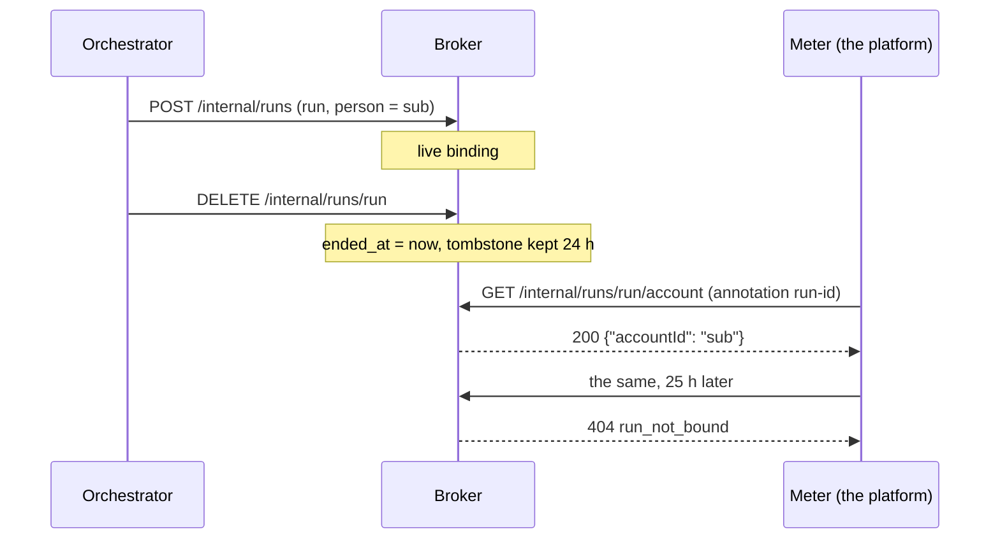
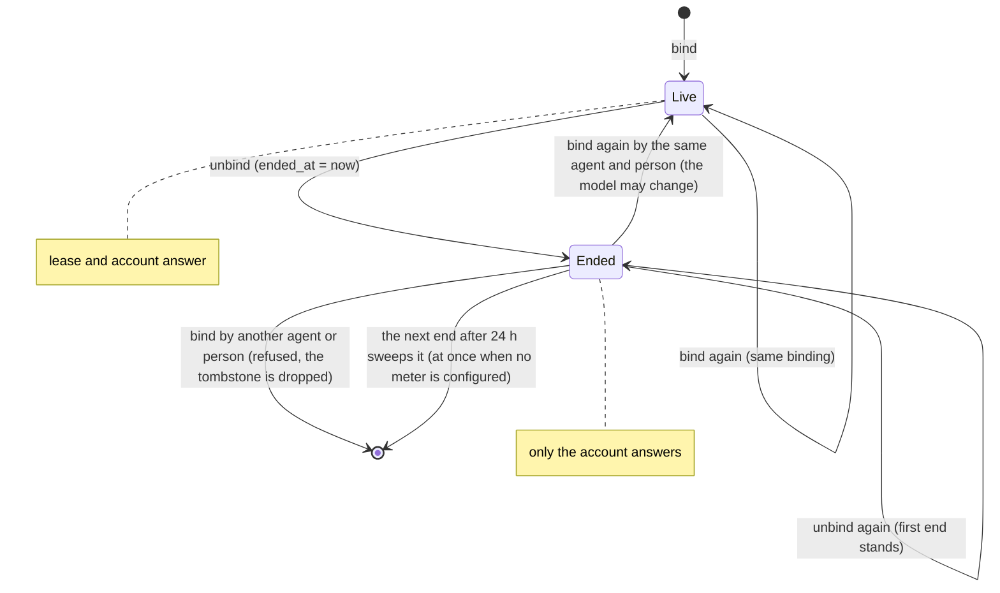

# ADR 0108 — A run is charged to the identity provider's `sub`, and an ended run is still answered to the meter

- **Status:** **Accepted (2026-11-27)** by the owner (card ANR-1099, security): *the account id is the identity provider's
  `sub`, enforced; the lease carries the same id; the e-mail shape gets no meter; a run that ended is still answered for 24
  hours; the run id the meter sends is the annotation, not the hash.* Amends [ADR 0084](0084-the-run-lease-the-broker-binds-a-run-and-lends-its-model-credential.md)
  (decision 6 and the two status notes of 2026-11-24 on `accountId`). **Open: ANR-Q139** (the owner's, on the board): whether the account
  is to be the `sub` exactly as the provider issues it rather than the orchestrator's trimmed, lower-cased `UserId`; this record
  states what holds today. **Amended (2026-11-27, ANR-1163):** the MCP surface's known gap (below) is closed. **Amended (2026-11-27, ANR-1186):** under a claim other than `email` and `sub` an MCP user is what that claim yields.
- **Numbering (2026-11-27):** written as 0106, renumbered to 0107 because an open pull request (#616) took 0106, and to 0108 because #620 (the SQL adapters' ADR) landed 0107.

## Context

The broker answers two callers an account: the injector gets `accountId` in a lease (it stamps `x-account-id`, ADR 0084
amended 2026-11-24), and the operator's pod-minute meter asks `GET /internal/runs/{run}/account` to learn whom a run pod is
charged to. Both answered the run's person as the orchestrator holds it: a `UserId`, which under `auth.jwt.userClaim: email` (the
chart's default) **is an e-mail address**.

That cannot cross to the platform. Its usage contract accepts an identifier only in a closed alphabet, `[A-Za-z0-9._:/-]`, 1 to
128 bytes, "so free text and personal data cannot pass" (*verified 2026-11-27*: `aap-usage`, `crates/usage/src/lib.rs`,
`PodMinuteEvent::validate` and `check_text`, in the platform checkout). An e-mail has an `@` and is refused; worse, a deployment
that sent it anyway would put a person's address in the platform's usage records. The meter also has two timing gaps: a run's
binding is deleted when the job ends (`store-postgres/src/run_leases.rs`, `end_run`'s `DELETE`) while a run pod lives up to 900 s
idle after it and the meter backfills up to 24 hours, so the pod's last minutes had no account to be charged to; and the broker's
`{run}` is **not** what a pod carries.

## Decision

1. **The account id is the person's `UserId` under the identity provider's `sub`, enforced.** The route
   `GET /internal/runs/{run}/account` answers `{accountId}` = the person's `UserId` (the `sub` claim, **trimmed and lower-cased** by
   `UserId::new`, as every owner key is) **only when the deployment reads
   `auth.jwt.userClaim: sub`**. The orchestrator refuses the configuration otherwise: a meter token (`server.internal.meter`) with
   any other claim, with no `auth.jwt`, or with a mode that also reads the identity header, is exit 78 naming
   `server.internal.meter`. The chart refuses the same render (`orchestrator.internal.meter.enabled` with `auth.userClaim` other
   than `sub`).
2. **The output is held to the platform's alphabet by construction.** `orch_core::AccountId` can only be built by
   `AccountId::parse`, which accepts `[A-Za-z0-9._:/-]{1,128}` and nothing else and changes nothing: the account is the person's
   `UserId`, which is `lower(trim(sub))` (`AccountId::of_user`), not the `sub` as the provider wrote it.
   `RunLease::account` and `RunLeases::account` return an `AccountId`, so a value outside the alphabet cannot leave an adapter.
   A run whose person is not one is refused `RunLeaseError::AccountNotOpaque`, `422 account_not_opaque`, with no part of the
   person in the answer, the error or the log. The check is on the **answer**: a binding with an e-mail person is still accepted,
   so the orchestrator's bind never fails on a deployment that has no meter.
3. **The lease carries the same id**, with the same check: `RunLease::bearer` takes an `AccountId`, and the injector's
   `x-account-id` is that `sub` (`docs/api/model-injector.md`). **Breaking port change** (invariant 6): `RunLeases::account` and
   `RunLease::account` change type, `RunBindingStore` changes (decision 6), and `RunLeaseError` gains `AccountNotOpaque`; the
   conformance testkit (`run_leases_conformance!`) and every implementation (`MemoryRunLeases`, `RunLeaseBroker` over
   `MemoryRunBindingStore` and `PgRunBindings`) are updated together, and each runs the same cases.
4. **The e-mail shape gets no meter.** A deployment keyed by e-mail has no account id to give the platform, and none is invented:
   the meter is not offered there, and an injected lease of such a deployment is refused `account_not_opaque`. Moving to `sub`
   is a change of `auth.jwt.userClaim`, which re-keys the people (a person's threads belong to the id the claim gives), and is
   the deployment's own decision, as it is for every other consumer of the claim.
5. **The run id the meter sends is the pod's annotation, not its label.** The broker's `{run}` is adam's A2A task id (bound at
   `app/src/dispatcher.rs`, `bind_run`, when the first frame names the task). The pod's label `adam.vymalo.com/run` is a 12-hex
   hash of it, and the full id is the annotation `adam.vymalo.com/run-id` (adam-rs `crates/adam-env-kubernetes/src/names.rs`:
   `RUN_LABEL`, `RUN_ID_ANNOTATION`; *verified 2026-11-27* in the checkout). The platform's meter must read
   **`metadata.annotations["adam.vymalo.com/run-id"]` → `GET /internal/runs/{run}/account` → `{"accountId"}`**. The broker does
   **not** accept the hash: it cannot be turned back into a run, and a second keying would be a second place to be wrong. The
   platform-side change is the platform's (card ANR-1160 on the board; there is no GitHub issue).
6. **A run that ends leaves a tombstone, for the account route alone.** `end_run` no longer deletes the binding: it marks it
   ended (`run_leases.ended_at`, Postgres migration `0035`). The row keeps (run, person, `ended_at`) for **24 hours**
   (`orch_ports::ACCOUNT_TOMBSTONE`; `RunLeaseBroker::with_tombstone_retention` bounds it otherwise, with no configuration key), and the account
   route answers it; after that it is `404 run_not_bound`. Every `end` also deletes the tombstones older than the bound, so the
   table does not grow past it with no sweeper to run. **Leases stay revoked at job end**: `RunBindingStore::get` returns live
   bindings only, so no credential outlives the job (ADR 0084 decision 6 stands for the lease). Ending twice keeps the first
   end's time; a run never bound leaves nothing.
   **A tombstone is never handed to someone else.** The run id is chosen by the agent, so a bind of an ended run id is admitted
   only for the same agent and person (the binding is then live again and takes the new model and deadline: the same person picking
   another model on a reused task id loses nothing, and no attribution is at stake). A live run keeps the full rule, agent, person
   and model. Any other bind of an ended run id, by another agent or person, **drops the tombstone and is refused `409 run_already_bound`**: the run is then unattributed to the meter (`404`), never
   attributed to the wrong person, and the new binding fails closed.
   **A tombstone is kept only where a meter can read it.** `RunLeaseBroker::with_tombstone_retention` is the bound; the binary
   sets it to 24 hours when `server.internal.meter` is configured and to **zero** when it is not, and a zero bound deletes the run
   at its end, as before this record, so no person's id outlives a run where nothing reads it.

## Consequences

- No e-mail address, and nothing outside `[A-Za-z0-9._:/-]{1,128}`, can leave the broker as an account: the type is the guard,
  the testkit proves it for every implementation, and the configuration refuses the meter where it could never be answered.
- A deployment on `userClaim: email` loses the injected lease (it is refused `account_not_opaque`) and has no meter until it moves
  to `sub`. Cloud runs of ours are signed and have no lease (ADR 0101), so this reaches only the custom injector.
- **Accepted consequence:** a refused rebind erases the tombstone, so the agent that controls a run id can make that run's post-end
  usage unattributed. It is fail-closed, never misattributed, and no worse than before this record, when every post-end charge was
  unattributed. The orchestrator logs the refusal distinctly (the run id and thread, never the person).
- **Rollout:** while replicas disagree on `server.internal.meter`, a replica with no meter has a zero bound, and its `end` sweeps
  every tombstone, including those a meter-configured replica kept. Turn the meter on for every replica together.
- With a meter configured, the binding table keeps ended rows up to 24 hours: one row per run, no secret (a person's `sub` and ids).
  Erasing an account does not reach it: an ended run's row holds the person's `sub` for at most the bound. **The sweep runs on
  `end`**, so the row is physically removed only while runs keep ending (a quiet deployment keeps its last rows longer); the
  account route filters by the bound on every read, so a row older than the bound is never answered either way.
- **Only an identity provider whose `sub` is lower-case ASCII of the alphabet is supported** for the meter and the injector's account.
  *Verified 2026-11-27:* another-idp issues lower-case CUID2 ids (cuid2 0.1.6 `to_str_radix(36)`, another-idp `email.rs:670`), so for it
  the account is the `sub` itself; Keycloak's UUIDs are lower-case too. An identity provider that issues case-sensitive mixed-case
  subjects (Okta, Entra) gets an account that is the lower-cased form and will not join records keyed by its raw `sub`; a `sub` with `|`
  (Auth0's `auth0|…`) passes the configuration check and is refused `422 account_not_opaque` on every call, so it gets no meter and no
  injected lease. Whether the account should be the raw `sub` instead is **open, ANR-Q139**.
- **Known gap, the MCP surface:** under `jwt` + `sub`, `bin/orchestrator/src/config.rs` still requires an MCP token's user to contain
  `@`, so a job started over `/mcp` is bound to an e-mail person and can never be leased or metered. Nothing leaks (it gets a `422`);
  it is simply not metered. Not changed here; a card is filed.
  **Amended (2026-11-27, ANR-1163): closed.** Under `auth.jwt.userClaim: sub` in a mode that reads no identity header, each user of
  `mcp.tokensFile` must be a `sub` (`AccountId` alphabet, after `UserId::new`) and an `@` is refused; under any other claim the e-mail rule
  stands. Either mismatch is exit 78 at load, naming the entry's position (the first is entry 1) and not the user's value. The file is read once at start.
  **Rollout:** before this build, a `sub` deployment must rewrite its tokens file's users to subs, or it exits 78 at start.
  **Amended (2026-11-27, ANR-1186):** the sentence "under any other claim the e-mail rule stands" left a job over `/mcp` under
  `preferred_username` or `oid` with no way to belong to the person signed in by JWT, whose `UserId` is that claim. The rule is now by
  claim: `email` (and any mode that reads an identity header) keeps the `@`; `sub` keeps the `AccountId` rule; **any other claim** takes
  what the JWT path takes of it, a user that is not blank after trimming, has no control character and is at most 256 bytes after
  `UserId::new` (the JWT path has no bound; 256 holds an e-mail address). A job under such a claim is leased when the id is an
  `AccountId` (a lower-case `oid` GUID is; an e-mail or a non-ASCII name is not) and is never metered, since the meter requires
  `userClaim: sub` (`crates/config/src/rules.rs`); this amendment is about who owns the job. The MCP principal's `email` is
  now set only when the user has an `@`. Every refusal of the tokens file names an entry by position and none shows a user, a `tokenEnv` that is not shaped like a variable name or a token (a pasted secret cannot reach an error). **Rollout:** a deployment on another claim whose tokens file holds e-mail users keeps working
  where the claim yields an e-mail and silently names nobody otherwise: check the file against the claim.
- An older build ignores `ended_at`, but its `DELETE` removes the binding with no tombstone: roll the build out on every replica
  before the meter is turned on.
- **Open (not decided here):** the injector's own token has no key in the configuration (`SharedTokens::with_injector` is never
  called by the binary, *verified 2026-11-27*), so no caller presents as `Injector` today and the chart's AuthConfig lookup
  answers `401`; wiring it is its own change.
- **Unverified:** the platform's meter reading the annotation, and the whole chain on a cluster; this is proven on mocks, renders and Rust tests only.

## Alternatives rejected

- **An unsalted hash of the owner (`owner_of`).** It looks opaque and is not: a hash of an e-mail address is a lookup table away
  from the address (the space of addresses is small and enumerable), and it would still be a derived identifier the ledger and
  the platform key differently, so the two could never be joined.
- **An HMAC of the owner under a server key.** Opaque to the platform, but it is a second identity for the person, stable only as
  long as the key; a rotation re-keys every account, and the platform's records could no longer be tied to the person's ledger.
- **A minted account id, kept in a table.** A new durable state beside the log and the ledger (invariant 3) for a value the
  identity provider already issues, and one more thing to erase with an account.
- **Sending the e-mail and letting the platform refuse it.** The platform's alphabet check would refuse every event of the
  deployment, and a refusal at the far end is a leak at the near one.
- **Accepting the hash label at the route.** It cannot be reversed to the run; the broker would have to keep the hash beside
  every run, and a collision (12 hex) would charge one person's pod to another.
