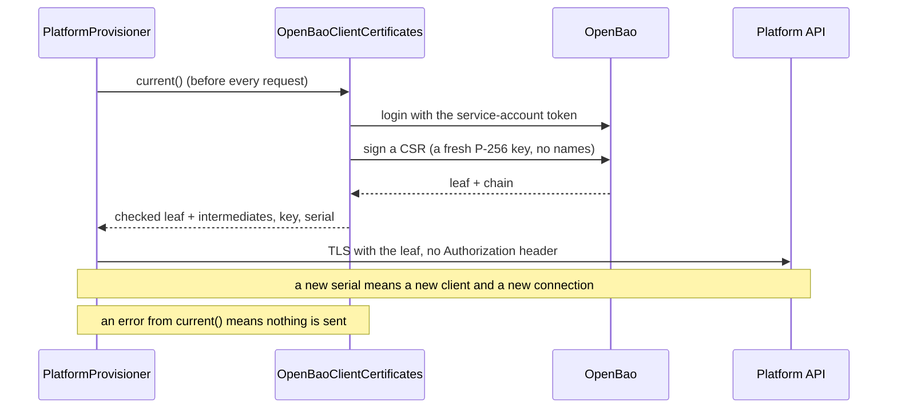

# ADR 0110 — The orchestrator presents its workload certificate to the platform

- **Status:** **proposed 2026-11-27** (card ANR-809). Built in `orchestrator/crates/platform-credentials-openbao` and
  `orchestrator/crates/provisioner-platform`; proven against an in-process stand-in of OpenBao and a real TLS listener in the
  tests, **never against a live OpenBao or a live platform** (see *What is verified*).

## Context

The orchestrator calls the Platform API's owner routes to make and wake a person's own agent
([ADR 0022](0022-platform-provisions-agents-system-discovers-them.md), [ADR 0103](0103-a-persons-own-agent-is-made-and-kept-ready-before-their-message-is-accepted.md)).
What it presents there is the port `PlatformCredentials`: a bearer token, asked before every request. Its only adapters are a fixed
token and a development OIDC client (`dev-oidc`), neither of which is how a deployment should hold the orchestrator's identity.

The platform authenticates a workload by the certificate it presents on the TLS connection (the platform's AD-065 and AD-068,
*unverified here*: read by the scoper of this card at `main` `44ac7408`, not re-read in this session). The orchestrator has an
OpenBao PKI to take one from and the pod's Kubernetes service-account token to prove who it is. A client certificate is not a
header, so it does not fit the token port: the HTTP client must be **built with it**, and rebuilt when it is renewed.

## Decision

1. **A second port, additive; never a fallback.** `orch-ports` gains `PlatformClientCertificates` with one method,
   `current() -> PlatformClientCertificate` (the chain, leaf first; the PKCS#8 key in a wiped buffer; the serial; `not_after`), and
   `Classify` for `PlatformCredentialsError` (`Unavailable` is `Transient`, `Refused` is `Unauthenticated`). `PlatformCredentials`
   is untouched. `orch-provisioner-platform` holds `PlatformAuth`, `Bearer(..)` or `ClientCertificate(..)`, chosen when it is built
   and **never switched at run time**: in the certificate mode it asks `current()` **first** at every request and, on an error,
   **sends nothing** (no connection, no `Authorization` header, no unauthenticated try), and it sends no `Authorization` header at
   all. It keeps one client per certificate, keyed by the **serial**, and builds a new one (a new pool, so a new handshake) exactly
   when the serial changes. A certificate needs an `https` platform URL; a `serverCaFile` may name the listener's authority.
2. **The sequence, in `orch-platform-credentials-openbao`.** Read the service-account token file **at each login** (it rotates);
   `POST /v1/auth/<kubernetesMount>/login {role, jwt}`; make an **ECDSA P-256 key in memory** and a CSR with **no subject and no
   names**; `POST /v1/<pkiMount>/sign/<pkiRole>` with `X-Vault-Token`, `{csr, uri_sans: <spiffeId>, ttl: "<ttl>s", format: "pem",
   remove_roots_from_chain: true}`; take the certificate and the chain; drop both tokens. The SPIFFE id is the **role's** to put in
   the leaf (`use_csr_sans=false`): the request cannot ask for any other name.
3. **The leaf is checked before it is used, and any other leaf fails closed** (`Unavailable`): it parses; its public key is the
   CSR's; its extended key usage has `clientAuth` and **not** `serverAuth`; its names are exactly one URI, the configured id; it is
   valid now on the injected `Clock`, and for longer than the renewal margin; it is not self-signed; it is **a leaf and not an
   authority** (no `basicConstraints` `cA`, no `keyCertSign`); and its extended key usages do not include `anyExtendedKeyUsage`. The
   chain presented is the leaf and the intermediates, **no root**, each once, at most eight. A `ca_chain` that is `null` or absent
   falls back to `issuing_ca`.
4. **Renewal is single-flight and early, and a failure is remembered.** One caller decides and renews while the others wait. A
   leaf is renewed once `now >= not_after - renewalMargin`, with a new key. **Every failed issue is recorded with its error and a
   pause, whether or not a leaf is held:** 30 s after an `Unavailable`, **60 s after a `Refused`** (a refusal is a fault of the
   deployment's setup that a retry does not mend, so it is tried at half the cadence, not never: a role that is fixed is seen within
   a minute). During the pause nothing is asked of OpenBao. A caller that comes meanwhile gets the old leaf if it is still valid
   (inside the margin), and otherwise **the recorded error**, so a burst of callers with no leaf makes one login and one signing and
   not one each in turn while OpenBao is down. **The pause is bounded and cannot outlive the leaf it began beside:** it ends early when the held leaf lapses (the next caller may try
   again at once, and the lapsed leaf and its key are dropped), and a pause that would run longer from now than the pause itself
   (the wall clock stepped back) is not waited for. A renewal that fails is judged again after the failure: the issue can take two
   requests of the timeout each, so the old leaf is served only if it is still valid at the end of it, and otherwise the answer is
   `Unavailable`. Past `not_after` a failed renewal is an error and there is no identity. A 400, 401
   or 403 is `Refused`; a 5xx, a network error, an unreadable answer, a missing token file and every refused leaf are
   `Unavailable`. **The provisioner is a second check:** a certificate whose `not_after` is at or before now is answered as
   unavailable and nothing is sent, whatever the port said, judged on the clock the provisioner is given (`PlatformConfig::with_clock`;
   the system clock, the same one the adapter uses, in a deployment).
5. **No key, CSR, certificate or token in a log, an error or a `Debug`.** An error is a stage and a class; a log line is a serial and
   a time; the key and the tokens are in `zeroize` buffers.
6. **Defaults.** `ttlSecs` 86 400 and `renewalMarginSecs` 28 800 (less than the life, enforced), key P-256, the Kubernetes mount
   `kubernetes`, the pod's own token file. **No certificate revocation list exists yet, so the life of a leaf is the revocation window
   of a stolen one**: a day keeps it short, and eight hours of margin give three renewal tries before the leaf lapses.
7. **The OpenBao side, which ANR-714 owns (the live PKI).** The PKI role is its own, for this one use (not the prompt-signing
   certificate of ANR-718): `client_flag=true`, `server_flag=false`, `allowed_uri_sans` exactly the SPIFFE id, `use_csr_sans=false`,
   `require_cn=false`, `key_type=ec`, `key_bits=256`, **no extra `ext_key_usage`** (so no `any` and no server usage), and a short
   `max_ttl` **no greater than `ttlSecs` and greater than `renewalMarginSecs`** (a leaf that does not outlive the margin is refused
   as unusable, so every issue would fail); the Kubernetes auth role binds
   the orchestrator's service account and gives it only `update` on `<pki>/sign/<role>`. This change creates none of it.
8. **Configuration.** `provisioner.credentials.type: openbao-pki` (`address`, `caFile`, `kubernetesMount`, `authRole`,
   `serviceAccountTokenFile`, `pkiMount`, `pkiRole`, `spiffeId`, `ttlSecs`, `renewalMarginSecs`, `serverCaFile`), validated at load:
   an `https` OpenBao address and `provisioner.url`, a plain-form `spiffe://<domain>/<path>`, the margin less than the life, names a
   URL path can carry. No secret is resolved: the credential is the pod's. The binary builds it behind the existing feature
   `provisioner-platform`.

```mermaid
stateDiagram-v2
  [*] --> NoIdentity
  NoIdentity --> Valid: issued and checked
  Valid --> Valid: renewed inside the margin (new key, new serial)
  Valid --> Valid: renewal failed, old leaf still valid (served; a pause begins)
  Valid --> NoIdentity: past not_after (the leaf and its key are dropped, a pause ends)
  NoIdentity --> Paused: issue failed (the error and a pause are recorded)
  Valid --> NoIdentity: renewal failed and the leaf lapsed meanwhile
  Paused --> Paused: callers get the recorded error, OpenBao is not asked
  Paused --> NoIdentity: the pause is over, or the clock stepped back
  Paused --> Valid: (after the pause) issued and checked
```

## What is verified, and what is not

- **Verified 2026-11-27** against OpenBao's published documentation (`openbao.org/docs/api/secret/pki/`,
  `openbao.org/docs/api/auth/kubernetes/`): the login takes `role` and `jwt` and answers `auth.client_token`; the signing endpoint
  takes `csr`, `uri_sans`, `ttl` and `format`, requires a `common_name` unless the role says otherwise (`require_cn`), answers
  `certificate`, `ca_chain`, `issuing_ca` and `serial_number`, and `remove_roots_from_chain` (default false) drops self-signed
  certificates from the chain; the role has `client_flag`, `server_flag`, `allowed_uri_sans`, `use_csr_sans`.
- **Verified by tests, on stand-ins:** the adapter's own behaviour (what it asks, what it checks, when it renews, what it sends
  nothing for) against a fake PKI, and the provisioner's presentation of the chain, the absence of `Authorization`, the zero
  connections without an identity and the new connection after a new serial against a real `rustls` listener with a
  `WebPkiClientVerifier`.
- **Unverified:** that a live OpenBao, with a role written as in 7, answers a leaf this adapter accepts; that the Kubernetes login
  works with the pod's projected token; that the platform's listener accepts the chain and the id as presented; that the platform's
  AD-065 and AD-068 say what is cited above. All of it is for the live PKI (ANR-714) and a real platform to show.

## Consequences

- A deployment holds no long-lived secret for the platform: the identity is the pod's, and a stolen leaf lapses within the day.
- The provisioner's public configuration changes: `PlatformConfig.credentials` becomes `PlatformConfig.auth`
  (`with_credentials` and `new` are unchanged and build `Bearer`); the new `with_client_certificate` and `with_server_ca_pem`
  build the certificate mode. `PlatformCredentialsError` gains `Classify`. The two new `BuildError` cases are
  `CertificateNeedsHttps` and `BadServerCa`.
- The binary gains a dependency on `rcgen` (key and CSR, on aws-lc-rs) and `x509-cert` (to read the leaf it checks), both behind
  the `provisioner-platform` feature, and the workspace gains `tokio-rustls` for the tests.
- Rotation of the leaf needs no restart; rotation of the service-account token needs none either (it is read at each login).
- A role whose `max_ttl` is not above the renewal margin makes every issue fail as unusable: the operator sees it in the log at once.
- The testkit's fixture contract says a source may remember a failure for a bounded pause and that the fixture's
  `set_issuer_failing` takes the source past it; the kit also runs against the real adapter over the fake PKI.
- `orch-ports` gains the conformance testkit `platform_client_certificates_conformance!` (valid now and complete; an error means no
  identity and is classified; a lapsed certificate is never answered; a renewal is a new serial and key; no key in a `Debug`) and the
  in-memory `MemoryPlatformClientCertificates` it runs against, with fakes that each break one rule.

## Alternatives rejected

- **A client certificate behind the existing token port.** A header cannot carry it, and a fallback from one mode to the other would
  let a failed certificate send an unauthenticated or differently authenticated request.
- **A leaf and key held in a file, rotated by an agent in the pod.** A second moving part with a key on disk, no better than the
  in-memory key renewed by the process that uses it.
- **A longer life with no margin.** With no revocation list a long life is a long window for a stolen key.
- **The platform generating the key.** It would travel the network; a CSR keeps the private half in this process.
