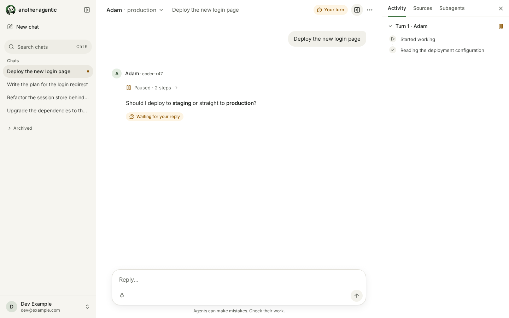
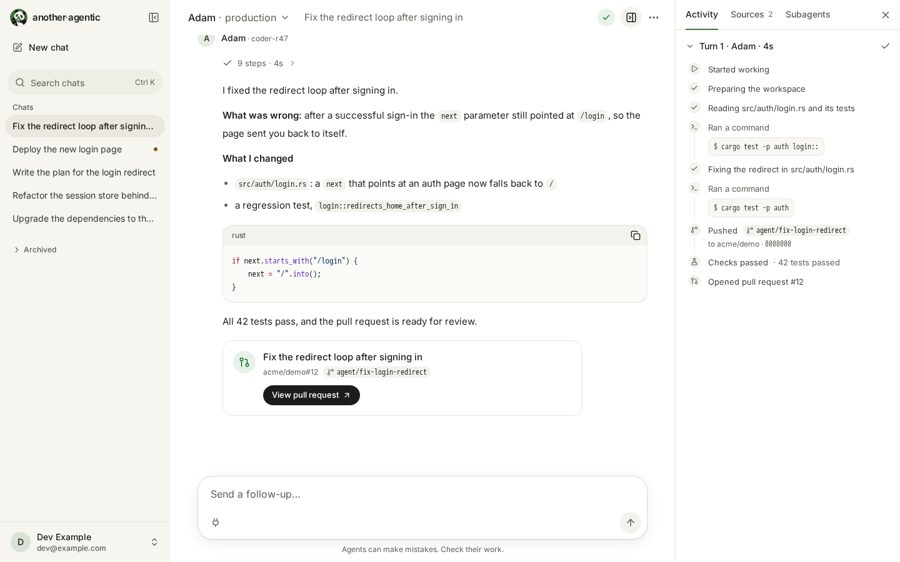

# Run it locally

The first success: one command brings up the chat, the orchestrator, a Postgres and adam-coder, with stand-ins for its
model, for GitHub, for a git remote and for CI. A real oauth2-proxy signs you in against a mock issuer. You need no
account and no key, and once the images are built nothing leaves the machine: every credential in the stack is a dummy
and every port listens on `127.0.0.1`.

## Prerequisites

| | |
|---|---|
| Docker Compose | any v2 (`docker compose version`) runs the command below; v2.24.4 or newer is only for `compose.live.yaml`'s `!override`, which this page never uses |
| Disk and memory | about 10 GB of free disk and 8 GB for Docker, the coder image alone being 2.9 GB (*unverified*: an estimate, not measured) |
| CPU | `linux/amd64`. The coder image has no arm64 build; an ARM machine runs it under emulation, which works but is slow |
| Ports | 8080 is the edge (chat, API, MCP, webhooks), and the `app` profile publishes about two dozen more on `127.0.0.1`. Most have a `*_PORT` variable in [`.env.example`](../.env.example); the rest are the `ports:` of [`compose.yaml`](../compose.yaml) |
| Host tools | `curl`, `jq`, `git` and `openssl` for most scenario scripts, and `node` 22 or newer for one of them. The stack itself needs none |

## Start it

```sh [terminal]
docker compose --profile app up -d --build --wait
```

The first run downloads the 2.9 GB coder image once — the chat and the researcher are the same image — then compiles the
orchestrator in Rust, the web, the git server, the mock CI and two mock servers: several minutes (*unverified*: an
estimate, not measured on a clean clone here). A later run takes seconds.

`--wait` returns once the containers are healthy, not when they have merely started. In `ps`, `edge`, `coder`, `chat`
and `researcher` read `healthy`; the orchestrator has no probe of its own, and the edge checks it.

```sh [terminal]
docker compose --profile app ps
```

`docker compose --profile app down` stops the stack; add `-v` to throw the databases and the pushed branches away with
it.

## Sign in and say hello

Open <http://127.0.0.1:8080>. You land in the chat already signed in as `dev@example.com`: the edge hands the browser to
a mock issuer, which approves it and sends it back, so there is nothing to type. The coder is preselected.

<picture>
  <source media="(prefers-color-scheme: dark)" srcset="../web/e2e/__screens__/desktop-dark-sign-in.png">
  
</picture>

*The web's sign-in page, which the local stack skips — the edge signs you in and brings you back. From the web's mock server.*

Send:

```text
hi
```

You get a greeting rather than a request: who it is, what it does, and what you would like to do. The thread then waits
for you — the pill in the top bar reads **Your turn** — until you answer. To be an administrator instead, tell the issuer
first and sign in again: <http://127.0.0.1:8099/login-as?user=admin@example.com>, then
<http://127.0.0.1:8080/oauth2/sign_out>.

<picture>
  <source media="(prefers-color-scheme: dark)" srcset="../web/e2e/__screens__/desktop-dark-your-turn.png">
  
</picture>

*A thread that waits for you. The question is the mock's, not the coder's greeting: the greeting is a sentence of its own. From the web's mock server.*

Then give it work in the same thread, and watch its steps in the side panel:

```text
In http://git-server:8080/local/sandbox.git (base branch main), add hello.txt containing hello.
```

The scripted model always does the same job: it clones the repository, writes the file, pushes a branch and opens a
pull request on the mock GitHub.

<picture>
  <source media="(prefers-color-scheme: dark)" srcset="../web/e2e/__screens__/desktop-dark-done-answer.png">
  
</picture>

*A finished answer: the words, the code it changed, the card and the steps of the turn, on a different task than the one above. On the local stack the same job ends in a file card holding the pull request's JSON instead, because the mock GitHub speaks plain `http` and the web does not open that as a link. From the web's mock server.*

## When it does not work

| You see | It is | Do |
|---|---|---|
| `port is already allocated` or `address already in use` | one of the stack's ports is taken, a Postgres already on 5432 usually | free it, or move that port: `POSTGRES_PORT=5433 docker compose --profile app up -d --wait` (the orchestrator still finds `postgres:5432` inside the network, so only the host side moves), or `EDGE_PORT` for the chat's |
| a `401` from a script, or a browser that keeps bouncing through the issuer | no token, one older than an hour, or a key the issuer replaced under your session | `dev/auth-header.sh` prints a fresh token; in a browser, reload or `/oauth2/sign_out` and back in; `docker compose --profile app logs oauth2-proxy mock-oidc` says which |
| `coder` never reads `healthy` | its image is still downloading, it is starting, or it died | `docker compose --profile app ps` reads `Exited` for a dead one; `docker compose --profile app logs coder` says why. Under emulation on an ARM machine it is slow |

## Next steps

- **Write an agent**: an agent is a folder — [`dev/README.md`](../dev/README.md#add-a-fourth-agent-by-writing-a-folder), "Add a fourth agent by writing a folder".
- **Deploy it**: the Helm chart — [`deploy/chart/README.md`](../deploy/chart/README.md).
- **Drive it from a program**: the API contracts — [`api/README.md`](api/README.md).
- Read [the vision](vision.md) for what the system is meant to be and [the MVP](mvp.md) for the build order.

[`dev/README.md`](../dev/README.md) is the long form: every service, every scenario, every knob.
