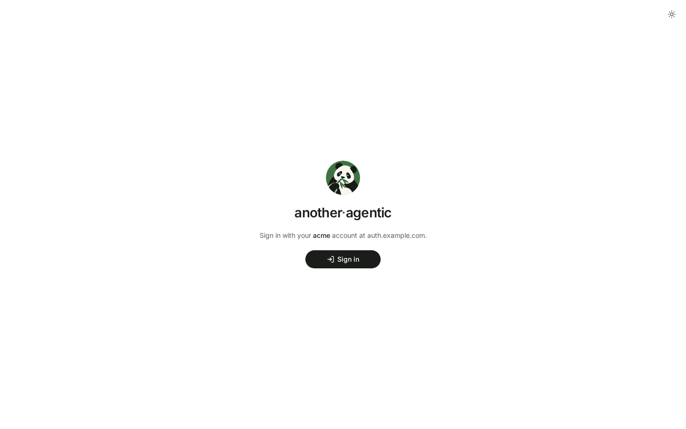
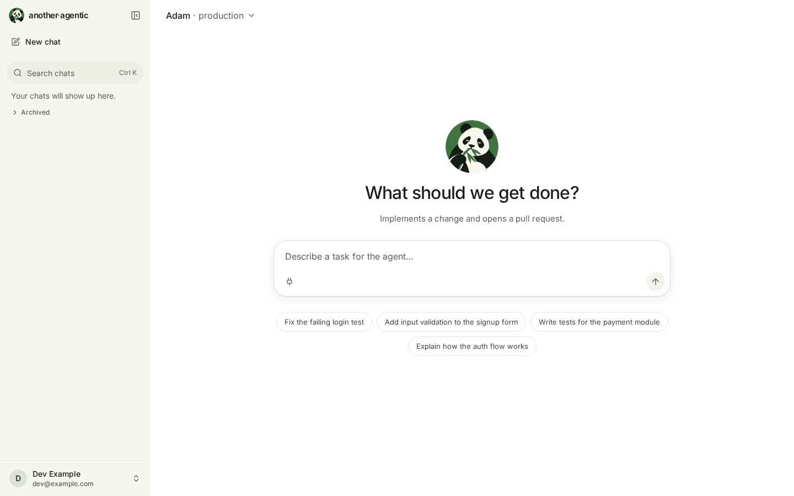

# Run it locally

The first success: one command starts the whole system on your machine, and you say hello to the default agent. It runs
offline and deterministically — the chat UI, the orchestrator, Postgres, adam-coder and scripted stand-ins for a model,
GitHub, a git remote and CI — behind a real sign-in against a mock issuer. Every credential is a dummy and every port is
bound to `127.0.0.1`.

## Prerequisites

| | |
|---|---|
| Docker Compose | v2.24.4 or newer (`docker compose version`); older versions refuse the live override |
| Disk and memory | about 10 GB of free disk and 8 GB for Docker: the coder image is 2.9 GB, and the builds add several more |
| CPU | `linux/amd64`: the coder image has no arm64 build, so an ARM machine runs it under emulation, slower |
| Ports | 8080 for the edge (the chat, the API, MCP and the webhooks), and about a dozen more on `127.0.0.1`; each has a `*_PORT` variable in [`.env.example`](../.env.example) if one clashes |
| Host tools | `curl`, `jq`, `git` and `openssl`, for the scenario scripts (the stack does not need them) |

## Start it

```sh [terminal]
docker compose --profile app up -d --build --wait
```

The first run pulls the coder (2.9 GB, once: the chat and the researcher run from the same image) and builds the
orchestrator, the web, the git server and the mock CI: several minutes. A later run takes seconds. The command returns
when the containers are up:

```sh [terminal]
docker compose --profile app ps
```

`edge`, `coder`, `chat` and `researcher` read `healthy` (the orchestrator has no health check of its own: the edge
probes it). `docker compose --profile app down -v` stops it and forgets the databases and the pushed branches.

## Sign in and say hello

Open <http://127.0.0.1:8080>. You are signed in as `dev@example.com` without typing anything: the edge sends the
browser to a mock issuer that approves it and brings it back. The coder is preselected; send:

```text
hi
```

It answers with a greeting — its name, what it does in one sentence and what it can help with — and the thread waits
for you: the pill in the top bar reads **Your turn**. To be an administrator instead, tell the issuer first, then sign
out and in again: <http://127.0.0.1:8099/login-as?user=admin@example.com>, then
<http://127.0.0.1:8080/oauth2/sign_out>.

<picture>
  <source media="(prefers-color-scheme: dark)" srcset="../web/e2e/__screens__/desktop-dark-sign-in.png">
  
</picture>

*The web's sign-in page, which the local stack skips: the edge signs you in without showing it. From the web's mock server.*

<picture>
  <source media="(prefers-color-scheme: dark)" srcset="../web/e2e/__screens__/desktop-dark-empty-thread.png">
  
</picture>

*An empty thread, the coder selected, with the person signed in as `dev@example.com`. From the web's mock server.*

Then give it work in the same thread, and watch its steps in the side panel:

```text
In http://git-server:8080/local/sandbox.git (base branch main), add hello.txt containing hello.
```

The scripted model always does the same job: it clones the repository, writes the file, pushes a branch and opens a
pull request on the mock GitHub.

<picture>
  <source media="(prefers-color-scheme: dark)" srcset="../web/e2e/__screens__/desktop-dark-done-answer.png">
  
</picture>

*A finished answer: the words, the code it changed, the pull request card and the steps of the turn. From the web's mock server.*

## When it does not work

| You see | It is | Do |
|---|---|---|
| `port is already allocated` or `address already in use` | a port of the stack is taken, a local Postgres on 5432 usually | stop the other process, or set that port's variable: `POSTGRES_PORT=5433 docker compose --profile app up -d --wait`, or `EDGE_PORT` for the chat's |
| an API call answers `401`, or the browser loops through the issuer | no token, an expired one (an hour), or `mock-oidc` was recreated and signs with a new key your session predates | `dev/auth-header.sh` prints a fresh one; in the browser reload, or `/oauth2/sign_out` and in again; `docker compose --profile app logs oauth2-proxy mock-oidc` |
| `coder` never reads `healthy` | its 2.9 GB image is still being pulled, or it is starting (`start_period` 10 s, then 30 tries) | `docker compose --profile app logs coder`; on an ARM machine it runs under emulation and is slow |

## Next steps

- **Write an agent**: an agent is a folder — [`dev/README.md`](../dev/README.md#add-a-fourth-agent-by-writing-a-folder), "Add a fourth agent by writing a folder".
- **Deploy it**: the Helm chart — [`deploy/chart/README.md`](../deploy/chart/README.md).
- **Drive it from a program**: the API contracts — [`api/README.md`](api/README.md).
- Read [the vision](vision.md) for what the system is meant to be and [the MVP](mvp.md) for the build order.

[`dev/README.md`](../dev/README.md) is the long form: every service, every scenario, every knob.
