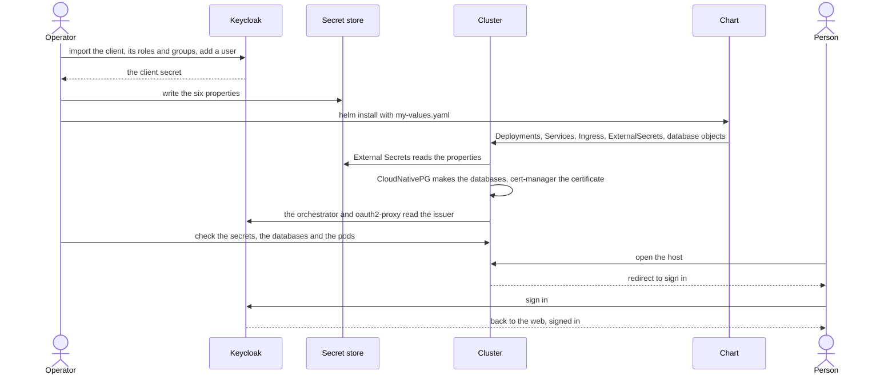
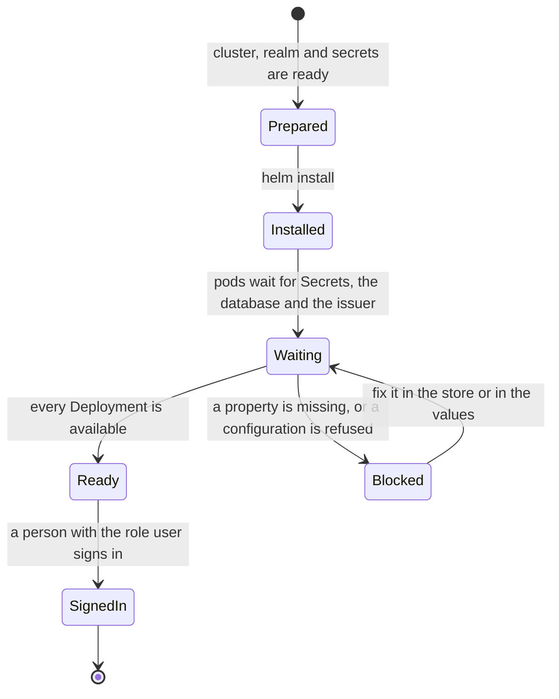

# Deploy to a Kubernetes cluster

This page takes you from a cluster with its operators to a person signed in to the web, who talks to the chat agent.
It installs the smallest useful deployment with the Helm chart `deploy/chart`. It is not the reference: every value,
its default and what the chart refuses are in the [chart's README](../../deploy/chart/README.md).

**How far this page is proven (2026-11-28).** The commands that need no cluster were run. **Everything that needs a
cluster, a Keycloak realm, a secret store, DNS or a browser is *unverified*: there was none where the page was
written.** Each step says which it is. "Ran" means it ran with the placeholder values below.

Every name with `example.com` or `my-` in it is a placeholder. Replace it with your own.





## 1. What you need

**On your machine:** `git`, `kubectl` pointed at your cluster, `curl`, `jq`, `openssl`, and **Helm 4.3.2**, the version CI
uses ([why](../decisions/0105-helm-4-only-and-kubernetes-1-37-as-the-floor.md)). Helm 3.16.1 refused to render this chart without a
cluster, because it assumes Kubernetes 1.31 (*verified 2026-11-28* by running it).

**In the cluster.** The chart installs none of these:

| Need | Why | Your value |
|---|---|---|
| Kubernetes **1.37 or later** | the chart's `kubeVersion` | |
| [CloudNativePG](https://cloudnative-pg.io/), 1.25 or later | the chart renders a `Cluster` and a `Database`. The `Database` kind came in 1.25 (*verified 2026-10-04*, [the chart's source](../../deploy/chart/README.md#one-database-cluster)). Whether your release runs the chart's PostgreSQL 18 image is *unverified* ([the image](../../deploy/chart/README.md#the-postgresql-image)) | |
| [External Secrets Operator](https://external-secrets.io/) with a `ClusterSecretStore` of yours | the chart renders `external-secrets.io/v1` `ExternalSecret`s. Which operator release first served `v1` is *unverified* | `externalSecrets.secretStoreRef.name` |
| An ingress controller. The chart is written for **Traefik** | it renders one `Ingress`. Another controller is *unverified*, in particular with the long streams | `ingress.className` (default `traefik`) |
| [cert-manager](https://cert-manager.io/) with a `ClusterIssuer` | the `Ingress` asks it for the certificate | `ingress.clusterIssuer` |
| A storage class | one volume for the database, one for the agents' files | `database.storage.storageClass`, `orchestrator.artifacts.storageClass` |
| A DNS name that reaches the ingress | the web, the API and the sign-in are on this one host | `host` |
| A Keycloak realm that exists, served over **https** | sign-in | `auth.issuer` |
| An OpenAI-compatible model endpoint with streaming, and its key | the chat agent | `model.baseUrl`, `chat.model` |

Check the cluster. ***Unverified*: no cluster.**

```sh [terminal]
kubectl version
kubectl get crd clusters.postgresql.cnpg.io databases.postgresql.cnpg.io \
  externalsecrets.external-secrets.io clustersecretstores.external-secrets.io clusterissuers.cert-manager.io
kubectl get clustersecretstore,clusterissuer
kubectl get ingressclass,storageclass
```

Then get the chart. Run every later command from the top of the repository. (Ran.)

```sh [terminal]
git clone https://github.com/vymalo/another-agentic-system.git
cd another-agentic-system
```

This page installs from the clone. A release also publishes the chart as an OCI package
([Releases](../../deploy/chart/README.md#releases)). An anonymous `helm show chart` read the published version `0.9.0`.
It answered `not found` for `0.10.0`, the version this tree's chart says (both *verified 2026-11-28*). This page was
not tried with the `0.9.0` package.

## 2. Keycloak

The chart signs people in with a confidential Keycloak client named `another-agentic`. The exports are in
`deploy/keycloak/` and hold no secret. The export of this client carries the host of this repository's own deployment
(so do the web, Android and iOS clients, which this page does not use), so write your host into a copy first. (Ran.)

```sh [terminal]
APP_HOST=agentic.example.com
jq --arg o "https://$APP_HOST" '.rootUrl = $o
  | .redirectUris = [$o + "/oauth2/callback"]
  | .webOrigins = [$o]
  | .attributes["post.logout.redirect.uris"] = $o + "/*"' \
  deploy/keycloak/client-another-agentic.json > my-client.json
```

Then, in the admin console of your realm. ***Unverified*: no realm was available, and the console labels are from
memory.** The unchanged exports imported into Keycloak 26.6.1 (*verified 2026-10-11*,
[the Keycloak README](../../deploy/keycloak/README.md)); your edited copy was not imported.

1. *Clients → Import client*: choose `my-client.json`.
2. *Realm settings → Action → Partial import*: choose `deploy/keycloak/roles-and-groups.json`. Do this after step 1.
   It adds the client roles and the groups. You need only the role `user` and the group `agentic-testers` here, but
   the import creates all of them. Among them are two roles and two groups for the coders of this repository's own
   deployment, and their names will appear in your realm. With the values of step 4 those two roles grant nothing.
   Their groups also give the role `user`, so do not add people to them. You can delete both roles and both groups.
3. Open the client `another-agentic`, tab *Credentials*, and keep the client secret for the next step.
4. Create a user with an e-mail address, turn **Email verified** on, and add the user to the group
   `agentic-testers`. The orchestrator keys a person's threads by that address and refuses an unverified one.

What each setting is for: [the Keycloak README](../../deploy/keycloak/README.md#what-each-setting-is-for).

## 3. The secrets

The chart holds no secret. Each `ExternalSecret` reads **properties** of one entry of your store, a JSON object. Its
name is `externalSecrets.key`. With the values of step 4 the chart renders four. (The names below were read from the
rendered chart.)

| `ExternalSecret` | Properties it reads |
|---|---|
| `another-agentic-orchestrator` | `thread_tools_secret`, `model_api_key`, `chat_a2a_token` |
| `another-agentic-oauth2-proxy` | `oauth2_client_secret`, `oauth2_cookie_secret` |
| `another-agentic-chat` | `chat_a2a_token`, `model_api_key` |
| `another-agentic-db-agent` | `agent_db_password` |

That is six properties. `oauth2_client_secret` comes from Keycloak and `model_api_key` from your model provider. You
make the other four. How to make each one, with its length and format, is in
[the chart's table](../../deploy/chart/README.md#the-aws-secret). These print random values of the two forms it asks
for (ran):

```sh [terminal]
openssl rand -hex 32   # thread_tools_secret, chat_a2a_token, agent_db_password: one run each
openssl rand -hex 16   # oauth2_cookie_secret
```

Write the six properties **before** you install: one missing property stops the whole Secret from syncing. (That is
External Secrets behaviour as [the chart's README](../../deploy/chart/README.md#the-key-of-the-stored-secrets-adr-0046-slice-3)
and its `values.yaml` state it; *unverified* here: there was no cluster.) How you
write them depends on your store, so this page has no command for it (***unverified***). The chart's own deployment
uses AWS Secrets Manager. A store of another kind must answer `remoteRef.property` (***unverified*** here).

An option you turn on later may read more properties. The chart's table says which.

## 4. The values

Save this as `my-values.yaml`. It sets what has no default, or has the default of another deployment.

```yaml [my-values.yaml]
# Placeholders: replace every value with your own. Every key is described in deploy/chart/README.md.
host: agentic.example.com

auth:
  issuer: https://keycloak.example.com/realms/my-realm

ingress:
  clusterIssuer: my-cluster-issuer

database:
  storage:
    storageClass: my-storage-class

orchestrator:
  artifacts:
    storageClass: my-storage-class

model:
  baseUrl: https://models.example.com/v1
chat:
  model: my-model-name

# The chat agent only. A list replaces the default list, which also names the coder, a separate chart.
agents:
  - id: chat
    name: Chat
    cardUrl: 'http://{{ include "agentic.fullname" . }}-chat.{{ .Release.Namespace }}.svc:8080/.well-known/agent-card.json'
    tokenEnv: CHAT_A2A_TOKEN

externalSecrets:
  secretStoreRef:
    name: my-secret-store
    kind: ClusterSecretStore
  key: my/secret/path
```

`host` is a name with no `https://`. `auth.issuer` has no trailing slash. If your ingress class is not `traefik`, set
`ingress.className`. All keys: [Values](../../deploy/chart/README.md#values). To add the coder later:
[The coder](../../deploy/chart/README.md#the-coder).

Check the file before you touch the cluster. All three ran with Helm 4.3.2: the lint passed with one note that the
chart has no icon, the render succeeded, and the dry run printed `DESCRIPTION: Dry run complete` near the top of its
output, which ends with the chart's notes. They check the chart and your
values, **not** your cluster.

```sh [terminal]
helm lint deploy/chart -f my-values.yaml
helm template another-agentic-system deploy/chart --namespace another-agentic-system -f my-values.yaml > rendered.yaml
helm install another-agentic-system deploy/chart --namespace another-agentic-system --create-namespace \
  -f my-values.yaml --dry-run=client
```

A value the chart refuses fails the render with a message that names the key.

## 5. Install

Point your DNS name at the ingress controller, then install. ***Unverified*: no cluster.**

```sh [terminal]
helm install another-agentic-system deploy/chart --namespace another-agentic-system --create-namespace \
  -f my-values.yaml
```

The notes that Helm prints say `AWS Secrets Manager` whatever kind of store you named.

## 6. Check that it works

Work down this list. ***Unverified*: no cluster.** What to expect comes from the chart's templates.

```sh [terminal]
kubectl -n another-agentic-system wait --for=condition=Ready externalsecret --all --timeout=5m
kubectl -n another-agentic-system wait --for=condition=Ready cluster.postgresql.cnpg.io/another-agentic-db --timeout=10m
kubectl -n another-agentic-system wait --for=jsonpath='{.status.applied}'=true \
  database.postgresql.cnpg.io/another-agentic-db-agent --timeout=5m
kubectl -n another-agentic-system wait --for=condition=Available deployment --all --timeout=10m
kubectl -n another-agentic-system get certificate,ingress
```

Each `wait` should end with `condition met`. The third waits for `status.applied` of the `Database` (the field is in
the chart's vendored CRD schema). You should then have five available Deployments (`another-agentic-` plus `orchestrator`,
`web`, `oauth2-proxy`, `edge` and `chat`) and a certificate that is ready.

Then from outside the cluster. ***Unverified*: no deployment.**

```sh [terminal]
curl -sS https://agentic.example.com/edge-healthz
curl -sS -o /dev/null -w '%{http_code}\n' https://agentic.example.com/api/me
curl -sS -o /dev/null -w '%{http_code} %{redirect_url}\n' https://agentic.example.com/
```

Expect `ok`, then `401` (no session), then `302` to `/oauth2/start`.

Last, in a browser. ***Unverified*: no deployment.**

1. Open `https://agentic.example.com/`. It sends you to Keycloak. Sign in as the user of step 2.
2. Open `https://agentic.example.com/api/me`. It shows your `user` (the e-mail address), `roles` with `user`, and
   `permissions` and `agents` that are not empty.
3. Back on `/`, send a message to **Chat** and wait for the reply. This is the first step that calls your model.

### If it stops

| You see | Look at |
|---|---|
| An `ExternalSecret` that is not `Ready` | `kubectl -n another-agentic-system describe externalsecret NAME`: a missing property, or the store |
| The orchestrator pod stays in `ContainerCreating`, with a `FailedMount` event that says a secret is not found | `kubectl -n another-agentic-system describe pod NAME`. It mounts `another-agentic-orchestrator` (the first row) and `another-agentic-db-app` (CloudNativePG makes it with the database) as files |
| The `chat` or `oauth2-proxy` pod in `CreateContainerConfigError` | `describe pod` names the missing Secret. They read theirs as environment variables: the first row, or the database |
| The orchestrator exits with code 78 | its log names the configuration key it refused |
| The orchestrator never becomes ready | `/readyz` answers 503 until it has the issuer's keys: can the pod reach `auth.issuer`? |
| Keycloak refuses the redirect | the client's redirect URI must be `https://` + `host` + `/oauth2/callback` (step 2) |
| Sign-in works and then access is refused | the user needs the client role `user` and **Email verified** |
| A new secret value has no effect | pods read secrets once, at start: [restart them](../../deploy/chart/README.md#the-aws-secret) |

## Next

Nothing here backs up the database: [Backups](../../deploy/chart/README.md#backups) are off by default. Also off or
left out: [several coders](../../deploy/chart/README.md#several-coders-one-per-github-owner),
[web search](../../deploy/chart/README.md#web-search-and-context7), [sharing](../../deploy/chart/README.md#sharing-a-thread)
and [more database instances](../../deploy/chart/README.md#scaling-the-database-issue-290). Why the deployment has
this shape: [ADR 0041](../decisions/0041-deployed-with-helm-on-kubernetes-secrets-by-externalsecret.md). What has not
run on a cluster: [the chart's list](../../deploy/chart/README.md#unverified).
