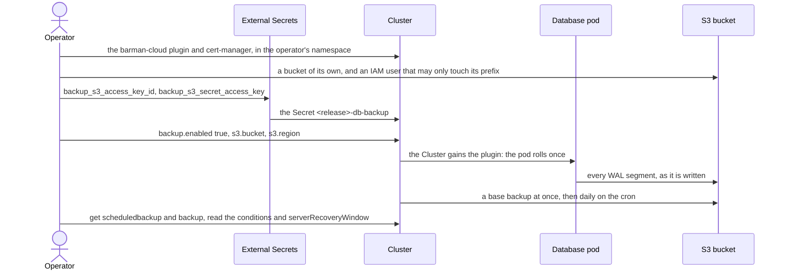
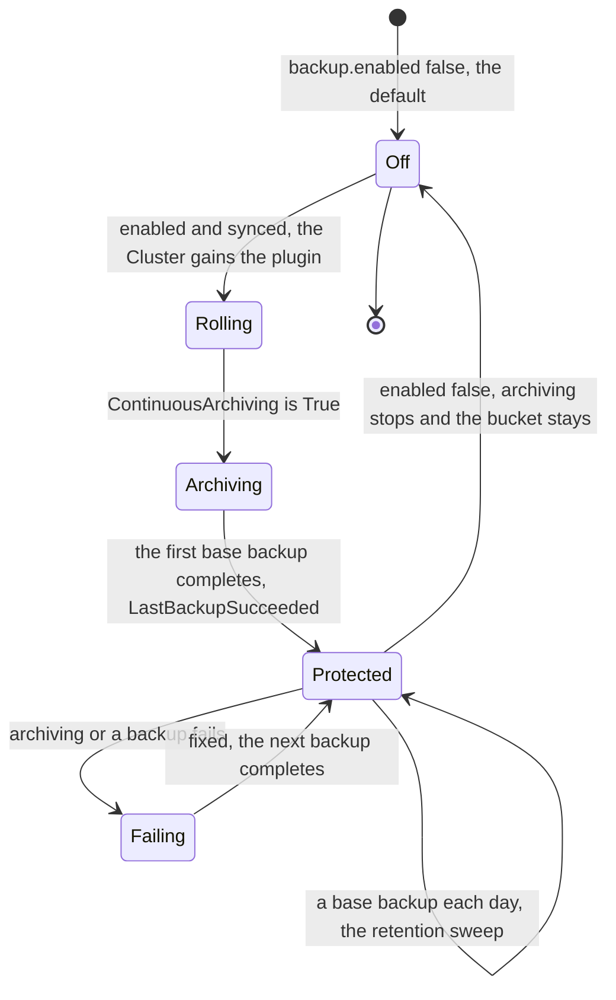
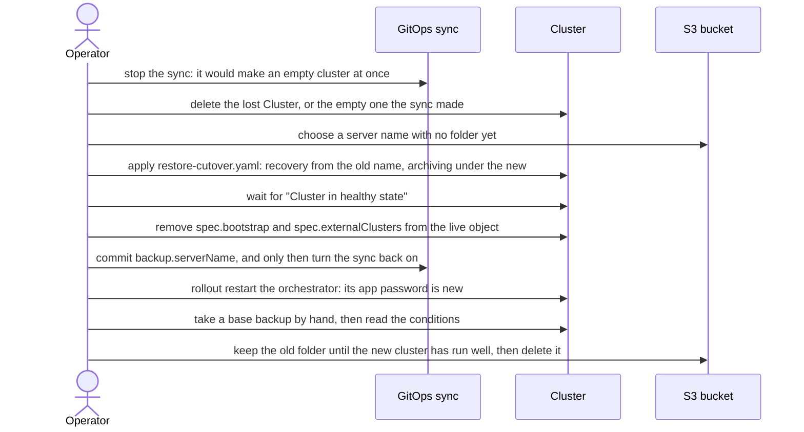
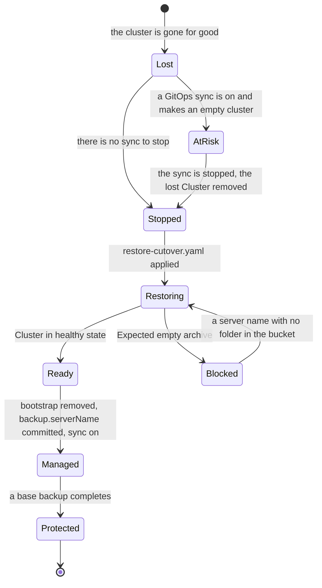

# Back up and restore the database

This page turns on continuous backups of the one database cluster, reads them, and restores them: first into a new cluster
beside the running one, then over a cluster that is lost. Every value, its default and what the chart refuses are in the
[chart's README](../../../deploy/chart/README.md#backups); this page is the order of the work and what each step proves.

**How far this page is proven (2026-11-28).** The mechanism, the values and the order come from the chart's README, whose backup
facts were *verified 2026-10-17* by reading the plugin's and CloudNativePG's sources, and from the one end-to-end run the README
quotes. **Nothing on this page was run against a cluster, a bucket or a secret store while it was written: there was none.** The
YAML and the commands are copied from the files named beside them. The only part of the chain that has run end to end is the
`backup-e2e` job on kind against a RustFS (§8); a managed cluster, an AWS bucket, the retention sweep, the credentials' ExternalSecret
and the whole cutover of §6 are *unverified*.

Every name with `example.com`, `my-` or `<…>` in it is a placeholder — except the objects the chart names itself: it fixes
their prefix to `another-agentic` (`fullnameOverride`, so the name does not follow the release). The examples use the release
name `another-agentic-system`; the cluster is `another-agentic-db` whatever that release is called, its credentials
`another-agentic-db-backup`, and the orchestrator `another-agentic-orchestrator`.





## 1. What you need

Backups are **off by default** (`backup.enabled: false`), and with them off the render is exactly what it was without them. Turning
them on renders three objects and changes the Cluster: an `ObjectStore`, a `ScheduledBackup`, an `ExternalSecret` in a file of its
own (so that turning backups on restarts no pod), and a `spec.plugins` entry on the Cluster. The mechanism is the **barman-cloud plugin** of
CloudNativePG, not the in-tree `barmanObjectStore`, which is deprecated from CloudNativePG 1.26: the Cluster archives its WAL as it
is written and takes a base backup every day ([ADR 0041](../../decisions/0041-deployed-with-helm-on-kubernetes-secrets-by-externalsecret.md),
amended 2026-10-17).

| Need | Why | Your value |
|---|---|---|
| CloudNativePG **1.26 or later** (1.27 or later recommended) | the plugin's floor | |
| The **`plugin-barman-cloud`** Helm chart, **in the operator's namespace** | it serves the `barmancloud.cnpg.io/v1` `ObjectStore`. 0.8.1, plugin v0.15.1, on 2026-10-17 | |
| cert-manager | the plugin needs it | |
| A bucket of its own, and an IAM user for it | where the WAL and the base backups go | `backup.s3.bucket`, `.region`, `.endpoint` |
| Two properties in the secret entry your `externalSecrets.key` names | the archiver signs with them | `backup_s3_access_key_id`, `backup_s3_secret_access_key` |

Check the plugin's CRD before anything else. ***Unverified*: no cluster.**

```sh [terminal]
kubectl get crd objectstores.barmancloud.cnpg.io
```

Without it the sync fails on the `ObjectStore`, and only on it: a deployment that does not turn backups on is untouched.

## 2. The bucket and its credentials

Make a bucket of its own and an IAM user for it. The user may list, read, write and delete **under the prefix** and do nothing else.
It **must not be the artifacts' user**: the orchestrator's pod reads those keys, and these keys can delete the backups, which is why
the chart refuses the same property names for both. The exact action list is *unverified* here; barman-cloud's documentation has it.

If the bucket is versioned, a version barman deletes survives as a non-current version until a rule expires it. **Set that rule so
that no version outlives the retention you tell people** (§4): a lifecycle rule that expires current versions a few days after the
recovery window and non-current ones later. This part is *unverified*: no bucket was available.

## 3. Turn it on

Add the two properties to the secret entry your `externalSecrets.key` names (the [deploy guide](../deploy.md#3-the-secrets) calls it
`my/secret/path`) **before the sync**. A missing property fails only the backups' own Secret, but the archiver then cannot sign, and a
PostgreSQL whose archiver keeps failing keeps its WAL on its volume, so watch `ContinuousArchiving` (*unverified*: PostgreSQL's
behaviour, not something this chart has seen).

Then set the values. This is [`tests/backup-aws.values.yaml`](../../../deploy/chart/tests/backup-aws.values.yaml), the shape the
chart's own checks render:

```yaml [my-values.yaml]
backup:
  enabled: true
  s3:
    bucket: my-bucket
    region: my-region        # the bucket's region; a server that has none wants us-east-1
    # endpoint: https://s3.example.com   # another S3-compatible server; omit for AWS S3
    # prefix: agentic                    # a folder; the server's name goes below it
  # retention: 28d                       # the default, and the ceiling: see §4
  # schedule: { cron: "0 17 3 * * *", immediate: true }   # six fields, seconds first
```

All keys and their refusals: [the values](../../../deploy/chart/README.md#the-values). `bucket` and `region` are required when
backups are on; `endpoint` is empty for AWS S3. Sync, and **expect the database pod to roll once**, because the Cluster gains a
sidecar. With `database.instances: 1` that is a short outage of everything that reads the database (*unverified*: it is how a changed
pod spec is rolled, not something this chart has seen).

Then look. ***Unverified*: no cluster.** The first base backup is taken at once, because `schedule.immediate` is true.

```sh [terminal]
kubectl -n another-agentic-system get scheduledbackup,backup
kubectl -n another-agentic-system get cluster another-agentic-db \
  -o jsonpath='{range .status.conditions[*]}{.type}={.status}{"\n"}{end}'   # ContinuousArchiving, LastBackupSucceeded
kubectl -n another-agentic-system get objectstore another-agentic-db \
  -o jsonpath='{.status.serverRecoveryWindow}'                              # the first recoverability point, the last good backup
kubectl cnpg status another-agentic-db -n another-agentic-system           # the kubectl plugin, if installed
```

If the first backup ran while the pod was still rolling and failed (*unverified* that it can), take one by hand; WAL without a base
backup restores nothing:

```sh [terminal]
kubectl cnpg backup another-agentic-db -n another-agentic-system \
  --method=plugin --plugin-name=barman-cloud.cloudnative-pg.io
```

Last, restore once before you rely on any of it (§5). **A backup nobody has restored is a guess.**

## 4. How long a deleted thread stays in the backups

Deleting a thread erases it from the database, its files and its link, and **the backups keep it until they expire**
([ADR 0043](../../decisions/0043-deleting-a-thread-erases-it.md), decision 7). The retention is a **recovery window**, not a
"keep the last N backups": the plugin keeps every backup and every WAL segment needed to restore to any moment in the window,
including the newest base backup older than it, and it deletes an obsolete backup only after the next backup completes.

So a window of W days keeps data for about **W+1 days**, and up to W+2 if a deletion waits for the next backup (*unverified* in a
cluster; the sweep runs every 30 minutes). With the default `28d`, a thread deleted today leaves the bucket after about **29 days**,
within 30. That is why the chart accepts **at most 28 days** (`28d` or `4w`) and refuses `29d`, `30d`, `5w`, the unit `m` and 0: a
ceiling of 30 would keep data 31 or 32 days and break the sentence people are given. **A longer keep is a decision about people's
threads, not a value.** [`docs/tester-note.md`](https://github.com/vymalo/another-agentic-system/blob/main/docs/tester-note.md) is the draft that says "within about 30 days" to testers.

Switching backups off does **not** erase the bucket: the sweep stops with the sidecar, and the data stays until someone deletes it.

## 5. Try a restore, beside the running cluster

CloudNativePG restores into a **new** cluster, never in place.
[`examples/restore-cluster.yaml`](../../../deploy/chart/examples/restore-cluster.yaml) makes `another-agentic-db-restore` from the
newest base backup and the WAL archive, and does not touch the running cluster. It deliberately has **no `plugins` entry**: a restored
cluster that archived would write into the bucket beside the source.

```sh [terminal]
kubectl -n another-agentic-system get objectstore another-agentic-db \
  -o jsonpath='{.status.serverRecoveryWindow}'                    # what can be restored
kubectl -n another-agentic-system apply -f deploy/chart/examples/restore-cluster.yaml
kubectl -n another-agentic-system get cluster another-agentic-db-restore -w   # until "Cluster in healthy state"
kubectl -n another-agentic-system exec another-agentic-db-restore-1 -c postgres -- \
  psql -d orchestrator -c 'select count(*) from threads'
kubectl -n another-agentic-system delete cluster another-agentic-db-restore   # the test is over; its volume goes with it
```

Three things about that file. It reads the `ObjectStore` `another-agentic-db` under the server name `another-agentic-db` (the
cluster's own name, or its `backup.serverName`; **a different name finds nothing**). Its `storage.size`, `storage.storageClass` and
image must equal the deployment's `database.storage.size`, `database.storage.storageClass` and `database.imageName`: a smaller volume
cannot hold the data and another PostgreSQL major cannot read it. And it names no `secret`, so CloudNativePG generates
`another-agentic-db-restore-app` with a **new random password** for the owner `orchestrator`; nothing reads it, and the running
cluster's Secret is untouched. A point in time is `bootstrap.recovery.recoveryTarget.targetTime`, between the oldest base backup and
the last archived WAL segment.

## 6. Replace a lost cluster

Only when `another-agentic-db` is **gone for good**: if it is merely unhealthy, repair it. A restore returns the data up to the last
archived WAL segment, so the minutes before the loss are not in it.
[`examples/restore-cutover.yaml`](../../../deploy/chart/examples/restore-cutover.yaml) keeps the name the applications use — so the
Service `another-agentic-db-rw` and the Secret `another-agentic-db-app` are the restored cluster's — and archives from then on under a
**new server name**, because CloudNativePG refuses to archive into a path that already holds another server's files
(`WAL archive check failed for server …: Expected empty archive`, and the pod stays in `Setting up primary`).





The steps, in this order. **None of it has run on a cluster**: rehearse it in a scratch namespace if you can, and keep the old
server's files until it has worked.

1. **Stop the sync** of the release, if a GitOps controller syncs the chart. With it on, it creates an empty `another-agentic-db`
   (`initdb`) as soon as the lost one is gone; that cluster cannot archive into the old path, and it holds the name.
2. **Remove the lost Cluster**, or the empty one the sync made: `kubectl -n another-agentic-system delete cluster another-agentic-db`.
   Never a cluster whose volume still holds the data.
3. **Choose a new server name** that has no folder in the bucket (`aws s3 ls s3://my-bucket/<prefix>/` lists the servers), for
   example `another-agentic-db-2`, and write it in a copy of `restore-cutover.yaml` under `plugins[].parameters.serverName`. In the
   same file `externalClusters[].plugin.parameters.serverName` is the **old** name. Set `storage` and the image as in §5.
4. **Have the `ObjectStore` and the credentials in the namespace** (`get objectstore another-agentic-db`, `get secret
   another-agentic-db-backup`). If they were pruned, render the chart's file with the deployment's values and apply it by hand while
   the sync is stopped:
   ```sh [terminal]
   helm template another-agentic-system deploy/chart -n another-agentic-system -f values.yaml \
     -s templates/cnpg-backup.yaml | kubectl -n another-agentic-system apply -f -
   ```
5. **Restore**: apply your copy, then wait for `Cluster in healthy state`. If the pod's log says `Expected empty archive`, the new
   server name was not new.
6. **Take a base backup at once** (§3, the last block), before anything else. The restored cluster archives under the new name
   from the moment it is up, but it has **no base backup** there, and WAL without one restores nothing: the schedule's next run
   may be a day away (the cron is daily), so until one completes a second loss inside that window cannot be restored.
7. **Make the live Cluster one the chart can take over.** The chart renders `bootstrap.initdb`, the restored cluster has
   `bootstrap.recovery`, and CloudNativePG refuses two bootstrap methods, which is what a sync would ask for:
   ```sh [terminal]
   kubectl -n another-agentic-system patch cluster another-agentic-db --type=json \
     -p '[{"op":"remove","path":"/spec/bootstrap"},{"op":"remove","path":"/spec/externalClusters"}]'
   ```
   A JSON patch is all or nothing: if either path is already gone (a re-run, or half of this done earlier) the whole command is
   rejected and `/spec/bootstrap` is not removed either — check with `kubectl get cluster another-agentic-db -o
   jsonpath='{.spec.bootstrap}'` first, or remove the two paths one at a time. Nothing refuses a change of the bootstrap on a
   running Cluster, and `initdb` is the method when none is given; that the operator then ignores the `initdb` a sync adds to a
   running cluster is *unverified*.
8. **Put `backup.serverName: another-agentic-db-2` in the release's values, commit it, and only then turn the sync back on.** In that
   order: a sync without the value would put the plugin entry back on the cluster's own name, which is the old path. The sync then
   adds the managed roles and the `Database` objects, which adopt the databases the restore brought back (*unverified*).
9. **Restart the orchestrator** (`rollout restart deployment/another-agentic-orchestrator`): CloudNativePG made
   `another-agentic-db-app` anew, with a new random password for `orchestrator`, and the orchestrator reads its connection string from
   that Secret at start. The chat agent and the coders keep their roles' passwords — they are in the restored data and in their own
   Secrets (*unverified*); look at their logs.
10. **Deal with the old server's folder.** It stays in the bucket and **no longer expires**, because the sweep is per server name
    (§4). Keep it until the new cluster has run well, then delete it or give its prefix a lifecycle rule: it holds people's threads.

## 7. What the backups keep, and what they do not

| Kept | Not kept |
|---|---|
| Every database of the one cluster: the orchestrator's (its thread log and the state beside it) and the agents' | The **Kubernetes Secrets**. The operator does not back them up: a restored cluster gets an app Secret with a **new random password** for `orchestrator`, and the other roles' Secrets are the chart's |
| The stored credentials, as **sealed envelopes** ([ADR 0046](../../decisions/0046-people-add-their-own-mcp-servers-secrets-in-a-credential-broker.md)) | **The key that opens them**, which is in the secret entry and not in the database. Keep that entry's history as you keep the backups, or every stored credential is lost |
| Everything up to the **last archived WAL segment** | The minutes between that segment and the loss |
| A deleted thread, for the retention (§4) | Nothing beyond it: a restore cannot reach past the recovery window |
| | The **artifacts**, the files agents hand over: they live in the artifact store ([ADR 0032](../../decisions/0032-files-from-agents-live-in-an-artifact-store.md)), not in the database, and a RustFS of the release has no backup ([its section](../../../deploy/chart/README.md#artifacts-in-s3-and-rustfs)) |

## 8. What CI proves, and what it does not

[`backup-e2e.yml`](../../../.github/workflows/backup-e2e.yml) runs
[`tests/backup-e2e/backup-e2e.sh`](../../../deploy/chart/tests/backup-e2e/backup-e2e.sh) on a fresh kind cluster: cert-manager, the
CloudNativePG operator and the barman-cloud plugin from their charts (each pinned by version and SHA-256 in `UPSTREAM`), and a RustFS
as the S3 server. It applies **the chart's own objects**, rendered with the chart's templates and the test's own values file
[`tests/backup-e2e/values.yaml`](../../../deploy/chart/tests/backup-e2e/values.yaml) (backups on, a cron of every minute,
ExternalSecrets off so the credentials Secret is the test's), and then
[`restore-cluster.yaml`](../../../deploy/chart/examples/restore-cluster.yaml) **as it is written**.

It asserts, in this order: the Cluster has the plugin's sidecar and `ContinuousArchiving` becomes True; a base backup made **after** a
first thread was written is `completed`, with `method: plugin`, and `LastBackupSucceeded` is True with a `serverRecoveryWindow`; the
bucket holds the base backup's `backup.info` and WAL under `wals/`; with the schedule suspended, a second thread is written and its
WAL segment is archived, so **only the WAL has it**; the restored cluster is Ready and `SELECT title FROM threads` returns **both**
titles; and the bucket still holds **one** server folder, because the restored cluster archives nothing. No credential of the run is
in a log or an object, and the script removes what it made.

It is **required by nothing**. It runs on a pull request that touches the database templates, `_helpers.tpl`, `_validate.tpl`,
`values.yaml`, either restore example, `tests/backup-e2e/` or the workflow itself; weekly; and on demand. The README quotes the run
that passed: **39008626108**, at `0e017d3` (*verified 2026-10-17* in its log), about 6 minutes, most of it image pulls.

What it does **not** prove: a managed cluster (its CloudNativePG version, its GitOps controller, its storage class, the pod rolling
when the Cluster gains the plugin), an AWS bucket and its IAM user, the ExternalSecret that makes the credentials, **the retention**
(nothing there ages a backup), the cutover of §6, a point in time, or a database with the chat agent's and the coders' roles.

## If it stops

| You see | Look at |
|---|---|
| The `ObjectStore` does not sync | the plugin is in the **operator's** namespace: `kubectl get crd objectstores.barmancloud.cnpg.io` |
| `ContinuousArchiving` is False | the archiver cannot sign: the two properties, the IAM policy. The cluster keeps its WAL on its volume meanwhile |
| `LastBackupSucceeded` never True | `get backup`; if the first one ran while the pod rolled, take one by hand (§3) |
| The database pod stays `Pending` after you enable backups | `sidecar.resources` is empty by default: a ResourceQuota or a LimitRange that asks for requests and limits on every container refuses the pod until you set them |
| A change to `s3.region`, `sidecar.env` or `sidecar.resources` has no effect | they are put into the pod spec when the pod is created: restart the pod |
| A restore stays in `Setting up primary` with `Expected empty archive` | the server name it archives under already has files in the bucket: choose a new one (§6, step 3) |
| The orchestrator cannot reach the restored cluster | its app Secret was made anew with a new password: restart it (§6, step 8) |
| The old backups never disappear after a cutover | the sweep is per server name: the old folder no longer expires by itself (§6, step 10) |

## Next

What the chart refuses and what it has not run: [the chart's README](../../../deploy/chart/README.md#unverified). The decision and its
amendment: [ADR 0041](../../decisions/0041-deployed-with-helm-on-kubernetes-secrets-by-externalsecret.md). What deletion erases and
what the backups still hold: [ADR 0043](../../decisions/0043-deleting-a-thread-erases-it.md). What testers are told:
[`docs/tester-note.md`](https://github.com/vymalo/another-agentic-system/blob/main/docs/tester-note.md), a draft for the owner. Installing the chart in the first place:
[Deploy to a Kubernetes cluster](../deploy.md).
