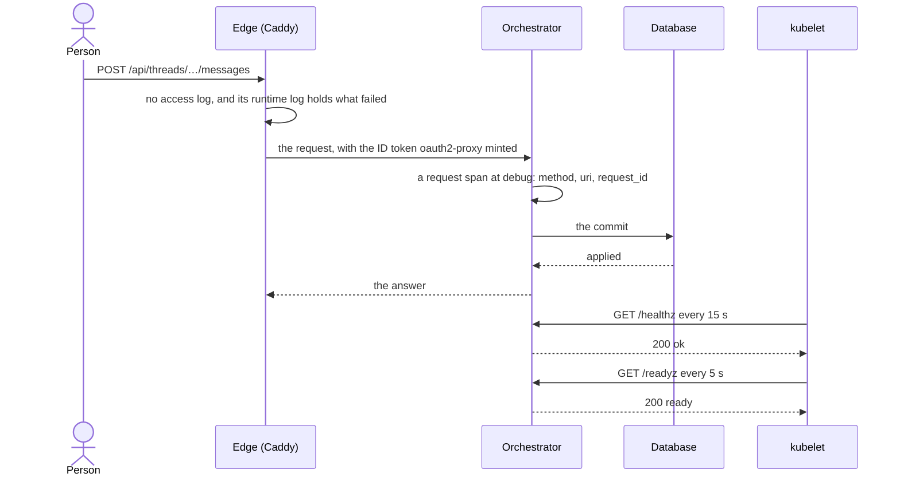
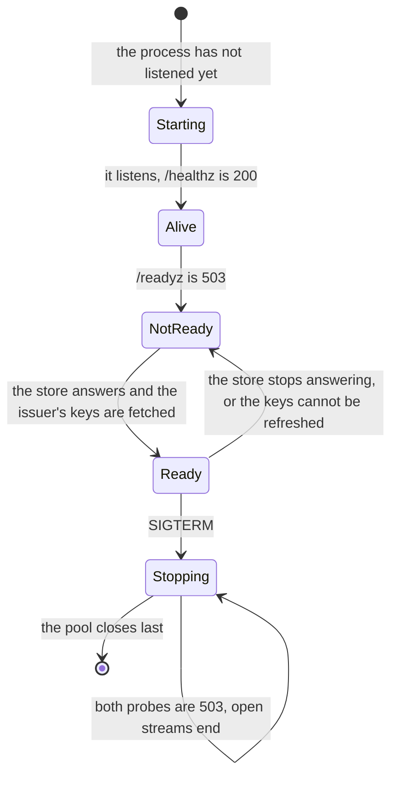

# Read the logs and traces of a deployment

This page is what an operator can read out of a running deployment: the lines the orchestrator writes,
the filter that decides which of them exist, the two probes Kubernetes asks, and the one thing that is
not there yet — a trace that follows one task across processes. It assumes the deployment of
[Deploy to Kubernetes](../deploy.md).

**How far this page is proven (2026-11-28).** The sources named in each step were read, and
`node tools/docs-check/check-docs.mjs` was run on this page. **Nothing was collected from a running
deployment: there was no cluster, so no line was read out of a pod, no probe was curled, and no
Traefik or Caddy log was seen.** Where a statement comes from a source rather than from an observation,
the step says which.

Every name with `example.com` or `my-` in it is a placeholder. Replace it with your own.





## 1. What a line is, and where it goes

The orchestrator logs with `tracing` **to stdout**, one line at a time, and keeps nothing on disk: the
container's filesystem is read-only, so stdout is the only place a line exists, and whatever collects it
is the cluster's business ([`logging.rs`](../../../orchestrator/bin/orchestrator/src/logging.rs)).

A line has one of two shapes, chosen by `log.format`:

| `log.format` | What a line is | Where it is set |
|---|---|---|
| `json` (default) | one JSON object per line, what a collector wants | `log.format` in the configuration; the chart writes `json` |
| `text` | human-readable, for a local run | the same key |

The chart does not expose the format as a value: its configuration template writes `log:
{format: json}`, so a deployment's lines are JSON
([`orchestrator-configmap.yaml`](../../../deploy/chart/templates/orchestrator-configmap.yaml)). The
config key and its default are in [`config.md`](../../api/config.md#server-log-database-dispatcher-inbox).

**Two fields are on every line**, and they are what tell two replicas apart once a collector merges
them: `role` (`all`, `control-plane` or `worker`) and `instance` (the lease owner of that process's
outbox claims). In JSON they are the first two keys; in text the line starts `role=worker instance=w1 `
([`logging.rs`](../../../orchestrator/bin/orchestrator/src/logging.rs)). A role that serves no routes
still logs, and its `instance` is the only way to know which pod a line came from.

The line that says a start worked is `orchestrator listening`, with the address, the number of agents
and the surfaces it mounted
([`boot.rs`](../../../orchestrator/bin/orchestrator/src/boot.rs)).

## 2. Set the filter

Verbosity is **not** a configuration key: it is `RUST_LOG`, read before anything else, and it is a
process override — a deployment sets it as an environment variable, not in the file
([`config.md`](../../api/config.md#variables-that-are-not-keys)). The chart renders one value into it:

```yaml [my-values.yaml]
orchestrator:
  logLevel: info   # RUST_LOG
```

([`values.yaml`](../../../deploy/chart/values.yaml), [`orchestrator-deployment.yaml`](../../../deploy/chart/templates/orchestrator-deployment.yaml).)

The rule the binary applies to that value is the useful part:

- **unset or empty**: the filter is `info,rmcp=off`;
- **set**: `rmcp=off` is **added** to your filter, unless your filter names `rmcp` (a directive whose
  target is `rmcp` or starts with `rmcp::`) — then it is yours whole.

So the chart's `info` runs as `info,rmcp=off`
([`orch-log-filter`](../../../orchestrator/crates/log-filter/src/lib.rs)).

**Why `rmcp` is off by default.** `rmcp` is the MCP library, and it logs what the servers it talks to
say: at `info` a server's own `instructions`, at `warn` and `error` the **URL** of a request that failed
(a person's URL can carry a secret in its path) and the pre-handshake messages, and at `debug` and
`trace` every message. A server a person typed can make any of that say what it likes. The
orchestrator's own lines say what happened without the URL and without a word the server chose, so the
library's are off unless you name it. **Naming `rmcp` in a deployment that lets people add servers puts
what a stranger's server says, and the URL of a failed request, in the logs** — that is the trade, and
it is yours to make.

To read one process more closely without drowning in the rest, raise its own filter, for one pod:

```sh [terminal]
kubectl -n another-agentic-system set env deploy/another-agentic-orchestrator RUST_LOG=info,orch_app=debug
```

***Unverified*: no cluster.** The variable and its effect are the binary's; the `kubectl set env` form
is this page's, and it restarts the pod, which is a rollout of one replica.

## 3. Read the probes

Kubernetes asks two questions, and both are answered on the orchestrator's own listener, with no
identity ([`routes.rs`](../../../orchestrator/crates/api/src/routes.rs)):

| Path | Answer | What it means |
|---|---|---|
| `GET /healthz` | `200 ok`, or `503 shutting down` | the process is alive and not stopping. It says nothing about the database |
| `GET /readyz` | `200 ready`, or `503 not ready` | it can serve: the store answers, and the issuer's keys were fetched |

`/readyz` has two refusals with different bodies. `not ready` is the process's own readiness — a worker
is ready once the store is reachable and its dispatcher has started; the other roles start ready, the
database having been migrated and reached. `not ready: cannot authenticate` is the identity provider:
while the issuer's keys have never been fetched, every request would be refused, so the pod stays out of
the Service ([`routes.rs`](../../../orchestrator/crates/api/src/routes.rs), ADR 0033).

The chart's probe timings decide how long a bad start looks like a bad start and not like a crash
([`orchestrator-deployment.yaml`](../../../deploy/chart/templates/orchestrator-deployment.yaml)):

| Probe | Path | Every | Fails after |
|---|---|---|---|
| startup | `/healthz` | 3 s | 40 tries (2 min) |
| liveness | `/healthz` | 15 s | 4 tries |
| readiness | `/readyz` | 5 s | not set: Kubernetes' own default |

The readiness probe sets no failure threshold, so the default applies; the other two set theirs, which
is what makes a slow start a two-minute grace rather than a restart.

**A 503 is not a crash.** Both probes turn 503 while the process is stopping, on purpose: open event
streams end once caught up and clients reconnect elsewhere, and a liveness probe must not kill a pod
that is draining ([`boot.rs`](../../../orchestrator/bin/orchestrator/src/boot.rs)). A pod that is
`Running` and not `Ready` is therefore a normal state for a start, and for a stop.

An **exit code** is the other half of the story, and the binary uses `sysexits.h` values
([`main.rs`](../../../orchestrator/bin/orchestrator/src/main.rs)):

| Code | Meaning |
|---|---|
| `78` | the configuration: a refused key, or a PostgreSQL below the floor |
| `69` | a service it needs (Postgres) is unavailable |
| `71` | the listen address cannot be bound |
| `70` | a component stopped or panicked |
| `1` | anything else, including a migration history that does not match |

## 4. There is no trace export yet

**The orchestrator exports no traces.** No OpenTelemetry crate is in any manifest, the outbox has no
`traceparent` column, and a W3C trace context cannot cross it: the request span, the request id and the
thread id are what tie a task's lines together, not a trace
([`orchestrator.md`](../../orchestrator.md), open question 27 in
[open questions](../../open-questions.md)). The work is tracked in the project's board and is not done
(*unverified* here: the card is not in this repository).

What that costs you, plainly: **a slow task cannot be followed as one trace across a control plane and
a worker.** You follow it by `thread` in the lines of every process that touched it, and you accept that
the hops are separate.

What you can rely on instead:

- **`role` and `instance` on every line**, so two replicas' lines can be told apart after a collector
  merges them.
- **A request span at `debug`**, with `method`, `uri`, `version` and `request_id` — the id read from the
  caller's `X-Request-Id` header, empty when none is sent
  ([`trace.rs`](../../../orchestrator/crates/api/src/trace.rs)). At the chart's `info` that span is not
  emitted.
- **No capability in a path.** The span's `uri` has the token segment of `/s/`, `/api/shared/`,
  `/api/public/shared/`, `/agui/shared/` and `/agui/public/shared/` replaced by `…`, and the OAuth
  callback's query — the `code`, the `state`, the `iss` — written as `…`
  ([`trace.rs`](../../../orchestrator/crates/api/src/trace.rs)). A share link is a working credential
  until it expires; a log that kept it would keep one.

## 5. What else a deployment can read

Besides stdout, four things are worth knowing about, and the chart turns on only some of them.

- **Kubernetes events and probe state.** `kubectl describe pod` and `kubectl get events` are where a
  failed mount, an unsynced `ExternalSecret` and a probe's refusals show up — not in the orchestrator's
  log, which never runs if the pod does not start. The list of what to look at, symptom by symptom, is
  [If it stops](../deploy.md#if-it-stops).
- **`/metrics`.** The process serves it on the same listener, with no identity, from the same router as
  the probes ([`lib.rs`](../../../orchestrator/crates/api/src/lib.rs)). **The chart configures no
  scrape**: metrics are listed among what a deployment does not have, because the reference deployment
  had no Prometheus and the logs are JSON on stdout
  ([Unverified and what is not there](../../../deploy/chart/README.md#unverified)). Scraping the pods
  directly is possible and *unverified* here.
- **The files host's access log.** That one Caddy does log, and it is built to be safe: the query
  string is emptied, the `Referer` is dropped and `Authorization` is Caddy's `REDACTED`, because a
  presigned URL is a working link until it expires
  ([the files host](../../../deploy/chart/README.md#the-files-host-adr-0058)).
- **Traefik's own access log, if the cluster turns it on.** The chart adds no access log at the
  Ingress, and the edge's Caddyfile has no `log` directive, so its runtime log holds only what failed
  ([`files/Caddyfile`](../../../deploy/chart/files/Caddyfile)). **Whether your Traefik logs request
  paths is *unverified*** and it is the cluster's setting
  ([Unverified](../../../deploy/chart/README.md#unverified)). It matters before you turn public sharing
  on: a share token is in the path, so an access log with paths is a list of working links
  ([Sharing a thread](../../../deploy/chart/README.md#sharing-a-thread)).

## 6. Follow one task by hand

There is no query language here, only lines. This is the shape of a search, and it is the one the
missing trace would have saved you:

```sh [terminal]
# every line of one pod, newest last, as it happens
kubectl -n another-agentic-system logs deploy/another-agentic-orchestrator -f

# the lines of one thread, across every process of the release
kubectl -n another-agentic-system logs -l app.kubernetes.io/instance=another-agentic-system \
  --tail=-1 | grep 0190aaaa-0000-7000-8000-000000000123
```

***Unverified*: no cluster.** The thread id is a UUID of the thread (`GET /api/threads`), and the label
selector is this page's — check it against your own render. With several replicas, `logs -l` merges
them, which is exactly why `instance` is on every line.

What to look for, in order: `orchestrator listening` (the process started), a line naming a refused
configuration key (it did not), the dispatcher's lines for the thread (the task was claimed), and the
agent's or the model's failure if the task ended badly. A job that ends `blocked` or a task that never
starts is a different page: [Troubleshoot](troubleshoot.md).

## 7. Where to read more

- Every key and its default: [`config.md`](../../api/config.md).
- The filter and why the MCP library is off:
  [`orch-log-filter`](../../../orchestrator/crates/log-filter/src/lib.rs).
- What a task's lines are tied by, and what a trace would need:
  [Trace context](../../orchestrator.md).
- What the chart does not have, in the deployment's own words:
  [Unverified and what is not there](../../../deploy/chart/README.md#unverified).
