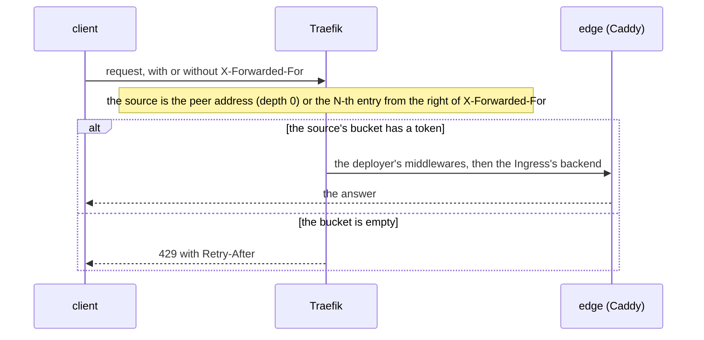
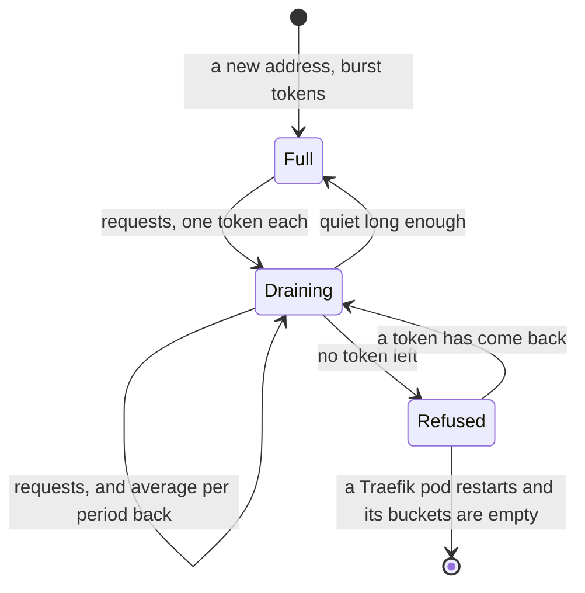

# Limit how fast one client address may call the host

The chart can render a Traefik `RateLimit` middleware and name it on its own `Ingress`, so that one client address cannot
call the host faster than a token bucket allows. It is off by default, and this page says why, how to find out whether your
ingress can even count the right address, and how to turn it on. Every value, its default and what the chart refuses are in
the [chart's README](../../../deploy/chart/README.md#a-limit-per-client-at-the-edge).

**How far this page is proven (2026-11-28).** Everything here was read from
`deploy/chart/templates/ingress-ratelimit.yaml`, `deploy/chart/templates/ingress.yaml`,
`deploy/chart/templates/_validate.tpl`, `deploy/chart/values.yaml` and the chart's README. **Nothing was run for this page:**
there was no cluster and no Helm 4.3.2 where it was written. The kind end-to-end `ratelimit-e2e` passed on `main` on
2026-11-27 (run 45639270193, job 139293066602, at `76afeb3`, as the repository's status note records), though the scenario's
own [README](../../../deploy/chart/tests/ratelimit-e2e/README.md) still says it was unverified in a cluster until the job ran.
**Unverified:** the production ingress's Traefik (its version, its `safeNaming`, its `forwardedHeaders.trustedIPs`), the
address it sees behind the provider's load balancer, and the starting numbers under real traffic.

Every host with `example.com` or `my-` in it is a placeholder. Replace it with your own.





## 1. What the limit is

A Traefik [`RateLimit`](https://doc.traefik.io/traefik/reference/routing-configuration/http/middlewares/ratelimit/) — a
`traefik.io/v1alpha1` custom resource of the cluster's Traefik — that the chart renders and names on its own `Ingress` with
the annotation `traefik.ingress.kubernetes.io/router.middlewares`. It is five values — `ingress.rateLimit.enabled`,
`.average`, `.period`, `.burst` and `.sourceDepth` — and every one is checked whether or not the limit is on, so a wrong one is
found when it is written and not the day it is turned on. Their defaults and refusals are in the
[chart's README](../../../deploy/chart/README.md#a-limit-per-client-at-the-edge), which owns them; `sourceDepth` is section 4.

**Traefik keeps a token bucket per client address:** it holds `burst` requests at once and gains `average` per `period`. A
request that would have to wait less than half the interval between two tokens — 25 ms at 20 a second — is held that long
instead of refused, which is Traefik's own smoothing. `average: 0` is not offered, because Traefik reads 0 as "no limit".

**A refused client gets Traefik's own `429`, with `Retry-After`, and nothing else.** The chart adds no access log and no body
of its own. The middleware runs first in the router's chain, so a `router.middlewares` your deployment already sets in
`ingress.annotations` is kept, after ours, in the same comma-separated value.

**It covers every path of the host** — the web, the API, the streams, the public share routes — but not the files host, which
has its own `Ingress`. A request is counted when it arrives, so an SSE stream counts once, at connect, and costs no more for
the time it stays open.

**The buckets live in each Traefik pod's memory.** Two Traefik replicas give a client twice the rate, and a restart empties
them. There is no shared state and no configuration for one.

## 2. Why it is off by default

The limit is only as good as the address it counts, and **with the wrong address it throttles everybody together** — which is
worse than no limit, because the site goes down for every person at the rate one client could use. There are two ways to get
it wrong, and the end-to-end reproduces both:

::: in-depth The two ways the address can be wrong
- **Depth 0 behind a proxy.** The peer that connects to Traefik is then the load balancer's or the node's address — a
  Service with `externalTrafficPolicy: Cluster` hides the client's address behind the node's — and it is the same for every
  client: one bucket for all of them.
- **Depth 1 or more with a proxy Traefik does not trust.** A peer that is not in the entrypoint's
  `forwardedHeaders.trustedIPs` has its `X-Forwarded-*` headers deleted before any middleware runs, so no request has a
  source, and every request without one shares a single bucket. The same happens when the header has fewer entries than
  `sourceDepth`.
:::

Nothing in this repository can say which case your provider's ingress is — that is
[open question 51](../../open-questions.md), still open — so the chart leaves the limit off and the decision is yours.

## 3. Find out what Traefik sees

Do this before you set any value. It is the cluster's Traefik configuration, not this chart's. ***Unverified*: no cluster.**

1. Turn Traefik's access log on for a few minutes, keeping the forwarded header and dropping the query (a share link's token
   and an OAuth `code` travel in paths and queries):

   ```sh [traefik flags]
   --accesslog=true --accesslog.format=json \
   --accesslog.fields.headers.names.X-Forwarded-For=keep \
   --accesslog.fields.queryparameters.defaultmode=drop
   ```

2. Make one request from a machine whose public address you know, and read the line. **`ClientAddr` is the peer Traefik
   saw** — what depth 0 counts. **`request_X-Forwarded-For` is the list a proxy in front appended to** — what depth N counts.
   `ClientHost` does not tell the two apart: it is the whole forwarded header when there is one and the peer's host when
   there is none.
3. Turn the access log off again unless the cluster keeps it.

Write down both addresses. If `ClientAddr` is the same for two different networks, depth 0 will throttle them together.

## 4. Choose the depth, and make Traefik trust the proxy

1. **`sourceDepth: 0`** when `ClientAddr` is the client. **`sourceDepth: N`** when N proxies you trust stand in front and
   the N-th entry **from the right** of the header is the client: a load balancer that appends the client's address is `1`;
   a CDN that appends the client and a load balancer that appends the CDN's edge is `2`. Never more than the proxies you
   trust — an entry further left is written by the client, so a client could pick its own bucket.
2. **Tell Traefik to trust that proxy**, for any depth above 0: the entrypoints' `forwardedHeaders.trustedIPs` (in Traefik's
   own chart, `ports.websecure.forwardedHeaders.trustedIPs`) must hold the proxy's addresses. Without it you get the second
   failure above, not a limit.

## 5. Check the Traefik itself before you turn it on

The Traefik in your cluster decides whether the annotation works at all: its version, and whether
`providers.kubernetesCRD.safeNaming` is on. ***Unverified*: no cluster.**

```sh [terminal]
kubectl -n my-traefik-namespace get deployment traefik \
  -o jsonpath='{.spec.template.spec.containers[0].image}{"\n"}'
kubectl -n my-traefik-namespace get deployment traefik -o yaml | grep -i safenaming
```

The chart writes the middleware's name in the form `<namespace>-<name>@kubernetescrd`, the form of Traefik before
`providers.kubernetesCRD.safeNaming`. **With `safeNaming` on, Traefik wants `<namespace>_<name>@kubernetescrd` and does not
resolve the form this chart writes: it does not create the router, and the host is not served.** The chart has no value for
the other form yet, so with `safeNaming` on, leave the limit off and say so in the issue.

## 6. Turn it on

***Unverified*: no cluster.** Start from what you measured in section 3; the numbers below are the chart's defaults, a first
guess and not a measurement.

1. Set the values in your deployment's values file, with the `sourceDepth` of section 4:

   ```yaml [my-values.yaml]
   ingress:
     rateLimit:
       enabled: true
       average: 20      # requests per period, per client address
       period: 1s
       burst: 50        # requests at once, the bucket's size
       sourceDepth: 0   # 0, or the N-th entry from the right of X-Forwarded-For
   ```

2. Sync or upgrade.
3. Look at what arrived:

   ```sh [terminal]
   kubectl -n my-namespace get middleware.traefik.io
   kubectl -n my-namespace get ingress another-agentic -o jsonpath='{.metadata.annotations}'
   ```

   The `Middleware` should be there with your numbers, and the Ingress's annotation should name it.

## 7. Check it, and take it off

***Unverified*: no cluster.** Call the host from two places and watch one of them refused:

```sh [terminal]
curl -s -o /dev/null -w '%{http_code} ' https://agentic.example.com/
```

In a loop, one client gets `429` after the burst while the other keeps being served. If the host answers **`404` instead**,
the annotation does not name a middleware Traefik has — most often the `safeNaming` form of section 5. Turn the value off and
read Traefik's log.

To take the limit off again, set `enabled: false`: the `Middleware` goes, and the annotation with it.

::: in-depth Measure before you tighten it
**Measure before you tighten it.** A page load of the web asks for the shell, a few dozen static files, the thread list and
a stream; the default burst is meant to hold one, and the default rate is meant to be far above what a person does and far
below what a script does. The orchestrator's own limit — per process, per share link — is the other layer, and it stays: it
does not depend on the address.
:::

## 8. What CI proves, and what it does not

::: in-depth What the checks prove, and what they do not
`tests/render-check.sh` holds the render: off, nothing (no `Middleware`, no annotation, the Ingress as it was); on, the
`Middleware` with the numbers and the annotation naming it in the release's namespace, ours before the deployer's, the
deployer's other annotations kept, and every refusal above — each check was broken on purpose once. `deploy.yml` validates
the `Middleware` against the vendored CRD schema.

`ratelimit-e2e` runs a real Traefik on kind: the Traefik chart pinned by version and SHA-256, the chart's own `Ingress` and
`Middleware`, a pinned whoami behind it and three client pods with addresses of their own. It asserts the control with the
limit off (all 200), one client refused at depth 0 while another is served, depth 1 on `X-Forwarded-For` (two forwarded
addresses from one pod are two clients, and one address from two pods is one client), and the two failures of section 2 — a
forged header at depth 0 is not the source, and a Traefik that does not trust the pods gives everybody one bucket
([the workflow](../../../.github/workflows/ratelimit-e2e.yml)).

**What it does not prove:** the production Traefik — its version, its `safeNaming`, its `forwardedHeaders.trustedIPs`, and
what `X-Forwarded-For` holds behind its load balancer (open question 51). Nor the starting numbers under real traffic, two
Traefik replicas (each keeps its own buckets), an SSE stream (counted once by Traefik's design, read in its source and not
run here), or the Ingress's TLS through cert-manager (the certificate in the scenario is self-signed).
:::

## Next

The values, their defaults and every refusal: [the chart's README](../../../deploy/chart/README.md#a-limit-per-client-at-the-edge).
What the orchestrator limits by itself, and why a share link is the unit there:
[ADR 0040](../../decisions/0040-thread-sharing-by-revocable-link.md). The open question about the address behind the
provider's ingress: [Open questions](../../open-questions.md). More instances of the database, which is the other kind of
scale: [Scale the database](scale-the-database.md).
