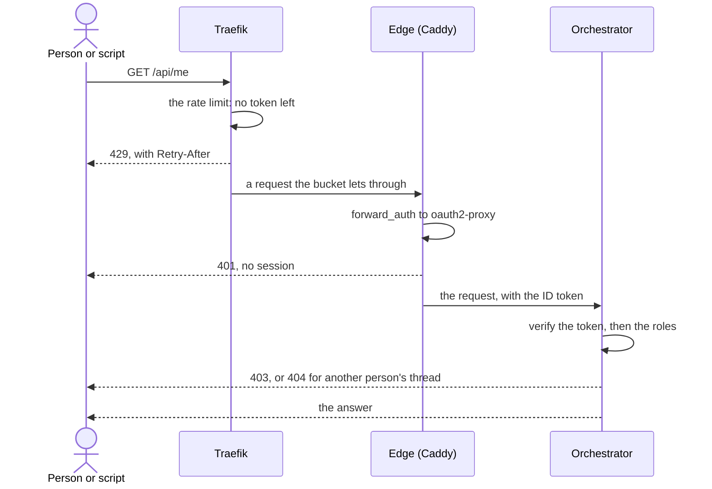
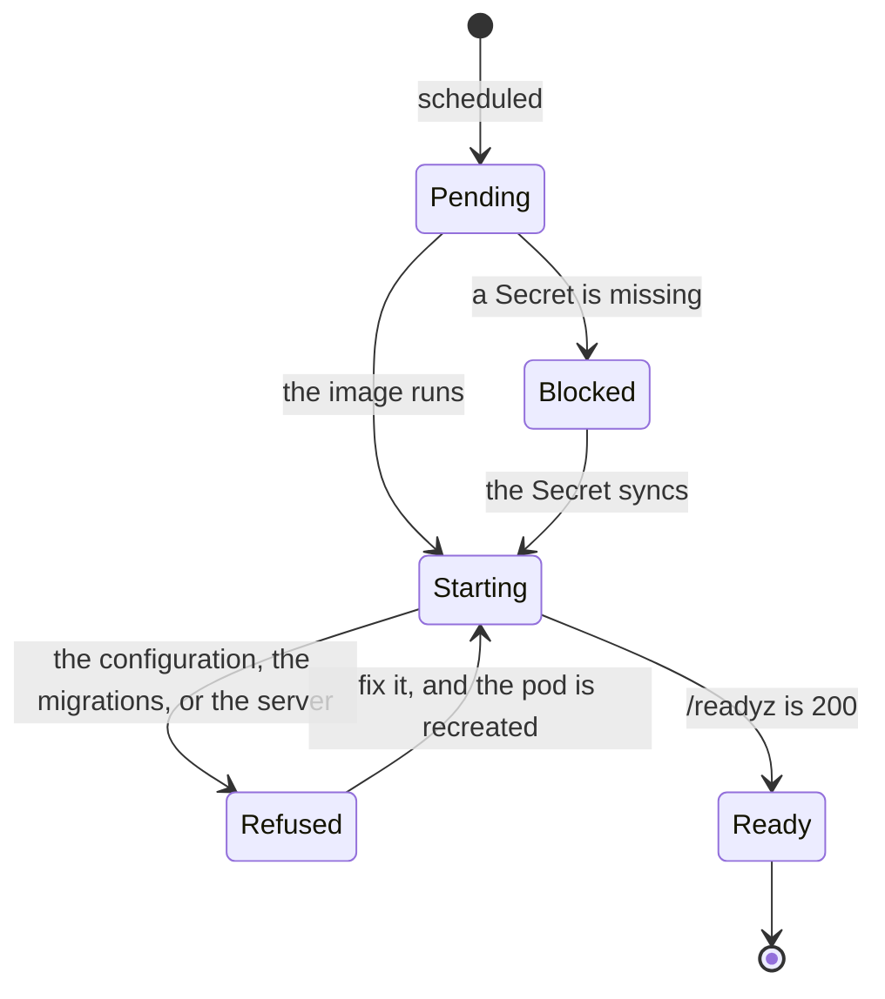

# Troubleshoot a deployment

Five symptoms cover most of what goes wrong on a deployment of this chart. Each one below says what you
see, what it means, the command or value that fixes it, and where to read more. It assumes the install
of [Deploy to Kubernetes](../deploy.md) and the chart `deploy/chart`, whose README is the reference for
every value.

**How far this page is proven (2026-11-28).** Every command is the one the chart README or the deploy
guide gives, or was read in the source named in its entry. **None of them was run against a cluster:
there was none where the page was written**, so no symptom here was observed end to end, and the one
thing this page cannot give you is what it looked like on your own pods.

Every name with `example.com` or `my-` in it is a placeholder. Replace it with your own. The namespace
`another-agentic-system` is the release name of the deploy guide; yours is whatever you installed.





## 1. A pod waits on a Secret

**What you see.** One of these, which are the same cause at two layers:

- an `ExternalSecret` that is not `Ready`, with a `SecretSyncedError` event;
- the orchestrator pod in `ContainerCreating`, with a `FailedMount` event that says a Secret is not found;
- the `chat` or `oauth2-proxy` pod in `CreateContainerConfigError`, and `describe pod` names the missing
  Secret.

**What it means.** The chart holds no secret: each `ExternalSecret` reads **properties of one entry** of
your store, a JSON object, and **one missing property stops the whole Secret from syncing**. The
orchestrator mounts its Secret as files, which is why it fails at the mount; the chat and oauth2-proxy
read theirs as environment variables, which is why they fail at container creation
([the secrets](../deploy.md#3-the-secrets)).

**The fix.** Ask the `ExternalSecret` which property it wanted, add it to the entry, hurry the sync, then
restart the pods that read it — **pods read secrets once, at start**, so a new value has no effect until
they do:

```sh [terminal]
kubectl -n another-agentic-system describe externalsecret another-agentic-orchestrator
kubectl -n another-agentic-system annotate externalsecret another-agentic-orchestrator \
  force-sync=$(date +%s) --overwrite
kubectl -n another-agentic-system rollout restart deploy/another-agentic-orchestrator
```

::: in-depth Where these two commands come from
***Unverified*: no cluster.** The `force-sync` annotation is the chart README's own
([one database cluster](../../../deploy/chart/README.md#one-database-cluster));
the `rollout restart` line is this page's.
:::

**Where to read more.** [The AWS secret](../../../deploy/chart/README.md#the-aws-secret) for the name,
length and format of every property, and [the secrets](../deploy.md#3-the-secrets) for which
`ExternalSecret` reads which.

## 2. The chart refuses a value, or the orchestrator refuses the configuration

**What you see.** One of two messages, from two different places:

- the render fails — `helm lint`, `helm template` or the sync — with a sentence that names the key
  (`edge.enabled: false needs ingress.enabled: false: …`);
- the pod starts and exits with code **`78`**, and its log names the configuration key it refused.

**What it means.** Both are refusals that fail closed, at two moments. The chart's `_validate.tpl`
refuses, at render time, a combination that cannot work, and fails the render with a sentence that names
the key ([`_validate.tpl`](../../../deploy/chart/templates/_validate.tpl)). The binary refuses, at
startup, a configuration it cannot honour, and exits `78` rather than starting wrong
([`main.rs`](../../../orchestrator/bin/orchestrator/src/main.rs)).

The second one has a cause that is easy to miss: **an image older than a configuration key refuses that
key**. A deployment turns a new option on only once `orchestrator.image.tag` is at or after the merge
commit that added it, or the pod exits `78` and, with `Recreate`, takes the orchestrator down
([the pinned orchestrator image](../../../deploy/chart/README.md#the-pinned-orchestrator-image)).

**The fix.** Read the key in the message. If it is a combination, change the value the chart names. If it
is a key the pinned image does not know, **bump the tag first** and turn the option on in the sync after:

```sh [terminal]
sh deploy/chart/bump-tag.sh deploy/chart/values.yaml orchestrator sha-abc1234
```

**Where to read more.** [Values](../../../deploy/chart/README.md#values) for every key, its default and
what is refused, and
[the pinned orchestrator image](../../../deploy/chart/README.md#the-pinned-orchestrator-image) for the
rule about a key newer than the image.

## 3. The orchestrator will not start: the migrations

**What you see.** A pod in `CrashLoopBackOff`, with one of two log lines and exit codes:

- exit **`78`**, with two PostgreSQL versions in the message: the server is below the floor;
- exit **`1`**, with a log line saying the applied migrations do not match what this build carries: a
  downgrade, or an edited migration.

**What it means.** The orchestrator migrates **when it starts**, on a connection of its own, under a
session advisory lock
([`orch-store-postgres`](../../../orchestrator/crates/store-postgres/README.md#api-at-a-glance)).
Before anything is applied it refuses three things: a row that did not succeed (`Dirty`), a version the
history has and this build does not (`VersionMissing`), and a checksum that differs (`VersionMismatch`).
**PostgreSQL 18 is the floor**, and a server below it is refused before any DDL
([`orch-pg-migrate`](../../../orchestrator/crates/pg-migrate/README.md)). A downgrade is exactly the
`VersionMissing` case: the older build does not know the newer migration
([the migration note](../../orchestrator.md)).

**The fix, by cause:**

| Cause | Fix |
|---|---|
| the server is below 18 | a `database.imageName` whose tag is 18 or later (a major move is CloudNativePG's offline in-place upgrade) |
| a downgrade (`VersionMissing`) | **there is no rollback**: go forward, or restore a backup into a new cluster |
| an edited migration (`VersionMismatch`) | restore the file from git: applied migrations are append-only, and CI refuses an edit |
| a row that did not succeed (`Dirty`) | a run was cut short; the history names the migration, and the migrator refuses to go on until it is resolved |
| the request pool goes through a pooler | set `database.directUrl` to the cluster's `-rw` Service, or the session lock cannot be held |

**Where to read more.** [One database cluster](../../../deploy/chart/README.md#one-database-cluster),
[the floor](../../../orchestrator/crates/pg-migrate/README.md), and
[going back](upgrade-a-release.md#6-going-back-the-database-refuses-the-previous-tag).

## 4. A `401` from the edge, a `403` from the orchestrator, or a `404`

**What you see.** `curl` answers `401`; or the person signs in and is then refused; or a thread they know
exists is a `404`.

**What it means.** Three layers, three answers, and the answer says which one:

| Answer | From | What it means |
|---|---|---|
| `401` | the edge (Caddy's `forward_auth`) | there is no session: not signed in, or the session ended |
| `401` carrying `WWW-Authenticate: Bearer` | the orchestrator's identity layer | it read a token and refused it, or there was none |
| `503` on `/api/…` | the orchestrator | it cannot tell: the issuer's keys were never fetched |
| `403` | the orchestrator | signed in, but a role or a permission is missing |
| `404` | the orchestrator | the thread is another person's — for every role, the administrator's included |

::: in-depth Why the header is the tell
The header is the tell: the orchestrator sets `WWW-Authenticate: Bearer` when a bearer token is a
credential it reads ([`lib.rs`](../../../orchestrator/crates/api/src/lib.rs),
[ADR 0039](../../decisions/0039-nobody-reads-another-persons-thread.md)).
:::

The `403` is the one to look at twice: a person reaches only the agents their roles name, and a role
`auth.roles` does not list grants nothing
([who reaches what](../../../deploy/chart/README.md#several-coders-one-per-github-owner)). The `401`
from the edge is usually the sign-in, not the API: the client's redirect URI must be `https://` + `host`
+ `/oauth2/callback`, and the person needs the client role `user` and **Email verified**
([If it stops](../deploy.md#if-it-stops)).

**The fix.** For the edge's `401`, sign in again, and check the client's redirect URI and the role. For
the orchestrator's `403`, give the role the permission, or the person the role. For the `404`, nothing:
it is the answer, by design.

**Where to read more.** [Roles and permissions](../../api/config.md#roles-and-permissions),
[ADR 0039](../../decisions/0039-nobody-reads-another-persons-thread.md), and
[If it stops](../deploy.md#if-it-stops).

## 5. A `429` from the rate limit

**What you see.** A `429` with `Retry-After`, in a loop, or after a burst of requests from one address.

**What it means.** It is **Traefik's** answer, not the orchestrator's: a token bucket per client address,
`average` requests per `period`, holding `burst` at once. The chart adds no body and no access log of its
own. The limit is **off by default**, and a page load of the web asks for the shell, a few dozen static
files, the thread list and a stream, which is why the starting point is generous. Two things make it
bite: `sourceDepth: 0` counts the peer, so behind another proxy every client looks like one address, and
the buckets live in each Traefik pod's memory, so two replicas give a client twice the rate
([a limit per client at the edge](../../../deploy/chart/README.md#a-limit-per-client-at-the-edge)).

**The fix.** Raise `ingress.rateLimit.average` or `.burst`, set `ingress.rateLimit.sourceDepth` to the
entry of `X-Forwarded-For` that holds the client (1 to 5, from the right), or turn
`ingress.rateLimit.enabled` off. A wrong number is refused whether the limit is on or off, so the render
tells you.

**Where to read more.**
[A limit per client at the edge](../../../deploy/chart/README.md#a-limit-per-client-at-the-edge), and the
five things it asks you to check about the ingress in front of it.

## 6. If it is none of these

Two pages answer the rest:

- [Deploy to Kubernetes](../deploy.md#6-check-that-it-works) works down the install check by check —
  secrets, database, pods, certificate, then the outside.
- [Logs and traces](logs-and-traces.md) is how to read what the pods say, which probe refused, and what
  an exit code means.

A symptom none of these explains is worth an issue of its own, with the exit code, the log line and the
value that was in place: those three are what makes it findable next time.
