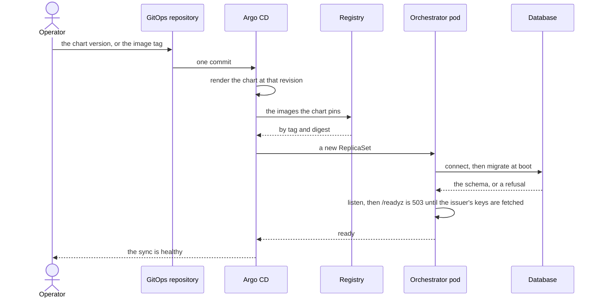
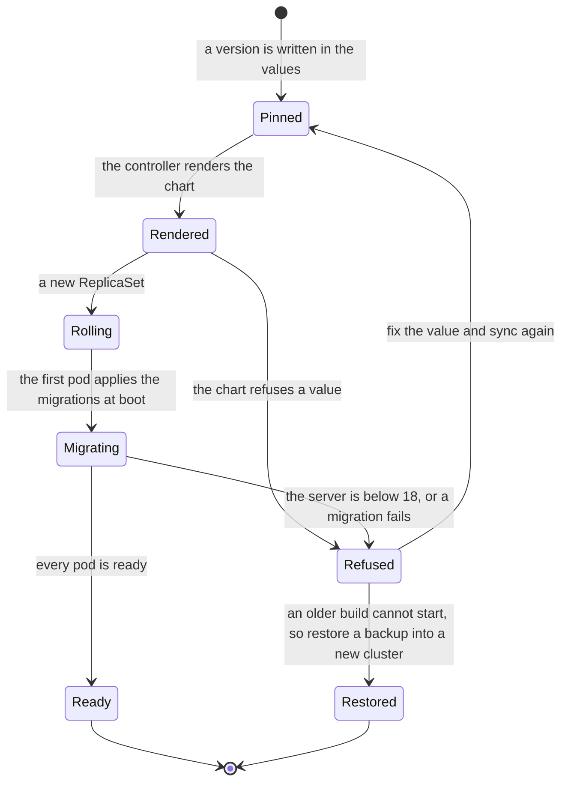

# Upgrade a deployment to a new release

This page moves a running deployment from one release to the next: what a release pins, how the new
tag reaches the pods, what the first pod to start does to the database, and what you can and cannot do
when it does not come back. It assumes the deployment of [Deploy to Kubernetes](../deploy.md), which
installs from a clone. Every value, its default and what the chart refuses are in the
[chart's README](../../../deploy/chart/README.md).

**How far this page is proven (2026-11-28).** `deploy/chart/bump-tag.sh` was run against a copy of
`deploy/chart/values.yaml`: it moved `orchestrator.image.tag`, said `unchanged` on a second run, and
refused `1.4.0` and a component it does not know, both with exit `2`. Everything that needs a
cluster, Argo CD, a registry, a release tag or a database is ***unverified*: there was none where the
page was written.** The migrations, their refusals and the exit codes are read in the sources named in
each step.

Every name with `example.com` or `my-` in it is a placeholder. Replace it with your own.





## 1. Know what a release pins

A release `vX.Y.Z` publishes three things at `X.Y.Z`, and never `latest` ([Releases](../../../deploy/chart/README.md#releases)):

| What | Tags |
|---|---|
| the orchestrator image | `X.Y.Z`, and `X.Y` (the highest patch of its minor) |
| the web image | the same |
| this chart, as an OCI package | `X.Y.Z`, with both images pinned to `X.Y.Z` **and their digests** |

Nothing is rebuilt at the tag. For each image, the release takes the `sha-<7>` of the newest commit at or
before the tag that changed that image workflow's paths, refuses an image whose
`org.opencontainers.image.revision` label is another commit, and copies it **by digest**
([ADR 0106](../../decisions/0106-a-release-tag-publishes-the-images-and-the-chart-at-one-version.md),
decision 2). Each digest and the chart are signed, and each image carries an SBOM and a provenance
attestation. A published version is never pushed over: an existing image tag must be the same digest,
and an existing chart version must have the same `values.yaml` (decision 6).

**What that means for you.** A deployment on a release sets the **chart's version** and leaves the image
values alone, because the packaged chart already pins them
([the same section](../../../deploy/chart/README.md#releases)). You do not write `X.Y.Z` into
`orchestrator.image.tag` in git: `_validate.tpl` accepts a first-party `X.Y.Z` tag only with its digest,
and never `X.Y` or `latest`.

## 2. Pick the version and write it down

Read the release notes before you pick. The changelog, `Chart.yaml`'s `version` and the app's version
files all carry the release's one version, and `tools/check-release-version.sh` refuses a tag whose
files disagree.

Then write the version into the values your deployment actually uses. Two shapes exist:

- **Argo CD.** The Application names the chart (its `path`, or the OCI reference) and the values. Change
  the target revision or the chart version there, and let the sync run. The chart at `HEAD` is the
  development path; a release is the OCI package at `X.Y.Z`
  ([ADR 0041](../../decisions/0041-deployed-with-helm-on-kubernetes-secrets-by-externalsecret.md)).
- **Helm by hand.** Pull the packaged chart at the version and upgrade the release:

  ```sh [terminal]
  helm upgrade another-agentic-system \
    oci://ghcr.io/vymalo/another-agentic-system/charts/another-agentic-system \
    --version X.Y.Z --namespace another-agentic-system -f my-values.yaml
  ```

  ***Unverified*: no registry was read beyond an anonymous `helm show chart` (below), and no upgrade ran.**
  Helm 4.3.2 is the version CI uses ([why](../deploy.md#1-what-you-need)).

Before you touch anything, check that the version exists and is the one you mean. The deploy guide ran
this form on 2026-11-28: it read the published `0.9.0`, and answered `not found` for `0.10.0`, the
version this tree's chart says (*verified 2026-11-28*,
[Deploy to Kubernetes](../deploy.md#1-what-you-need)):

```sh [terminal]
helm show chart oci://ghcr.io/vymalo/another-agentic-system/charts/another-agentic-system --version X.Y.Z
```

A version change moves the labels `helm.sh/chart` and `app.kubernetes.io/version`, and the checksums of
the orchestrator's configuration and Secrets include them, so **a release rolls those pods once even when
nothing else moved** ([Releases](../../../deploy/chart/README.md#releases)). That is normal; do not read
it as a failed upgrade.

## 3. Bump an image tag, on the development path

On `main`, the two image workflows build `sha-<7>` after their checks pass, and a bump job writes that
tag into `deploy/chart/values.yaml` with [`bump-tag.sh`](../../../deploy/chart/bump-tag.sh). The script
does one thing, and it is the only writer of those tags in git:

```sh [terminal]
sh deploy/chart/bump-tag.sh deploy/chart/values.yaml orchestrator sha-abc1234
# changed: orchestrator.image.tag sha-1ed5335 -> sha-abc1234
sh deploy/chart/bump-tag.sh deploy/chart/values.yaml orchestrator sha-abc1234
# unchanged: orchestrator.image.tag is already sha-abc1234
```

(Ran, against a copy of the file: the two lines above are its output, and the second run left the file
alone.)

It refuses what it is not for, each with exit `2` (ran):

```sh [terminal]
sh deploy/chart/bump-tag.sh my-values.yaml orchestrator 1.4.0
# refusing tag '1.4.0': expected sha-<7 hex digits>
sh deploy/chart/bump-tag.sh my-values.yaml chat sha-abc1234
# refusing component 'chat': expected orchestrator, web or webSearch
```

Two consequences. **A release tag is not written this way**: `X.Y.Z` comes from the packaged chart, and
the script refuses it. And only `tag:` inside `<component>:` / `image:` is touched, every other line is
preserved byte for byte, so the bump is safe to review as a one-line diff.

## 4. Let the rollout happen

You do not restart anything by hand. The controller applies the render, a changed pod template (the
image, or the version labels and checksums of step 2) makes a new ReplicaSet, and the old pods go away
as the new ones become ready.

Watch it, then look at the pods as well as the rollout. A pod still on the old configuration seals what it
writes with the old key, so the rollout is done only when every pod is new
([the key of the stored secrets](../../../deploy/chart/README.md#the-key-of-the-stored-secrets-adr-0046-slice-3)):

```sh [terminal]
kubectl -n another-agentic-system rollout status deploy/another-agentic-system-orchestrator
kubectl -n another-agentic-system get pods -l app.kubernetes.io/name=another-agentic-system
```

***Unverified*: no cluster.** The `rollout status` line and the advice to read `get pods` are the chart
README's ([step 3 of the re-seal](../../../deploy/chart/README.md#the-key-of-the-stored-secrets-adr-0046-slice-3));
the label selector is this page's, so check it against your own render.

## 5. Expect the migrations at boot

**The orchestrator migrates when it starts**, not in a Job you run: `PgStore::migrate()` applies the
migrations embedded in the binary, on a connection of its own, under a session advisory lock, so two
replicas that start together take turns instead of racing
([`orch-store-postgres`](../../../orchestrator/crates/store-postgres/README.md#api-at-a-glance)). A
deployment whose request pool goes through a transaction-mode pooler migrates over
`database.directUrl`, the cluster's own Service, because a pooler cannot hold the session lock
([the pooler](../../../deploy/chart/README.md#scaling-the-database-issue-290)).

Three rules follow, and they are the whole of what an operator has to remember:

1. **A migration is never edited.** Applied migrations are append-only; a change is a new file, and CI
   checks the list against the base branch
   ([`orch-store-postgres`](../../../orchestrator/crates/store-postgres/README.md)).
2. **Nothing is applied on a history that does not match.** Before its first statement the migrator
   refuses a row that did not succeed (`Dirty`), a version the history has and this build does not
   (`VersionMissing`), and, where its version comes, a checksum that differs (`VersionMismatch`)
   ([`orch-pg-migrate`](../../../orchestrator/crates/pg-migrate/README.md)).
3. **PostgreSQL 18 is the floor.** The first statement reads the server's version, and a server below
   18 is refused before any DDL: the orchestrator exits `78` naming both versions
   ([the floor](../../../orchestrator/crates/pg-migrate/README.md) and
   [the chart](../../../deploy/chart/README.md#one-database-cluster)).

A refused migration is not an outage a restart fixes. The process exits non-zero and stays down until
the cause is gone: `78` for a server below the floor, `1` for a history that does not match (a
`VersionMissing` is classified `Corrupt`, not `Transient`, in
[`error.rs`](../../../orchestrator/crates/store-postgres/src/error.rs), and
[`main.rs`](../../../orchestrator/bin/orchestrator/src/main.rs) maps only a configuration error or a
server below the floor to `78`).

## 6. Going back: the database refuses the previous tag

**There is no downgrade.** Once a release's migrations have run, the previous build cannot start: its
own migrator returns `VersionMissing` for a migration it does not know, "as for every migration", so a
pod of the older build that restarts refuses to start
([the migrations list](../../orchestrator.md#data-model)). A replica of the older build that is *already
running* keeps running and ignores what it does not read, but it cannot be rescheduled, and a
`helm rollback` or a reverted tag turns into a CrashLoopBackOff on the first new pod.

So the way back is one of two, and neither is a rollback:

- **Forward.** Fix the value, the configuration or the image and upgrade again. The release you moved to
  is signed and immutable, and a new one is a new version.
- **Restore.** Put the database back from a backup into a **new** cluster and cut the deployment over to
  it, with the older image. The chart ships the manifest for the restore cluster,
  [`examples/restore-cluster.yaml`](../../../deploy/chart/examples/restore-cluster.yaml), and the cutover
  is [steps by hand](../../../deploy/chart/README.md#replace-a-lost-cluster) which have not run on a
  cluster. **Backups are off by default**: if `backup.enabled` was false, there is nothing to restore, and
  this is the moment you find out
  ([Backups](../../../deploy/chart/README.md#backups)). The order of that work is
  [Back up and restore the database](backup-and-restore.md).

Before you upgrade, ask the two questions this section answers: do I have a backup, and can I go
forward from here? A release that changes the schema is a one-way door.

## 7. Check that it worked

Work down this list. ***Unverified*: no cluster.**

```sh [terminal]
kubectl -n another-agentic-system wait --for=condition=Available deployment --all --timeout=10m
kubectl -n another-agentic-system get pods
kubectl -n another-agentic-system logs deploy/another-agentic-system-orchestrator --tail=50
curl -sS -o /dev/null -w '%{http_code}\n' https://agentic.example.com/api/me
```

Expect every Deployment to report `condition met`, one ReplicaSet per Deployment with every pod new, a
log whose last lines are not a refusal, and `401` from `/api/me` with no session. In the log, a start
that worked says
`orchestrator listening` with the address, the agent count and the surfaces
([`boot.rs`](../../../orchestrator/bin/orchestrator/src/boot.rs)). `/readyz` answers `503` until the
issuer's keys have been fetched, so a pod that is `Running` but not `Ready` for a minute is the normal
shape of a start, not a failed upgrade.

Then sign in and send one message: that is the step that proves the model endpoint, the agents and the
new schema agree. What to expect at each step is
[Check that it works](../deploy.md#6-check-that-it-works).

## 8. Where to read more

- Every tag, what is signed and how to verify it: [Releases](../../../deploy/chart/README.md#releases).
- Why a release is a copy of a `main` build and not a rebuild:
  [ADR 0106](../../decisions/0106-a-release-tag-publishes-the-images-and-the-chart-at-one-version.md).
- What the migrations are, and the refusals:
  [`orch-pg-migrate`](../../../orchestrator/crates/pg-migrate/README.md).
- What a deployment turns on only after a bump (an image older than a key refuses the configuration at
  startup): [the pinned orchestrator image](../../../deploy/chart/README.md#the-pinned-orchestrator-image).
- The rest of the first install: [Deploy to Kubernetes](../deploy.md).
