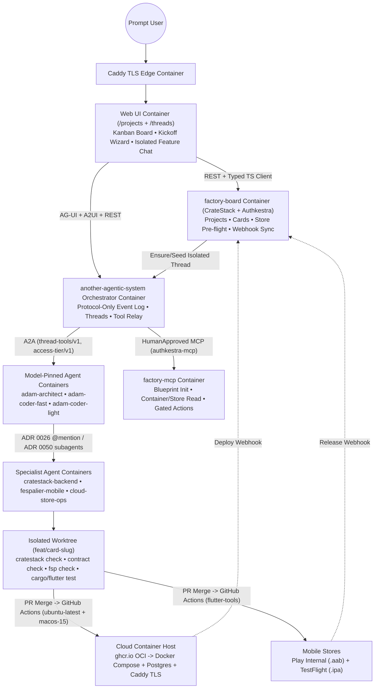

# App Factory Technical Plan (2026-12): Maintainable Mobile Apps & Cloud Containers

> **Status:** Superseded in part by the [Amended (2026-11-26)](../decisions/0073-app-factory-board-and-model-selection.md#amended-2026-11-26) note of ADR 0073 (the board a component of this repository outside the core, one SQLite container per app run by a platform app kind and built in the person's own GitHub, model pick by ADR 0086, specialists as child sessions; no Compose stack). Was: Proposed for review (`@stephane-segning`) — revised 2026-11-18 for container-only MVP (see [ADR 0073](../decisions/0073-app-factory-board-and-model-selection.md))  
> **Target Window:** 2026-11-18 to 2026-12-31  
> **Backbone:** `another-agentic-system` + [another-adam-rs](https://github.com/vymalo/another-adam-rs) + [another-agentic-images](https://github.com/vymalo/another-agentic-images) (**no Kubernetes for MVP — plain OCI containers + Docker Compose + Caddy TLS**)  
> **Generated App Stack:** [fespalier](https://github.com/fespalier/fespalier) (Flutter UI) + [cratestack](https://github.com/cratestack/cratestack) (`.cstack` schema-first server, offline SQLite, typed Dart client) + [authkestra](https://github.com/Authkestra/authkestra) (OIDC OP, passkeys, device-signed sessions, `authkestra-mcp`)  
> **Delivery Targets:** Cloud container backend (OCI image + Docker Compose + Postgres container + Caddy HTTPS) & Store-ready mobile releases (Google Play Internal Track + Apple TestFlight via [flutter-tools](https://github.com/vymalo/flutter-tools))

> **Scope note per repository conventions:** Per [`ROADMAP.md`](../../ROADMAP.md), product delivery schedules and operator staffing belong in the blueprint/operator repositories rather than `another-agentic-system`; this document records the cross-repo **architecture, verified findings, common traps, and dependency-ordered work breakdown** for the December release, anchored by [ADR 0073](../decisions/0073-app-factory-board-and-model-selection.md).

---

## 1. Goal & Definition of "Maintainable"

Build a **prompt-driven, Kanban-orchestrated software factory** running on **containers only** using the `vymalo/another-*` stack so a user goes from a project brief and feature cards to:
1. A **maintainable full-stack codebase** generated from a golden template (`vymalo/app-factory-blueprint`).
2. **Isolated feature development** where each Kanban card owns a 1:1 isolated chat thread, git branch (`feat/<slug>`), worktree, model-pinned agent container, and tool preset.
3. **Automated cloud container deployment** (OCI image build → `ghcr.io` → cloud Docker host `docker compose pull && docker compose up -d --wait` with Postgres + Caddy automatic HTTPS + Authkestra endpoints).
4. **Automated store push** (GitHub Actions + `vymalo/flutter-tools` producing signed `.aab` → Google Play Internal Track and signed `.ipa` → Apple TestFlight).

### What "Maintainable" Means Measurably for Every Generated App
- **Single schema source of truth:** `schema/app.cstack` drives server routes/SQLx, client models/RPCs (`cratestack generate-dart --preset fespalier --no-native-cbor`), and API backward-compatibility (`cratestack contract lock/check` + `cratestack diff`).
- **Deterministic tool & version pins:** Pinned `CRATESTACK_REQUIRE_VERSION`, pinned `fespalier` release tag, pinned `authkestra` revision, and checked-in Renovate config so generated apps stay cleanly upgradable.
- **Strict verification thresholds:** `cratestack check`, `cratestack contract check`, `generate-dart --check`, `fsp check`, `flutter test`, `cargo fmt --check`, `cargo clippy --all-targets -- -D warnings`, `cargo deny check`, and `docker compose config -q` + container smoke check.
- **In-repo ADRs & conventions:** Each generated app carries `AGENTS.md`, `.agents/skills/`, and `docs/decisions/` so subsequent human or AI edits preserve architectural boundaries.

---

## 2. Decisions & Open Questions for Review (`@stephane-segning`)

1. **Architecture, Container-Only Runtime & Invariant Boundary ([ADR 0073](../decisions/0073-app-factory-board-and-model-selection.md)):**
   - **No Kubernetes for MVP:** Both the factory itself (extending [`compose.yaml`](../../compose.yaml) + [`compose.live.yaml`](../../compose.live.yaml)) and generated cloud backends deploy as plain **OCI containers via Docker Compose + Caddy TLS**. [`another-agentic-platform`](https://github.com/vymalo/another-agentic-platform) (CRDs, Helm, CNPG, gVisor run pods) is deferred post-MVP.
   - Keep `projects`, `cards`, git branches, PRs, container rollouts, and store release state **outside `another-agentic-system`** in a standalone `factory-board` container (`cratestack-pg` + `authkestra` JWT validation), preserving invariants 1 and 3 of [`CLAUDE.md`](../../CLAUDE.md).
   - Deliver per-card **model choice** via separate model-pinned agent containers (`adam-architect`, `adam-coder-fast`, `adam-coder-light`) selectable in `GET /api/agents`, deferring `model-relay/v1` ([ADR 0063](../decisions/0063-an-openai-compatible-model-endpoint-per-thread-on-the-orchestrator.md)).
   - Deliver **subagent communication** via existing A2A `@mentions` ([ADR 0026](../decisions/0026-agent-mentions-as-structured-references.md)) + folder subagents ([ADR 0050](../decisions/0050-the-chat-has-sub-agents.md)) + already-merged `SessionTools`, deferring `another-adam-rs` `ADR 0045` slices 3, 4, and 6.
   - Gate any mutating deploy/store MCP action behind `authkestra-mcp`'s `HumanApproved` step-up tier; default deploys/releases trigger via PR merge to `main`.
2. **Remaining Tactical Question:**
   - Confirm creating a new repository `vymalo/app-factory-blueprint` for the golden full-stack starter (`cratestack-pg` + `authkestra` + `fespalier` + container Compose/Caddy + `flutter-tools` workflows), and confirm running generated app CI on GitHub-hosted `ubuntu-latest` (Rust/Docker/Android/Play) + `macos-15` (iOS/TestFlight) rather than requiring self-hosted K8s ARC runners.

### Hard Dec 2026 Cutline (Deferred to Jan 2027+)
- **Kubernetes / Platform Operator:** `another-agentic-platform`, Helm charts, CloudNativePG, Argo CD, and K14 gVisor run pods ([plat#54](https://github.com/vymalo/another-agentic-platform/issues/54)).
- Account deletion (`M5`, [#294](https://github.com/vymalo/another-agentic-system/issues/294)), user GitHub OAuth linking ([ADR 0064](../decisions/0064-the-person-reaches-the-agent-and-links-their-github.md), [#278](https://github.com/vymalo/another-agentic-system/issues/278)). (Security posture: without K8s `runPods`, MVP runs in a **trusted-team container deployment** with per-thread git worktree isolation.)
- Store **Production** review submission & automated screenshot framing (`flutter-tools/actions/screenshots` + full `app-store-submit` metadata) — Dec release targets **Play Internal Track + TestFlight** with manual one-time Play/ASC app creation.
- Remaining [ADR 0067](../decisions/0067-the-plan-to-librechat-grade-and-the-client-agnostic-rule.md) LibreChat items (speech/voice, foreign imports, live React/HTML sandboxes) and headless `obscura` web preview.

---

## 3. Deep-Search Findings & Common Traps (*Verified 2026-11-18*)

### 3.1 Backbone & Container Findings (`vymalo/another-*`)

| Finding | Verified Evidence | Plan Action / Guardrail |
|---|---|---|
| **Compose stack already exists, but `compose.live.yaml` is localhost-only** | [`compose.yaml`](../../compose.yaml) & [`compose.live.yaml`](../../compose.live.yaml):54–56 (*"sign-in is still the mock issuer's... Do not publish it on a network you do not trust"*, sets `MCP_ALLOW_INSECURE=true`). | Add a production `compose.factory.yaml` override (`E2-T1b`) replacing `mock-oidc` with a real OIDC issuer behind Caddy HTTPS TLS before exposing the factory on a cloud host. |
| **Orchestrator + Web MVP is mock-proven only** | [`README.md`](../../README.md), [`ROADMAP.md`](../../ROADMAP.md), [`another-adam-rs#102`](https://github.com/vymalo/another-adam-rs/issues/102): core orchestrator, AG-UI, A2UI (`catalog` v8), `thread-tools/v1`, `access-tier/v1`, forks ([ADR 0029](../decisions/0029-forking-a-thread-copies-its-log.md)) are built on WireMock / scripted models. | Run an immediate **W1 Live-Model & Real-GitHub Smoke Gate (`E2-T1`)** using `compose.live.yaml` before building Kanban integration on top. |
| **Orchestrator invariants forbid repo/CI/store tables** | [`CLAUDE.md`](../../CLAUDE.md) invariants 1 & 3, [ADR 0064](../decisions/0064-the-person-reaches-the-agent-and-links-their-github.md) (*"the orchestrator is never told what a repository is"*). | Place board/app state in companion `factory-board` container ([ADR 0073](../decisions/0073-app-factory-board-and-model-selection.md)). |
| **Model Relay (`ADR 0063`) is unbuilt; `ADR 0049` aliases are single-agent** | [`docs/api/model-relay-v1.md`](../api/model-relay-v1.md) (*"Nothing is built"*); [ADR 0049](../decisions/0049-the-coder-is-shown-as-adam-agents-may-have-aliases.md) aliases resolve legacy ids onto one canonical agent, not separate models. | Run distinct model-pinned agent containers (`adam-architect`, `adam-coder-fast`, `adam-coder-light`) in Compose, selectable via `GET /api/agents` (`E3-T1`). |
| **`adam-rs` ADR 0045 background sessions are 2/8 slices** | [`ROADMAP.md`](../../ROADMAP.md) & [`another-adam-rs` ADR 0045](https://github.com/vymalo/another-adam-rs/blob/main/docs/decisions/0045-a-subagent-can-run-in-the-background-as-a-session.md): Slices 1–2 (`SessionTools` in `crates/adam-llm-agent/src/sessions.rs`) are merged; Slices 3–8 are unbuilt. | Use existing A2A `@mentions` ([ADR 0026](../decisions/0026-agent-mentions-as-structured-references.md)) + `ADR 0050` folder subagents + merged `SessionTools` (`E4-T1`); defer Slices 3/4/6. |
| **Subagents inherit NOTHING by default** | [ADR 0050](../decisions/0050-the-chat-has-sub-agents.md): `ToolCtx::start_child` starts with `{message}` only; parent `thread-tools/v1` grants do not propagate. | Each subagent folder declares its own `tools:` / `mcp.json` and receives repo/branch/schema context in its prompt handoff (`E4-T1`). |
| **Workspace image has `rust-analyzer`, lacks Android SDK, `fsp`, `cratestack-cli`, Dart LSP** | [`another-agentic-images/toolchains/install.sh`](https://github.com/vymalo/another-agentic-images/blob/main/toolchains/install.sh) installs `rust-analyzer` (line 144), `gopls`, `tsserver`, `pyright`, and runs `flutter precache --web --no-android --no-ios`. | Create `app-factory` workspace image in `another-agentic-images` (`E2-T2`) baking pinned `fsp`, `cratestack-cli`, `sqlx-cli`, and Android cmdline-tools (no K8s/Helm tools needed); register Dart LSP in `adam-coder` (`E2-T3`). |

### 3.2 Generated App, Store & Compatibility Findings

| Finding | Verified Evidence | Plan Action / Trap Avoidance |
|---|---|---|
| **Store app records cannot be created purely via API** | [`flutter-tools/actions/play-submit/README.md`](https://github.com/vymalo/flutter-tools/blob/main/actions/play-submit/README.md) requires manual Play Console app creation + manual initial build upload; Apple App Store Connect API does not support `POST /v1/apps` (requires manual creation in My Apps + `.p12`, `.mobileprovision`, `.p8`). | Add **W1 Store Accounts & Signing Bootstrap (`E1-T0`)** and an explicit **Store Pre-flight Gate** in the Kickoff Wizard (`E5-T3`). |
| **Container rollout & schema updates can crash installed store apps** | Installed mobile binaries call old API shapes; [`cratestack-cli/SKILL.md`](https://github.com/cratestack/cratestack-skills/blob/main/skills/cratestack-cli/SKILL.md) provides `cratestack contract lock/check` (0.15.2+) and `cratestack diff` (0.17.0+). Also, a freshly restarted server container must run idempotent DB migrations and pass `/readyz` before Caddy routes traffic. | Enforce `cratestack contract check` + `cratestack diff` in PR gates (`E1-T4`, `E4-T2`), run startup migrations before binding HTTP, and gate `docker compose up -d --wait` on `/readyz` (`E1-T3`). |
| **`fespalier` + `cratestack` + `authkestra` integration & version alignment** | [`fespalier/examples/cratestack/README.md`](https://github.com/fespalier/fespalier/blob/main/examples/cratestack/README.md) pins CrateStack `0.17.2` while [`cratestack-skills`](https://github.com/cratestack/cratestack-skills/blob/main/skills/cratestack-cli/SKILL.md) targets `0.20.4`. | Pin `0.20.4` (or latest verified `0.20.x`) across server + `CRATESTACK_REQUIRE_VERSION` in `app-factory-blueprint` (`E1-T2`), keeping `--no-native-cbor` default. |
| **CrateStack `IdempotencyLayer` vs `AuthProvider` ordering trap** | [`fespalier/examples/cratestack/README.md`](https://github.com/fespalier/fespalier/blob/main/examples/cratestack/README.md): outer `IdempotencyLayer` runs before `AuthProvider`, colliding across unauthenticated/renewed keys. | Enforce per-user `Idempotency-Key` checks inside procedures *after* authentication (`E1-T2`). |
| **Authkestra `rustls` crypto provider trap** | [`authkestra/README.md`](https://github.com/Authkestra/authkestra/blob/main/README.md): default `rustls-aws-lc-rs` compiles C/asm and fails `cargo-deny`/musl unless `rustls-no-provider` + `ring::default_provider().install_default()` is set. | Bake `rustls-no-provider` + `ring` initialization into `app-factory-blueprint` (`E1-T2`) for clean static/distroless container builds. |
| **`vymalo/flutter-tools` path & iOS traps** | [`flutter-tools#34`](https://github.com/vymalo/flutter-tools/issues/34) (`project-dir` defaults to `'mobile'`); `ios-build` uses `flutter build ipa --no-codesign` + `xcodebuild -exportArchive` (`flutter#176636`). | Fix `flutter-tools#34` first (`E1-T1`) and wire explicit `apps/mobile` paths in blueprint workflows (`E1-T4`). |

---

## 4. System Architecture (Container-Only MVP)

---

## 5. Dependency-Ordered Work Breakdown & Board Schema

### Board Schema (`vymalo` GitHub Project v2: `App Factory — Dec 2026 MVP`)
- **Columns (`Status`):** `Backlog`, `Ready`, `In Progress`, `In Review`, `Done`
- **Custom Fields:** `Priority` (`P0`, `P1`, `P2`), `Size` (`S` 0.5–1d, `M` 1.5–2d, `L` 2.5–3d), `Track` (`Blueprint/Mobile-CI`, `Containers/Agents`, `Factory-MCP`, `Board/Web-UI`, `E2E/Security`), `Owner` (single owner per ticket)
- **Fallback Plan:** If `factory-board` web Kanban UI slips in W4, GitHub Project v2 cards link directly to orchestrator `threadId` URLs with no impact on container or store delivery.

### Epic 1: Store Bootstrap, `flutter-tools` & Golden Blueprint (`vymalo/app-factory-blueprint`, `vymalo/flutter-tools`)

| ID | Prio | Size | Window | Ticket & Scope |
|---|---|---|---|---|
| **E1-T0** | P0 | S | W1 | **Store Accounts, Signing & App Record Bootstrap:** Manual Play Console app + initial internal upload, ASC My Apps record, Distribution `.p12`, `.mobileprovision`, ASC `.p8`, Play service-account JSON, and Android upload keystore checklist. |
| **E1-T1** | P0 | M | W1 | **Fix `flutter-tools#34` & release patch:** Fix `project-dir` default bug (`issues/34`), verify `android-build`, `play-submit`, `ios-build`, `testflight-submit` tests. |
| **E1-T2** | P0 | L | W1–W2 | **Build `vymalo/app-factory-blueprint` monorepo:** `cratestack-pg` (`0.20.4`, `CRATESTACK_REQUIRE_VERSION`) + `authkestra` (`rustls-no-provider` + `ring`, post-auth `Idempotency-Key`, startup migration, `/healthz`, `/readyz`) + `fespalier` (`v0.26.0`, `--preset fespalier --no-native-cbor`), `s.contracts.lock`, Renovate, and `docs/decisions/`. |
| **E1-T3** | P0 | S | W2 | **Blueprint OCI `Dockerfile`, Cloud `compose.yaml` & Caddy TLS:** Multi-stage `cargo-chef` → `distroless:nonroot` server image + production `deploy/compose/` (`app-server` + `postgres:17-alpine` + Caddy automatic HTTPS + healthcheck-gated `docker compose up -d --wait`). |
| **E1-T4** | P0 | M | W2 | **Blueprint CI/CD & API compatibility gates:** PR gate (`cratestack check`, `cratestack contract check`, `cratestack diff`, `generate-dart --check`, `fsp check`, `cargo test/clippy/deny`, `flutter test`, `docker compose config -q`); `main` deploy (`ubuntu-latest` OCI push to `ghcr.io` + Compose rollout + Play Internal; `macos-15` iOS TestFlight). |
| **E1-T5** | P1 | S | W2 | **Blueprint `AGENTS.md` & skills:** Vendor `cratestack-skills`, `Authkestra/skills`, and `fespalier` skills into `.agents/skills/` for `adam-coder` (`adam-rs` ADR 0044 slices 7–8). |

### Epic 2: Workspace Image, Production Compose & Dart LSP (`vymalo/another-agentic-images`, `another-agentic-system`, `another-adam-rs`)

| ID | Prio | Size | Window | Ticket & Scope |
|---|---|---|---|---|
| **E2-T1** | P0 | M | W1 | **Live-model & real-GitHub smoke gate + `compose.factory.yaml`:** Validate `compose.live.yaml` against a real OpenAI-compatible gateway ([`adam#102`](https://github.com/vymalo/another-adam-rs/issues/102)) and real GitHub App repo; add `compose.factory.yaml` swapping `mock-oidc` for real OIDC behind Caddy TLS. |
| **E2-T2** | P0 | M | W1 | **`app-factory` workspace container image:** Extend `another-agentic-images/workspace/Dockerfile` (keeping `rust-analyzer` at `install.sh:144`) with pinned `fsp`, `cratestack-cli`, `sqlx-cli`, and Android cmdline-tools under `/opt` & `/cache`. |
| **E2-T3** | P1 | S | W2 | **Dart LSP in `adam-coder`:** Register `dart language-server` in `another-adam-rs/bin/adam-coder/src/tools/lsp/table.rs` (`adam-rs` ADR 0044 slice 17). |

### Epic 3: Model-Pinned Containers, Tool Presets & `HumanApproved` Factory MCP

| ID | Prio | Size | Window | Ticket & Scope |
|---|---|---|---|---|
| **E3-T1** | P0 | S | W2 | **Model-pinned agent containers (`ADR 0073`):** Define `adam-architect` (reasoning), `adam-coder-fast` (coding), and `adam-coder-light` (smaller) containers in `compose.factory.yaml` + `AGENTS_FILE`, selectable in `GET /api/agents`. |
| **E3-T2** | P0 | M | W3 | **Unified `factory-mcp` container (`authkestra-mcp`):** Repo instantiation from blueprint, container `/readyz`/Compose status & Actions/Play/TestFlight read tools, with `McpSecurityTier::HumanApproved` (JCS + step-up) on any mutating deploy/release trigger. |
| **E3-T3** | P1 | S | W3 | **Web `ToolsPicker` presets:** Extend `web/src/features/tools/components/tools-picker.tsx` with preset bundles (`App Builder Full`, `Backend & Schema`, `Flutter UI`, `Ops Read-Only`). |

### Epic 4: Subagent Team & Verification Gate (`another-adam-rs`, `another-agentic-system`)

| ID | Prio | Size | Window | Ticket & Scope |
|---|---|---|---|---|
| **E4-T1** | P0 | M | W3 | **Specialist agent folders (`ADR 0050` + `ADR 0026`):** Create `architect`, `cratestack-backend`, `fespalier-mobile`, and `cloud-store-ops` with explicit `tools:` / `mcp.json` (since children inherit nothing) and repo/branch/schema handoff templates. |
| **E4-T2** | P0 | S | W3 | **Hardened full-stack verification gate (`ADR 0018`):** Enforce `cratestack check`, `cratestack contract check`, `cratestack diff`, `generate-dart --check`, `fsp check`, `cargo test`, `flutter test`, and `docker build` / `compose config -q` in `run_checks` before PR creation. |

### Epic 5: `factory-board` Container, Kanban UI & Isolated Feature Chat

| ID | Prio | Size | Window | Ticket & Scope |
|---|---|---|---|---|
| **E5-T1** | P0 | M | W3 | **`factory-board` CrateStack + Authkestra container (`ADR 0073`):** Schema-first Rust API (`Project`, `BoardCard`, `StorePreflight`, `thread_id`, `agent_id`, branch/PR/deploy/store status) + GitHub/CI webhook ingest + `cratestack generate-typescript` SDK + container build. |
| **E5-T2** | P0 | M | W4 | **Isolated Feature Chat orchestration:** Lazily create 1:1 `thread_id` via `another-agentic-system` REST/AG-UI API seeded with repo URL, `feat/<slug>`, `schema/app.cstack`, and `lib/app/` summary (zero cross-card bleed). |
| **E5-T3** | P1 | M | W4 | **Web UI `/projects` + A2UI Kickoff Wizard:** Portfolio view + A2UI Wizard enforcing `E1-T0` Store Pre-flight Gate before dispatching `adam-architect` to seed repo & initial cards. |
| **E5-T4** | P0 | L | W4–W5 | **Web UI `/projects/[id]` Kanban Board + Slide-over Feature Chat:** 5-column board with live PR/Checks/Container/Store pills and slide-over `ChatShell` (`threadId = card.threadId`) + Model-agent & Tool-preset selectors. |

### Epic 6: End-to-End Proofs, Rework & Security Audit

| ID | Prio | Size | Window | Ticket & Scope |
|---|---|---|---|---|
| **E6-T1** | P0 | M | W5 | **E2E Cloud Container Proof:** Kickoff Wizard → Kanban → Feature PR → merge → `ghcr.io` OCI container + Postgres + Caddy HTTPS rollout on cloud Docker host + `cratestack contract check` pass. |
| **E6-T2** | P0 | M | W5 | **E2E Store Push Proof:** `flutter-tools` CI builds signed `.aab`/`.ipa` from generated repo → Play Internal Track + Apple TestFlight build links synced onto Kanban card. |
| **E6-T3** | P1 | M | W6 | **Failure-recovery & Rework E2E:** Intentional broken `.cstack`, breaking `cratestack contract check` rejection, `--check` drift, `fsp check` error, and red CI recovered via `ADR 0018` rework loop. |
| **E6-T4** | P1 | S | W6 | **Security & secret hygiene audit:** `gitleaks`, log/trace redaction check (`authkestra-mcp` JCS), trusted-team container runtime risk note, and operator runbook. |

---

## 6. Verification Plan

1. **Docs & ADR Checks (this repo):** `node tools/agents/sync.mjs --check` and `node tools/docs-check/check-docs.mjs` must output `docs OK`.
2. **Compose & Container Checks:** `docker compose -f compose.yaml -f compose.factory.yaml config -q`, OCI image smoke tests for `factory-board`, `factory-mcp`, and `app-factory` workspace.
3. **Blueprint (`vymalo/app-factory-blueprint`):** `cratestack check`, `cratestack contract check`, `cratestack generate-dart --preset fespalier --no-native-cbor --check`, `cargo fmt --check && cargo clippy --all-targets -- -D warnings && cargo test --locked`, `cargo deny check`, `fsp check && flutter test`, `docker compose -f deploy/compose/compose.yaml config -q`.
4. **Web UI (`web/`):** `pnpm check && pnpm typecheck && pnpm test && pnpm build` + Playwright specs (`pnpm test:e2e`).
5. **Live E2E Acceptance (`E6-T1`, `E6-T2`, `E6-T3`):** Full walkthrough on live LLM + real GitHub org + cloud Docker host + Play Internal & TestFlight sandbox.
