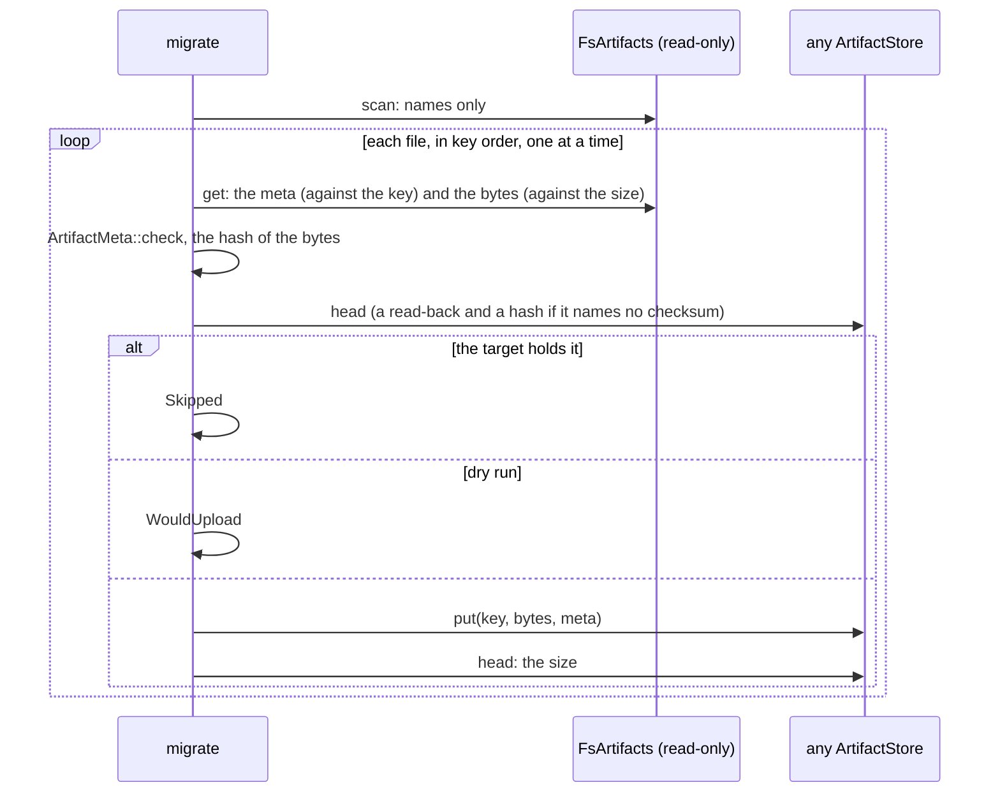
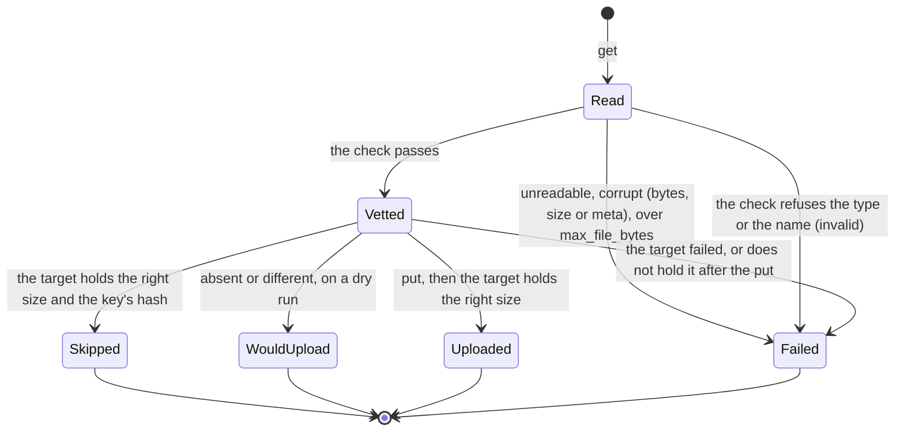

# orch-artifacts-fs

`ArtifactStore` over a directory: the store for development and for a single node.

## Where it sits

An **adapter** of the `ArtifactStore` port in [`orch-ports`](../ports/README.md)
([ADR 0032](../../../docs/decisions/0032-files-from-agents-live-in-an-artifact-store.md),
[ADR 0009](../../../docs/decisions/0009-swappable-implementations-at-build-time.md)): the files an agent hands
over are kept here by the hash of their content, and the event log keeps only the reference. Only the binary
([`orchestrator`](../../bin/orchestrator/README.md)) depends on it, behind the Cargo feature `artifacts-fs` (on by
default), and builds it from `artifacts.fs.root` when `artifacts.store` is `fs`. The production store is
[`orch-artifacts-s3`](../artifacts-s3/README.md).

**Every role of a deployment must see the same directory** (the worker that ingests a file and the control plane that
serves it): one machine, or a volume that all of them mount. Anything else needs the S3 store.

## API at a glance

| Item | What |
|---|---|
| `FsArtifacts::open(root).await -> Result<FsArtifacts, OpenError>` | creates the root and its parents (mode `0700`) when they are not there, and writes and removes a probe file in it, so a root that cannot be used is found at startup and not when the first file is shared. Cheap to clone |
| `FsArtifacts::root()` | the directory |
| `OpenError` | `cannot use <path> as the artifact root: <io error>`: the only error that shows a path (it goes to the operator's log; `ArtifactError`s never show one) |
| `FsArtifacts::open_read_only(root).await -> Result<FsArtifacts, OpenError>` | opens an **existing** directory without writing anything: no directory is made and no probe file is written, so a volume mounted read-only works. The root must be a readable directory; a call that writes fails like a write to a read-only disk (`Unavailable`). For a migration |
| `FsArtifacts::scan().await -> Result<Scan, ScanError>` | the files of the directory: every `threads/<uuid>/<sha256>` with its meta beside it (`Scan.keys`, in key order), and everything else (`Scan.ignored`: `Temporary`, `NoMeta`, `NoBytes`, `NotARegularFile`, `Unrecognized`). Reads names only, follows nothing (a link is ignored); a root with no `threads` directory holds nothing |
| `migrate(&fs, &to, Options { dry_run, max_file_bytes }, observe).await -> Result<Report, ScanError>` | moves the files into **any** `ArtifactStore`, [below](#moving-a-directory-into-another-store); `Outcome` (`Uploaded`, `Skipped`, `WouldUpload`, `Failed`), `Failure { key, kind: FailureKind, reason }`, `Report`, `MAX_CONSECUTIVE_TARGET_FAILURES` |
| `impl ArtifactStore for FsArtifacts` | `put`, `get`, `delete`, `copy` and `delete_prefix` as the port says |

## Layout and guarantees

```text
<root>/threads/<thread uuid>/<sha256>             the bytes, mode 0600
<root>/threads/<thread uuid>/<sha256>.meta.json   {"mediaType","size","sha256","filename"}, mode 0600
```

* **A write is atomic and durable.** The meta, then the bytes, are each written to a temporary file in the same
  directory (`.tmp-<uuid>`, created `create_new`, mode `0600`), flushed, fsynced and renamed into place; the directory
  is fsynced at the end, and `put` returns only then. The bytes are renamed last, so a file is found only when both
  are there: a crash in the middle leaves a meta without bytes (not found, and a retried `put` repairs it) or a
  `.tmp-*` file that nobody reads and that is safe to delete while no process is writing.
* **Idempotent by content.** A `put` of a file whose bytes are there (right size) and whose meta is the same writes
  nothing; with another meta (a second file name for the same content) it replaces the meta file whole and leaves the
  bytes. Concurrent puts of one key each write their own temporary files and rename: the last rename wins and the
  result is whole.
* **A copy is a hard link** of the bytes to the new key's name (one root, one file system), made under a temporary name and renamed, so no byte moves and a file is never written in place: the two names are independent, and deleting the source leaves the copy. Where the link is refused the bytes are copied to a temporary file, hashed as they are read, compared with the key's hash (`Corrupt` and nothing kept when they differ) and renamed. The meta is written first and the bytes last, as for a put, and a copy of a file that is there writes nothing. The source must be the two regular files of its key: a link in their place is `Corrupt` and is not followed; a missing one is `NotFound`; a size that is not the meta's is `Corrupt`.
* **A key cannot leave the root.** The path is built from the key's two parts, a UUID and 64 hex digits, and from
  nothing an agent wrote; and `ArtifactKey::parse` refuses every other text. The root is trusted: a symbolic link put
  under it by someone who can write there is followed.
* **Private.** Files `0600`, directories the store makes `0700` (the process's umask can only take more away).
* **Damage is reported, not served.** A file whose size is not its meta's, a meta that is not the JSON above or names
  another hash is `ArtifactError::Corrupt` (class `Corrupt`, alert). `get` reads the file as a stream of 64 KiB pieces.
* **Errors.** An I/O failure (a full disk, a permission) is `ArtifactError::Unavailable` (transient), with the I/O
  error as its source and no path in its text.
* Nothing is removed but by `delete` and `delete_prefix`: no expiry and no cleanup of empty directories (retention is open question 46).
* **`delete_prefix(thread)` removes the thread's directory**, `<root>/threads/<thread uuid>` (the erasure of a deleted thread, [ADR 0043](../../../docs/decisions/0043-deleting-a-thread-erases-it.md)), with one `remove_dir_all` of a path built from the UUID alone, then makes the removal durable (an fsync of `threads/`). It returns how many files it removed (the entries named by a hash: the metas and a temporary file a crashed put left go with the directory and are not counted). A thread with no directory is `Ok(0)`, so a repeat is fine.

## Moving a directory into another store

[ADR 0058](../../../docs/decisions/0058-large-files-go-up-through-a-presigned-url-the-orchestrator-gives-the-agent.md) A5.4, behind [`orchestrator artifacts migrate`](../../bin/orchestrator/README.md#the-command-artifacts-migrate): a deployment that
switches from this store to the bucket keeps the volume, and `migrate` copies its files into the bucket through [`ArtifactStore::put`](../ports/README.md), **under the same keys**, so the references in the event log stay valid.





* **Vetting.** The directory's own `get` checks the meta against the key and the file's size against the meta's; `migrate` then runs `ArtifactMeta::check` (the size, the key's hash over the bytes, the type and name as text a header can carry). A file that fails is `Outcome::Failed` with a kind (`Unreadable`,
  `Corrupt`, `Invalid`, `TooLarge`) and is **never** put.
* **Idempotent and resumable.** A file the target holds with the right size and, when the target says one, the key's checksum, is `Skipped`; a target that says none (S3 does not for an object a plain `put` wrote) is read back and hashed as it streams, never held whole; one that cannot `head` at all is read instead.
  An object of another size or other bytes under the key is not the file: it is overwritten and counted as `replaced`. After a `put` the target is asked for the size; one that does not hold the file is a failure, never an `Uploaded`.
* **Memory.** `put` takes the whole file, so one file is held at a time and one over `Options::max_file_bytes` (the ingest's `artifacts.maxFileBytes`) is `TooLarge` before it is read.
* **A failing target stops the run.** After `MAX_CONSECUTIVE_TARGET_FAILURES` (5) files in a row on which the *target* failed, the rest are `not_attempted`: a bucket that cannot be reached would cost each remaining file its retries. A file the *directory* failed does not count.
* **What is not a file.** A name the store never writes, a temporary file of a crashed write, bytes without a meta (what a delete in progress leaves), a meta without bytes, a link: `Report::ignored`, named and counted, never a failure.
* **Never destructive.** Nothing is written to the directory or deleted from it, and nothing is deleted from the target.

## Tests

No environment variables; each case uses a temporary directory.

* `tests/conformance.rs`: the `ArtifactStore` testkit of `orch-ports` (`artifact_store_conformance!`, twenty cases:
  round trip, empty file, the meta kept whole, idempotent put, a second name, missing key, an 8 MiB file streamed,
  concurrent puts of one key and of different files, delete, threads that share nothing, bytes that are not their key
  refused; five for `copy`: a copy of its own that outlives its source, idempotent, concurrent, a missing source, another hash; and three for `delete_prefix`: every file of the thread and no other's, twice, and many files; and `artifact_no_presign_conformance!`, one case: a directory cannot presign, so `can_presign` is false and `presign_put`, `presign_get` and `head` say "not supported" while the rest of the port works, which is what keeps `uploads/v1` from being offered for it; the test's wrapper forwards the five calls of ADR 0058, so the answer tested is the directory's own), and what only a directory has: the files left after a put are the two and no temporary file, with the
  contents and the JSON; modes `0600` and `0700` (a root made with its parents); files survive a reopen of the root;
  a second put of the same file writes nothing (the modification times do not move); a second name replaces the meta
  and keeps the bytes; bytes without a meta and a meta without bytes are not found and a put repairs both; a short
  file, a meta that is not JSON, names another hash or has an unknown member is `Corrupt`; a root that is a file or
  below one is refused when opened, a missing root is made; a write that cannot land is transient, shows no path and
  leaves no temporary file; a copy is a hard link (one inode, two names, modes `0600`, no temporary file, the source deleted leaves the copy) and writes nothing when the file is there, repairs a destination that has only its meta, never follows a link out of the root, and is `Corrupt` and not kept for damaged bytes; an erasure of a thread removes its directory with a temporary file and a lone meta a crashed put left, counts only the files, leaves another thread's files and is `Ok(0)` the second time.
* `tests/migrate.rs` (the migration, into `MemoryArtifacts`, no environment): every file put under its own key with its meta and the report counts them; a second run skips every file and changes nothing in either side; a dry run reads, checks and writes nothing (and says what it would replace); bytes that do not hash to their key (same length), a file that is not the size its meta says, a meta that cannot be read, are `Corrupt` and never reach the target while the other files go; a meta the check refuses (a control character in the name) is `Invalid`; a file over the bound is `TooLarge`; a file already in the target (under another name) is skipped and left as it is; an object of the wrong size, and one of the right size with other bytes under a target that says no checksum, are replaced and counted; a target that does not say its checksums, and one that cannot `head`, are read back to skip and to resume; a temporary file, bytes with no meta, a meta with no bytes, a stray name and a link are ignored and named; an empty directory and one with no `threads` are zero files; opening read-only needs an existing directory and creates nothing; nothing is deleted from either side; a `put` the target forgets is a failure and not an upload; a target that cannot be reached stops the run after five files and the rest are `not_attempted`; failures of the directory do not count towards that. Four mutations of the code (the dry run, the vetting, the skip, the count of failures) were each caught by a test.
* Unit tests in `src/lib.rs`: every path the store builds, for a key of zeros, of `0xff` and of `0x2e` bytes, is a
  chain of plain names under the root two or three deep; nine traversal attempts are not keys; a meta of another hash is
  corrupt; the copy that stands in for a link hashes what it reads, keeps nothing of a file that does not hash to its key, and leaves no temporary file.

## See also

[`orch-ports`](../ports/README.md), [`orch-artifacts-s3`](../artifacts-s3/README.md),
[`orchestrator`](../../bin/orchestrator/README.md).
