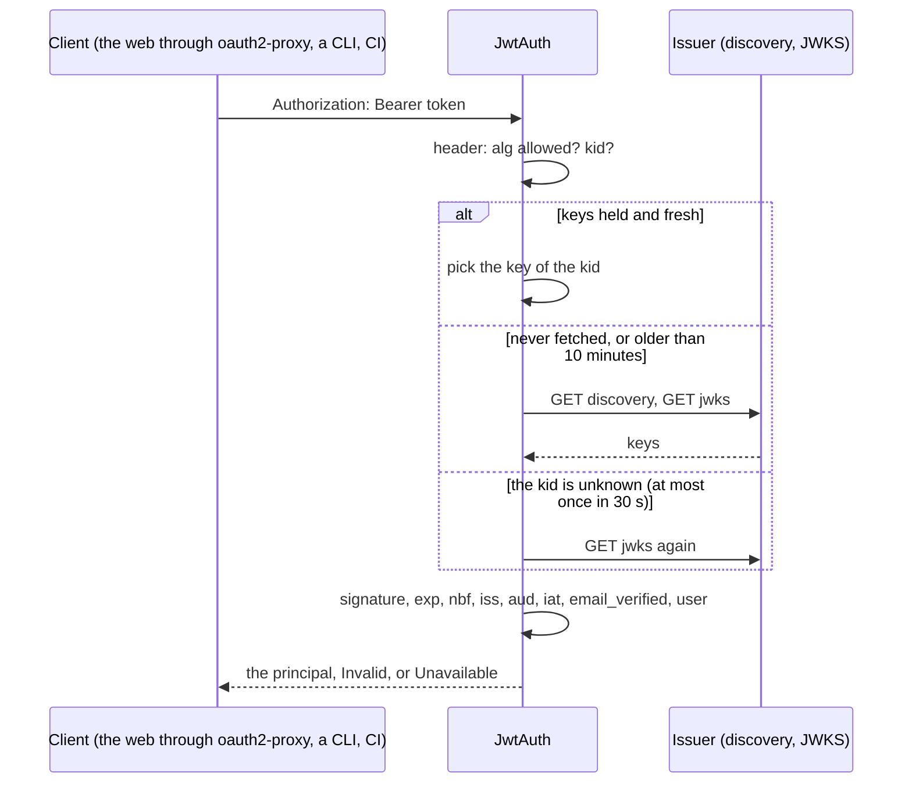

# orch-auth-jwt

The `Authenticator` over OAuth2 bearer tokens: a JWT signed by the issuer, validated here against the issuer's
keys, so that the orchestrator is an OAuth2 resource server and trusts no header a client can send. With `auth.dpop`
it also takes tokens **bound to the client's key** (DPoP, RFC 9449, [ADR 0054](../../../docs/decisions/0054-the-web-holds-its-own-tokens-dpop-bound-in-indexeddb.md)).

## Where it sits

An **adapter** of the `Authenticator` port in [`orch-ports`](../ports/README.md)
([ADR 0009](../../../docs/decisions/0009-swappable-implementations-at-build-time.md),
[ADR 0033](../../../docs/decisions/0033-the-orchestrator-is-an-oauth2-resource-server.md)). Only the binary
([`orchestrator`](../../bin/orchestrator/README.md)) depends on it, behind the Cargo feature `auth-jwt` (on by
default), and builds one for `auth.mode: jwt` and `jwt_or_proxy_header`. Depends on
[`orch-core`](../core/README.md) and [`orch-ports`](../ports/README.md); the signatures are checked by
`jsonwebtoken` 11 over `aws-lc-rs`, the backend `rustls` already brings (which also hashes a DPoP proof's `ath`).

## What it does

```mermaid
stateDiagram-v2
  [*] --> NoKeys: the process starts, nothing is persisted
  NoKeys --> Fresh: a fetch gives at least one usable key
  NoKeys --> NoKeys: the fetch fails; not again for 5 s, Unavailable meanwhile
  Fresh --> Stale: 10 minutes old
  Stale --> Fresh: a fetch succeeds
  Stale --> Stale: the fetch fails; still verifies, for up to an hour more
  Stale --> NoKeys: older than 10 minutes plus the hour, or the copy is dropped
```

- **Algorithm**: RS256, RS384, ES256 and EdDSA, and nothing else. `none` and the HMAC family are refused whatever
  key they name (the algorithm confusion attack), and a key only verifies tokens of its own family. A JWKS key that
  cannot verify (symmetric, an RSA modulus under 2048 bits, `use: enc`, another curve) is skipped, never an error
  for the rest of the set.
- **Which key**: the keys of the token's `kid` and of the algorithm's kind, **every one of them**: a JWKS may hold
  two keys under one `kid` (a rotation that kept the name, two sets merged), and the token is good if any of them
  signed it (only a bad signature moves on to the next key; a token a key verified and whose claims are wrong ends
  there). A token with no `kid` takes the one key of its kind, when there is exactly one, and none otherwise.
- **How a key is read** (`src/keys.rs`): as the numbers its members are, however the issuer wrote them. An RSA `n`
  and `e` by their magnitude, without leading zeros (a sign byte is dropped; the 2048 bits are counted on the
  magnitude, so a sign byte does not make a 2040-bit modulus big enough, and 256 octets whose first is `0x01` are 2041 bits, not a key; an exponent of zeros is none). A P-256
  coordinate left-padded to its 32 octets (cut, in full, or with a sign byte), refused when it has more than 32
  significant octets or is empty. An Ed25519 key is exactly its 32 octets, a zero in front included: nothing is cut and
  nothing is added, and 31 or 33 octets are not a key. The `=` padding that RFC 7515 forbids and some issuers write
  is accepted on every member.
- **Claims**, checked in this order, so that a token with several wrong is always refused for the first: the
  signature; `exp` present and not past, `nbf` not in the future, both with 60 s of leeway (`LEEWAY_SECS`);
  `iss` **one text** equal to the configured issuer exactly (a list that holds it is refused, and so is a token that
  names another issuer beside ours); one of the configured audiences is among `aud` (a text, or a list of texts);
  `iat` present; `email_verified` is not `false` (a boolean or the text); the user claim (`userClaim`, default
  `email`) is text that is **not blank and has no control character (Unicode Cc: U+0000–U+001F, U+007F–U+009F)**, trimmed and lower-cased by `UserId::new`.
  Format characters (Cf, such as U+200B or U+202E) and the line and paragraph separators U+2028 and U+2029 are not refused. Only the issuer can put them in a token.
  The e-mail and the name are `Principal.email` and `.name`, and the token's `exp` is `Principal.expires_at` (it bounds the streams opened with the token, ADR 0033). The roles are the texts at
  the dotted path `rolesClaim` (`realm_access.roles`, `groups`): a claim whose own name has dots is found by that
  name first; a list gives its texts, a text is one role, anything else is none, and a bad roles claim never
  refuses a token. (`jsonwebtoken` checks `exp` and `nbf`; `iss` and `aud` are checked here, because the library
  accepts an `iss` that is a list holding ours and reports the first of several missing claims in the order of a
  hash set.)
- **Size**: a token over 16 KiB (`MAX_TOKEN_BYTES`) is refused unread. A token that is not three base64url parts
  of JSON ends before any key is looked at: no fetch, no key.
- **The key cache** is a copy this process may lose at any time (ADR 0001). Fetched on first use and by `ready()`
  (which `/readyz` calls), refreshed once 10 minutes old, fetched again when a token names a `kid` the copy lacks
  **at most once in 30 s** (any fetch counts), and not again for 5 s after a failure. One request at a time:
  concurrent first requests make one fetch. While there is no copy, or it is older than the refresh interval plus an
  hour, every request is `AuthError::Unavailable` (fail closed; not a refusal, `Transient`); in between, the copy
  goes on verifying while the issuer is down.
- **Where the keys are**: `jwksUrl`, or the `jwks_uri` of `{issuer}/.well-known/openid-configuration` (exactly one
  terminating `/` of the issuer is removed before the path is appended, OpenID Connect Discovery 1.0, 4), whose `issuer`
  must be the configured one (4.3). `jwks_uri` must be `http(s)` without credentials
  and not plain HTTP under an HTTPS issuer. **No redirect is followed**, a body over 1 MiB is refused, a request times
  out (5 s), `HTTP(S)_PROXY` is honoured like the A2A client's. There is no filter on the issuer's *address*: it is the
  operator's own configuration, and an identity provider in the cluster is a private address.
- **The log**: a `WARN`, once, when the authenticator is built with an issuer or a `jwksUrl` over plain `http` (the keys
  every token is checked against then travel in the clear; not a refusal, since a Keycloak in the cluster is often
  reached so, on purpose). No line names a URL, a token, a `kid` or a claim: a `jwksUrl` is the operator's to write
  and may hold a secret in its query, and a failed request is logged without its URL.
- **The crypto provider** of `jsonwebtoken` is installed by `JwtAuth::new` (aws-lc-rs), so that the choice does not
  depend on the features Cargo unifies: the library picks its backend itself when exactly one of `aws_lc_rs` and
  `rust_crypto` is enabled and **panics on the first verification when both are** (a binary that links another crate
  with `rust_crypto`). Today this crate is the only user of the library in the workspace and enables `aws_lc_rs` alone,
  so the call is a guard; it is idempotent and leaves a provider that is already installed alone.
- **DPoP** (`JwtConfig::with_dpop(DpopConfig)`, `auth.dpop`; `src/dpop.rs`), off by default: then `Authorization: DPoP` is refused (fail
  closed, as a bearer's refusal) and a bearer is exactly what it was, a token with `cnf` included. When on, in this order:
  **one proof**, exactly one `DPoP` header of at most 8 KiB; **header**: `typ` `dpop+jwt`, `alg` `ES256` or `EdDSA` only (not `none`,
  HMAC, RSA, ES384), `jwk` a public key of the algorithm's kind (P-256 or Ed25519, coordinates in full length) **with no private
  member** (`d`, `p`, `q`, `dp`, `dq`, `qi`, `oth`, `k`: read from the raw header, since a typed key would drop them); **signature** by
  that `jwk`; **claims**: `htm` the method, `htu` without query and fragment, normalized (scheme and host in lower case, default port),
  one of `publicOrigins` plus the request's path (the process sits behind a proxy and cannot rebuild the public URL), `iat` within
  60 s past and 5 s ahead (`DpopConfig::with_window`), a `jti`, `ath` the base64url SHA-256 of the token; then **the token is
  validated exactly as a bearer** and its `cnf.jkt` must equal the RFC 7638 SHA-256 thumbprint of the proof's key
  (`jsonwebtoken::jwk::Jwk::thumbprint`, over a key rebuilt from its public members only); last, the **`jti` is recorded**. A refusal of the
  proof is `CredentialKind::DpopProof`; one of the token, of its binding (none, or another key), or **a token that carries `cnf` sent as
  `Bearer`**, is `CredentialKind::DpopToken`. `ready()` and the key cache are the bearer's; the principal's `expires_at` is the token's
  `exp`, so a stream opened with a DPoP request ends with it as a bearer's does.
- **The replay cache is in memory** (a `Mutex` over a queue and a set, keyed by thumbprint and `jti`, entries kept for the age plus the skew,
  expired ones evicted at the front on each use, at most 100 000, `DpopConfig::replay_capacity`): **a process knows only its own proofs**, so a
  deployment of several processes accepts a replayed proof once per process within the window (the chart runs one, ADR 0054 decision 6). A
  proof is recorded last, once the token is valid and bound, so a caller with no good token cannot fill it; when it is full every DPoP request
  is `Unavailable` until the oldest expire (a replay is never let in for want of room). No lock is held across an await.
- Errors never carry the token or a claim value; a refusal says "the token has expired", "the token is not for this
  API (issuer or audience)", "the token's signature does not verify".

`JwtConfig::new(issuer, audiences)` builds the configuration (`with_user_claim`, `with_roles_claim`,
`with_jwks_url`, `with_dpop`, `without_system_proxy`; the intervals are public fields, for tests); `JwtAuth::new` reads nothing.
`BuildError` refuses an issuer that is not an `http(s)` URL without credentials, query or fragment, no audience, an
empty claim name, a bad `jwksUrl`, and for DPoP no origin, an origin that has a path, a query, credentials or a scheme other than `http(s)` (`BadDpopOrigin`, `NoDpopOrigin`), and a zero age or capacity (`BadDpopWindow`).

## Features

| Feature | Default | Effect |
|---|---|---|
| `testkit` | no | `testkit::TestIdp`: a token issuer on `127.0.0.1:<port>` serving its discovery document and its JWKS, with RSA 2048, P-256 and Ed25519 keys made once per process (twice: one set it publishes, one it does not until `publish_unpublished_keys()`), `mint(claims, Signing)` for the tokens the cases need (the right ones, and `alg: none`, HS256 with a public key as the secret, a key that is not published), `set_jwks_down`, `set_discovery_down`, and fetch counters; and `DpopKey` (P-256 or Ed25519: `jwk()`, `jkt()` computed from the canonical JSON, `proof(method, htu, token)`, and `header()`, `claims()` and `sign()` for the proofs that must be bad) with `TestIdp::bound_token` and `bound_claims` (`cnf.jkt`). For this crate's tests and the tests of the crates that authenticate with it (the binary's). |

## Tests

- **Which tests run**: all of them, with a plain `cargo test -p orch-auth-jwt`. `tests/conformance.rs`, `tests/dpop.rs` and
  `tests/jwks.rs` need the feature `testkit`, and the crate's `[dev-dependencies]` name itself with it (`orch-auth-jwt = { workspace
  = true, features = ["testkit"] }`, as the platform's `aap-auth-oidc` does), so they are built whether the run is the crate's alone
  or the workspace's: none compiles to nothing and no `--features` is needed (110 tests: *run 2026-10-16*). Every
  client a test builds for itself takes no proxy, and so does every authenticator (`without_system_proxy()`), so the
  suite passes with `HTTP_PROXY` and `HTTPS_PROXY` set and no `NO_PROXY` (*run 2026-10-16* with both on a closed port).
- `tests/conformance.rs`: `orch_ports::bearer_token_conformance!` through a `TokenFixture` over a `TestIdp` (the
  intervals shortened): a valid token for each allowed algorithm; expired and not yet valid, with the leeway; the
  issuer exactly; the audience (a string, a list, none); `exp` and `iat` required; `alg: none`; HS256 with a public
  key; a key nobody published; an unknown `kid` fetched at most once per interval; a rotated key found once
  published; the issuer down (`Unavailable`, `ready` failing, garbage still `Invalid` with no fetch); no bearer,
  an identity header alone, and malformed tokens; `email_verified`; the configured user claim; the roles claim; no
  error shows a token.
- `tests/jwks.rs`: discovery and `jwksUrl`; refresh when old; one fetch for concurrent first requests; the retry
  interval; the stale copy and its grace; a discovery document for another issuer, without a `jwks_uri`; a redirect
  never followed; an answer over 1 MiB; a set with no usable key; unusable keys beside good ones; the token cap;
  a trailing slash on the issuer, and exactly one of several removed to find the discovery document; what a build
  refuses.
- `tests/keys.rs` (no `testkit`; a server that serves the key set the test builds, **real keys** made with aws-lc-rs
  that sign real tokens): an Ed25519 key whose public key starts with a zero octet; Ed25519 keys of 31, 33 and no octets
  are not keys; a P-256 key whose `x` or `y` starts with a zero octet, written in full, cut, with a sign byte and with
  padding; P-256 coordinates of 33 significant octets and empty ones are not keys; an RSA key written with a sign byte before
  `n`, an exponent written `AAEAAQ`, and padding; a 2040-bit modulus with a sign byte is not 2048 bits; `=` padding on an
  Ed25519 key; two keys under one `kid` (a token signed by either, one signed by neither, no `kid` and two keys, and the
  claims read from the key that verified).
- `tests/claims.rs` (no `testkit`; an Ed25519 key): `iss` one text, and a list that holds it refused; `aud` among a text,
  a list, a list with a non-text, other types; a user claim (`email`, `sub`, `preferred_username`) that is blank or holds a
  control character (Unicode Cc: U+0000–U+001F, U+007F–U+009F; a newline that trimming would hide included) and one that is fine; the reason for a token with
  several claims missing is the same in 40 rounds and goes `exp`, `iss`, `aud`, `iat`, the user; the times come before the
  issuer; the leeway of `exp` and `nbf` is 60 s (just inside at 55 s and 30 s, just outside at 65 s and 120 s).
- `tests/logs.rs` (a test binary of its own, with a captured log): one `WARN` for a plain-`http` issuer and for plain-`http`
  keys behind an `https` issuer, none for `https`, and none that names the URL; a secret in the query of a configured
  URL, a `kid` and a claim in no line, whatever fails (the connection, a 404, a key set with no usable key, a refused token).
- `tests/common/mod.rs`: what `keys.rs`, `claims.rs` and `logs.rs` share.
- `tests/dpop.rs` (32 cases): a valid ES256 and EdDSA proof; `expires_at` is the token's; the roles are read; each public origin and no other; `htu` compared without query or fragment and normalized; a wrong `htm` (case-sensitive), `htu` origin, path and scheme; `iat` too old and too far ahead, and the window configured; a replayed `jti` (refused, but not for another key, and not spent by a refused request), 16 concurrent requests with one proof let exactly one in, and a full cache refuses as `Unavailable` and never forgets; `ath` of another token, empty, not text, missing; a missing `jti`, `htm`, `htu`, `iat`; a key with each private member, for both algorithms; `typ` wrong or missing; `alg` HS256, HS512, RS256, PS256, ES384, `none` (also unsigned), unknown; a key that did not sign, of another kind than its algorithm, absent, of another curve, short; a tampered, malformed, empty and oversized proof; none, two and the same twice; a token bound to another key (the thief's proof, either algorithm), with no `cnf.jkt` (and `cnf` of another shape), expired, of another audience or issuer, unpublished key, `none`, HS256, empty; **a bound token as a bearer** (any `cnf`); a plain bearer unchanged with DPoP on; `DPoP` scheme without `auth.dpop` refused and a bearer, bound or not, as before; a DPoP request never falls back to the bearer; no refusal shows a token or a proof; what a build refuses. A unit test of the replay queue (`src/dpop.rs`) pins eviction and the cap with explicit instants.
- Unit tests in `src/`: how a key is read and the choice of keys (`keys.rs`), the claims and the user (`claims.rs`), `iss` and `aud` (`lib.rs`), the `jwks_uri` rule (`fetch.rs`), the replay cache, origins and `htu` (`dpop.rs`).

## See also

[`orch-ports`](../ports/README.md), [`orch-auth-header`](../auth-header/README.md), [`orch-api`](../api/README.md).
