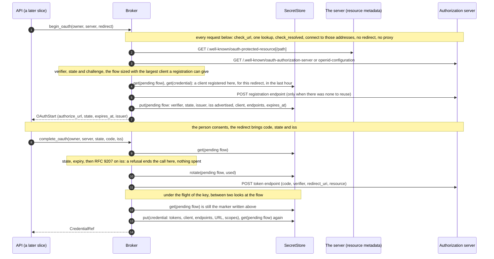
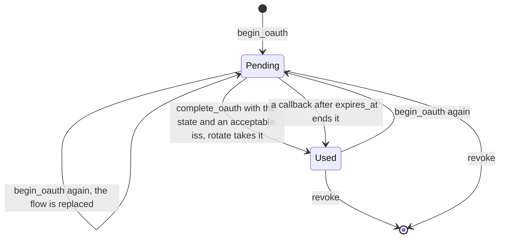
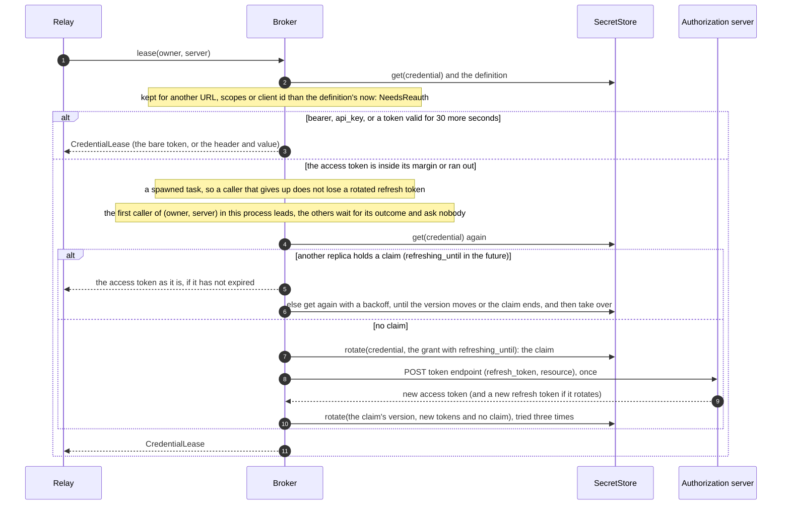
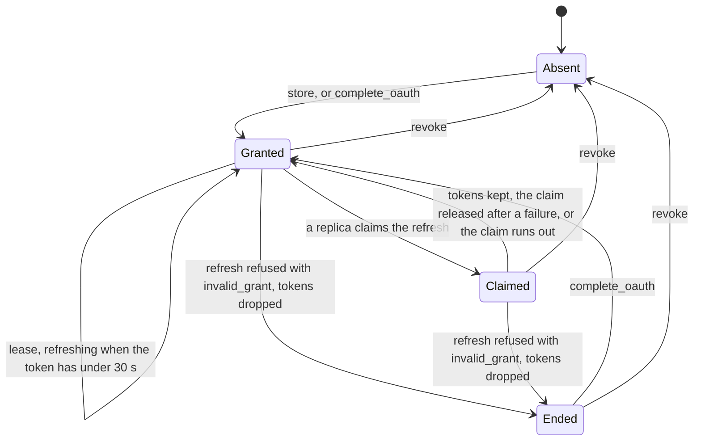

# orch-credential-broker

The one implementation of `orch_ports::CredentialBroker` ([ADR 0046](../../../docs/decisions/0046-people-add-their-own-mcp-servers-secrets-in-a-credential-broker.md),
the amendment of 2026-10-11): it keeps the credentials of a person's own MCP servers in a `SecretStore`, runs the OAuth
work (discovery, PKCE `S256`, the `resource` parameter, client registration, refresh), and lends a short, fresh
`CredentialLease` for one call. It is generic over the two ports it is composed with, `S: SecretStore` and
`D: UserToolServerStore`, and reads a clock (`C: Clock`, `SystemClock` by default). It builds the HTTP client it
needs itself, and **every URL that client fetches goes through the egress guard** (`orch_ports::EgressPolicy`).

**Wired into the binary since slice 4a** (the composition root builds a `Broker<PgSecretStore, PgUserToolServers>` when
`userToolServers.enabled` and the file has a `secrets` section, with the egress policy, the system clock, and `BrokerConfig` from
`userToolServers.oauth.clientName` and `clientMetadataUrl`; with no `secrets` section the root puts `orch_ports::NoBroker` in its place,
which refuses every call). **No route and no relay uses it yet**: the endpoints (4b) and the relay's lease (5) are later slices. No
configuration, environment variable or feature here: the crate takes what the binary gives it, and the lease and flow lifetimes, the
timeouts and the response size keep their defaults (no configuration key tunes them).

## API

```rust
let broker = Broker::builder(secrets, definitions, egress_policy)   // S, D, EgressPolicy
    .clock(clock)                       // default SystemClock
    .config(BrokerConfig::default())    // default as below
    .lookup(SystemLookup)               // default; how a name becomes addresses
    .build()?;                          // Result<Broker<S, D, C>, BuildError>
```

| Item | What |
|---|---|
| `Broker<S, D, C>` | Implements `CredentialBroker`. `Clone` is cheap and shares the single-flight table (one process); build another with `Broker::builder` for another replica. `Debug` prints nothing of what it holds. |
| `BrokerBuilder` | `clock`, `config`, `lookup`, `build`. |
| `BrokerConfig` | `with_client_name`, `with_client_metadata_url`, `with_refresh_margin`, `with_lease_ttl`, `with_flow_ttl`, `with_timeouts`, `with_max_response_bytes`; checked by `build`: every duration is above zero and at most its bound (`MAX_LEASE_TTL`, `MAX_FLOW_TTL`, `MAX_REFRESH_MARGIN`, `MAX_TIMEOUT`), the response size is in `1..=MAX_RESPONSE_BYTES`, the document URL is at most 2 KiB (`BuildError::Config`, `BuildError::ClientMetadataUrl`). |
| `HostLookup`, `LookupFuture`, `SystemLookup` | How a host name becomes addresses. The default asks the operating system. Whatever answers, the guard judges the addresses and the connection is made to those alone. |
| `egress_refusal(&CredentialError)` | The `EgressRefusal` behind an `Unavailable` error, if the guard is why, found in the error's chain. The API maps it to `UnavailableReason::EgressRefused` and shows a person `public_reason()`, never `rule()` ([ADR 0046](../../../docs/decisions/0046-people-add-their-own-mcp-servers-secrets-in-a-credential-broker.md), departure 17). |
| `BuildError` | `Config`, `ClientMetadataUrl`, `Http`. |

| Setting | Default | Meaning |
|---|---|---|
| refresh margin | 30 s (at most 10 min) | An access token with less than this to live is refreshed at `lease`. |
| lease TTL | 300 s (at most 1 h) | The longest a lease lasts (it ends sooner when the access token does). |
| flow TTL | 600 s (at most 1 h) | How long an authorization that has begun may take: `OAuthStart::expires_at`. |
| request / connect timeout | 10 s / 5 s (each at most 60 s) | One request to an authorization server, and the connection. A refresh's claim lasts one request timeout and 10 s. |
| max response bytes | 64 KiB (at most 1 MiB) | Metadata, a token, a registration; a longer response is refused. |
| client name | `another-agentic-system` | The `client_name` of a client registered dynamically. |
| client metadata URL | none | The `https` URL (with a path) of the orchestrator's Client ID Metadata Document, which the orchestrator serves; without it that step of the registration order is skipped. |

## What each call does

| Call | Does |
|---|---|
| `store` | For `bearer` and `api_key`: reads the definition, keeps the token (or key) **and the definition's normal-form URL** sealed under `SecretServer::credential(id)`, returns `CredentialRef` (`cred-<id>-v<version>`). `none` and `oauth2` are `Unknown`: an OAuth credential is obtained by `begin_oauth`, not typed. |
| `begin_oauth` | Discovers the authorization server, makes the PKCE verifier and the `state` (256 bits each), checks that the sealed flow fits the store **before anything is registered**, takes a client (below), keeps the pending flow sealed under `SecretServer::pending_flow(id)` with its `expires_at`, the **issuer** of the authorization server and whether it advertised `authorization_response_iss_parameter_supported`, and returns `OAuthStart { authorize_url, state, expires_at, issuer }`. The authorization request carries `response_type=code`, `client_id`, `redirect_uri`, `state`, `code_challenge` with `code_challenge_method=S256`, `resource` (the definition's URL) and `scope` (the definition's scopes; **none if the person named none**: the server's `scopes_supported` is a stranger's list and is not read). A request over 8 KiB is `Unavailable`. A flow already pending is replaced. **The API should rate-limit it**: it is a call that can reach a registration endpoint. |
| `complete_oauth` | Loads the flow, compares the `state` in constant time (a wrong one is `Unknown` and leaves the flow), refuses it after `expires_at` (ending it with a swap), applies **RFC 9207** to the `iss` of the callback (below; a refusal is `Unknown` and leaves the flow and the code unspent), **claims** the flow with `rotate` (so one callback wins across replicas and the code is spent once), exchanges the code with the verifier, `redirect_uri` and `resource`, and keeps the grant bound to the URL, the scopes and the client id the flow began with. The write is under the flight of the key and between two looks at the flow (below). A refused code is `NeedsReauth` and spends the state; a failing authorization server is `Unavailable`. |
| `lease` | See below. |
| `revoke` | Deletes the credential and any pending flow (under the flight of the key, so not while a refresh writes the tokens, and an authorization being kept loses to it), **then** asks the authorization server to revoke the grant (RFC 7009) if the grant names a revocation endpoint. The upstream call is best effort and a failure is logged, not returned. Idempotent, and it does not read the definition (the grant names its own endpoints), so it works for a definition that is already gone. |





A flow that was used is not deleted: it is swapped for the marker `used`, which holds nothing, and stays until the next
`begin_oauth` or a `revoke`. The store has no compare-and-delete, and a delete would take a flow begun since; the marker is
also what `complete_oauth` looks for to know that nobody revoked or began again while it exchanged the code.

### The `iss` of the callback (RFC 9207), and why the broker checks it

A person's server names its authorization server in its own metadata, so a person with several servers talks to several
authorization servers, some a stranger's. That is the situation of the **mix-up attack** (RFC 9700, section 4.4): the browser
is sent to one authorization server and comes back with a code another one issued, and a client that sends it to the first
one's token endpoint hands the second one's grant to a stranger. RFC 9700 (section 2.1) makes a defence required for a client
that can talk to more than one authorization server, and names `iss` of RFC 9207.

`begin_oauth` keeps the issuer of the authorization server it sent the person to (the `issuer` of its metadata, which discovery
showed is the one the resource named) and whether the metadata said `authorization_response_iss_parameter_supported: true`
(only a JSON `true` counts). `complete_oauth` takes the `iss` of the redirect as the API got it, and applies section 2.4 before it
touches anything, comparing with `==` (simple string comparison, RFC 3986 6.2.1: a trailing slash or a capital is another issuer):

| Advertised | `iss` of the callback | Result |
|---|---|---|
| yes | equal to the issuer | accepted |
| yes | another | refused (MUST) |
| yes | none | refused (MUST) |
| no | one | refused (RFC: SHOULD discard; local policy may accept, this broker does not) |
| no | none | accepted: the server takes no part in RFC 9207, and the defence is the `state` alone |

A refusal is `Unknown` and a warning with a fixed reason (`mismatch`, `missing`, `unexpected`) and the server's id, never the value
(a stranger chose it). **It spends nothing**: the code is sent to nobody and the flow stays, so the person's own callback still
completes it. The issuer is in `OAuthStart` for the API to show the person which server the stranger's MCP server chose. An error
callback (`error=`) is not a call; RFC 9207 says its origin is not to be assumed either, so the API shows it as unverified text.

### The end of an authorization, beside a revoke or a new `begin_oauth`

The code is exchanged outside any lock (it is a request to a stranger). What follows is the write of the credential, and two
other calls can arrive during the exchange: a `revoke` (which deletes the credential and then the flow) and a `begin_oauth`
(which replaces the flow). The write therefore holds the flight of `(owner, server)`, which no refresh or revoke of this process
writes beside, and is bracketed by two looks at the flow, which reach the replicas the flight does not:

1. The flow must still be the marker `used` that this callback wrote (the same version). If it is gone (a revoke) or is another
   (a flow begun since), the tokens are revoked upstream, nothing is written and the call is `Unknown`; the newer flow is as it was.
2. The credential is written, and the flow is looked at again. If it changed in between, a revoke or a `begin_oauth` ran beside
   the write: the credential is taken back, by a swap and not a delete (a credential another authorization wrote since is not
   taken), for the grant without its tokens, and the tokens are revoked upstream. **A revoke wins** in this process and in another.

### Discovery, and what is refused

1. **Protected resource metadata** (RFC 9728): `GET` at `/.well-known/oauth-protected-resource` with the server's path
   inserted, then at the root. Its `resource` must be the definition's URL (same scheme, host, port and path; `https://h`
   and `https://h/` are the same), else the document is not used. Its `authorization_servers` are the issuers (the
   first three are tried).
2. **Authorization server metadata** (RFC 8414 and OpenID Connect Discovery): for an issuer with a path,
   `oauth-authorization-server` with the path inserted, `openid-configuration` with it inserted, `openid-configuration`
   with it appended; for one without, the first two. Its `issuer` must be the issuer asked about.
3. **A server whose metadata does not list `S256` in `code_challenge_methods_supported` is refused** (`Unavailable`),
   and so is one that names no token or authorization endpoint.
4. The token endpoint is judged by the guard at once, so a flow that cannot finish does not send the person anywhere.
   The authorization endpoint is only a place to send the person (it may carry a query), so the rest of it is judged; a
   fragment in it is refused (RFC 6749, 3.1).
5. **The documents are a stranger's, so they are held to what the broker keeps.** A URL over 2 KiB (an endpoint, an issuer) is
   refused as `Unavailable`; the `resource` sent is **the definition's own URL** once the document's `resource` has been shown to
   name it, not the document's spelling of it; `scopes_supported` is not read, so a person who named no scope asks for none
   (the MCP specification would use the list; the list is the stranger's, and a consent for scopes nobody chose is the worse
   failure; a server that needs a scope tells the person to name it).

### Client registration, in the ADR's order

1. The `client_id` of the definition (`oauth2 { client_id }`): a public client.
2. A **Client ID Metadata Document**, when the authorization server says `client_id_metadata_document_supported` and
   `BrokerConfig::with_client_metadata_url` is set: the `client_id` is that URL. (The authorization server fetches the
   document, not the broker; the orchestrator serves it.)
3. **Dynamic registration** (RFC 7591) at the `registration_endpoint`: a public client (`token_endpoint_auth_method:
   none`) for the redirect URI, `authorization_code` and `refresh_token`. If the server answers with a client secret it is
   kept and used (`client_secret_basic`, or `client_secret_post` if the server says so); a client id over 2 KiB or a secret
   over 1 KiB is refused. **A client is registered once per hour** for an authorization server (its issuer) and a redirect URI:
   the next `begin_oauth` uses the client of the pending flow or of the grant when it was made for the same issuer and the same
   redirect URI less than an hour ago, so a caller that begins in a loop makes one registration; a registration is not trusted for
   longer, because the server may have forgotten it, and one made at another issuer is never offered to this one (it could carry
   a secret). Rate-limiting `begin_oauth` is the API's.
4. Otherwise `Unavailable`: the person needs to give a client id.

What can fail on this side (the randomness, the size of the sealed flow, which is checked with the largest client a registration
can give) is done **before** step 3 registers anything. What can still leave a registration behind is the store failing at the
`put`, or a request over 8 KiB once the real client id is in it.

## Leases, refresh and the URL binding





- **The binding** (departure 15 of slice 1): the normal-form URL of the definition is kept inside the sealed
  material by `store` and `complete_oauth`, and `lease` compares it with the definition's now. A grant also keeps the
  definition's **scopes** (as a set: another order is the same) and **`client_id`**, and a definition edited to ask for other
  scopes or name another client is not the one the person authorized. A mismatch, a credential of another kind than the
  definition's, a revoked credential and one never given are `NeedsReauth`; a missing server and a `none` server are `Unknown`.
- **Lease**: `Bearer` (the bare token, for `bearer` and `oauth2`) or `Header { name, value }` (for `api_key`, the
  definition's header), ending at `min(token end, now + lease TTL)`.
- **Refresh is lazy, and a refresh token is presented once.** An authorization server that rotates refresh tokens treats one
  presented a second time as stolen and revokes the grant (RFC 9700, 2.2.2 and 4.14.2), so two replicas must not both ask; a
  compare and swap on the new tokens does not prevent it (it prevents a lost update, not the second request). So:
  1. **In a process**, the first caller of an `(owner, server)` leads and every caller that arrives while it runs follows: it is told
     how the leader ended (the tokens were kept, or the error, with the egress refusal if that was why) and does not ask the
     authorization server. Eight leases against a server that is failing, or hanging until its timeout, are one request and one
     timeout, not eight.
  2. **Across replicas**, the leader first **claims** the refresh: it writes the grant with `refreshing_until` (one request timeout
     and 10 s ahead) with `rotate` on the version it read, and only the replica whose swap lands asks. A replica that finds a claim
     lends the access token if it has not expired (only the 30 s margin is skipped) and otherwise reads the store again with a
     backoff (20 ms, doubling to 250 ms) until the version moves (the other replica kept its tokens) or the claim ends (it died),
     and then claims itself. It gives up, `Unavailable`, after one claim's length of real time, in case a clock stands still.
  3. The claim ends with the tokens that answer it (`rotate` on the claim's version, tried three times if the store stumbles: the
     refresh token the server rotated to is the only one that works now). If the store stays down the caller still gets its
     lease, whose access token is good, and the log says the refresh token is lost; the callers of this process that waited for it are
     told the tokens were not kept (`Unavailable`) and do not wait for a claim that nobody will end. A refresh that fails, or is refused with a code
     other than `invalid_grant`, releases its claim, so the next caller asks at once. The claim is the broker's own record in the
     `SecretStore`; no lock is added to the port.
  4. A refusal first reads the credential again: if it is no longer the version this refresh claimed (another replica took over
     after the claim ran out, or the person authorized again or revoked), the refusal is about a token that stopped being the
     grant's, and nothing is written (before, `end_grant`'s lost swap was ignored and the definition was marked `needs_reauth`
     all the same). What is there is read, and this refresh is not repeated.
- **Failures**: `400` or `401` at the token endpoint is `NeedsReauth`, and with `invalid_grant` the broker drops the
  tokens (a compare and swap on the claim, so a newer grant is never touched) so nobody asks again with a refused refresh token.
  A network error, a timeout, a `5xx` or an answer that is not a token response is `Unavailable` and costs the
  person nothing: the grant is kept. Only the error codes of RFC 6749, 5.2 and RFC 8707 are logged (`invalid_grant`); any other
  text the server sends as `error` is logged as `unknown`, because it could be anything, a token among it.
- **State**: the broker writes one state of the definition, `needs_reauth`, with `UserToolServerStore::set_state` and
  the revision it read, when it learns the grant is over (a refused refresh; an expired token with no refresh token). A
  definition edited since is `Conflict` and nothing is written. `connected`, `revoked` and the credential reference are
  the API's `replace`, which writes the reference in the same compare and swap.
- **Token lifetime**: `expires_in` seconds (a number, a float or a numeric string; at most a year). When the server says
  nothing, an hour if there is a refresh token to ask again with; with none, the token has no known end and is lent
  until the server says otherwise. **`expires_in: 0` counts as nothing said** (some servers send it for a token that does not
  expire, and read as "ends now" it would make every lease a refresh).

## Egress

Nothing in this crate opens a connection except `http.rs`, and it does this for every request (resource metadata,
authorization-server metadata, the token, registration and revocation endpoints):

1. `EgressPolicy::check_url` on the URL, and the request goes to the **normal form** it returns; an address written in
   the URL is also judged by `check_resolved`.
2. A name is resolved by the client's `dns_resolver` hook (`reqwest::dns::Resolve`), which resolves **once**
   (`HostLookup`), calls `check_resolved` on the answer and hands the client only the addresses that passed: the address
   that was judged is the address connected to. One refused address among several refuses the answer.
3. No redirect (`Policy::none()`), no proxy of the environment, a connect and a request timeout (the timeout covers the body: a
   body that drips is cut), at most 64 KiB read by default (checked against `Content-Length` and, for a body with none, as it
   arrives), `pool_max_idle_per_host(0)` (no connection outlives its request).

The policy is the deployment's: the lists change, so a stored grant's endpoints are judged again when they are used (a
refresh under a stricter list is refused with nothing sent). A refusal is `Unavailable`; the operator's log gets
`rule()` (never an address or a URL) and the API finds the refusal with `egress_refusal`.

## Secrets

- The only places a secret is: the argument of `store` and `complete_oauth` (`ToolSecret`), a `CredentialLease`, the
  sealed material in the `SecretStore`, and, for the length of a request, the broker's memory. `ToolSecret` and
  `SecretMaterial` print `<redacted>` and are wiped on drop. (The wipe covers the copy those types hold; a request
  makes copies while it is sent, which it does not.)
- **No error, `Debug` or log line holds one.** The `detail` of every `Unavailable` this crate makes is a fixed phrase
  (no URL, no body), no `serde_json` error is ever kept (it can quote what it could not read), and an authorization
  server's error response is **never echoed**: of a token error the broker keeps the status and, if it is one of the error
  codes the RFCs define (`invalid_grant`), that code, in the log only; any other `error` is `unknown`, however well formed. The
  tests plant a sentinel in everything the authorization server issues and echoes, among it the `error` of a refusal, and look for
  it in every error, `Debug` and log line.
- What is kept is JSON `{"v":1,"d":…}` of two records, the credential and the pending flow (`src/material.rs`); a
  record that cannot be read is `Unavailable`, not a request to sign in.

## Tests

`cargo test -p orch-credential-broker` (no Postgres, no network beyond the loopback). The authorization server of the
tests is `tests/support` (axum on `127.0.0.1`, an ephemeral port): it **enforces** PKCE `S256`, the `resource`, the
redirect URI and the client's authentication, so a test that gets a token has proved the request was right. The
egress policy of the tests names `127.0.0.1` explicitly (`allowing_http` and an `allow` entry), which proves the guard
is in the path.

The mock enforces more than the broker owes it in the happy path: it can **rotate refresh tokens with reuse detection**
(a refresh token presented twice revokes the family, as RFC 9700 4.14.2 allows), send and advertise `iss` or not, play a
second, honest authorization server for a mix-up, chunk a body with no `Content-Length`, and drip one. Tests that read the log
hold the subscriber alone (`Captured::install`), and the files that use it have no test that does not; `tracing` caches which call
sites are wanted, and a subscriber of one thread misses a site another thread met first. `ORCH_TEST_REQUIRE_TRIPWIRE=1` makes a
test fail, instead of saying it is skipped on stderr, when `127.0.0.2` cannot be bound (the tripwire, a listener that counts
connections, cannot then prove that nothing connected).

| File | What |
|---|---|
| `tests/conformance.rs` | `orch_ports::credential_broker_conformance!` (36 cases, in `orch-ports`' `testkit::credential_broker`) over `MemorySecretStore` (behind a wrapper that yields after every call, so two replicas interleave as they do in production), `MemoryUserToolServers` and the mock. Among them: the `iss` of the callback in all its cases and a mix-up with a second authorization server; three replicas and six leases that present a rotating refresh token once; eight leases against a failing server that make one request; a grant not lent after the scopes or the client id change. |
| `tests/egress.rs` | A policy that does not name the address, `http` without `allowing_http`; **which endpoint is refused at which address**: the token endpoint at `169.254.169.254` with a policy that does not name it (`allow-list`) and with one that does, so that the class of the address decides (`private-address`); the registration endpoint at `169.254.169.254` (class decides) and at `127.0.0.2`; the revocation endpoint at `127.0.0.2` (and at `169.254.169.254`, whose rule is read from the log: `tests/logs.rs`); the token endpoint at `127.0.0.2`. Where the address is `127.0.0.2` a tripwire listener counts connections: none. Also: a stricter policy at a refresh, a name that resolves to a private address (DNS rebinding), to a mix, to nothing, a resolver that fails, a name admitted by `allow` and connected to only through the hook, a redirect not followed, an authorization endpoint that is not http(s) or has a fragment, a response over the limit with a `Content-Length` and **without one** (chunked), a body that drips, a slow server. |
| `tests/registration.rs` | The order of the ADR (client id, document, reuse, dynamic), the secret of a registered client, **one registration per hour per issuer and redirect URI** and never at another issuer, the authorization request (PKCE, `state`, `resource` as the definition's URL, scope or none, redirect), the root metadata fallback, OpenID-only issuers, metadata about another resource or issuer, a URL over 2 KiB in the metadata, a request over 8 KiB, a flow too large for the store refused before a client is registered, a token that is not a bearer token, and the settings checks and their upper bounds. |
| `tests/behaviour.rs` | What is kept, lifetimes and leases (`expires_in: 0`), rotating and non-rotating refresh tokens, **the claim to refresh** (written before the request, waited for, taken over when it runs out, the access token lent while another replica refreshes, released after a failure), **a refusal after another replica rotated**, a hanging refresh that is one request, a rotate that fails once or stays down (and the callers that waited for it hear so), the state the broker writes (and does not write after an edit), revocation upstream, stores that are down, a refresh that outlives its caller, **a revoke that runs beside an authorization (in this process and in another)**, **a flow begun while another ends**, the marker of a used flow, a corrupt record. |
| `tests/hygiene.rs` | The whole life of a credential under a subscriber that keeps every level, with a planted sentinel (in the tokens, the echoed errors and the `error` code): no secret and no server path in the log. |
| `tests/logs.rs` | What the operator reads: a store that does not recover (the refresh token is lost, said without the token), the revocation endpoint at `169.254.169.254` refused by the class of the address, for which server. |
| unit tests | `src/discovery.rs` (the well-known URLs, the resource comparison), `src/oauth.rs` (the RFC 7636 appendix B vector, the error codes the RFCs define, `expires_in`), `src/material.rs` (records, the claim, the issuer check, the binding), `src/flights.rs` (the keyed lock, the leader and its followers). |

## Dependencies

`orch-core` and `orch-ports` only among ours; `reqwest` (the workspace's, `rustls`), `url`, `serde`/`serde_json`, `sha2`,
`base64`, `getrandom` (PKCE and `state`), `jiff`, `tokio`, `tracing`, `zeroize`, `thiserror`. Dev: `axum`,
`tracing-subscriber`, `futures`.
