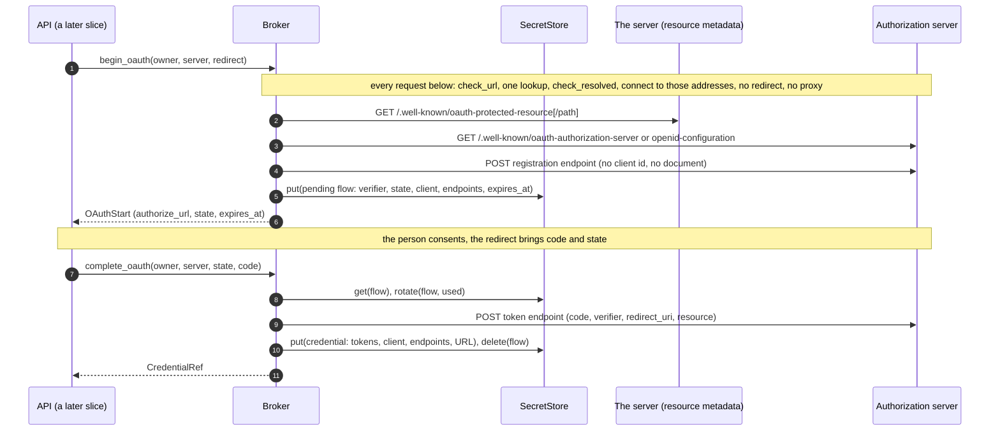
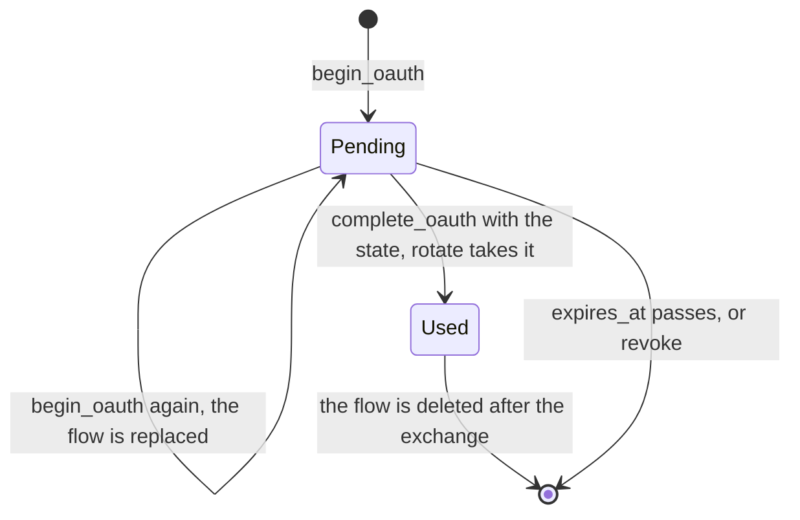
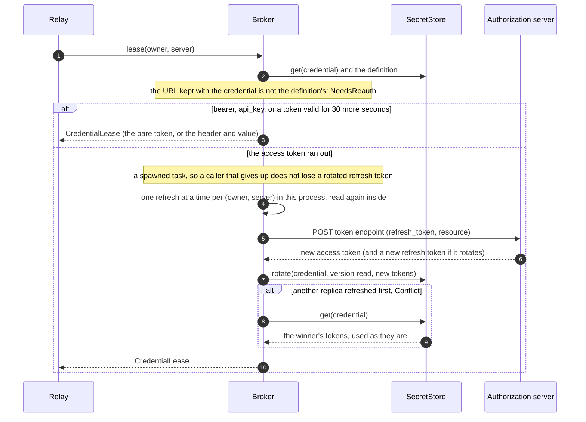
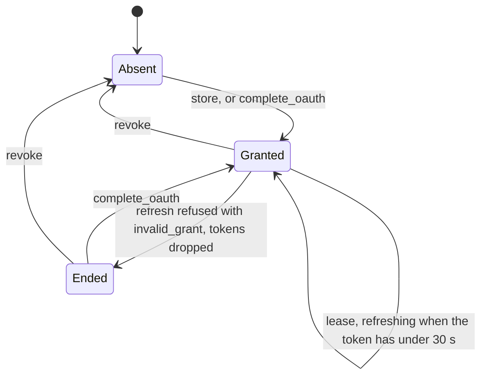

# orch-credential-broker

The one implementation of `orch_ports::CredentialBroker` ([ADR 0046](../../../docs/decisions/0046-people-add-their-own-mcp-servers-secrets-in-a-credential-broker.md),
the amendment of 2026-10-11): it keeps the credentials of a person's own MCP servers in a `SecretStore`, runs the OAuth
work (discovery, PKCE `S256`, the `resource` parameter, client registration, refresh), and lends a short, fresh
`CredentialLease` for one call. It is generic over the two ports it is composed with, `S: SecretStore` and
`D: UserToolServerStore`, and reads a clock (`C: Clock`, `SystemClock` by default). It builds the HTTP client it
needs itself, and **every URL that client fetches goes through the egress guard** (`orch_ports::EgressPolicy`).

**Not wired into the binary yet** (the composition root, the `secrets` and `userToolServers` configuration, the
endpoints and the relay's lease are later slices of the ADR). No configuration, environment variable or feature
here.

## API

```rust
let broker = Broker::builder(secrets, definitions, egress_policy)   // S, D, EgressPolicy
    .clock(clock)                       // default SystemClock
    .config(BrokerConfig::default())    // default as below
    .lookup(SystemLookup)               // default; how a name becomes addresses
    .build()?;                          // Result<Broker<S, D, C>, BuildError>
```

| Item | What |
|---|---|
| `Broker<S, D, C>` | Implements `CredentialBroker`. `Clone` is cheap and shares the single-flight table (one process); build another with `Broker::builder` for another replica. `Debug` prints nothing of what it holds. |
| `BrokerBuilder` | `clock`, `config`, `lookup`, `build`. |
| `BrokerConfig` | `with_client_name`, `with_client_metadata_url`, `with_refresh_margin`, `with_lease_ttl`, `with_flow_ttl`, `with_timeouts`, `with_max_response_bytes`; checked by `build` (`BuildError::Config`, `BuildError::ClientMetadataUrl`). |
| `HostLookup`, `LookupFuture`, `SystemLookup` | How a host name becomes addresses. The default asks the operating system. Whatever answers, the guard judges the addresses and the connection is made to those alone. |
| `egress_refusal(&CredentialError)` | The `EgressRefusal` behind an `Unavailable` error, if the guard is why, found in the error's chain. The API maps it to `UnavailableReason::EgressRefused` and shows a person `public_reason()`, never `rule()` ([ADR 0046](../../../docs/decisions/0046-people-add-their-own-mcp-servers-secrets-in-a-credential-broker.md), departure 17). |
| `BuildError` | `Config`, `ClientMetadataUrl`, `Http`. |

| Setting | Default | Meaning |
|---|---|---|
| refresh margin | 30 s | An access token with less than this to live is refreshed at `lease`. |
| lease TTL | 300 s | The longest a lease lasts (it ends sooner when the access token does). |
| flow TTL | 600 s | How long an authorization that has begun may take: `OAuthStart::expires_at`. |
| request / connect timeout | 10 s / 5 s | One request to an authorization server, and the connection. |
| max response bytes | 64 KiB | Metadata, a token, a registration; a longer response is refused. |
| client name | `another-agentic-system` | The `client_name` of a client registered dynamically. |
| client metadata URL | none | The `https` URL (with a path) of the orchestrator's Client ID Metadata Document, which the orchestrator serves; without it that step of the registration order is skipped. |

## What each call does

| Call | Does |
|---|---|
| `store` | For `bearer` and `api_key`: reads the definition, keeps the token (or key) **and the definition's normal-form URL** sealed under `SecretServer::credential(id)`, returns `CredentialRef` (`cred-<id>-v<version>`). `none` and `oauth2` are `Unknown`: an OAuth credential is obtained by `begin_oauth`, not typed. |
| `begin_oauth` | Discovers the authorization server, takes a client (below), makes the PKCE verifier and the `state` (256 bits each), keeps the pending flow sealed under `SecretServer::pending_flow(id)` with its `expires_at`, and returns `OAuthStart`. The authorization request carries `response_type=code`, `client_id`, `redirect_uri`, `state`, `code_challenge` with `code_challenge_method=S256`, `resource` and `scope` (the definition's scopes; else the resource's `scopes_supported`; else none). A flow already pending is replaced. |
| `complete_oauth` | Loads the flow, compares the `state` in constant time (a wrong one is `Unknown` and leaves the flow), refuses it after `expires_at`, **claims** it with `rotate` (so one callback wins across replicas and the code is spent once), exchanges the code with the verifier, `redirect_uri` and `resource`, keeps the grant bound to the URL the flow began with, and forgets the flow whatever came of the exchange. A refused code is `NeedsReauth`; a failing authorization server is `Unavailable`. |
| `lease` | See below. |
| `revoke` | Deletes the credential and any pending flow, **then** asks the authorization server to revoke the grant (RFC 7009) if the grant names a revocation endpoint. The upstream call is best effort and a failure is logged, not returned. Idempotent, and it does not read the definition (the grant names its own endpoints), so it works for a definition that is already gone. |





### Discovery, and what is refused

1. **Protected resource metadata** (RFC 9728): `GET` at `/.well-known/oauth-protected-resource` with the server's path
   inserted, then at the root. Its `resource` must be the definition's URL (same scheme, host, port and path; `https://h`
   and `https://h/` are the same), else the document is not used. Its `authorization_servers` are the issuers (the
   first three are tried).
2. **Authorization server metadata** (RFC 8414 and OpenID Connect Discovery): for an issuer with a path,
   `oauth-authorization-server` with the path inserted, `openid-configuration` with it inserted, `openid-configuration`
   with it appended; for one without, the first two. Its `issuer` must be the issuer asked about.
3. **A server whose metadata does not list `S256` in `code_challenge_methods_supported` is refused** (`Unavailable`),
   and so is one that names no token or authorization endpoint.
4. The token endpoint is judged by the guard at once, so a flow that cannot finish does not send the person anywhere.
   The authorization endpoint is only a place to send the person (it may carry a query), so the rest of it is judged.

### Client registration, in the ADR's order

1. The `client_id` of the definition (`oauth2 { client_id }`): a public client.
2. A **Client ID Metadata Document**, when the authorization server says `client_id_metadata_document_supported` and
   `BrokerConfig::with_client_metadata_url` is set: the `client_id` is that URL. (The authorization server fetches the
   document, not the broker; the orchestrator serves it.)
3. **Dynamic registration** (RFC 7591) at the `registration_endpoint`: a public client (`token_endpoint_auth_method:
   none`) for the redirect URI, `authorization_code` and `refresh_token`. If the server answers with a client secret it is
   kept and used (`client_secret_basic`, or `client_secret_post` if the server says so). A client is registered at each
   `begin_oauth`.
4. Otherwise `Unavailable`: the person needs to give a client id.

## Leases, refresh and the URL binding





- **The URL binding** (departure 15 of slice 1): the normal-form URL of the definition is kept inside the sealed
  material by `store` and `complete_oauth`, and `lease` compares it with the definition's now. A mismatch, a credential
  of another kind than the definition's, a revoked credential and one never given are `NeedsReauth`; a missing server and
  a `none` server are `Unknown`.
- **Lease**: `Bearer` (the bare token, for `bearer` and `oauth2`) or `Header { name, value }` (for `api_key`, the
  definition's header), ending at `min(token end, now + lease TTL)`.
- **Refresh** is lazy and single flight: the callers of one `(owner, server)` that need it wait for one, and each reads
  the material again inside the flight, so a refresh already done is used. Across replicas `rotate` with the version
  read settles it; the loser reads again and uses the winner's tokens, and **never refreshes twice in a row**
  (`Unavailable` if what it then finds is still stale).
- **Failures**: `400` or `401` at the token endpoint is `NeedsReauth`, and with `invalid_grant` the broker drops the
  tokens (a compare and swap, so a newer grant is never touched) so nobody asks again with a refused refresh token.
  A network error, a timeout, a `5xx` or an answer that is not a token response is `Unavailable` and costs the
  person nothing: the grant is kept.
- **State**: the broker writes one state of the definition, `needs_reauth`, with `UserToolServerStore::set_state` and
  the revision it read, when it learns the grant is over (a refused refresh; an expired token with no refresh token). A
  definition edited since is `Conflict` and nothing is written. `connected`, `revoked` and the credential reference are
  the API's `replace`, which writes the reference in the same compare and swap.
- **Token lifetime**: `expires_in` seconds (a number, a float or a numeric string; at most a year). When the server says
  nothing, an hour if there is a refresh token to ask again with; with none, the token has no known end and is lent
  until the server says otherwise.

## Egress

Nothing in this crate opens a connection except `http.rs`, and it does this for every request (resource metadata,
authorization-server metadata, the token, registration and revocation endpoints):

1. `EgressPolicy::check_url` on the URL, and the request goes to the **normal form** it returns; an address written in
   the URL is also judged by `check_resolved`.
2. A name is resolved by the client's `dns_resolver` hook (`reqwest::dns::Resolve`), which resolves **once**
   (`HostLookup`), calls `check_resolved` on the answer and hands the client only the addresses that passed: the address
   that was judged is the address connected to. One refused address among several refuses the answer.
3. No redirect (`Policy::none()`), no proxy of the environment, a connect and a request timeout, at most
   64 KiB read, `pool_max_idle_per_host(0)` (no connection outlives its request).

The policy is the deployment's: the lists change, so a stored grant's endpoints are judged again when they are used (a
refresh under a stricter list is refused with nothing sent). A refusal is `Unavailable`; the operator's log gets
`rule()` (never an address or a URL) and the API finds the refusal with `egress_refusal`.

## Secrets

- The only places a secret is: the argument of `store` and `complete_oauth` (`ToolSecret`), a `CredentialLease`, the
  sealed material in the `SecretStore`, and, for the length of a request, the broker's memory. `ToolSecret` and
  `SecretMaterial` print `<redacted>` and are wiped on drop. (The wipe covers the copy those types hold; a request
  makes copies while it is sent, which it does not.)
- **No error, `Debug` or log line holds one.** The `detail` of every `Unavailable` this crate makes is a fixed phrase
  (no URL, no body), no `serde_json` error is ever kept (it can quote what it could not read), and an authorization
  server's error response is **never echoed**: of a token error the broker keeps the status and, if it is a
  well-formed OAuth error code (`invalid_grant`), that code, in the log only. The tests plant a sentinel in everything the
  authorization server issues and echoes, and look for it in every error, `Debug` and log line.
- What is kept is JSON `{"v":1,"d":…}` of two records, the credential and the pending flow (`src/material.rs`); a
  record that cannot be read is `Unavailable`, not a request to sign in.

## Tests

`cargo test -p orch-credential-broker` (no Postgres, no network beyond the loopback). The authorization server of the
tests is `tests/support` (axum on `127.0.0.1`, an ephemeral port): it **enforces** PKCE `S256`, the `resource`, the
redirect URI and the client's authentication, so a test that gets a token has proved the request was right. The
egress policy of the tests names `127.0.0.1` explicitly (`allowing_http` and an `allow` entry), which proves the guard
is in the path.

| File | What |
|---|---|
| `tests/conformance.rs` | `orch_ports::credential_broker_conformance!` (27 cases, in `orch-ports`' `testkit::credential_broker`) over `MemorySecretStore` (behind a wrapper that yields after every call, so two replicas interleave as they do in production), `MemoryUserToolServers` and the mock. |
| `tests/egress.rs` | A policy that does not name the address, `http` without `allowing_http`, a token, registration or revocation endpoint at `169.254.169.254` or at an address the policy does not name (a tripwire listener counts connections: none), a stricter policy at a refresh, a name that resolves to a private address (DNS rebinding), to a mix, to nothing, a resolver that fails, a name admitted by `allow` and connected to only through the hook, a redirect not followed, a response over the limit, a slow server. |
| `tests/registration.rs` | The order of the ADR (client id, document, dynamic), the secret of a registered client, the authorization request (PKCE, `state`, `resource`, scope, redirect), the root metadata fallback, OpenID-only issuers, metadata about another resource or issuer, a token that is not a bearer token, and the settings checks. |
| `tests/behaviour.rs` | What is kept, lifetimes and leases, rotating and non-rotating refresh tokens, the state the broker writes (and does not write after an edit), revocation upstream, stores that are down, a refresh that outlives its caller, a corrupt record. |
| `tests/hygiene.rs` | The whole life of a credential under a subscriber that keeps every level, with a planted sentinel: no secret and no server path in the log. |
| unit tests | `src/discovery.rs` (the well-known URLs, the resource comparison), `src/oauth.rs` (the RFC 7636 appendix B vector, error codes, `expires_in`), `src/material.rs` (records), `src/flights.rs` (single flight). |

## Dependencies

`orch-core` and `orch-ports` only among ours; `reqwest` (the workspace's, `rustls`), `url`, `serde`/`serde_json`, `sha2`,
`base64`, `getrandom` (PKCE and `state`), `jiff`, `tokio`, `tracing`, `zeroize`, `thiserror`. Dev: `axum`,
`tracing-subscriber`, `futures`.
