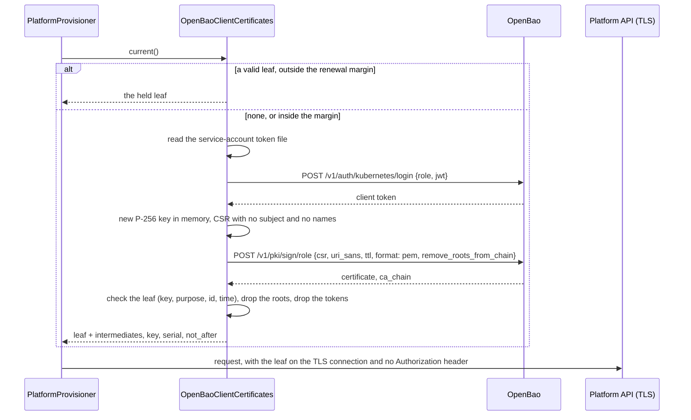
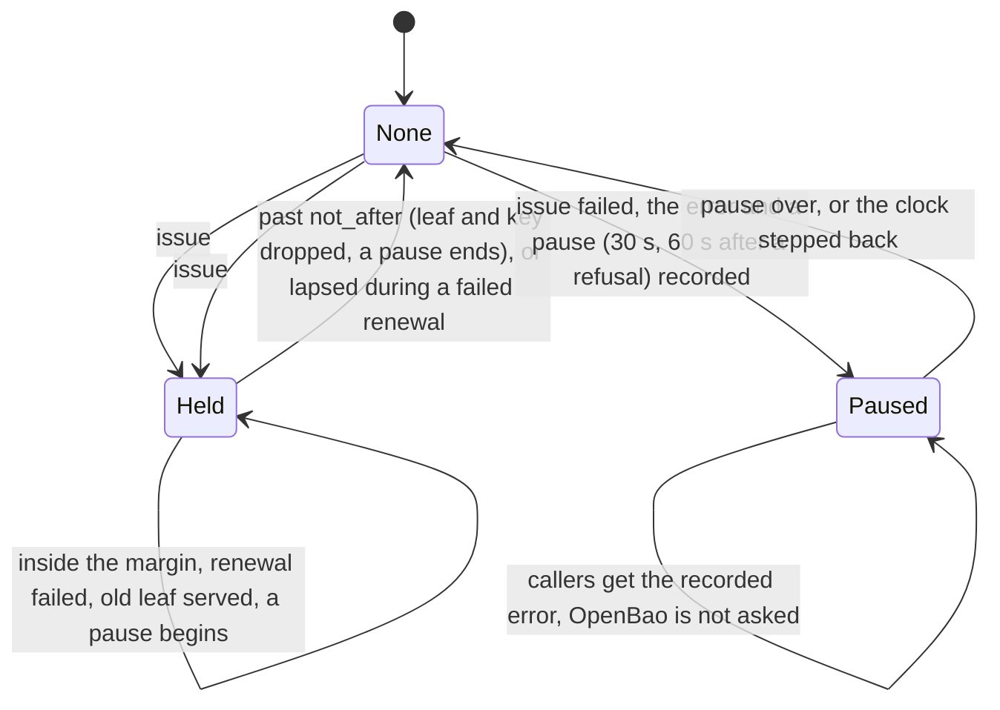

# orch-platform-credentials-openbao

`PlatformClientCertificates` from an OpenBao PKI secrets engine: the orchestrator's **workload
certificate**, the identity it presents to the Platform API on the TLS connection (ANR-809,
[ADR 0110](../../../docs/decisions/0110-the-orchestrator-presents-its-workload-certificate-to-the-platform.md)).

## Where it sits

An **adapter** of the `PlatformClientCertificates` port in [`orch-ports`](../ports/README.md)
([ADR 0009](../../../docs/decisions/0009-swappable-implementations-at-build-time.md)). The port is a
second, additive sibling of `PlatformCredentials` (a bearer token), never a fallback of it: a provisioner
is built with one mode or the other. [`orch-provisioner-platform`](../provisioner-platform/README.md)
asks this adapter for the certificate before **every** request and presents it on the TLS connection; the
binary composes the two (Cargo feature `provisioner-platform`, `provisioner.credentials.type:
openbao-pki`). Nothing of OpenBao's crates is a dependency
([ADR 0007](../../../docs/decisions/0007-protocol-only-dependencies.md)): the adapter speaks HTTP and JSON.

It is the certificate of **this one use**. It is not the certificate that signs prompts (ANR-718): that is
another PKI role, another key and another lifetime.

## What it does

* **Login.** The pod's service-account token is read from its file **at each login** (the kubelet rotates
  it; the default path is `/var/run/secrets/kubernetes.io/serviceaccount/token`) and posted to
  `POST /v1/auth/<kubernetesMount>/login` with the configured role. The client token that comes back is
  used for one signing and dropped.
* **Key and request.** An **ECDSA P-256** key is made in memory for each issue, and a CSR with **no subject
  and no names** is signed by `POST /v1/<pkiMount>/sign/<pkiRole>` with `uri_sans` the configured SPIFFE id,
  `ttl`, `format: pem` and `remove_roots_from_chain: true`. The id is the PKI role's to put in the leaf
  (`use_csr_sans=false`), never something the request can ask for.
* **The leaf is checked before it is used, and anything else fails closed:** it parses; its public key is the
  one of our CSR; its extended key usage has `clientAuth` and **not** `serverAuth`; its names are **exactly
  one URI, the configured id**; it is valid now on the injected `Clock` and for longer than the renewal
  margin; it is not self-signed; it is a leaf and not an authority (no `cA`, no `keyCertSign`); and `anyExtendedKeyUsage` is not
  among its usages. The chain presented is the leaf and the intermediates OpenBao sent, **no
  root**, each once, at most eight; a `ca_chain` that is `null` or absent falls back to `issuing_ca`.
* **Renewal.** One caller at a time decides and renews (single flight: a burst of requests makes one login and
  one signing). The leaf is renewed once `now >= not_after - renewalMargin`, with a **new key** each time.
  **A failed issue is remembered, with or without a leaf:** nothing is asked of OpenBao for 30 s after an
  `Unavailable` and **60 s after a `Refused`** (a setup fault a retry does not mend, so half the cadence, but
  a fixed role is seen within a minute). Meanwhile a caller gets the old leaf if it is still valid, and
  otherwise the recorded error: a burst with no leaf makes one login and one signing, not one each in turn.
  **The pause cannot outlive the leaf it began beside:** it ends early when the held leaf lapses (the next
  caller may try again at once; the lapsed leaf and its key are dropped), and a pause that would run longer
  from now than the pause itself (the wall clock stepped back) is not waited for. A renewal that fails is
  judged again after the failure (an issue can take two requests of the timeout each): the old leaf is served
  only if it is still valid then, otherwise the answer is `Unavailable`.
  Past `not_after`, a failed renewal is an error: **there is no identity, and the provisioner sends nothing**.
* **Errors carry a class** (`PlatformCredentialsError`, `Classify`): a 400, 401 or 403 from OpenBao is
  `Refused` (`Unauthenticated`: the deployment's setup, not a transient fault); a 5xx, a network error, an
  answer that is not what OpenBao documents, a missing token file and **every leaf that fails the check** are
  `Unavailable` (`Transient`).
* **No key, CSR, certificate or token in a log, an error or a `Debug`.** An error says a stage and a class,
  a log line says a serial number and an end of validity, and the `Debug` of the adapter, of its configuration
  and of the certificate (the port's `PlatformClientCertificate`) show names, serials and times only.
  The private key and the tokens are wiped from our buffers when they are dropped (`zeroize`); the
  copy held inside the signing library's key object and the buffers of the HTTP client are not ours to wipe
  (said plainly, not claimed away).

## Configuration

`OpenBaoPkiConfig::new(address, auth_role, pki_mount, pki_role, spiffe_id)` and its public fields; the binary
reads them from the `provisioner.credentials` block of its configuration
([`docs/api/config.md`](../../../docs/api/config.md#provisioner)).

| Setting | Default | |
|---|---|---|
| `address` | — | OpenBao, `https` in the binary (the adapter also takes `http`, for the tests) |
| `ca_pem` | system roots | PEM certificates OpenBao's own certificate is also checked against |
| `kubernetes_mount` | `kubernetes` | the Kubernetes auth method's mount |
| `auth_role` | — | the role the pod's service account logs in as |
| `service_account_token_file` | the pod's own | read at each login |
| `pki_mount`, `pki_role` | — | the PKI engine's mount and **this certificate's own role** |
| `spiffe_id` | — | `spiffe://<trust domain>/<path>` in its plain form: the one name the leaf must carry |
| `ttl` | 86 400 s (a day) | at least 60 s; the role's `max_ttl` may cut it, but must stay above `renewal_margin` |
| `renewal_margin` | 28 800 s (8 h) | must be less than `ttl` |
| `timeout` | 5 s | one request to OpenBao |

A leaf that is, or would be, shorter-lived than the margin is refused as unusable (it would be renewed at
every call); say so in the role's `max_ttl`.

**Why a day, and why P-256.** No certificate revocation list exists yet, so **a leaf's life is the
revocation window** of a stolen one: a day keeps it short without a renewal storm, and eight hours of margin
give a renewal three tries before the leaf lapses. ECDSA P-256 is the curve every platform listener reads and
the cheapest to make on each renewal. (Both are defaults, set by configuration.)

### What the OpenBao side needs (ANR-714 owns the live PKI)

The PKI role must be written to match what the adapter checks, or the leaf is refused here:
`client_flag=true`, `server_flag=false`, `allowed_uri_sans` (exactly the configured id),
`use_csr_sans=false`, `require_cn=false` (and no `use_csr_common_name`), `key_type=ec`, `key_bits=256`, **no
extra `ext_key_usage`**, and a short `max_ttl` (at most the configured `ttl` and **greater than the renewal
margin**). The Kubernetes auth role binds the orchestrator's service
account and namespace and gives it **only** `update` on `<pki>/sign/<role>`. This crate does not create any of
it.

## Tests

`tests/fake_pki.rs` runs the adapter against an in-process stand-in of OpenBao written from its documented
API (no cluster, no OpenBao): a root and an intermediate minted with `rcgen`, a login that reads the token, a
signing endpoint that **parses the CSR it is sent** and answers a leaf dated by a `FixedClock`, and modes that
refuse (403), fail (500), answer something that is not JSON, or mis-issue. It checks: a leaf issued for our key
with the one URI name and the chain without the root (and a root sent anyway not presented); no call outside
the margin; a renewal inside it with a **new serial and a new key**; **one signing under eight concurrent
callers**; past `not_after` with the PKI down is `Unavailable` and inside the margin the old leaf is served and
not hammered; a refused login or signing is `Refused` and a down or unreadable OpenBao `Unavailable`, with
nothing kept; each leaf that is not ours (server authority too, any usage, none, server only, two names, another name,
an extra DNS name, no name, another key, expired, shorter than the margin, a CA, `keyCertSign`, self-signed) is
refused as unusable; a chain of eight is presented and one of nine refused; a `null` `ca_chain` falls back to
`issuing_ca`; **a burst with no leaf makes one login and every caller gets the same error**, with the pause
after a failure and after a refusal; a back-off that runs past the end of the leaf is an error without a new try; the token file
is read again at each login; **no sentinel, `BEGIN`, token or key bytes in a `Debug`, an error or a captured
log**; and the settings are checked when the adapter is built.

**The port's own conformance kit runs against this adapter** (`mod conformance` of `tests/fake_pki.rs`,
`orch_ports::platform_client_certificates_conformance!`) with a fixture whose `set_issuer_failing` moves the
fake clock 61 s forward, past the longest pause: the kit's contract lets a source remember a failure for a
bounded pause and requires the fixture to take it past that.

The provisioner side of the same port is proven against a real TLS listener in
[`orch-provisioner-platform`](../provisioner-platform/README.md) (`tests/mtls.rs`).

**Status: unverified against a live OpenBao.** The stand-in is built from OpenBao's documentation, not from a
server: that the real answer has the fields read here, that the role settings above produce a leaf this adapter
accepts, and that the Kubernetes login works with the pod's token are for the live PKI to show (ANR-714).
