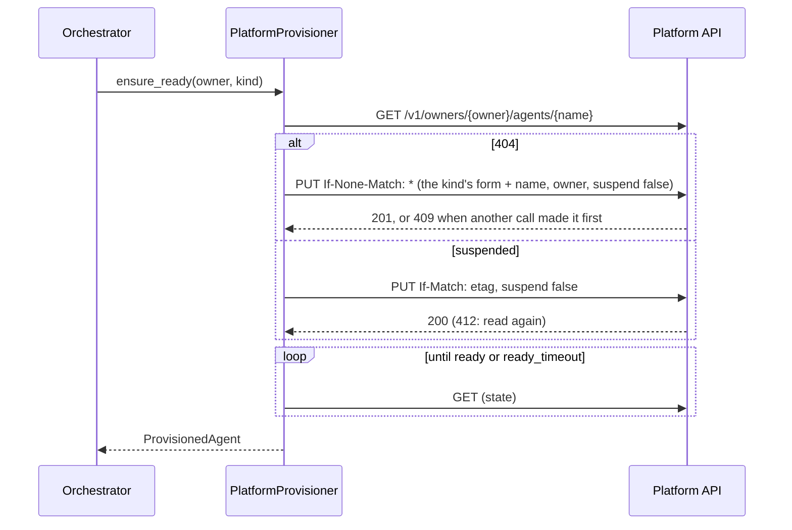
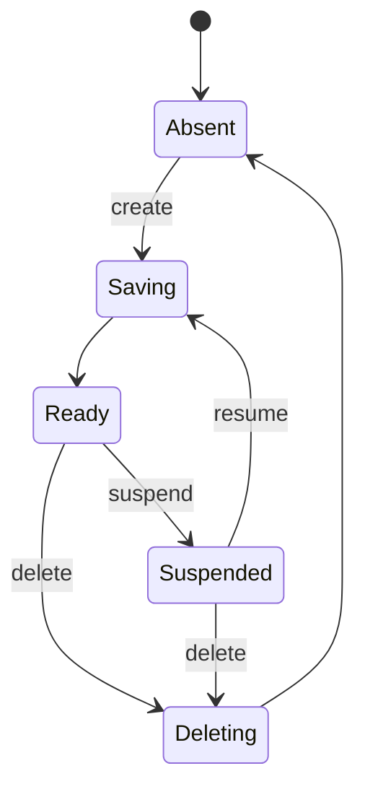

# orch-provisioner-platform

`AgentProvisioner` over the Platform API's owner routes: a person's first message to a coder or
workspace agent makes their agent, a later one resumes it, and the call waits until it is `ready`.

## Where it sits

An **adapter** of the `AgentProvisioner` port in [`orch-ports`](../ports/README.md)
([ADR 0009](../../../docs/decisions/0009-swappable-implementations-at-build-time.md),
[ADR 0022](../../../docs/decisions/0022-platform-provisions-agents-system-discovers-them.md)).
The contract is the platform's OpenAPI document, `docs/api/platform-api-v1.openapi.json` in
another-agentic-platform; nothing of that repository is a dependency
([ADR 0007](../../../docs/decisions/0007-protocol-only-dependencies.md)). The shared `chat` agent is
not provisioned per person and never goes through it.

## What it does

* The agent is named `<kind>-<owner>` (`coder-<owner>`, `workspace-<owner>`): one per owner and
  kind, so two first messages at once name one agent. The create is conditional, so the platform
  makes one and answers the other `409` `already-exists`, which the adapter reads as "it exists".
  The platform's other `409`s on that route are told apart by the problem's `type`
  (`urn:vymalo:agents:problem:<slug>`): `managed-by-gitops` (a GitOps-managed `coder-<owner>`
  that the API will not write) is `Invalid`, `deleting` is `Deleting`, and `conflict`, an unknown
  slug or a body that is no problem is a transient `Unavailable`. Only `already-exists` is "made".
  A `409` on a *replace* (resume) is still read as "read again": the loop ends in a transient
  error after eight rounds, never in "made".
* Every call goes through the owner routes, which answer `404` for an agent of another owner: the
  adapter cannot read, suspend or delete one, and a name held by another owner is
  `ProvisionError::Invalid`.
* The agent's **form** (model, image, secrets) is the deployment's, given per kind to
  `PlatformConfig::with_form`; the adapter adds `name`, `owner` and `suspend` and refuses a form
  that sets them.
* A wait that ends before `ready` is `NotReady { last }` (transient); a `Deleting` agent is
  `Deleting`. A bad token is `Refused`. No retry loop beyond the waits above.

## Configuration

`PlatformConfig::new(url, token)`; defaults: 5 s per request, 120 s to be ready, polled every 2 s.
The token must hold `platform:agents.own`. **How the orchestrator gets that token is not decided
yet** (design task ANR-783), and this crate is not yet built into the `orchestrator` binary: the
composition root takes a static bearer token until then.

## Tests

`tests/platform.rs` runs the port's conformance testkit
(`orch_ports::agent_provisioner_conformance!`) against an in-process stand-in of the owner routes
written from the OpenAPI document (bearer, `ETag`, `If-None-Match: *`, `If-Match`, `404` for
another owner). It is a stateful axum server and not a WireMock stub, because the cases make an
agent and then read it back. It also checks: a wrong token makes nothing, an agent of another owner
with the same name is never written, the form that is sent, a wait that times out, and an
unreachable platform.

The testkit itself is proven able to fail: `crates/ports/tests/provisioner_kit_catches.rs` builds
fakes that each break one rule (a create that races, a resume that does not wait, a suspend that
reaches another owner) and asserts the matching conformance case goes red.
