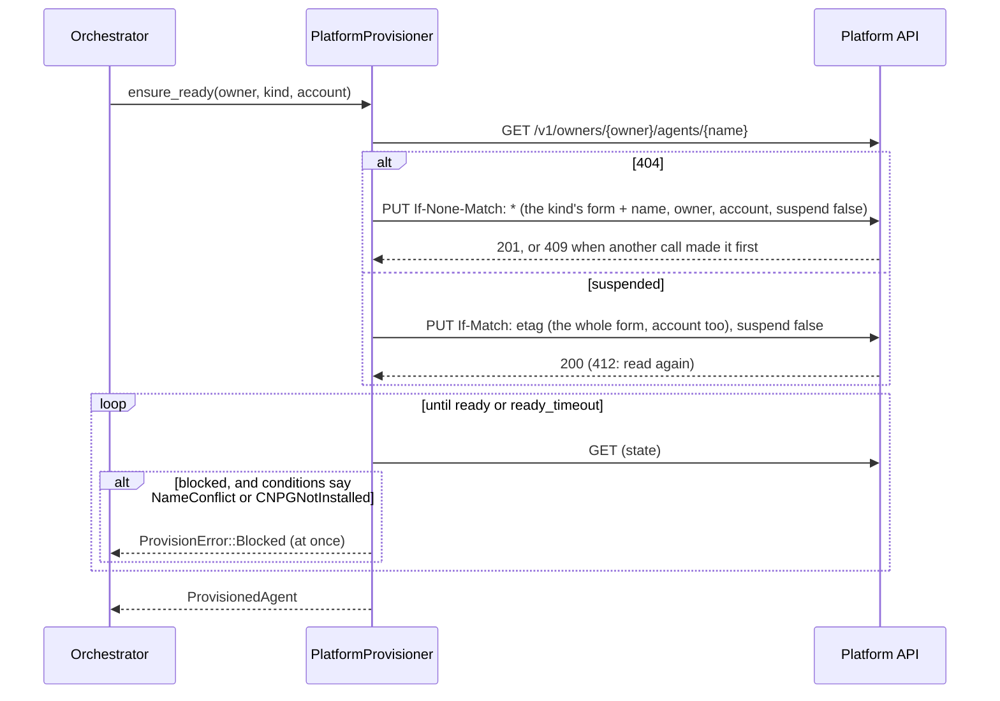
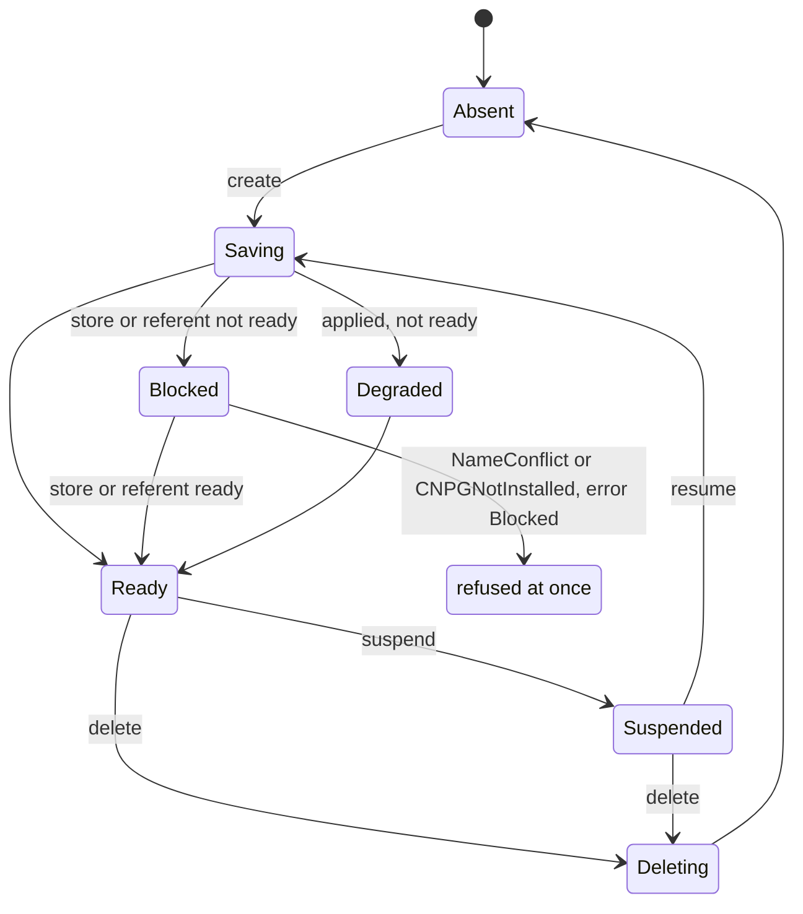

# orch-provisioner-platform

`AgentProvisioner` over the Platform API's owner routes: a person's first message to a coder or
workspace agent makes their agent, a later one resumes it, and the call waits until it is `ready`.

## Where it sits

An **adapter** of the `AgentProvisioner` port in [`orch-ports`](../ports/README.md)
([ADR 0009](../../../docs/decisions/0009-swappable-implementations-at-build-time.md),
[ADR 0022](../../../docs/decisions/0022-platform-provisions-agents-system-discovers-them.md)).
The contract is the platform's OpenAPI document, `docs/api/platform-api-v1.openapi.json` in
another-agentic-platform; nothing of that repository is a dependency
([ADR 0007](../../../docs/decisions/0007-protocol-only-dependencies.md)). The shared `chat` agent is
not provisioned per person and never goes through it.

## What it does

* The agent is named `<kind>-<owner>` (`coder-<owner>`, `workspace-<owner>`): one per owner and
  kind, so two first messages at once name one agent. The create is conditional, so the platform
  makes one and answers the other `409` `already-exists`, which the adapter reads as "it exists".
  The platform's other `409`s on that route are told apart by the problem's `type`
  (`urn:vymalo:agents:problem:<slug>`): `managed-by-gitops` (a GitOps-managed `coder-<owner>`
  that the API will not write) is `Invalid`, `deleting` is `Deleting`, and `conflict`, an unknown
  slug or a body that is no problem is a transient `Unavailable`. Only `already-exists` is "made".
  A `409` on a *replace* (resume) is still read as "read again": the loop ends in a transient
  error after eight rounds, never in "made".
* Every call goes through the owner routes, which answer `404` for an agent of another owner: the
  adapter cannot read, suspend or delete one, and a name held by another owner is
  `ProvisionError::Invalid`.
* The agent's **form** (model, image, secrets) is the deployment's, given per kind to
  `PlatformConfig::with_form`; the adapter adds `name`, `owner`, `account` and `suspend` and refuses a form
  that sets them (`BuildError::BadForm`).
* **The account** (ANR-1321, [ADR 0108](../../../docs/decisions/0108-a-run-is-charged-to-the-identity-providers-sub-and-an-ended-run-is-still-answered-to-the-meter.md))
  is the `orch_core::AccountId` the caller passes to `ensure_ready` and `suspend`, the two methods that write the agent
  (`AgentService.spec.account`). It is not the owner key. Every create and replace sends it; an agent that is `ready` is only
  read, so one made without it gets it at its next resume or suspend. It names a person: it is in the request body and in no
  error and no `Debug`, and the crate logs nothing.
* A wait that ends before `ready` is `NotReady { last }` (transient); a `Deleting` agent is
  `Deleting`. `Saving`, `Degraded` (applied, not ready: a rollout or a crash loop, which returns to
  `ready` by itself) and `Blocked` are polled until `ready_timeout`: a fresh database cluster or a
  referent not made yet blocks an agent that then goes `ready`, so a first message is not refused for
  it. Only a `Blocked` agent whose `conditions` (each `{type, status, reason}`, as the platform's
  detail has them) say that waiting cannot help is refused at once, as `ProvisionError::Blocked
  { reason }` (a 500 `agent_blocked` for the person: the deployment's to repair): `RuntimeReady`
  `False` for `NameConflict`, and `StoreReady` `False` for `CNPGNotInstalled`. Every other reason
  (`ClusterNotReady`; `ConfigNotFound`, a `ConfigResolved` `False`; `ConfigInvalid`, which also reports a referent not made yet; `ConfigNotResolved`, a `StoreReady` `Unknown` while the config is not resolved; an unknown or missing one) is waited for
  and ends, at the bound, as `NotReady { last: Blocked }`. A bad token is `Refused`. No retry loop beyond the waits above.

## Configuration

`PlatformConfig::new(url, token)` presents a fixed token; `PlatformConfig::with_credentials(url, credentials)`
presents what a [`PlatformCredentials`](../ports/src/platform_credentials.rs) gives, **asked before every
request and never kept**. Defaults: 5 s per request, 120 s to be ready, polled every 2 s. The token must
hold `platform:agents.own`. A credentials error is `Refused` (the issuer refused the orchestrator) or
`Unavailable` (it could not be reached); neither holds a token, a secret or a URL.

Adapters of the port here: `StaticCredentials` (one token) and `OidcClientCredentials`, the **development**
adapter: the OAuth `client_credentials` grant against a token endpoint with the extension parameters of the
local stack's `mock-oidc` (`user`, `audience`, `roles`), the token cached until 30 s before it expires.

**Two modes, chosen when the provisioner is built, never switched, never a fallback** (`PlatformConfig.auth`, a `PlatformAuth`):
`Bearer` (above) and `ClientCertificate`, built with `PlatformConfig::with_client_certificate(url, certificates)` over a
[`PlatformClientCertificates`](../ports/src/platform_credentials.rs) (the orchestrator's workload certificate,
[`orch-platform-credentials-openbao`](../platform-credentials-openbao/README.md), ANR-809,
[ADR 0110](../../../docs/decisions/0110-the-orchestrator-presents-its-workload-certificate-to-the-platform.md)). In that mode
the adapter asks `current()` **first** at every request and **sends nothing if it errors**, or if the certificate it
answers has a `not_after` at or before now (`Unavailable`: the port should never answer one, the provisioner does not rely on it). "Now" for that guard is
`PlatformConfig.clock` (`with_clock`, the system clock by default): in a deployment it is the system clock the
certificate source also uses (`OpenBaoClientCertificates::new`), so the two cannot disagree, and a test gives one
`FixedClock` to both (`Refused` stays `Refused`, anything
else is `Unavailable`; no connection is opened), presents the chain on the TLS connection and sends **no `Authorization` header**.
It keeps one `reqwest::Client` per certificate **serial** and builds a new one (a new pool, so a new handshake) exactly when the
serial changes, with the same redirect and proxy settings as the bearer mode (the identity goes to the configured URL only).
`with_server_ca_pem(pem)` adds the listener's private authority to the roots (both modes). A certificate needs an `https` URL
(`BuildError::CertificateNeedsHttps`); an unreadable CA is `BuildError::BadServerCa`. **`PlatformConfig.credentials` became
`PlatformConfig.auth`**; `new` and `with_credentials` are unchanged and build `Bearer`.

The `orchestrator` binary builds the provisioner from the `provisioner:` section of its configuration
(Cargo feature `provisioner-platform`, on by default; [`docs/api/config.md`](../../../docs/api/config.md#provisioner)).
The message path of `orch-app` calls it: before a message to the agent the deployment calls `coder` or `workspace` is written, `ensure_ready` makes or resumes the person's agent and waits ([`Provisioning`](../app/README.md), ANR-806), and the dispatcher then sends the message to that agent, found in the registry under the name `ensure_ready` returns (ANR-1061). The wait-ready bound the application reports is the `readyTimeoutSecs` given to this adapter.

## Tests

`tests/platform.rs` runs the port's conformance testkit
(`orch_ports::agent_provisioner_conformance!`) against an in-process stand-in of the owner routes
written from the OpenAPI document (bearer, `ETag`, `If-None-Match: *`, `If-Match`, `404` for
another owner). It is a stateful axum server and not a WireMock stub, because the cases make an
agent and then read it back. It also checks: a wrong token makes nothing, an agent of another owner
with the same name is never written, the form that is sent (the account beside `name`, `owner` and `suspend`, on a create,
a suspend and a resume), a configured form with an `account` refused at build, the account in no error (`Display`, `Debug`
and the cause chain) when the stand-in quotes the request back in its problem (create and replace, each status), a wait that times out, and an
unreachable platform, and the platform's states: a `Blocked` agent (a store not ready) waited for until
it is ready; `Blocked` for `NameConflict` and for `CNPGNotInstalled` refused at once (`Blocked`, a
time bound and two reads); look-alike conditions (`RuntimeReady` `True` with `NameConflict`, `Ready`
`False` with `NameConflict`) and `ConfigInvalid` still waited for, ending in `NotReady { last: Blocked }`;
a `Degraded` agent waited for until it is ready, and `NotReady { last: Degraded }` when it stays so.

`tests/mtls.rs` runs the certificate mode against a **real TLS listener** (`rustls` with a `WebPkiClientVerifier` over a root
minted in the test, behind an owner-routes stand-in, served by `axum::serve` over a listener that records what it saw): the
leaf and its intermediate are what the listener sees and **no `Authorization` header** comes; a certificate source that errors
(`Refused` or `Unavailable`) makes `ensure_ready` fail with the matching error and the listener **accepts zero connections**;
the same serial reuses its connection and a **new serial opens a new one** that presents the new leaf; a certificate of another
authority is stopped by the listener (and the listener's own refused-handshake count moves); a certificate that is
over (on the one clock given to the provisioner, moved past the certificate's end) is not presented and not one new connection is opened; and the build refuses an `http` URL or an unreadable CA.

The testkit itself is proven able to fail: `crates/ports/tests/provisioner_kit_catches.rs` builds
fakes that each break one rule (a create that races, a resume that does not wait, a suspend that
reaches another owner) and asserts the matching conformance case goes red.
