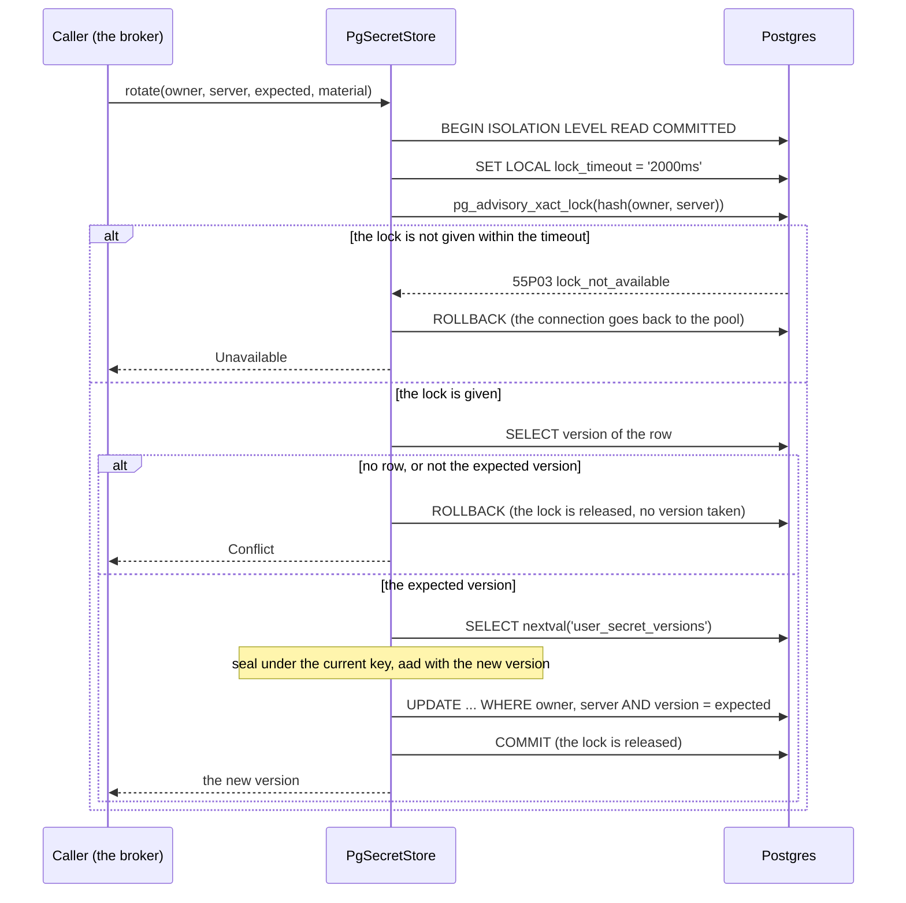
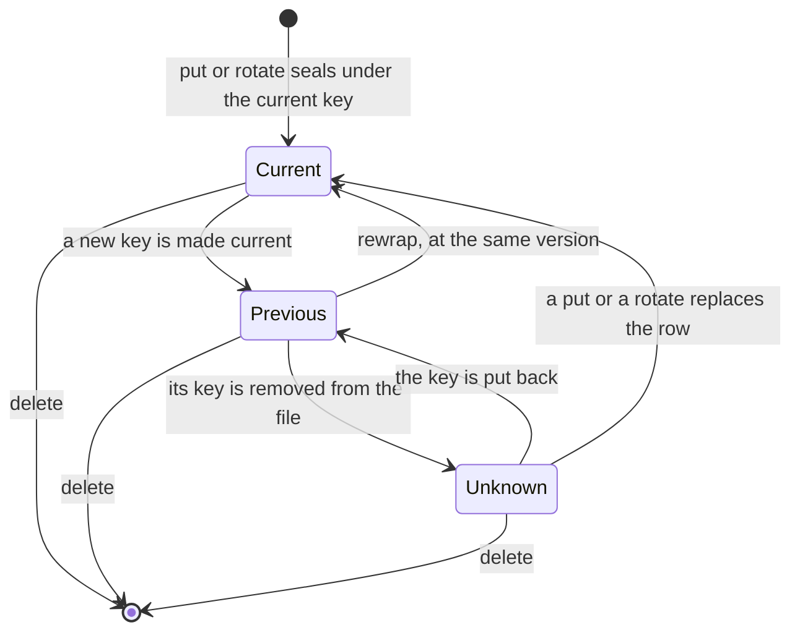
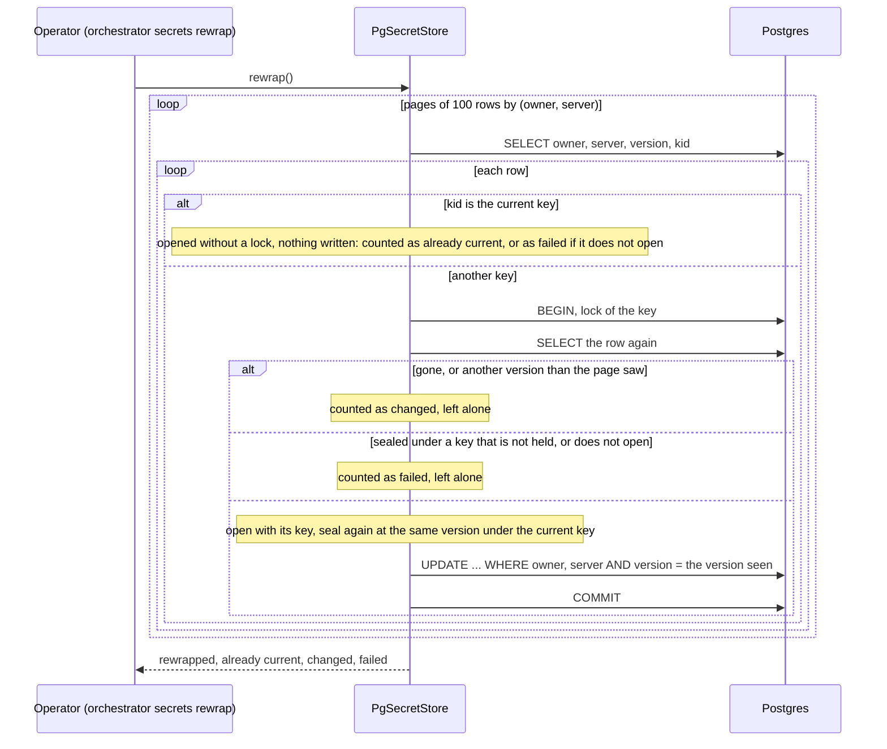

# orch-secrets-pg

The default [`SecretStore`](../ports/README.md) adapter: the opaque material of a person's credentials, **sealed** with
AES-256-GCM, in the orchestrator's own Postgres ([ADR 0046](../../../docs/decisions/0046-people-add-their-own-mcp-servers-secrets-in-a-credential-broker.md),
the amendment of 2026-10-11 and "Amended 2026-10-14, slice 3"). The database holds ciphertext and nothing it can read; the
key is in the configuration, by reference.

## Where it sits

An **adapter** of the `SecretStore` port in [`orch-ports`](../ports/README.md) ([ADR 0009](../../../docs/decisions/0009-swappable-implementations-at-build-time.md)):
[`orch-credential-broker`](../credential-broker/README.md) keeps tokens, a pending flow's verifier and client secrets through it
and does not know where they go. Only the binary ([`orchestrator`](../../bin/orchestrator/README.md)) depends on this crate, behind the
Cargo feature `secrets-pg` (on by default). It uses it for the command `orchestrator secrets rewrap` and, **when `userToolServers.enabled`
and the file has a `secrets` section**, to build the service's `SecretStore` and the credential broker over it, in a pool of its own of four
connections (`PgSecretStore::connect`, so a lock that is held in the secret store can never keep a connection of the thread store, and the
other way round) and with `migrate()` at boot in every role; the routes of slice 4b reach it only through the broker, which holds the only handle (ADR 0046, slices 4a and 4b). It depends on `orch-ports` and `orch-core` and on no other crate of the
workspace; its tests also use `orch-store-postgres`, to show that the two sets of migrations live in one database.

## API at a glance

| Item | What |
|---|---|
| `PgSecretStore::connect(url, keyring)`, `connect_with(url, keyring, max)`, `from_pool(pool, keyring)` | a store over a pool (four connections by default, and a call waits at most ten seconds for one, so `connect` to a database that is down fails in ten; [why four](#the-pool-and-a-lock-that-is-held); `connect_with` takes another size, `from_pool` the orchestrator's own pool or a test's pinned to a schema). Cheap to clone: clones share the pool and the keys |
| `LOCK_TIMEOUT` | two seconds: how long a write waits for its key's lock (or any other lock) before it fails as `Unavailable` ([below](#the-pool-and-a-lock-that-is-held)) |
| `migrate()` | applies this crate's migrations, recorded in their own history table `_orch_secrets_pg_migrations` (`MIGRATIONS_TABLE`). Idempotent; every replica may run it at boot |
| `impl SecretStore` | `put`, `get`, `delete`, `rotate` as the port says (below) |
| `rewrap() -> RewrapReport` | re-seals every row that is not under the current key, **in place at the version it has**, and **opens the rows that are** (so a key whose bytes changed under its id shows as `failed`, not as current); returns `rewrapped`, `already_current`, `changed`, `failed` and the first 100 failures (`server`, `kid`, `KeyUnknown` or `Corrupt`; never the owner) |
| `is_outage(&SecretError) -> bool` | whether an error is the database being down or too busy to answer (the network, TLS, the pool, a lock that was held for longer than `LOCK_TIMEOUT`, SQLSTATE class `08` or `53`, `40001`, `40P01`, `57P01`..`57P03`), as opposed to a statement it refused (a missing privilege at `migrate`, a syntax error, a read-only session). The port's `Unavailable` is both and its class `Transient` says neither, so a caller that decides from the class alone (the service's exit code: 69 for an outage, 1 for a refusal, as the thread store's) asks here. It reads the driver's error that `Unavailable` keeps as the source; an `Unavailable` with no source says only that the store could not be reached and is an outage; every other variant is not |
| `close()` | closes the pool (every later call is `Unavailable`): a clean shutdown, and the conformance testkit's breaker |
| `advisory_lock_key(owner, server) -> i64` | the key of the lock every write takes; anything else that writes `user_secrets` by hand takes `pg_advisory_xact_lock(advisory_lock_key(..))` too, and lets go within seconds: past `LOCK_TIMEOUT` the writers of that key give up |
| `Keyring::new(current, [(KeyId, KeyBytes)])` | the keys of a deployment: any opens what it sealed, `current` seals. Refuses no keys, a repeated id, a current id that is not held. `Clone` shares the keys (an `Arc`): another handle to the same ciphers, not another copy of the key bytes (the service keeps one in its configuration and gives a clone to the store) |
| `KeyId::parse`, `KeyBytes::from_hex` / `from_bytes` | an id is 1 to 64 characters of `A-Z a-z 0-9 . _ -`; a key is 64 hex characters (`openssl rand -hex 32`), surrounding white space cut, and not all zero (`KeyError::ZeroKey`: a placeholder nobody replaced). `KeyBytes` is wiped when dropped, `Debug` is `<redacted>`; no error quotes a key |

Errors are the port's: `Conflict` (a `rotate` of a stale or missing version), `Unavailable` (the pool, the network, the server, a rejected
statement, a key's lock that is held for more than `LOCK_TIMEOUT`; the driver's error is the source and holds no parameter), `KeyUnknown` (sealed under a key id this deployment does not hold), `Corrupt`
(an envelope that does not parse or open; the detail is a fixed sentence with no bytes in it).

## The table

`migrations/0001_user_secrets.sql`, one table, one sequence:

| Column | |
|---|---|
| `owner`, `server` | the key: the person (`UserId`, a lower-cased e-mail) and the text form of the `SecretServer` (`u-abcdefghij`, or `u-abcdefghij#flow`). Primary key `(owner, server)` |
| `version` | the last version this key was given, from the sequence `user_secret_versions` |
| `v`, `kid`, `nonce`, `ciphertext` | **the envelope**: the format (1), the id of the key that sealed it, 96 random bits, the ciphertext followed by the 128-bit tag. Checks: `nonce` is 12 bytes, `ciphertext` at least 16 |
| `updated` | when the material last changed (`clock_timestamp()` at the write); `rewrap` does not touch it |

An index on `kid` serves `rewrap` and an operator's `SELECT kid, count(*) FROM user_secrets GROUP BY kid`, which shows how far a rotation is.

### Why its own history table

`sqlx` records applied migrations in `_sqlx_migrations`, and refuses to start when a version in that table is not among the migrations it was
built with (`VersionMissing`). If this crate and `orch-store-postgres` shared the table, each would see the other's versions as unknown, and both
would number their files from 1. So this crate runs its migrations through a `Migrator` whose table is renamed with `Migrator::dangerous_set_table_name`
(*verified 2026-10-14*, by reading `sqlx-core` 0.9.0, `src/migrate/migrator.rs`: the method exists, takes a table name that may be schema-qualified, and its
documentation warns only that changing the name of a table that already has a history loses it, which is not the case for a new crate). The crate then needs nothing of `orch-store-postgres`' schema, and the
orchestrator's guard that **an applied migration is never edited** applies to `crates/secrets-pg/migrations` as to the other directory: add a numbered file.
Both migrators take sqlx's advisory lock of the database while they run, so they serialize if started together (a test does).

## The envelope

AES-256-GCM (RustCrypto's [`aes-gcm`](https://crates.io/crates/aes-gcm) 0.11.1, licence `Apache-2.0 OR MIT`, `rust-version` 1.85: *verified 2026-10-14* from its manifest).
A **random 96-bit nonce** from the operating system (`getrandom`) for every seal, so two seals of one material differ. The **associated data**, authenticated and not stored:

```text
aad = v (1 byte) ‖ len(owner) ‖ owner ‖ len(server) ‖ server ‖ version ‖ len(kid) ‖ kid
```

Every `len` is eight bytes, big-endian, and so is the `version`. The length in front of each text makes the encoding unambiguous (owner `ab` with server
`c…` is never owner `a` with server `bc…`); `v` binds the format, and `kid` the key. A row copied to another owner, another server (or from a credential
to its pending flow), or given another version, or whose `kid` was edited (even to a key with the same bytes), **does not open**: `Corrupt`. The test
`the_associated_data_is_pinned_byte_for_byte` pins the encoding, and `a_seal_is_what_openssl_makes_of_the_same_key_nonce_and_associated_data` pins the
cipher: the vectors were made by OpenSSL 3.0.13 through Python `cryptography` 49.0.0 with an encoder of the associated data written separately
(*verified 2026-10-14*). Changing either makes every stored secret unreadable, so it would be a migration.

The key and the plaintext: `KeyBytes` and `SecretMaterial` are wiped when dropped; the buffers this crate seals and opens in are `Zeroizing` and made with room for the tag
(so they never move and leave a copy); the cipher's key schedule is wiped with the `zeroize` feature of `aes-gcm`. A copy the driver makes of a
bound parameter is the ciphertext.

**How many seals one key may make.** With random 96-bit nonces, NIST SP 800-38D, section 8.3, says "the total number of invocations of the authenticated
encryption function shall not exceed 2^32, including all IV lengths and all instances of the authenticated encryption function with the given key"
(*verified 2026-10-14*, <https://nvlpubs.nist.gov/nistpubs/Legacy/SP/nistspecialpublication800-38d.pdf>). Every `put`, `rotate` and `rewrap` of a row is a seal
under the current key: at 100 000 seals a day that is 118 years, at ten million a day 430 days. Rotate before a deployment gets near it.

## Versions, and the lock that numbers them

A version is the number a write took from **one sequence for the whole store** (`user_secret_versions`, `NO CYCLE`), so none is ever given twice for a key, not across a
`delete` either (a sequence is not rolled back: *verified 2026-10-14*, PostgreSQL 16 manual, "Sequence Manipulation Functions": "the value obtained by nextval is not
reclaimed for re-use if the calling transaction later aborts", so a failed write leaves a gap, never a repeat). The version is in the associated data, so it
must be known **before** sealing, and a number taken outside the writers' order could be committed after a greater one. So every write of a key (`put`, `rotate`,
`delete`, and `rewrap` of one row) is one transaction that **takes `pg_advisory_xact_lock` of a hash of `(owner, server)` first**, and only then reads, takes
`nextval`, seals and writes. A transaction-level advisory lock is released automatically at the end of the transaction, with no explicit unlock
(*verified 2026-10-14*, PostgreSQL 16 manual, "Explicit Locking", advisory locks), so the writers of a key are serialized from the lock to the commit, take their
versions in the order they land, and **the version a key holds is the greatest it was given**, which the testkit's concurrent case asserts (and fails when the lock is taken out: a
mutation made while writing the crate failed it in two runs of three). The lock key is 64 bits of the SHA-256 of a domain string and the two texts with their lengths; two keys that collide
only wait for each other. A `get` takes no lock: a row is read whole or not at all.



`put` is the same without the check (an `INSERT ... ON CONFLICT DO UPDATE`), `delete` takes the lock and deletes, and `rotate` never opens the old row, so it can replace
one whose key is gone. `rotate` of a missing secret, and with a stale `expected`, is `Conflict`; `delete` of nothing succeeds. The lock is what makes a **revoke linearizable**:
a `delete` that did not take it could find no row while a `put` of the same key is between its insert and its commit, succeed, and the put would then commit the credential back.

**`READ COMMITTED`, whatever the database defaults to.** Every write transaction begins with `BEGIN ISOLATION LEVEL READ COMMITTED`. Under `REPEATABLE READ` (a
`default_transaction_isolation` of the database or the role) the snapshot is taken by the first query, which is the lock, *before* the wait; the writer that waited would then
read a row the writer ahead of it had changed since and fail with SQLSTATE `40001`. The test `writers_of_one_key_do_not_depend_on_the_isolation_the_database_defaults_to` runs the
concurrent writers on sessions that default to `REPEATABLE READ`. `get` is one statement and needs no transaction.

### The pool, and a lock that is held

A write holds a pooled connection from the moment it asks for its key's lock to its commit. Without a bound on the wait, one key whose lock is held for long (a replica that is wedged or
paused, an operator's repair that was never committed, which the advisory-lock rule above invites) would keep every writer of that key on a connection after its caller had given up, the
pool would be gone, and a `get` of an unrelated key would fail for want of a connection. So every write sets `SET LOCAL lock_timeout = '2000ms'` (`LOCK_TIMEOUT`) right after `BEGIN`: a
wait that ends is SQLSTATE `55P03`, which is `SecretError::Unavailable` (class `Transient`, with a detail that says the key is locked), the transaction is rolled back at once and the connection goes
back to the pool. The bound also covers a wait for a **row** lock that a hand-made transaction holds. A write holds the lock for milliseconds; two seconds rides out a slow commit and
costs a stuck key one connection per writer for two seconds. The test `a_key_whose_lock_is_held_makes_its_writers_unavailable_and_leaves_the_pool_to_the_rest` holds one key's lock and
sends eight writers at it through a pool of four: each is `Unavailable` after about two seconds, meanwhile a `get` and a `put` of other keys succeed (as soon as a connection is free),
nobody is left waiting in `pg_locks`, and four writes at once then run on four connections in a moment.

**Why the pool stays at four.** A call holds a connection for a few milliseconds; the writers of one *key* are serialized anyway and a person's keys are written by that person's own
requests, a few a minute, so the pool is not the bottleneck and a larger one would only move the limit on the server. The size is a parameter, not a constant of the design: `connect_with`
takes another, `from_pool` takes the orchestrator's own pool (the service does **not** use it: it connects a pool of four of its own, which is what keeps this store's lock waits away from the thread store's connections), and the command asks for two. What the timeout does **not** do is
make a flood harmless: writers arriving at one wedged key faster than four per two seconds would still queue the other keys' calls behind them, and those would see `Unavailable` after ten
seconds. Nothing writes one key that fast; if something did, the right alarm is the rate of `Unavailable` with the lock detail in the log, not a larger pool.

## Rotating the key, and `rewrap`

Keys are named by id, in the configuration (`secrets.pg.keys`, `secrets.pg.current`, [`docs/api/config.md`](../../../docs/api/config.md)). New seals, and every re-seal, use `current`; any key that is
held opens what it sealed. To rotate: add a key, make it current (a restart of every replica, **and wait until the rollout is complete and no pod is left on the old configuration**: a pod still on the old `current` seals under the old key after the run, which the exit `75` of a second run shows), run **`orchestrator secrets rewrap`**, and when it reports that nothing failed or changed and a
second run reports every row as current, remove the old key.

**Never change the bytes behind an id: add a new id.** A row says only which id sealed it, and the id is part of what the seal authenticates, not a fingerprint of the key. If the file or property behind `k1` is overwritten, or `k1` is removed and a different key is later added under the name `k1`, every row sealed under the old bytes stops opening (`Corrupt`), and `get` fails for all of them. `rewrap` shows it: it opens the rows already under the current key too, so they are counted as `failed` and the exit is `65`, not "already current" and `0`. The way back is to put the old bytes back under their id.



A row in `Unknown` is `KeyUnknown` to `get` (that server is unavailable, nothing else is) and `failed` to `rewrap`.

### Why `rewrap` is not a `rotate`

The ADR's first text said `rewrap` re-seals each row "through `rotate`". It does not. `rotate` makes a new version, and the broker
([`broker.rs`](../credential-broker/src/broker.rs), `claim` and `keep`) refreshes by **claiming** the grant with `rotate(read version)` and ending the claim with
`rotate(claim's version)`; a `Conflict` at the second is read as "another replica took over" and the refresh token the authorization server has just rotated to is dropped. A `rewrap` that
bumped the version between the two would make that a lost grant. So `rewrap` re-seals **in place at the same version**: the same material, a new `kid` and a new nonce, under the key's lock, and
only if the row still has the version the run saw. Callers compare versions for equality only (the port's contract), and the material behind a version has not changed. The test
`a_refresh_that_is_claimed_before_a_rewrap_can_still_keep_its_tokens_after_it` is that scenario, and fails if `rewrap` takes a new version. This is a departure from the ADR's text, recorded in it (departure 47).



The counts: a **changed** row was written or deleted by someone else while the run was under way; it is left alone, and the writer sealed it under *its* current key, which is the
new one unless that replica still runs the old configuration. So `changed > 0` is not a proof that no row is under the old key, and the command says so in its exit code (it is 75, "run it again";
the codes are in the binary's README). A **failed** row is one whose key is not held (`KeyUnknown`: put the old key back in the file and run again) or that does not open (`Corrupt`: investigate; a row under the *current* key that does not open means the bytes behind the id changed). A run that
the database interrupts, or that meets a key whose lock is held for more than `LOCK_TIMEOUT`, is an error, not a report (`Unavailable`; the rows before it are done), and can be repeated: the rows done are counted as current. A run writes nothing for a row it counts as anything but `rewrapped`.

## What the tests prove

`ORCH_TEST_DATABASE_URL` (the variable of `orch-store-postgres`' tests; a Postgres 16 is what CI starts) makes the database tests run; without it they print `skipped` and pass. Each test has a schema of its own
(`search_path`), so they run in parallel against one database. `cargo test -p orch-secrets-pg` runs:

| Where | Cases | Proves |
|---|---|---|
| `src/keys.rs`, `src/envelope.rs`, `src/store.rs` (no database) | 22 | a key is 64 hex characters, not all zero, and never printed; the ring's rules; the associated data byte for byte and unambiguous; the cipher against OpenSSL's; sizes from 0 to 16 KiB; fresh nonces; no plaintext in the envelope; a changed owner, server, version, kid, format, nonce, ciphertext or tag does not open; an unknown key is `KeyUnknown`; the lock key; **`is_outage` over a table of driver errors** (the network, TLS, the pool, a lock not got in time and the transient SQLSTATEs are outages; a missing privilege, a syntax error, a read-only session, a migration that could not be resolved and every variant but `Unavailable` are not) |
| `tests/conformance.rs` | 16 | `secret_store_conformance!` with `breaker =` (the pool is closed), so every case runs, including `no_error_from_a_broken_store_shows_a_secret` |
| `tests/adapter.rs` | 17 | a row moved to another owner, server, pending flow or version does not open; an edited ciphertext, nonce, format or tag is `Corrupt` and the error holds no bytes; an unknown key id is `KeyUnknown` and only that server is affected; two seals of one material differ; **the table holds no plaintext** (the whole row printed by Postgres, as text, has neither the sentinel nor its hex); versions come from one sequence, shared by replicas; a refused `rotate` takes no version; **sixteen writers of one key, 25 times, over two pools, mixing `put` and `rotate`: the key holds the greatest version it gave**; the two sets of migrations are idempotent and coexist, in either order and at the same moment; a history that does not match is `Corrupt`; a database that is gone is `Unavailable` and an outage; **a statement the database refuses** (`migrate` in a session that may write nothing) is `Unavailable`, class `Transient`, and **not** an outage (`is_outage`) |
| `tests/rewrap.rs` | 11 | rows move to the current key with their versions, material and `updated` unchanged, and a second run writes nothing; more rows than a page; a key that is not held and a row that does not open are counted as failed, listed without the owner, and left byte for byte as they were; **a row under the current key is opened, and counted as failed when the bytes behind the current id are not the ones that sealed it** (and the same for a key that is not current); **a claim made before a rewrap can still be ended after it**; a rewrap racing a `rotate` (40 rounds) never makes the `rotate` a `Conflict` and loses nothing; a rewrap beside writers and deleters fails nothing; two at once do each row once; a row changed or deleted while the run waits for its lock is left alone and counted (it waits on **that key's** lock in `pg_locks`) |
| `tests/locking.rs` | 7 | with the key's lock held by a raw transaction: **a `delete`, a `put` and a `rotate` each queue behind it and stay queued** (the delete is ordered after the in-flight put and removes its row; the rotate compares versions after the lock and is a `Conflict`); **a key whose lock is held makes eight writers `Unavailable` in about two seconds each while a `get` and a `put` of other keys succeed and nobody is left waiting**; a `rewrap` that meets such a key stops there with the rows before it done; **the concurrent writers pass on sessions that default to `REPEATABLE READ`**; the helpers that read `pg_locks` see one key whatever the sign and the halves of its 64 bits |

How they were checked to be able to fail (each change made in turn, then reverted): no advisory lock in the write path (`concurrent_puts_of_one_key_leave_one_whole_secret` failed in two of three runs);
`rewrap` through a new version (three cases failed, among them the claim test); `rewrap` without the check of the version it saw (the changed-while-waiting case failed); a version left out of the associated data (five unit
tests failed). Of the review of slice 3: no `SET LOCAL lock_timeout` (the pool-of-four case failed on the `get` of another key with `PoolTimedOut`, and the wedged `rewrap` was still waiting after 12 seconds); `pool.begin()` for
`BEGIN ISOLATION LEVEL READ COMMITTED` (the `REPEATABLE READ` case failed in round 0 with SQLSTATE `40001`); `pool.begin()` in `put`, in `delete` and in `rotate`, one at a time (the queueing case of each failed, and the `put` one
also the pool and the isolation cases); `rewrap` counting the rows under the current key by their id (the case of the changed bytes counted five as current).

**Isolation between the tests.** The advisory lock of a key is a hash of its owner and server, locks are shared by every schema of the database, and the owners of a test used to be the same in all (`user1@example.test`):
a test that waited for "some session blocked on an advisory lock" could return on another test's wait, or on sqlx's own migration lock, before its `rewrap` had started, and see the row after the writer's change
(7 failures in about 270 runs, reproduced here as 8 in 300). Now each test makes its owners from a tag of its own (`TestDb::owner`), and the helpers read `pg_locks` for **its key** (`waiters`, `holders`,
`wait_for_waiters`). The pool of a test's store is eight connections at most, and a raw pool four. The server's `max_connections` is shared by every test of every process that runs against it (100 by default): when several runs at once ask for more, a call that
needs a new connection waits for one, fails as `PoolTimedOut` after its acquire timeout and shows as `Unavailable`; that is what the assertion of `a_key_id_edited_into_another_key_with_the_same_bytes_does_not_open` printed in a stress run of 25 copies of the binary against a default server (it now prints the
outcome, never the material: `Err(Unavailable { .. PoolTimedOut })`), and the other cases fail the same way at that load. CI runs the three binaries one after the other.

## Dependencies, and what they cost

`aes-gcm` 0.11.1 with `default-features = false, features = ["aes", "alloc", "zeroize"]` (no `getrandom` feature: the nonce comes from the workspace's `getrandom`, so there is one source of randomness in this
crate). The lock file gains ten third-party packages, all RustCrypto's or their support (`aead` 0.6.1, `aes` 0.9.3, `aes-gcm` 0.11.1, `cipher` 0.5.2, `cpubits` 0.1.1, `ctr` 0.10.1, `ghash` 0.6.0, `inout` 0.2.3, `polyval` 0.7.3,
`universal-hash` 0.6.1), and the workspace package itself. All ten are `MIT OR Apache-2.0` (or `Apache-2.0 OR MIT`), the workspace's own licence (*verified 2026-10-14*, their manifests in `~/.cargo/registry`). `sqlx`, `sha2`, `getrandom`, `zeroize`, `thiserror` and `tracing` were in it already.
