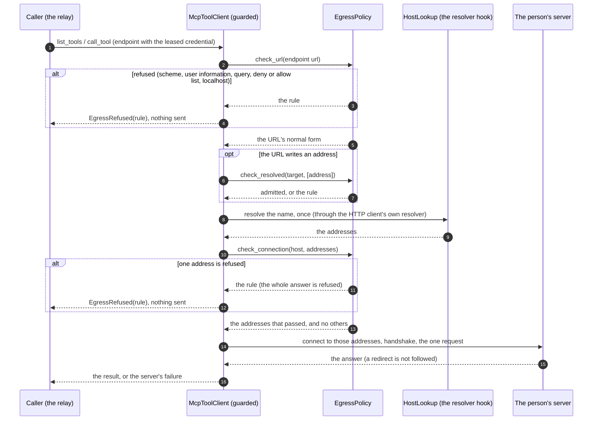

# orch-tools-mcp

`ToolServerClient` over MCP: the orchestrator as a **client** of an MCP server, to list its tools and
call one. It is `rmcp`'s client over streamable HTTP behind the port in
[`orch-ports`](../ports/README.md), so the relay of the thread-tools endpoint
([`thread-tools/v1`](../../../docs/api/thread-tools-v1.md), [ADR 0024](../../../docs/decisions/0024-mcp-tools-attached-per-conversation.md))
sees the port's types and never an MCP library type.

## Where it sits

An **adapter** of the `ToolServerClient` port
([ADR 0009](../../../docs/decisions/0009-swappable-implementations-at-build-time.md)): the one
implementation that speaks the network. The in-memory one, `MemoryToolServers`, is in `orch-ports`
(feature `testkit`). Its one user is the relay
(`RelayTools` of `orch-surface-thread-tools`): the binary composes this client into it behind its feature `tool-relay`
(default). The client side of `rmcp` is enabled in this crate's manifest only (the
workspace entry has the server side, which the surfaces use). The server a person lists is the
deployment's own (`toolServers` of the configuration, [`config.md`](../../../docs/api/config.md#toolservers)),
never one a person or an agent typed.

## API at a glance

| Item | What |
|---|---|
| `McpToolClient::new() -> Result<McpToolClient, BuildError>` | implements `ToolServerClient`. Builds one HTTP client (no idle connection kept, a connect timeout of 10 s, **no redirect followed**, no proxy of the environment) and installs the `rustls` crypto provider if none is installed. Cheap to clone. `BuildError::Http` is the TLS backend not starting. It judges no address: it is for the servers the deployment lists |
| `McpToolClient::guarded(EgressPolicy)` | the same client for **servers people name** (ADR 0046, decision 5): the egress guard runs at every connection, on the address connected to. See "Servers people name" below |
| `McpToolClient::guarded_with_lookup(EgressPolicy, impl HostLookup)` | `guarded` with a resolver of your own: a test that maps a name to a loopback address (DNS rebinding), or a deployment with its own resolver |
| `HostLookup`, `LookupFuture`, `SystemLookup` | how a host name becomes addresses for a guarded client. The default asks the operating system. Whatever answers, the guard judges the addresses and the connection is made to those alone. (`orch-credential-broker` has a trait of the same shape for its own client; the two are not shared because neither crate depends on the other, and the **verdict** is shared: `EgressPolicy::check_connection` in `orch-ports`) |

The port's `list_tools(&ToolServerEndpoint)` and `call_tool(&ToolServerEndpoint, &ToolCall)` are the whole
interface; the types are in [`orch-ports`](../ports/README.md#api-at-a-glance).

**One request is one session.** Each call connects, runs `initialize`, makes its one request
(`tools/list` with all its pages, or `tools/call` with the arguments and the request's `_meta`) and lets
the session go; nothing is kept between requests and no listing is cached, so any replica serves any
request ([ADR 0001](../../../docs/decisions/0001-rust-state-machine-on-postgres.md)). The transport
accepts a server that keeps no session as well as one that does (rmcp's `allow_stateless`).

**The endpoint's `timeout` bounds the whole request.** A handshake still open at the deadline is
`Unreachable` (nothing answered), a call still open is `TimedOut { after }`. A call is **cancelled by
dropping its future**: the request is abandoned and the session closed in the background; the server may
run the call to its end.

How a server's answer maps to the port's errors (`Classify`):

| The server | `ToolServerError` | Class |
|---|---|---|
| refuses or drops the connection, resets, answers 5xx, 404, 408 or 429, or does not finish the handshake | `Unreachable` (no URL in the text) | transient |
| answers 401 or 403, with `WWW-Authenticate` or without | `Unauthenticated` | unauthenticated |
| has not answered a call in time | `TimedOut` | transient |
| answers a JSON-RPC error (an unknown tool, arguments it cannot read) | `Remote { code, message }`, the message cut at 1 KiB | invalid |
| answers something that is not MCP (HTML, a malformed message), or another 4xx | `Protocol` | transient |
| has a result with `isError: true` | **not an error**: `Ok` with `is_error`, passed through | |
| the endpoint is unusable: a URL that is not `http` or `https`, a header a request cannot carry, one of `Authorization`, `Accept`, `Content-Type`, `Host`, `Mcp-Session-Id`, `Mcp-Protocol-Version`, `Last-Event-ID` | `Misconfigured`, nothing sent | invalid |
| the endpoint is refused by the egress guard (a **guarded** client only): its URL, or an address its name resolved to | `EgressRefused(rule)`, nothing sent | invalid |

**Credentials.** `Authorization: Bearer <bearer>` and the endpoint's headers go on every request to that
server and nowhere else: redirects are not followed (they would replay the headers to another host), the
values are marked sensitive in the HTTP client, and no error holds one (the conformance suite searches
every error, its sources and its `Debug`). The rmcp error is kept as the `source` of `Unreachable` and
`Protocol`, which may hold the server's URL and body; `public_detail()` is what may be shown.

**Servers people name.** A person's MCP server is a stranger's URL, and the orchestrator calls it with the
person's credential. `McpToolClient::guarded(policy)` is the client for it, with the egress guard of
`orch-ports` in front of every connection:



1. The URL goes through `EgressPolicy::check_url` and the client connects to the **normal form** it returns,
   so what was judged is what is used.
2. An address written in the URL (`127.0.0.1`, `2130706433`, `[::1]`, `0x7f.1` in any spelling the URL
   parser reads as an address) is judged before the client is asked to connect: the HTTP connector never
   asks a resolver about an address.
3. A name is resolved **once**, by the client's own resolver hook, and the answer is judged address by address
   (`check_connection`): one address the guard refuses refuses the whole answer, and the connection is made
   to the addresses that passed and to no other, so there is no second lookup to rebind. A name that
   resolves to nothing is `Unreachable`, as it is for the other client.
4. No connection is kept (every request is judged again), no redirect is followed and no proxy is used.

A refusal is `ToolServerError::EgressRefused(rule)` and **nothing was sent**: the handshake, and with it
the credential, never leave. Its `public_detail()` is the guard's `public_reason()` (one sentence for a
private address and for none, so a person cannot map the network behind the orchestrator); the precise rule
is for the operator's log. The class is the rule's (`Invalid`: nobody retries).

**Bounds.** The content of a result is cut at `MAX_RESULT_BYTES` (256 KiB) before it is returned
(`truncated`). The cut is of what is returned, not of what is read: an event of a streamed answer over
4 MiB is refused (`Protocol`), and a plain JSON answer is read whole, bounded by the endpoint's timeout.
What a server says is untrusted text: the tools' descriptions, the content of a result and an error's
message go back into an agent's model, so they are data to pass on. The icons a server lists are dropped
(open question 38), and so is anything else the port does not carry.

*Verified 2026-10-02, against `rmcp` 3.5.0 (`~/.cargo/registry`):* a 401 with `WWW-Authenticate` is
`StreamableHttpError::AuthRequired`; a 401, 403 or 5xx without it is
`StreamableHttpError::UnexpectedServerResponse("HTTP <status>: <body>")`, from which this crate reads the
status (the tests of both shapes would fail on a change); a refused connection is `Client(reqwest::Error)`.

## Tests

Offline: a real MCP server over HTTP on a loopback port (`orch_testsupport::FakeToolServer`). No
environment variables.

* `tests/mcp.rs`: the `ToolServerClient` conformance suite of `orch-ports` (`tool_server_conformance!`,
  eleven cases: the tools and their schemas, the credentials on the wire, an echo round trip with the
  arguments and `_meta`, `isError` passed through, a wrong or missing bearer is `Unauthenticated`, an
  unreachable server, a slow call is `TimedOut` within the timeout plus a second, a dropped call leaves the
  client usable, an unknown tool is `Remote`, a result over 256 KiB is cut, and no secret in any error or
  `Debug`), run **three times**: against a server that keeps no session, one that keeps a session and
  answers on an event stream, and one that refuses with a bare 401. And what only this client says: a 5xx
  is unreachable, a 403 unauthenticated, an HTML page a protocol error, a server that accepts and says
  nothing is unreachable within the timeout, a redirect is not followed (the target is never reached), an
  endpoint the client cannot use is `Misconfigured` for a listing and a call, every request lists again,
  and non-ASCII arguments and `_meta` arrive as the server can read them.

* `tests/guarded.rs`: the guarded client. The suite of the port again, against a guarded client that admits
  the loopback. And, with a **tripwire** (a listener that counts the connections made to it): loopback is never
  connected to under the default policy; every spelling of a private address (`2130706433`, `0x7f.0.0.1`,
  `017700000001`, `127.1`, `[::1]`, `[::ffff:7f00:1]`, `localhost`, `LOCALHOST.`, `sub.localhost`) is refused
  with no connection; a name that resolves to a private address, or to a public one and a private one, is
  refused on the address connected to (the lookup of the test stands in for the resolver); a name the
  operator named exactly is connected to through the lookup, and a `*.` entry admits and does not lift the
  ban; the deny list, the allow list and the scheme apply at every connection; a URL with user information, a
  query, a fragment or port 0 is refused; a name that does not resolve is `Unreachable`; the refusal holds no
  address, URL, rule-revealing text or secret; and a redirect to a refused address is not followed.

```sh
cargo test -p orch-tools-mcp
```
